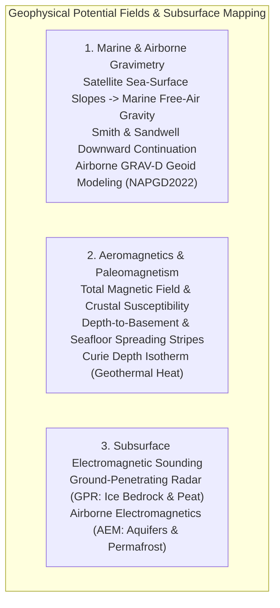
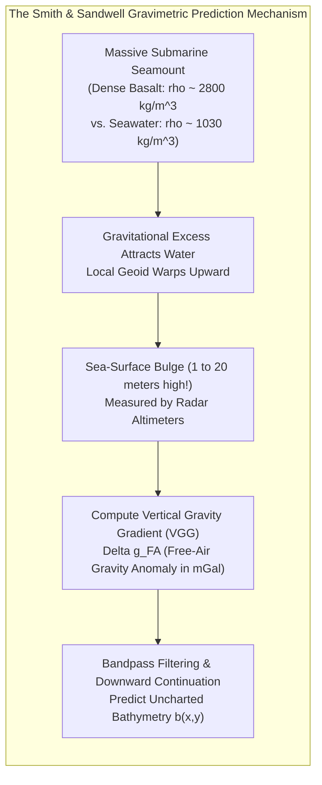
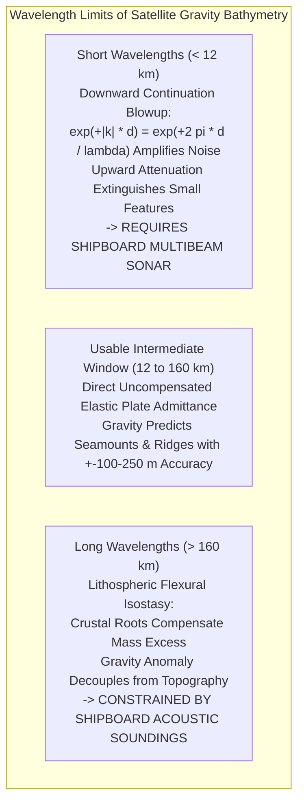
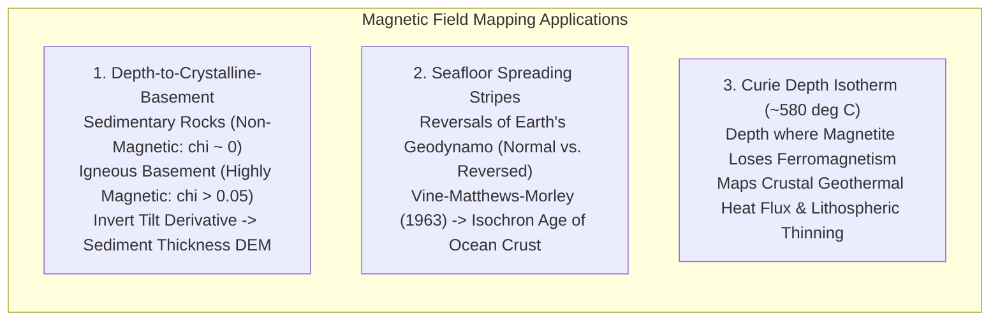

## 11.4 Using Other Data to Help Mapping: Gravity, Magnetics, and Seismic

Direct acoustic and optical remote sensing can only observe interfaces that actively reflect sound or light. However, the true three-dimensional structure of the Earth—from the bedrock hidden beneath deep marine sediments and polar ice sheets to the global marine geoid—can be illuminated by integrating auxiliary geophysical potential fields: planetary gravity, crustal magnetism, and electromagnetic sounding.

---

### 11.4.1 Marine Bathymetry from Satellite Altimetry Gravity: The Smith & Sandwell Method

Less than $25\%$ of the global ocean seafloor has been sounded by shipboard multibeam echosounders. The remaining $75\%$ of global bathymetric Digital Elevation Models (such as GEBCO, SRTM15+, and ETOPO) is predicted from **satellite radar altimetry marine gravity**, formulated by Walter H. F. Smith and David T. Sandwell (1994, 1997).

#### The Physical Mechanism: Gravitational Sea-Surface Mounds
A massive submarine topographic feature—such as an undersea seamount, volcanic ridge, or oceanic trench—represents a large lateral mass excess or deficit relative to surrounding seawater ($\Delta\rho = \rho_{\text{rock}} - \rho_{\text{water}} \approx 2800 - 1030 = 1770\text{ kg/m}^3$). 

By Newton's law of universal gravitation, this excess rock mass exerts an extra lateral gravitational pull on the surrounding ocean. Water is an incompressible fluid that responds to gravity by flowing laterally until it achieves hydrostatic equilibrium along an equipotential surface of the Earth's gravity field (the **marine geoid**). Consequently, every submarine seamount pulls ocean water toward it, creating a permanent **sea-surface mound or "bump"** directly above the summit!
* A $2000\text{ m}$ tall seamount resting on the abyssal plain creates a subtle, broad sea-surface bulge measuring **$1\text{ to }5\text{ m}$ in height** spanning $20\text{–}50\text{ km}$ across.
* An oceanic trench (a mass deficit) causes the sea surface to dip into an elongated trough.

Spaceborne radar altimeters (GEOSAT, ERS-1, CryoSat-2, SARAL, Sentinel-6, and SWOT) measure these minute sea-surface undulations with sub-centimeter precision along global orbital ground tracks.

#### Mathematical Inversion: Downward Continuation and Isostatic Filtering
Converting the observed sea-surface slopes into seafloor topography requires inverting the gravitational potential field from the ocean surface down to the seabed. Adopting the standard radial spatial wavenumber convention of this handbook ($\mathbf{k} = [k_x, k_y]^\top$ in $\text{rad}\cdot\text{m}^{-1}$, with magnitude $|\mathbf{k}| = 2\pi / \lambda = 2\pi |\mathbf{f}|$, where $|\mathbf{f}| = 1/\lambda$ is cyclical spatial frequency in $\text{cycles}\cdot\text{m}^{-1}$), Parker's (1973) linearized potential field equation relates the 2D Fourier transform of the sea-surface free-air gravity anomaly $\mathcal{F}\{\Delta g\}(\mathbf{k})$ to seafloor relief $\mathcal{F}\{b\}(\mathbf{k})$ above mean ocean depth $d$:

$$\mathcal{F}\{\Delta g\}(\mathbf{k}) = 2\pi G \, \Delta\rho \, e^{-|\mathbf{k}| d} \, \mathcal{F}\{b\}(\mathbf{k}) = 2\pi G \, \Delta\rho \, e^{-2\pi d / \lambda} \, \mathcal{F}\{b\}(\mathbf{k})$$

where $G = 6.67430 \times 10^{-11}\text{ m}^3\cdot\text{kg}^{-1}\cdot\text{s}^{-2}$ is the Newtonian gravitational constant and $\Delta\rho = \rho_c - \rho_w \approx 1770\text{ kg}\cdot\text{m}^{-3}$ ($2\pi G\,\Delta\rho = 7.42 \times 10^{-7}\text{ s}^{-2} = 0.0742\text{ mGal}\cdot\text{m}^{-1}$, since $1\text{ mGal} = 10^{-5}\text{ m}\cdot\text{s}^{-2}$).

Solving directly for the seafloor relief spectrum yields the **downward continuation relation**:

$$\mathcal{F}\{b\}(\mathbf{k}) = \frac{e^{+|\mathbf{k}| d}}{2\pi G \, \Delta\rho} \, \mathcal{F}\{\Delta g\}(\mathbf{k})$$

#### The Fundamental Wavelength Window ($12\text{ to }160\text{ km}$)
The downward continuation equation reveals two physical barriers that strictly limit gravity-predicted bathymetry to an intermediate bandpass window ($\lambda \in [12, 160]\text{ km}$):

1. **Short-Wavelength Attenuation ($\lambda < 12\text{ km}$):** The factor $e^{-|\mathbf{k}| d} = e^{-2\pi d / \lambda}$ governs upward harmonic attenuation through the water column. In an abyssal ocean $d = 4{,}000\text{ m}$ deep, topographic features with wavelengths shorter than $12\text{ km}$ ($|\mathbf{k}| d > 2.09$) attenuate by $> 88\%$ before reaching the sea surface. Inverting this requires multiplying by $e^{+|\mathbf{k}| d}$, which exponentially amplifies radar altimeter wave-height and eddy noise ($\sigma_{\Delta g} \approx 1\text{–}2\text{ mGal}$). Consequently, **gravity cannot resolve features smaller than $\approx 12\text{ km}$**; fine abyssal hills, fault scarps, and navigational hazards can only be mapped by shipboard multibeam sonars.
2. **Long-Wavelength Isostatic Compensation ($\lambda > 160\text{ km}$):** Large, broad topographic structures (oceanic plateaus, mid-ocean ridge swells) bend the elastic oceanic lithosphere and are supported by regional **flexural isostasy** (buoyant low-density crustal roots projecting into the denser mantle, governed by flexural rigidity $D_e$). Because the negative gravitational attraction of the deep Moho root cancels the positive attraction of the surface relief at long wavelengths, the gravitational admittance $Z(|\mathbf{k}|) = \mathcal{F}\{\Delta g\}/\mathcal{F}\{b\} \to 0$ for $\lambda > 160\text{ km}$. Regional baseline depths must therefore be anchored by direct shipboard acoustic soundings.

#### Worked Numerical Example: Why Altimetric Gravity Sees Broad Seamounts but Misses Deadly Pinnacles
Consider two volcanic features rising $b_0 = 1{,}500\text{ m}$ above an abyssal plain of mean depth $d = 4{,}000\text{ m}$ ($\Delta\rho = 1{,}770\text{ kg}\cdot\text{m}^{-3}$, infinite-slab Bouguer factor $2\pi G\,\Delta\rho = 0.0742\text{ mGal}\cdot\text{m}^{-1}$), observed by a satellite altimeter constellation with marine gravity noise floor $\sigma_{\Delta g} = 1.5\text{ mGal}$:
* **Feature A (Broad Guyot, $\lambda = 50\text{ km}$):** Angular wavenumber $|\mathbf{k}| = 2\pi / 50{,}000\text{ m} = 1.257 \times 10^{-4}\text{ rad}\cdot\text{m}^{-1}$. Upward continuation retains $e^{-|\mathbf{k}| d} = \exp(-0.5027) = 0.6049$ ($60.5\%$) of the seafloor signal, producing a prominent sea-surface free-air anomaly of $\Delta g_A \approx 0.0742 \times 1{,}500 \times 0.6049 = \mathbf{67.3\text{ mGal}}$ ($\text{SNR} \approx 45$, inverted height uncertainty $\sigma_b = \sigma_{\Delta g} e^{+|\mathbf{k}| d} / 0.0742 \approx \mathbf{\pm 33\text{ m}}$).
* **Feature B (Narrow Volcanic Spire, $\lambda = 4\text{ km}$, Comparable to the 2005 *USS San Francisco* Hazard):** Angular wavenumber $|\mathbf{k}| = 2\pi / 4{,}000\text{ m} = 1.571 \times 10^{-3}\text{ rad}\cdot\text{m}^{-1}$. Upward continuation crushes the gravity signal by $e^{-|\mathbf{k}| d} = \exp(-2\pi) = \mathbf{0.00187}$ (**$99.81\%$ attenuation!**), leaving a sea-surface anomaly of just $\Delta g_B \approx 0.0742 \times 1{,}500 \times 0.00187 = \mathbf{0.21\text{ mGal}}$—more than $7\times$ *below* the $1.5\text{ mGal}$ altimetric noise floor! Worse, attempting an unfiltered downward continuation at $\lambda = 4\text{ km}$ multiplies the $1.5\text{ mGal}$ sensor noise by $e^{+2\pi} = 535.5$, exploding the depth error to $\sigma_b \approx \mathbf{\pm 10{,}825\text{ m}}$—which is why global compilations (`SRTM15+`, `GEBCO`) apply a strict low-pass cutoff near $\lambda_c \approx 12\text{–}16\text{ km}$, smoothing narrow $1{,}500\text{ m}$ pinnacles down by $800\text{–}1{,}400\text{ m}$ when no ship track crosses them.

#### Operational Global Compilation (SRTM15+ and GEBCO)
Modern global marine elevation models (e.g., SRTM15+; Tozer et al., 2019) fuse both domains:
* Direct, calibrated multibeam and single-beam soundings provide high-resolution "truth" along survey tracks.
* The satellite altimetry gravity grid is used as a smooth, continuous predictive surface to interpolate across the vast uncharted gaps between ship tracks.

---

### 11.4.2 Airborne Gravimetry and the Gravimetric Geoid (NOAA GRAV-D)

On land, high-precision GNSS positioning measures ellipsoidal height ($h$). However, water flows according to gravity (orthometric height $H$). Bridging the two requires an ultra-precise model of the geoid undulation $N$:

$$H = h - N$$

To eliminate the legacy meter-level errors of the leveling-based North American Vertical Datum of 1988 (NAVD88), NOAA's National Geodetic Survey (NGS) executed the **Gravity for the Redefinition of the American Vertical Datum (GRAV-D)** project.

Operating high-precision marine/airborne relative gravimeters and strapdown inertial sensors aboard survey aircraft flown at $20{,}000\text{ ft}$ along $10\text{ km}$ grid lines across the United States and its coastal territories, GRAV-D measured the Earth's gravity field to $1.5\text{ mGal}$ accuracy. Ingested into spherical harmonic boundary-value models, GRAV-D yields the **North American-Pacific Geopotential Datum of 2022 (NAPGD2022)**, establishing a zero-elevation geoid reference surface accurate to **$\pm 1\text{ cm}$**, allowing hydrologists to convert GNSS drone and aircraft elevations directly into flood-routing orthometric DEMs.

---

### 11.4.3 Aeromagnetics, Paleomagnetism, and Crustal Basement Depth

Magnetic surveys measure spatial anomalies in the Earth's total magnetic field ($\mathbf{B}$) caused by variations in the magnetic susceptibility ($\chi$) and remanent magnetization ($\mathbf{M}_r$) of crustal rocks.

#### Depth-to-Basement Inversion
In sedimentary basins and coastal margins, sedimentary strata (sandstone, limestone, shale) are virtually non-magnetic ($\chi \approx 0$). In contrast, underlying crystalline igneous and metamorphic basement rocks contain significant concentrations of magnetite ($\text{Fe}_3\text{O}_4$), exhibiting high magnetic susceptibility ($\chi \approx 0.01\text{–}0.10\text{ SI}$).

By computing the **horizontal tilt angle derivative** or applying Euler deconvolution to high-resolution aeromagnetic grids:

$$\theta_{\text{tilt}} = \arctan\left(\frac{\partial T / \partial z}{\sqrt{(\partial T / \partial x)^2 + (\partial T / \partial y)^2}}\right)$$

geophysicists map the 3D depth to the crystalline basement ($z_{\text{basement}}$), since under vertical magnetization the zero contour ($\theta_{\text{tilt}} = 0^\circ$) lies directly over geological fault/contact edges while the half-width between $\theta_{\text{tilt}} = \pm 45^\circ$ equals the depth $h_c$ to the magnetic source top! Historically rooted in **Alexander von Humboldt's 1797** observation of intense remanent magnetization in lightning-struck Alpine serpentinites and **Patrick Blackett's 1956** high-sensitivity astatic magnetometer (`gis-history`), magnetic surveying also serves critical nearshore engineering roles: because dipolar magnetic anomalies decay as $\|\Delta\mathbf{B}(r)\| = \frac{\mu_0}{4\pi} \frac{m_{\text{dip}}}{r^3}\sqrt{1 + 3\sin^2 I_m}$ (where $I_m$ is the angle from the dipole's equatorial plane, $\sin I_m = \hat{\mathbf{r}}\cdot\hat{\mathbf{m}}$), towed marine cesium-vapor gradiometers and drone magnetometers flown $2\text{–}5\text{ m}$ above the seabed map **buried submarine cables, steel pipelines, and unexploded ordnance (UXO)** invisible to high-frequency multibeam echosounders prior to offshore wind-farm dredging. Subtracting the regional magnetic basement surface from the modern topographic/bathymetric DEM yields **total sedimentary thickness**, vital for earthquake ground-motion amplification models, groundwater basin hydrogeology, and carbon sequestration reservoirs.

---

### 11.4.4 Seismic Reflection, Ground-Penetrating Radar (GPR), and Airborne Electromagnetics (AEM)

Where DEMs must resolve solid-earth interfaces buried beneath thick marine ooze, glacial ice, or alluvial overburden, acoustic seismic reflection and electromagnetic sounding provide non-invasive subsurface horizons:

1. **Marine and Terrestrial Seismic Reflection Profiling:** Multi-channel seismic (MCS) airgun arrays and high-resolution boomer/sparker systems ($50\text{ Hz to }4\text{ kHz}$) record two-way acoustic travel times $\Delta t_{\text{twt}}$ between the seafloor reflector ($t_{\text{sf}}$) and buried stratigraphic horizons or acoustic basement ($t_{\text{base}}$). Converting seismic time horizons into true sub-bottom elevation grids $z_{\text{base}}(x,y) = z_{\text{sf}}(x,y) - d_{\text{sed}}(x,y)$ requires integrating depth-compacting compressional velocity $v_p(z)$ (e.g., Hamilton's linear marine sediment compaction law $v_p(z_{\text{sub}}) = v_0 + g_v z_{\text{sub}}$, with $v_0 \approx 1{,}510\text{ m}\cdot\text{s}^{-1}$ and $g_v \approx 1.0\text{–}1.3\text{ s}^{-1}$):
   $$d_{\text{sed}} = \frac{v_0}{g_v}\left[\exp\!\left(\frac{g_v\,\Delta t_{\text{twt}}}{2}\right) - 1\right] \approx \frac{1}{2}\bar{v}_p\,\Delta t_{\text{twt}}$$
   Crucially, global gravimetric bathymetry compilations (`SRTM15+`) rely on seismic sediment-thickness grids (`GlobSed`) to mask abyssal fans (e.g., the Bengal and Indus Fans, where $d_{\text{sed}} > 5\text{–}15\text{ km}$): because unconsolidated sediment ($\rho_{\text{sed}} \approx 1{,}900\text{–}2{,}200\text{ kg}\cdot\text{m}^{-3}$) buries rugged basaltic ridges ($\rho_c \approx 2{,}800\text{ kg}\cdot\text{m}^{-3}$) beneath a flat seabed, an uncorrected gravity-to-topography inversion would hallucinate $500\text{–}1{,}500\text{ m}$ seafloor troughs over buried basement grabens!
2. **Ground-Penetrating Radar (GPR):** Transmits high-frequency pulsed electromagnetic waves ($10\text{ MHz to }2.5\text{ GHz}$) into low-loss media, recording reflections at discontinuities in relative dielectric permittivity ($\epsilon_r$, propagation speed $v_{\text{GPR}} = c_0 / \sqrt{\epsilon_r}$).
   * *Glaciology & Subglacial Bed DEMs:* Because cold meteoric ice has minimal electrical conductivity ($\sigma \approx 10^{-5}\text{ S}\cdot\text{m}^{-1}, \epsilon_r \approx 3.15 \implies v_{\text{ice}} \approx 168.9\text{ m}\cdot\mu\text{s}^{-1}$), airborne VHF radar depth sounders ($60\text{–}195\text{ MHz}$, e.g., NASA Operation IceBridge, CReSIS) penetrate $> 4\text{ km}$ of ice. Fusing radar bed picks with mass-conservation ice-flow physics yields continental **subglacial bedrock topography DEMs** (`BedMachine` Antarctica and Greenland; Morlighem et al., 2020; Chapter 30).
   * *Peatlands, Permafrost, and Infrastructure:* GPR maps permafrost active-layer thaw depths, mineral substrates beneath compressible peat bogs, and highway asphalt/ballast layer thicknesses.
3. **Airborne Electromagnetic (AEM) Sounding:** Helicopter-slung or fixed-wing time-domain (SkyTEM, VTEM) transmitter loops broadcast low-frequency electromagnetic pulses ($25\text{ Hz to }100\text{ kHz}$), inducing subsurface eddy currents whose decay rates invert via 1D/3D Tikhonov regularization into electrical resistivity models ($\rho_{\text{res}} \in [1, 1000]\,\Omega\cdot\text{m}$) down to $300\text{–}500\text{ m}$ depth—delineating depth-to-bedrock DEMs beneath glacial till, clay aquitards, and coastal saltwater-intrusion wedges.
