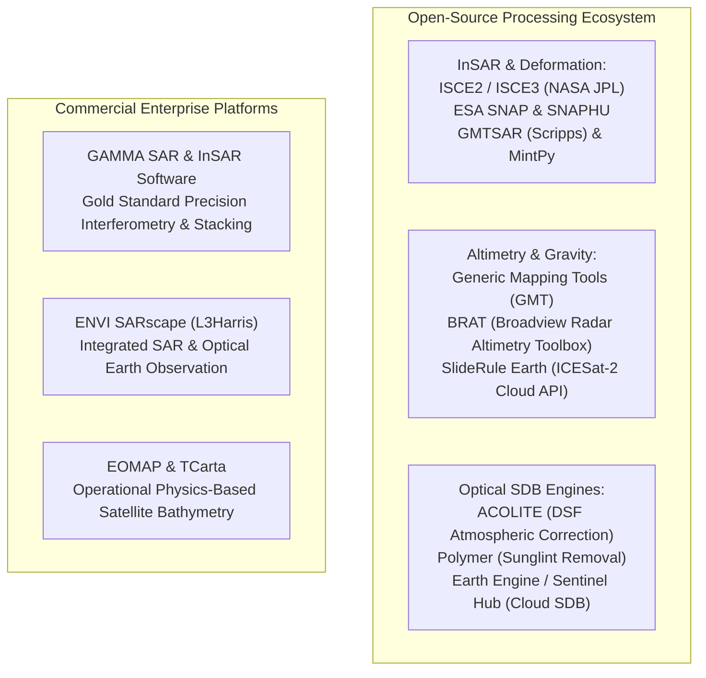

## 11.7 Software Ecosystem

Processing microwave radar interferometry, spaceborne altimetry, and satellite-derived bathymetry requires specialized computational software stacks that handle complex numbers, orbital ephemerides, atmospheric phase corrections, and radiative transfer optimizations. This section evaluates both the open-source scientific software suite and commercial enterprise platforms.



---

### 11.7.1 Open-Source Software Stack

#### 1. InSAR Processing: ISCE, SNAP, GMTSAR, and MintPy
* **ISCE2 and ISCE3 (NASA JPL / Caltech):** The **InSAR Scientific Computing Environment** is the premier open-source Python/C++ engine for geophysical radar processing. It provides modular workflows (`stripmapApp`, `topsApp`, `topsStack`) supporting ESA Sentinel-1, ALOS-2, TerraSAR-X, and the joint NASA-ISRO NISAR dual-frequency (L- and S-band) mission. ISCE3 provides GPU-accelerated backprojection and geocoding kernels engineered for cloud-scale processing.
* **ESA SNAP (Sentinel Application Platform):** Distributed free by ESA, SNAP provides both an interactive desktop GUI and a headless command-line **Graph Processing Tool (`gpt`)**. SNAP handles the complete Sentinel-1 InSAR workflow: orbital ephemeris application, Sentinel-1 TOPS coregistration with Enhanced Spectral Diversity (ESD), interferogram formation, topographic phase removal via external DEMs, Goldstein phase filtering, export to `SNAPHU` for phase unwrapping, and Range-Doppler terrain correction.

```bash
# Example ESA SNAP Graph Processing Tool (gpt) batch execution
# Co-registers Sentinel-1 SLC pair, forms interferogram, and exports to SNAPHU
gpt InSAR_Formation_Graph.xml -Pmaster=S1A_IW_SLC__1SDV_20230501.zip \
                              -Pslave=S1A_IW_SLC__1SDV_20230513.zip \
                              -Pdem="Copernicus 30m Global DEM" \
                              -Ptarget=interferogram_out.dim
```

* **GMTSAR (Scripps Institution of Oceanography; Sandwell et al., 2011):** Built directly on top of the Generic Mapping Tools (GMT), GMTSAR is a lightweight, high-performance C/csh InSAR processor. It uses precise orbital integration and 2D Fourier filtering to process ERS, Envisat, ALOS-1/2, and Sentinel-1 interferograms, exporting phase grids natively into netCDF formats for direct geodetic modeling.
* **MintPy (Miami INsar Time-series software in PYthon; Zhang et al., 2019):** Ingests stacks of unwrapped interferograms produced by ISCE, SNAP, or GMTSAR, executing Small Baseline Subset (SBAS) and Persistent Scatterer (PS) time-series inversions. MintPy corrects for tropospheric water vapor delay using global atmospheric reanalysis models (ERA5 or GACOS), estimates topographic phase residuals, and computes millimeter-per-year ground subsidence velocity maps.

#### 2. Spaceborne Altimetry & Marine Gravity: GMT and BRAT
* **Generic Mapping Tools (GMT; Wessel et al., 2019):** The indispensable foundation for marine geophysics. Programs such as `grdgradient`, `grdfft`, `surface`, and `sphinterpolate` provide the exact mathematical algorithms used by Sandwell and Smith to compute vertical gravity gradients (VGG), apply 2D Butterworth bandpass filters, downward-continue free-air gravity anomalies, and merge shipboard multibeam soundings into global bathymetric grids (SRTM15+).
* **Broadview Radar Altimetry Toolbox (BRAT; ESA / CNES):** A dedicated open-source C++ utility for reading, retracking, editing, and mapping radar altimeter data products from ERS-1/2, Envisat, TOPEX/Poseidon, Jason-1/2/3, CryoSat-2, SARAL/AltiKa, and Sentinel-3/6.

#### 3. Satellite-Derived Bathymetry (SDB): ACOLITE and Polymer
* **ACOLITE (Royal Belgian Institute of Natural Sciences; Vanhellemont & Neukermans, 2014):** The international scientific reference tool for aquatic atmospheric correction over coastal waters. ACOLITE implements the **Dark Spectrum Fitting (DSF)** algorithm, which dynamically determines aerosol reflectance over dark water pixels without user intervention, and includes automated modules for computing Stumpf log-ratio and Lyzenga multi-band bathymetry grids from Sentinel-2 and Landsat-8/9 L1C imagery.
* **Polymer (HYGEOS; Steinmetz et al., 2011):** An advanced spectral optimization algorithm specifically engineered to retrieve ocean color and remote-sensing reflectance in the presence of severe solar sunglint and thin cirrus clouds, providing clean reflectances for nearshore SDB.
* **SlideRule Earth (`sliderule-python`, University of Washington / NASA) & Active-Passive SDB Fusion Tools:** Cloud-native C++/Python service that subsets raw **ICESat-2 `ATL03`** photon clouds on-demand from NASA Earthdata S3 buckets, classifies sea-surface vs. benthic photons, and enables automated active-passive regression against ACOLITE/Polymer Sentinel-2 reflectances without downloading multi-gigabyte HDF5 granules.

#### Reproducible Open-Source Workflows: InSAR Unwrapping, Gravimetric Bathymetry, and ICESat-2 + SDB Fusion

1. **Statistical-Cost Phase Unwrapping (`SNAPHU`) & `MintPy` Tropospheric Correction:**
   After generating a stack of wrapped interferograms and spatial coherence rasters (`filt_topophase.flat`, `phsig.cor`) in `ISCE2`/`ISCE3` or `GMTSAR`, statistical-cost network-flow unwrapping (`snaphu`) and `MintPy` (`smallbaselineApp.py`) separate topographic residual errors ($\Delta z_{\text{DEM}}$) from tropospheric water-vapor delays (`ERA5` via `PyAPS`) and surface deformation velocity:

```bash
# 1. Unwrap a 4096-column interferogram in smooth/topography mode (-t) weighted by coherence (-c)
snaphu -t filt_topophase.flat 4096 -c phsig.cor -o unwrapped_phase.unw --nproc 8

# 2. Run MintPy SBAS time-series inversion with ERA5 tropospheric phase-screen removal
#    and residual DEM height error estimation (mintpy.topographicResidual = yes)
smallbaselineApp.py sentinel1_mintpy.cfg --dostep load_data
smallbaselineApp.py sentinel1_mintpy.cfg --dostep modify_network
smallbaselineApp.py sentinel1_mintpy.cfg --dostep invert_network
smallbaselineApp.py sentinel1_mintpy.cfg --dostep correct_troposphere
smallbaselineApp.py sentinel1_mintpy.cfg --dostep deramp
smallbaselineApp.py sentinel1_mintpy.cfg --dostep correct_topography
smallbaselineApp.py sentinel1_mintpy.cfg --dostep velocity
```

2. **GMT (`grdfft` & `surface`) Bandpass Gravimetric Bathymetry Prediction:**
   In `GMT 6`, `grdfft` executes 2D Fourier upward/downward continuation (`-C`) and bandpass filtering (`-F`) on marine free-air gravity grids (`faa_mgal.nc`) in the $12\text{–}160\text{ km}$ elastic admittance window before restoring long-wavelength shipboard multibeam control:

```bash
# 1. Bandpass filter free-air gravity (mGal) to the 12-160 km admittance window (-F<lc>/<lp>/<hp>/<hc> in m)
#    and downward-continue by mean ocean depth d0 = 4000 m (-C-4000 in GMT upward-positive convention)
gmt grdfft faa_mgal.nc -fg -F200000/160000/15000/12000 -C-4000 -Gfaa_down4000.nc

# 2. Scale downward-continued gravity by 1 / (2 * pi * G * Delta_rho) = 1 / 0.0742 m/mGal -> 13.477 m/mGal
#    and add regional long-wavelength ship-sounding depth trend (d_regional.nc)
gmt grdmath faa_down4000.nc 13.477 MUL d_regional.nc ADD = bathy_grav_pred.nc
```

3. **Active-Passive ICESat-2 (`ATL03`) + Sentinel-2 (`ACOLITE`) SDB Calibration & IHO S-44 TVU:**
   The Python workflow below applies 3D Snell/group-velocity water refraction ($532\text{ nm}$ seawater phase index $n_p = 1.3420$ and group index $n_g = 1.3643$ at $15^\circ\text{C}, 35\text{ PSU}$, Quan & Fry, 1995; note that Parrish et al., 2019 employ the single bulk seawater index $n_w = 1.34116$ across clear coastal waters) to submerged ICESat-2 `ATL03` benthic photons, calibrates a Sentinel-2 Stumpf log-ratio raster (`Rrs_492`, `Rrs_560`) using outlier-resistant RANSAC, masks pixels beyond the optical extinction floor ($R_{rs} \le R_\infty + 3\sigma_{\text{deep}}$), and outputs a co-registered $95\%$ **Total Vertical Uncertainty ($\text{TVU}_{95\%}$)** raster:

```python
import numpy as np
from sklearn.linear_model import RANSACRegressor

def fuse_icesat2_sentinel2_sdb(
    atl03_z_uncorr: np.ndarray, z_sea_surface: float, beam_elev_rad: np.ndarray,
    rrs_blue: np.ndarray, rrs_green: np.ndarray, sample_rows: np.ndarray, sample_cols: np.ndarray,
    rrs_inf_green: float = 0.0025, sigma_deep_green: float = 0.0004, n_scale: float = 1000.0
) -> tuple[np.ndarray, np.ndarray]:
    """Refraction-correct ICESat-2 benthic photons, fit Stumpf SDB, and compute 95% TVU."""
    # 1. Snell + group-index refraction correction on raw ATL03 apparent submerged heights (532 nm seawater)
    n_p, n_g = 1.3420, 1.3643  # Seawater phase & group indices at 15 C, 35 PSU (Ch. 9; Quan & Fry, 1995)
    theta_1 = (np.pi / 2.0) - beam_elev_rad                    # Incidence angle in air (rad)
    theta_2 = np.arcsin(np.sin(theta_1) / n_p)                 # Refracted angle in seawater (rad)
    d_apparent = z_sea_surface - atl03_z_uncorr                # Uncorrected apparent depth (m, +down)
    slant_air = d_apparent / np.cos(theta_1)
    d_true_ref = (slant_air / n_g) * np.cos(theta_2)           # True refraction-corrected depth (m)

    # 2. Compute Stumpf (2003) log-ratio X = ln(n * Rrs_blue) / ln(n * Rrs_green) and mask deep water
    extinct_mask = (rrs_green <= rrs_inf_green + 3.0 * sigma_deep_green) | (rrs_blue <= 1.0 / n_scale)
    x_ratio = np.where(
        ~extinct_mask,
        np.log(np.maximum(n_scale * rrs_blue, 1.01)) / np.log(np.maximum(n_scale * rrs_green, 1.01)),
        np.nan,
    )

    # 3. Robust RANSAC calibration against refraction-corrected ICESat-2 seafloor photons
    x_ctrl = x_ratio[sample_rows, sample_cols]
    valid = np.isfinite(x_ctrl) & (d_true_ref > 0.3) & (d_true_ref < 30.0)
    ransac = RANSACRegressor(residual_threshold=0.50, random_state=42).fit(
        x_ctrl[valid].reshape(-1, 1), d_true_ref[valid]
    )
    inliers = ransac.inlier_mask_
    residuals = d_true_ref[valid][inliers] - ransac.predict(x_ctrl[valid][inliers].reshape(-1, 1))
    sigma_cal = 1.4826 * np.median(np.abs(residuals - np.median(residuals)))  # Robust NMAD (1-sigma)

    # 4. Predict full 2D bathymetric depth (+down) and propagate 95% TVU (IHO S-44 convention)
    depth_sdb = np.full_like(rrs_blue, np.nan, dtype=np.float32)
    ok = np.isfinite(x_ratio)
    depth_sdb[ok] = np.clip(ransac.predict(x_ratio[ok].reshape(-1, 1)), 0.0, None)
    tvu_95 = 1.9600 * np.sqrt(sigma_cal ** 2 + (0.035 * depth_sdb) ** 2)
    return depth_sdb, tvu_95
```

---

### 11.7.2 Commercial Enterprise Platforms

#### 1. GAMMA SAR and InSAR Software (GAMMA Remote Sensing AG, Switzerland)
Widely recognized across the defense, mining, and aerospace sectors as the gold standard for high-precision radar processing:
* Implements proprietary phase-calibration and motion-compensation algorithms for airborne and orbital repeat-pass InSAR.
* Features advanced Interferometric Point Target Analysis (IPTA) for persistent-scatterer interferometry, extracting sub-millimeter displacement rates on critical civil infrastructure (bridges, dams, railway corridors).
* Highly stable across non-standard geometries (eccentric orbits, steep off-nadir angles, bistatic airborne campaigns).

#### 2. ENVI SARscape (L3Harris Geospatial / sarmap)
A commercial SAR processing environment fully integrated with the ENVI image processing suite:
* Provides guided modular workflows for DEM generation, coherent change detection, polarimetry (PolSAR), and persistent-scatterer time series.
* Natively fuses SAR products with multispectral, hyperspectral, and LiDAR point clouds in a unified GIS visualization canvas.

#### 3. Commercial SDB Providers: EOMAP and TCarta
* **EOMAP GmbH (Germany):** The commercial global pioneer in operational physics-based satellite-derived bathymetry. EOMAP's proprietary **MIP (Modular Inversion Program)** simultaneously solves for atmospheric aerosol optical depth, water-column turbidity/chlorophyll, benthic albedo, and seafloor depth from Sentinel-2, WorldView-2/3, and PlanetScope constellations, providing hydrographic offices chart-ready bathymetric grids certified against IHO S-44 standards.
* **TCarta Marine LLC (USA):** Combines machine learning and stereo photogrammetry with ICESat-2 active LiDAR photon calibration tracks (the "Trident SDB" workflow) to deliver high-resolution coastal bathymetry for defense, hydrographic charting, and coastal resilience planning.

---

### 11.7.3 Master Comparison Matrix of Radar, Altimetry, and SDB Software

| Software Suite | License & Cost | Core Specialization | Input Sensor Formats | Key Algorithms & Features | Target Community |
| :--- | :--- | :--- | :--- | :--- | :--- |
| **ISCE2 / ISCE3** | Open-Source (Apache 2.0) | InSAR processing & raw radar focusing | Sentinel-1, ALOS-1/2, TerraSAR-X, NISAR | GPU backprojection, TOPS coregistration, stripmap & time-series stacking. | Geodesists, NASA/JPL science teams, geophysicists. |
| **ESA SNAP** | Open-Source (GPLv3) | Sentinel constellation processing & InSAR | All Sentinel missions, ENVISAT, ERS, third-party SAR | Interactive GUI, Graph Processing Tool (`gpt`), SNAPHU wrapper, terrain correction. | Remote sensing students, GIS analysts, researchers. |
| **GMTSAR** | Open-Source (GPLv3) | High-performance geodetic InSAR | Sentinel-1, ALOS-1/2, ERS, Envisat | Seamless GMT integration, netCDF output, lightweight command-line scripting. | Academic geophysicists, tectonic geodesists. |
| **MintPy** | Open-Source (GPLv3) | InSAR time-series deformation (SBAS/PS) | Ingests unwrapped stacks from ISCE, SNAP, GMTSAR | GACOS/ERA5 atmospheric delay correction, tectonic velocity fitting. | Crustal deformation researchers, subsidence monitoring. |
| **GMT** | Open-Source (LGPL) | Potential field geophysics & 2D gridding | Binary, netCDF, ASCII point clouds | `grdfft`, `surface` splines under tension, Parker potential field inversion. | Marine geophysicists, oceanographers, cartographers. |
| **ACOLITE** | Open-Source (GPLv3) | Coastal atmospheric correction & SDB | Sentinel-2, Landsat-8/9, PlanetScope, Pléiades | Dark Spectrum Fitting (DSF), Stumpf log-ratio SDB, turbidity mapping. | Coastal oceanographers, estuarine researchers, hydrographers. |
| **GAMMA SAR** | Commercial Enterprise | Precision InSAR, stacking, & Persistent Scatterers | All commercial & civilian SAR sensors | Proprietary phase unwrapping, IPTA persistent scatterers, metrology calibration. | Commercial survey contractors, mining, defense agencies. |
| **ENVI SARscape** | Commercial Enterprise | End-to-end SAR analytics & DEM generation | Comprehensive orbital & airborne SAR | Multi-temporal speckle filtering, radargrammetry, automated SBAS/PS workflows. | Enterprise GIS users, environmental monitoring organizations. |
| **EOMAP MIP** | Commercial Service | Physics-based radiative transfer SDB | Sentinel-2, WorldView-2/3, PlanetScope, SuperView | Simultaneous atmospheric, benthic, and depth inversion without ground truth. | Hydrographic offices, dredging companies, port authorities. |
