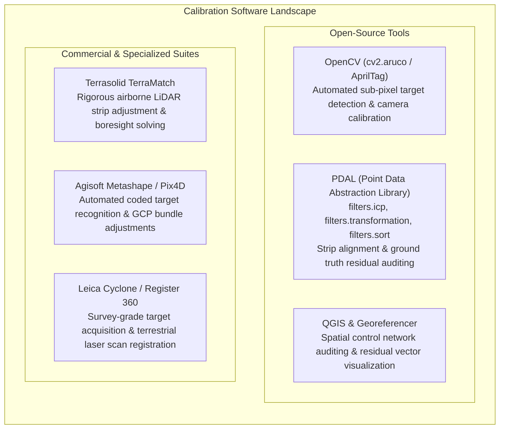
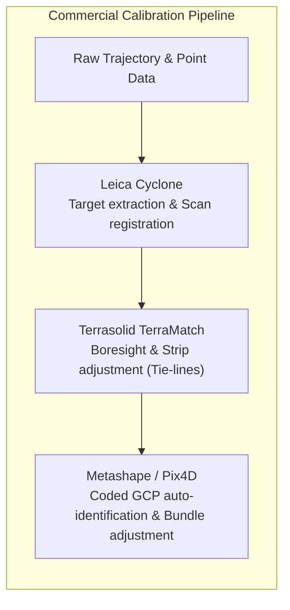

## 12.7 Software Ecosystem for Calibration, Target Detection, and Control Management

Ground control management and target calibration span a sophisticated ecosystem of open-source computer vision libraries, point cloud processing engines, and proprietary photogrammetric and laser scanning software suites. This section examines the core computational workflows used to detect targets, register control networks, and validate surface models.



---

### 12.7.1 Open-Source Tools: Computer Vision and Point Cloud Registration

#### Automated Target Detection with OpenCV (AprilTag and ChArUco)
Manual picking of ground control points in hundreds of drone images is slow and introduces operator fatigue errors ($1\text{–}3\text{ pixels}$ jitter). Modern automated photogrammetric pipelines utilize **ChArUco** (Checkerboard + ArUco) or **AprilTag** planar fiducials. 

A ChArUco board combines the occlusion resilience and unique ID coding of ArUco markers with the sub-pixel corner precision of classical checkerboard patterns:

```python
"""Automated ChArUco Ground Control Point Detection Pipeline."""

import cv2
from cv2 import aruco
import numpy as np


def detect_charuco_gcp(image_path: str, camera_matrix: np.ndarray, dist_coeffs: np.ndarray):
  # 1. Load image and convert to 8-bit grayscale
  image = cv2.imread(image_path)
  gray = cv2.cvtColor(image, cv2.COLOR_BGR2GRAY)

  # 2. Define ChArUco board geometry (e.g., 5x7 squares, 0.10m square, 0.07m marker)
  dictionary = aruco.getPredefinedDictionary(aruco.DICT_5X5_100)
  board = aruco.CharucoBoard((5, 7), 0.10, 0.07, dictionary)
  detector_params = aruco.DetectorParameters()

  # 3. Detect raw ArUco marker corners and IDs
  detector = aruco.ArucoDetector(dictionary, detector_params)
  marker_corners, marker_ids, rejected = detector.detectMarkers(gray)

  if marker_ids is not None and len(marker_ids) > 4:
    # 4. Interpolate sub-pixel accurate checkerboard corner positions
    charuco_detector = aruco.CharucoDetector(board)
    charuco_corners, charuco_ids, _, _ = charuco_detector.detectBoard(gray)

    if charuco_corners is not None and len(charuco_corners) >= 4:
      # 5. Pair 2D detections with 3D board points & solve 6-DOF pose (OpenCV >= 4.7)
      obj_points, img_points = board.matchImagePoints(charuco_corners, charuco_ids)
      if len(obj_points) >= 4:
        valid, rvec, tvec = cv2.solvePnP(
            obj_points, img_points, camera_matrix, dist_coeffs
        )
        if valid:
          return {
              "status": "DETECTED",
              "num_corners": len(charuco_corners),
              "corners_px": charuco_corners,
              "rvec": rvec,
              "tvec": tvec,
          }

  return {"status": "FAILED", "reason": "Insufficient visible markers"}
```

#### Point Cloud Control Auditing with PDAL and Python (`rasterio` / `scipy`)
The Point Data Abstraction Library (PDAL) provides pipeline stages for registering moving candidate point-cloud strips against a fixed reference ground-truth survey using `filters.icp` (where the first stage in `"pipeline"` or `"inputs"` is always the **fixed** reference cloud and the second is the **moving** candidate cloud, writing the solved rigid $4\times 4$ transformation to `--metadata`):

```json
{
  "pipeline": [
    {
      "type": "readers.las",
      "filename": "ground_truth_tls_bed.laz"
    },
    {
      "type": "readers.las",
      "filename": "flight_strip_04_uncalibrated.laz"
    },
    {
      "type": "filters.icp",
      "max_iter": 100,
      "mse_abs": 1e-8,
      "rt": 0.99999
    },
    {
      "type": "writers.las",
      "filename": "flight_strip_04_calibrated.laz",
      "forward": "all"
    }
  ]
}
```

Once a DEM raster is exported, independent Check Point (CP) accuracy must be audited strictly out-of-solution—stratifying open-terrain residuals ($\text{RMSE}_z$ and $\text{NVA}_{95\%}$) separately from vegetated canopy residuals ($\text{VVA}_{95\%}$) and checking whether CPs lie inside the convex hull of the GCPs:

```python
import numpy as np
import rasterio
from scipy.spatial import ConvexHull, Delaunay

def audit_checkpoints_against_dem(
    dem_tif: str,
    gcp_xy: np.ndarray,
    cp_xyz: np.ndarray,
    cp_is_vegetated: np.ndarray,
) -> dict[str, float]:
    """Audit withheld Check Points (CPs) against a DEM and flag GCP convex-hull extrapolation."""
    inside_hull = Delaunay(gcp_xy).find_simplex(cp_xyz[:, :2]) >= 0
    with rasterio.open(dem_tif) as src:
        z_dem = np.array([val[0] for val in src.sample(cp_xyz[:, :2])])
        valid = (z_dem != src.nodata) & np.isfinite(z_dem)

    err = z_dem[valid] - cp_xyz[valid, 2]
    veg = cp_is_vegetated[valid]
    nva_err = err[~veg]
    vva_err = err[veg]

    rmse_nva = float(np.sqrt(np.mean(nva_err**2))) if len(nva_err) else np.nan
    return {
        "n_cp_valid": int(valid.sum()),
        "pct_outside_gcp_hull": float(100.0 * (~inside_hull[valid]).mean()),
        "nva_rmse_m": rmse_nva,
        "nva_95_m": 1.9600 * rmse_nva,
        "vva_95th_m": float(np.percentile(np.abs(vva_err), 95)) if len(vva_err) else np.nan,
    }
```

#### USGS/CEOS Cal/Val Portal, Hydrographic Patch-Test Tools, and QGIS Control Auditing
For orbital elevation and optical intercalibration, the **USGS/CEOS Cal/Val Test Sites Catalog** (`https://calval.cr.usgs.gov/apps/test_sites_catalog`) provides curated geographic polygons, surface BRDF/reflectance histories, and in-situ meteorological/elevation baseline files for global Pseudo-Invariant Calibration Sites (PICS) such as Railroad Valley Playa and Dome C. At project scale, **QGIS** (coupled with Python vector residual plugins and Delaunay hull overlays) visualizes spatial $\Delta Z$ and $(\Delta X, \Delta Y)$ error vectors across check points to detect residual block tilt, doming, or uncalibrated datum shifts prior to sign-off.

In the marine and coastal hydrographic domain, open-source calibration workflows center on **`Kluster`** (`hstb-kluster`) and **`HydrOffice QC Tools`** alongside **`MB-System`**. Rather than using painted optical fiducials, hydrographic teams verify vessel reference targets via **patch-test surface differencing** over surveyed flat floors, submarine slopes, and submerged concrete blocks or wrecks: `Kluster`'s Patch Test GUI and `Qimera`'s Patch Test Tool compute 3D residuals across reciprocal and speed-varied swath pairs to isolate roll, pitch, yaw, and latency before running automated **check-line / cross-line difference grids** and **flier/holiday detection** against NOAA HSSD and IHO S-44 compliance thresholds.

#### Choosing Between ChArUco Boards and Individual AprilTags in Field Surveys
When selecting open-source OpenCV fiducials for UAV or terrestrial calibration surveys, practitioners weigh single-tag detection range against multi-corner sub-pixel precision:
* **AprilTag (`tag36h11` / `DICT_APRILTAG_36h11`):** Each printed vinyl or aluminum target panel carries one high-contrast square fiducial with a 6-bit Hamming error-correcting code (detectable at smaller apparent pixel widths, down to $\sim 12\text{–}16\text{ px}$ across the tag, with strong false-positive rejection against foliage and gravel). Ideal for wide-area aerial GCP/CP ground panels where only the center $(u_c, v_c)$ is surveyed by RTK-GNSS.
* **ChArUco Boards:** Combine multiple ArUco IDs embedded inside a rigid checkerboard grid, providing dozens of saddle-point corners whose sub-pixel intersections are unaffected by perspective shear or partial occlusion. Ideal for **pre-flight camera interior orientation** (solving focal length $f_{\text{cam}}$, principal point $(c_x, c_y)$, and Brown-Conrady radial/decentering distortion $k_1, k_2, p_1, p_2$ prior to nadir flight) to prevent photogrammetric doming.

---

### 12.7.2 Commercial and Industrial Suites



#### Terrasolid TerraMatch
In commercial airborne LiDAR production, **TerraMatch** (running on Bentley MicroStation or standalone Spatix) is the industry standard for strip adjustment and boresight self-calibration:
* **Tie-Line Extraction:** TerraMatch automatically extracts surface tie-lines (planar roof facets, flat highway profiles, and linear breakline features) across overlapping flight strips and orthogonal cross-strips.
* **Rigorous Rigidity Optimization:** It solves simultaneously for static sensor boresight misalignments (roll $\Delta\phi$, pitch $\Delta\omega$, heading $\Delta\kappa$ in Terrasolid's photogrammetric convention), mirror scan-angle scale error, range zero-offset, and time-varying GNSS/INS trajectory fluctuations ($\Delta X(t), \Delta Y(t), \Delta Z(t)$) by minimizing point-to-plane distances between overlapping strips and surveyed ground control profiles.

#### Agisoft Metashape and Pix4D
These Structure-from-Motion (SfM) photogrammetry packages feature native support for circular 12-bit and 16-bit coded targets, AprilTags, and cross-marks:
* Automatically identifies target IDs and refines sub-pixel center coordinates across hundreds or thousands of overlapping nadir and oblique images simultaneously.
* Enforces strict point-role toggles separating **Control Points** (weighted inside the self-calibrating bundle adjustment) from **Check Points** (strictly excluded from optimization).
* Generates detailed 3D residual vector tables and directional error ellipses across the project convex hull so analysts can verify that interior and ridge check points match open-valley accuracy.

#### Leica Cyclone and Register 360
In terrestrial laser scanning (TLS) and mobile mapping used to survey Level 2 metrological ground-truth calibration beds (runways, gable roofs, coastal bluffs):
* Automatically recognizes precision planar black/white tilt-and-turn targets and 3D matte calibration spheres ($100\text{–}200\text{ mm}$ diameter).
* Employs least-squares best-fit geometry to extract sphere centers with sub-millimeter precision independent of scan incidence angle, achieving network registration loop closures of $<2\text{ mm}$ over multi-station industrial and geodetic calibration surveys.

---

### 12.7.3 Feature Comparison Matrix

| Software / Tool | License Model | Primary Target Modalities | Mathematical Core | Key Mapping Role |
| :--- | :--- | :--- | :--- | :--- |
| **OpenCV** | Open-Source (Apache 2.0) | AprilTag, ArUco, ChArUco, Checkerboards | Sub-pixel corner detection, PnP RANSAC | UAV automated fiducial detection; lens distortion calibration. |
| **PDAL** | Open-Source (BSD-3) | 3D Point Clouds, Planar surfaces | ICP registration, transformation matrices | Batch point cloud verification against reference check surveys. |
| **USGS/CEOS Cal/Val Portal** | Public / Open Data | Global PICS polygons & reference datasets | Time-series radiometric & altimetric baselines | Cross-calibrating orbital laser altimeters and optical/SAR sensors. |
| **QGIS** | Open-Source (GPLv2) | Vector points, Raster DEMs | Delaunay hulls, residual vector overlays | Spatial CP distribution auditing and datum error diagnostics. |
| **TerraMatch** | Commercial (Terrasolid) | Planar roof facets, road profiles, tie lines | Rigorous multi-strip least-squares adjustment | Airborne LiDAR boresight calibration and swath strip leveling. |
| **Agisoft Metashape** | Commercial (Agisoft) | Coded circular targets, Crosses, Chessboards | Multi-view Structure-from-Motion bundle adjustment | Automated GCP detection; separate GCP vs. CP accuracy reporting. |
| **Pix4Dmapper** | Commercial (Pix4D) | Diagonal quadrants, Coded circles | Bundle adjustment with auto-marker extraction | UAV survey-grade orthomosaic and DSM generation. |
| **Leica Cyclone** | Commercial (Hexagon) | Spheres ($100\text{–}200\text{ mm}$), B/W planar targets | Best-fit sphere/planar centroid extraction | Survey-grade terrestrial laser scanning georeferencing. |
