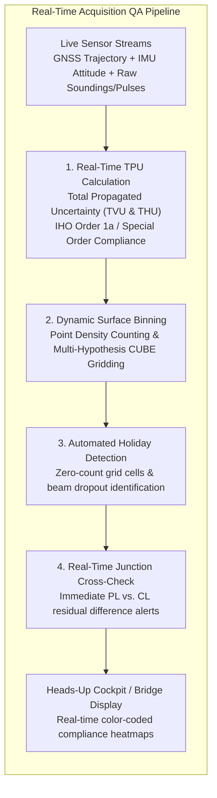
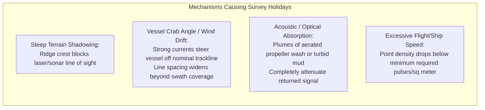
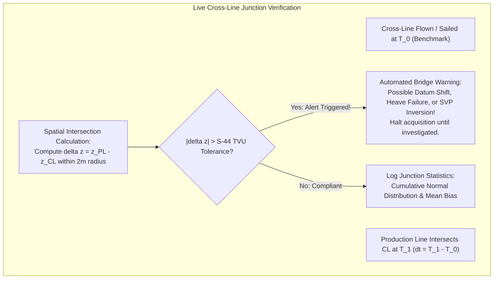

## 13.3 Real-Time Quality Assurance (QA) During Acquisition

In remote mapping operations—whether operating a $100\text{-meter}$ oceanographic research vessel in the Bering Sea or flying a specialized twin-engine LiDAR aircraft over the Alaskan tundra—the cost of field mobilization and vessel charter ranges from $\$10,000$ to upwards of $\$100,000$ per operational day. Discovering that a survey contains holidays (coverage gaps), excessive uncertainty, or an unsolved boresight bias after demobilizing and returning to the processing office is an unmitigated operational and financial catastrophe. Real-time Quality Assurance (QA) during acquisition integrates automated mathematical error monitoring into the live data ingestion stream, guaranteeing compliance with standards before the platform leaves the project area.



---

### 13.3.1 Live Total Propagated Uncertainty (TPU) Heatmaps

Historically, hydrographic and topographic surveys assessed data uncertainty during post-processing weeks after acquisition. Modern acquisition software (e.g., Kongsberg SIS, QPS Qinsy, Hypack Hysweep) computes the **Total Propagated Uncertainty (TPU)** for every sounding and laser pulse in real time.

#### The IHO S-44 Uncertainty Model
Under the International Hydrographic Organization (IHO) Standards for Hydrographic Surveys (S-44, 6th Edition), maximum allowable Total Vertical Uncertainty ($\text{TVU}_{\max}$) at the $95\%$ confidence level is parameterized as a function of water depth $d$:

$$\text{TVU}_{\max}(d) = \sqrt{a^2 + (b \cdot d)^2}$$

where $a$ represents depth-independent vertical uncertainty (fixed errors from draft, heave, and water levels) and $b$ represents depth-dependent uncertainty (scale errors from sound speed refraction and beam pointing):

| IHO S-44 Survey Order | Parameter $a$ (Fixed Error) | Parameter $b$ (Depth Factor) | Typical Operational Regime |
| :--- | :--- | :--- | :--- |
| **Exclusive Order** | $0.15\text{ m}$ | $0.0075$ | Critical shallow harbors, under-keel clearance $<1\text{–}2\text{ m}$ |
| **Special Order** | $0.25\text{ m}$ | $0.0075$ | Harbors, berthing areas, commercial shipping fairways $<40\text{ m}$ |
| **Order 1a / 1b** | $0.50\text{ m}$ | $0.0130$ | Coastal waters $<100\text{ m}$, navigation safety corridors |
| **Order 2** | $1.00\text{ m}$ | $0.0230$ | Deep oceanic waters $>100\text{ m}$ where navigation hazards are absent |

#### Live TPU Calculation and Display
During acquisition, the software multiplies the real-time sensor observation variance vector by the system Jacobian matrix:

$$\boldsymbol{\Sigma}_{xyz} = \mathbf{J} \, \boldsymbol{\Sigma}_{\text{obs}} \, \mathbf{J}^T$$

If real-time sea conditions degrade (causing violent ship heave) or if GNSS PDOP rises, the calculated vertical uncertainty $\sigma_z$ expands. 
* The real-time navigation display renders the survey swath not as simple raw depths, but as a **color-coded compliance heatmap**: green indicates $\text{TVU} \le \text{TVU}_{\max}$, yellow indicates marginal compliance ($80\%\text{–}100\%$ of specification), and red indicates non-compliance.
* The hydrographer immediately throttles back vessel speed or triggers a sound velocity cast before proceeding.

---

### 13.3.2 Automated Holiday (Data Gap) Detection and Point Density Tracking

A **holiday** is any unplanned void or gap within the nominal survey bounding box where elevation data is missing or fails to meet minimum point density thresholds.



#### Real-Time Grid Binning and Density Accumulators
Modern acquisition systems maintain an in-memory spatial grid of the survey area (e.g., $1\text{-m}$ or $2\text{-m}$ cells):
1. **Pulse/Sounding Accumulator:** Each incoming pulse or sounding increments the hit counter in its corresponding spatial cell.
2. **Density Compliance Thresholds:** For USGS Quality Level 1 (QL1) LiDAR, the required pulse density is $\ge 8\text{ pulses/m}^2$; for QL2, $\ge 2\text{ pulses/m}^2$. For IHO Special Order multibeam bathymetry, standards require full bottom search with $\ge 95\%$ of grid cells containing at least 5 soundings.
3. **Automated Holiday Alert Engine:** When adjacent parallel swaths fail to overlap—due to severe vessel drift in cross-currents or aircraft turbulence—the software flags unpopulated cells as active holidays, generating an immediate audio-visual alert in the wheelhouse or cockpit and automatically plotting an **infill line** (re-run track) on the pilot's navigation display.

---

### 13.3.3 Real-Time Cross-Line Junction Discrepancy Alerts

The ultimate test of data integrity during field operations is the agreement between orthogonal production lines and cross-lines.



#### Automated Junction QC Tools
Software packages such as HydrOffice QC Tools (developed jointly by NOAA and the Center for Coastal and Ocean Mapping, CCOM/JHC) run background daemons during acquisition:
* As a vessel sails over a previously surveyed cross-line, the software automatically extracts soundings within an intersection radius (e.g., $2\text{–}5\text{ m}$) from both lines.
* The system computes the junction elevation difference:
  $$\Delta z_{\text{junction}} = z_{\text{production}} - z_{\text{cross}}$$
* If the junction discrepancy exhibits a mean vertical bias exceeding allowable tolerances (e.g., $|\Delta z| > 0.15\text{ m}$ for IHO Special Order), the system raises an alarm. 
* This provides instant diagnosis: an abrupt vertical jump indicates an unmodeled tidal datum step, an antenna height entry error, or a dynamic heave filter divergence, allowing the field crew to fix the issue on the spot rather than discovering an unusable dataset months later.

---

### 13.3.4 Slope-Coupled Live TPU Budgeting and Automated Field QA Implementation

During real-time acquisition over rugged continental slopes, submarine canyon walls, or steep terrestrial scarps, flat-bottom vertical uncertainty $\sigma_{z,0}$ understates the true vertical uncertainty of the gridded surface. As established in `book/00-front-matter/notation-and-symbols.md` (Section 6.2), on a surface with local slope angle $\alpha$ ($\tan\alpha = \|\nabla z\|_2$), any horizontal positioning uncertainty $\sigma_H$ ($1\sigma$ single-axis horizontal standard deviation along the gradient direction, related to $95\%$ circular Total Horizontal Uncertainty by $\sigma_H = \text{THU}_{95\%} / 2.4477$) induces an apparent vertical error $\delta z_{\text{slope}} \approx -\nabla z \cdot \delta\mathbf{x}$. By first-order variance propagation, the live **slope-coupled Total Vertical Uncertainty** at $95\%$ confidence ($\text{TVU}_{95\%,\text{eff}} = 1.9600\,\sigma_{z,\text{total}}$) is:

$$\sigma_{z,\text{total}}^2 = \sigma_{z,0}^2 + \tan^2\alpha \cdot \sigma_H^2 \implies \text{TVU}_{95\%,\text{eff}} = \sqrt{\text{TVU}_{95\%,0}^2 + \left(\frac{1.9600}{2.4477}\tan\alpha \cdot \text{THU}_{95\%}\right)^2}$$

#### Worked Numerical Example: Live QA Alert for Slope-Induced TVU Breach and Cross-Current Holiday
Suppose a survey vessel maps a harbor entrance channel at depth $d = 20.0\text{ m}$ under **IHO S-44 Special Order** ($\text{TVU}_{\max}(20\text{ m}) = \sqrt{0.25^2 + (0.0075 \times 20)^2} = \mathbf{0.292\text{ m}}$).
1. **Flat Channel Bed ($\alpha = 2^\circ$) vs. Dredged Channel Bank ($\alpha = 22^\circ$):**
   In the outer swath ($\theta = 62^\circ$), the real-time TPU engine reports a flat-bottom $95\%$ vertical uncertainty of $\text{TVU}_{95\%,0} = 0.240\text{ m}$ ($\le 0.292\text{ m}$, green on flat bottom) and a $95\%$ circular horizontal uncertainty of $\text{THU}_{95\%} = 1.10\text{ m}$ ($\sigma_H = 1.10 / 2.4477 = 0.449\text{ m}$). As the outer swath sweeps across the $22^\circ$ dredged channel bank ($\tan 22^\circ = 0.4040$), the slope-coupled vertical contribution is $\frac{1.9600}{2.4477}(0.4040)(1.10\text{ m}) = 0.356\text{ m}$, inflating the effective $95\%$ vertical uncertainty to:
   $$\text{TVU}_{95\%,\text{eff}} = \sqrt{0.240^2 + 0.356^2} = \mathbf{0.429\text{ m}} > 0.292\text{ m}$$
   The real-time bridge display immediately flags the outer bank beams in red ($147\%$ of Special Order allowance), prompting the hydrographer to narrow the effective swath gate from $\pm 62^\circ$ to $\pm 50^\circ$ along the channel walls.
2. **Automated Holiday Detection and Cross-Line Junction Check:**
   The Python script below implements the core real-time QA checks run on board prior to demobilization: (a) evaluating slope-coupled IHO S-44 compliance per grid node, (b) scanning the hit-count accumulator grid for interior coverage holidays ($N_{\text{hits}} < 5$), and (c) auditing production-vs-crossline junction differences using both Gaussian ($95\%$ quantile) and robust Normalized Median Absolute Deviation ($\text{NMAD} = 1.4826 \cdot \text{median}(|e - \text{median}(e)|)$) estimators.

```python
import numpy as np

def audit_realtime_survey_qa(
    depth_grid: np.ndarray,
    slope_deg_grid: np.ndarray,
    tvu95_flat_grid: np.ndarray,
    thu95_grid: np.ndarray,
    hit_count_grid: np.ndarray,
    junction_dz: np.ndarray,
    a_iho: float = 0.25,
    b_iho: float = 0.0075,
    min_hits: int = 5,
) -> dict[str, float]:
    """Run real-time IHO S-44 TVU compliance, holiday detection, and junction QA."""
    # 1. Slope-coupled effective TVU_95% vs. IHO S-44 limit
    tvu_max = np.sqrt(a_iho**2 + (b_iho * depth_grid) ** 2)
    tan_alpha = np.tan(np.deg2rad(slope_deg_grid))
    tvu95_slope_term = (1.9600 / 2.4477) * tan_alpha * thu95_grid
    tvu95_eff = np.hypot(tvu95_flat_grid, tvu95_slope_term)
    pct_tvu_compliant = 100.0 * float(np.mean(tvu95_eff <= tvu_max))

    # 2. Holiday (under-populated grid cell) detection
    holiday_cells = int(np.sum(hit_count_grid < min_hits))

    # 3. Cross-line junction discrepancy audit (Bias, NMAD, and 95th percentile |dz|)
    med_bias = float(np.median(junction_dz))
    nmad_dz = 1.4826 * float(np.median(np.abs(junction_dz - med_bias)))
    q95_abs_dz = float(np.percentile(np.abs(junction_dz), 95.0))
    return {
        "tvu_compliant_pct": pct_tvu_compliant,
        "holiday_cell_count": float(holiday_cells),
        "junction_median_bias_m": med_bias,
        "junction_nmad_m": nmad_dz,
        "junction_q95_abs_m": q95_abs_dz,
    }

if __name__ == "__main__":
    rng = np.random.default_rng(42)
    depths = np.full((50, 50), 20.0)
    slopes = np.where(np.arange(50)[:, None] > 40, 22.0, 2.0)
    tvu_flat = np.full((50, 50), 0.24)
    thu = np.full((50, 50), 1.10)
    hits = rng.integers(6, 25, size=(50, 50))
    hits[24, 18:22] = 0  # Simulated 4-cell holiday from vessel crabbing
    junc_diffs = rng.normal(loc=0.015, scale=0.045, size=400)
    report = audit_realtime_survey_qa(depths, slopes, tvu_flat, thu, hits, junc_diffs)
    for k, v in report.items():
        print(f"{k:24s}: {v:.3f}")
```
