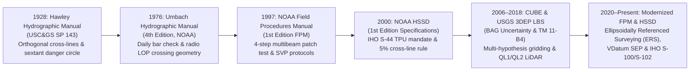
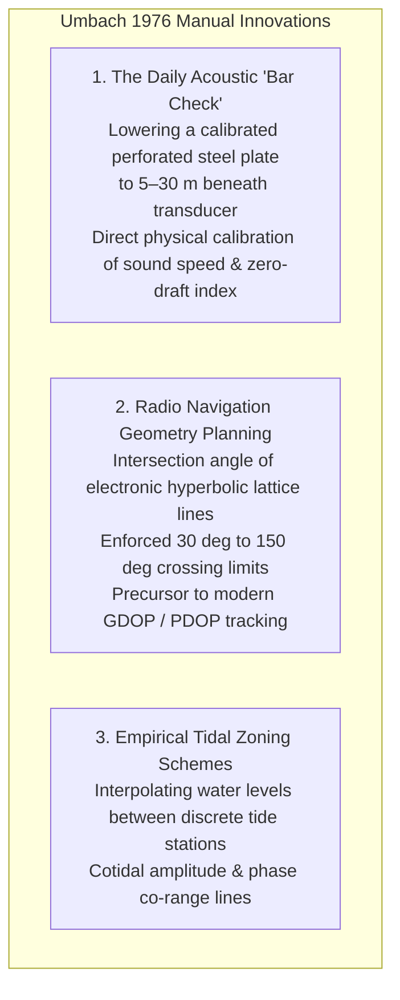
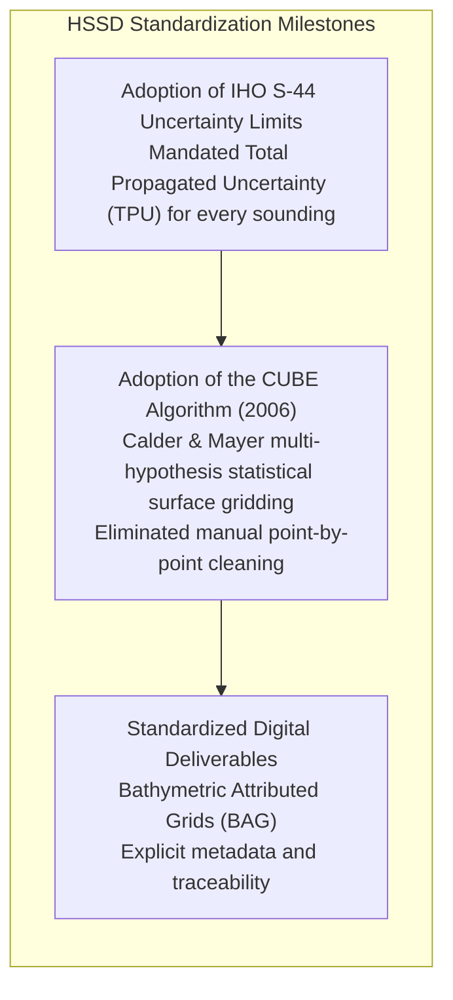

## 13.4 Historical Evolution of Survey Planning and Quality Control (`gis-history` Context)

The operational principles governing modern digital elevation and bathymetric surveys did not originate in computer algorithms; they were forged through a century of hydrographic and topographic field manuals documented in the `gis-history` chronology. From early lead-line instructions designed to keep wooden survey schooners off uncharted shoals to modern specifications that dictate automated multibeam uncertainty propagation and airborne LiDAR density compliance, the history of survey manuals reflects the continuous mathematical codification of error control.

---

### 13.4.1 The 1928 Hawley Hydrographic Manual (USC&GS Special Publication 143)

In 1928, Hydrographic and Geodetic Engineer (later Rear Admiral) Jean H. Hawley of the U.S. Coast and Geodetic Survey published Special Publication 143, the *Hydrographic Manual*. This monumental text represented the first comprehensive, systematic codification of hydrographic survey planning in North America.

#### Foundational Principles Established in 1928
1. **The First Formalization of Cross-Lines:** Hawley mandated that a system of cross-lines cutting across regular sounding lines at right angles be executed for every survey sheet. Hawley noted that while parallel lines provide systematic spatial coverage, only orthogonal cross-lines could expose undetected tide errors, lead-line shrinkage, and horizontal position misclosures.
2. **Line Spacing Formulas:** Hawley established mathematical rules linking survey line spacing directly to water depth, coastal bottom slope, and the draft of contemporary maritime commerce. In shoal or rocky waters, line spacing was compressed to $50\text{–}100\text{ m}$ intervals, requiring launch crews to maintain steady compass courses using visual three-point sextant fixes to onshore triangulation marks.
3. **Lead-Line Metrology:** The manual established strict calibration protocols for the lead-line itself: measuring the wet shrinkage of braided hemp and flax cords against brass standard pins set into the wooden deck of the survey ship before and after every working day.

---

### 13.4.2 The 1976 Hydrographic Manual, 4th Edition (Melvin J. Umbach)

By the mid-1970s, hydrography had transitioned from mechanical lead-lines to single-beam acoustic echosounders and medium-frequency terrestrial radio navigation (e.g., Raydist, Hi-Fix, Del Norte Trisponder). In 1976, Commander Melvin J. Umbach authored the *Hydrographic Manual, 4th Edition*, modernizing survey planning for the electronic era.

* **The Bar Check:** Umbach formalized the daily "bar check"—lowering a heavy, flat, perforated steel plate or pipe suspended by calibrated steel chains beneath the transducer head to depths from $2\text{ m}$ down to $30\text{ m}$. By comparing the acoustic echo against the physical chain markings, hydrographers directly calibrated both the instrument index draft and the average speed of sound in the upper water column.
* **Navigation Line Geometry:** Umbach introduced rigorous geometric dilution limits for radio positioning networks, establishing that lines of position (LOPs) intersecting at angles $<30^\circ$ or $>150^\circ$ were mathematically degenerate, establishing the conceptual ancestor of modern GNSS Dilution of Precision (DOP).

---

### 13.4.3 The 1997 / 2020 NOAA Field Procedures Manual (FPM)

With the advent of multibeam swath sonar systems, kinematic GPS, and shipboard computing in the 1990s, single-beam methods became obsolete. The NOAA Office of Coast Survey introduced the **Field Procedures Manual (FPM)** in 1997 (continuously updated through 2020 and subsequent editions) as a living, operational guide for hydrographic field units.

#### Multibeam Patch Tests and Dynamic Sound Speed Profiling
The FPM formalized the modern four-parameter **Patch Test** (latency, pitch, roll, and yaw), establishing standardized operational templates for running reciprocal lines over flat and sloping seafloors. The manual also instituted protocols for deploying Moving Vessel Profilers (MVP) and using surface sound velocity sensors directly integrated into sonar beamforming engines.

#### Ellipsoidally Referenced Surveying (ERS)
The 2020 edition of the FPM codified the transition from physical tide gauges and empirical tidal zoning to **Ellipsoidally Referenced Surveys (ERS)**. By logging dual-frequency GNSS carrier phase data on the survey vessel and processing trajectories via Post-Processed Kinematic (PPK) or PPP solutions, the water surface is tied directly to the ITRF/WGS84 ellipsoid. Vertical reduction to chart datums (MLLW) is performed via continuous separation models (NOAA VDatum), eliminating the single largest operational source of hydrographic error.

---

### 13.4.4 The 2000 NOAA Hydrographic Surveys Specifications and Deliverables (HSSD)

First promulgated in 2000 and updated annually, the **Hydrographic Surveys Specifications and Deliverables (HSSD)** established strict, legally binding technical standards for contractors and federal survey vessels conducting nautical charting surveys in the United States.

The HSSD transformed survey planning from qualitative "good seamanship" into a rigorous statistical framework:
* **Total Propagated Uncertainty (TPU) Mandate:** Mandated that every sounding ingested into a nautical chart deliverable carry an explicit, mathematically derived horizontal (THU) and vertical (TVU) uncertainty value at the $95\%$ confidence level.
* **CUBE Surface Integration:** In 2006, NOAA officially integrated the Combined Uncertainty and Bathymetry Estimator (CUBE) into the HSSD. Survey lines were no longer planned simply to generate dense soundings, but to provide the spatial and statistical redundancy required by CUBE's multi-hypothesis Kalman filters to resolve true seafloor depth in the presence of acoustic fliers, fish schools, and bubble noise.

---

### 13.4.5 Terrestrial Parallel: From 1947 NMAS to USGS 3DEP (TM 11-B4) and ASPRS Standards

Alongside the hydrographic evolution from Hawley (1928) to the NOAA HSSD (2000–present), terrestrial topographic survey planning underwent a parallel transformation from graphical contour inspection to statistical point-cloud quality assurance:
1. **1947 U.S. National Map Accuracy Standards (NMAS):** Formulated for stereoscopic compilation from aerial film cameras, NMAS required that no more than $10\%$ of tested points fail by more than one-half of the published contour interval ($\text{VMAS} = 0.5\,\text{CI}$, corresponding under a Gaussian distribution to $\text{RMSE}_z \approx 0.30\,\text{CI}$). Flight planning was governed strictly by base-to-height ratio ($B/H \approx 0.60$) and $C$-factor limits ($C = H_{\text{AGL}} / \text{CI}$) of mechanical stereoplotters.
2. **1998 FGDC National Standard for Spatial Data Accuracy (NSSDA) and 2015/2023 ASPRS Standards:** Recognizing that digital elevation grids have no intrinsic "contour interval" and that vegetated canopy errors violate Gaussian normality, the FGDC NSSDA (`FGDC-STD-007.3-1998`) standardized $95\%$ accuracy reporting ($\text{Accuracy}_z = 1.9600\,\text{RMSE}_z$), while the **ASPRS Positional Accuracy Standards for Digital Geospatial Data** separated **Non-Vegetated Vertical Accuracy ($\text{NVA} = 1.9600\,\text{RMSE}_z$)** from non-parametric **Vegetated Vertical Accuracy ($\text{VVA} = 95\text{th percentile } |e|$)** in Edition 1 (2015, still referenced by USGS 3DEP TM 11-B4), updated to direct $\text{RMSE}_V$ accuracy classes, a 30-checkpoint minimum, and informational VVA reporting in Edition 2 (2023), and mandated cross-strip overlap consistency checks.
3. **USGS 3D Elevation Program (3DEP) Lidar Base Specification (TM 11-B4):** Authored by Hans Karl Heidemann (2012–2018, *USGS Techniques and Methods 11-B4*), the 3DEP Lidar Base Specification codified modern airborne LiDAR flight planning: mandating Quality Level 1 ($\ge 8\text{ pulses/m}^2$, Nominal Pulse Spacing $\text{NPS} \le 0.35\text{ m}$, $\text{RMSE}_z \le 10.0\text{ cm}$) and Quality Level 2 ($\ge 2\text{ pulses/m}^2$, $\text{NPS} \le 0.71\text{ m}$, $\text{RMSE}_z \le 10.0\text{ cm}$), $\ge 90\%$ relative swath-to-swath vertical agreement ($\le 8.0\text{ cm}$ RMSD in smooth open overlap zones), and orthogonal cross-tie strips across every project block.

---

### 13.4.6 Mathematical Continuity: From 1928 Sextant Danger Circles and 1976 LOP Crossing Angles to Modern DOP

A striking mathematical thread links the geometric survey rules of Hawley (1928) and Umbach (1976) to modern GNSS/acoustic survey planning: **Jacobian conditioning of intersecting lines of position (LOPs)**.
* **1928 Three-Point Sextant Fix and the "Danger Circle":** In Hawley's 1928 manual, launch crews positioned soundings by simultaneously measuring two horizontal sextant angles $(\alpha, \beta)$ between three onshore triangulation stations $(A, B, C)$. Geometrically, each sextant angle defines a circular locus of position passing through two shore stations and the boat. If the survey boat happens to lie on the **circumcircle passing through all three shore stations $A, B, C$** (the classic hydrographic **"danger circle"**), the two position circles become tangent (collinear normals), the $2\times 2$ Jacobian determinant vanishes ($\det\mathbf{J} = 0$), and horizontal position uncertainty explodes to infinity ($\text{THU} \to \infty$).
* **1976 Electronic Range-Range / Hyperbolic LOP Intersection Angle ($\gamma$):** In Umbach's 1976 manual, microwave range-range systems (e.g., Trisponder, Mini-Ranger) measured distances $(r_1, r_2)$ with standard deviation $\sigma_r$ from two shore transponders whose unit line-of-sight vectors $\hat{\mathbf{u}}_1, \hat{\mathbf{u}}_2$ intersect at the vessel at crossing angle $\gamma \in (0, \pi)$. Linearizing $\delta r_i = \hat{\mathbf{u}}_i^\top \delta\mathbf{x}$ yields design matrix $\mathbf{H} = [\hat{\mathbf{u}}_1, \hat{\mathbf{u}}_2]^\top$, covariance $\mathbf{\Sigma}_{xy} = \sigma_r^2 (\mathbf{H}^\top\mathbf{H})^{-1}$, and radial Horizontal Dilution of Precision ($\text{HDOP}$):

$$\text{HDOP}(\gamma) = \frac{\sigma_{\text{radial}}}{\sigma_r} = \sqrt{\text{tr}\big((\mathbf{H}^\top\mathbf{H})^{-1}\big)} = \frac{\sqrt{2}}{\sin\gamma}$$

At an orthogonal crossing ($\gamma = 90^\circ$), $\text{HDOP}(90^\circ) = \sqrt{2} \approx 1.414$. At Umbach's mandatory cutoff limits ($\gamma = 30^\circ$ or $150^\circ$), $\sin 30^\circ = 0.500$, doubling the radial positioning error to $\text{HDOP}(30^\circ) = 2\sqrt{2} \approx 2.828$. Below $15^\circ$, $\text{HDOP}$ exceeds $5.47$, degrading horizontal accuracy beyond IHO tolerances—the exact mathematical principle that today governs GNSS PDOP/VDOP sky-plot planning and underwater USBL/LBL acoustic array design.

| Era & Standard (`gis-history`) | Primary Depth / Elevation Sensor | Horizontal Positioning & Datum | Mandatory Geometric QA Rule | Vertical Uncertainty Metric |
| :--- | :--- | :--- | :--- | :--- |
| **1928 Hawley Manual** (USC&GS SP 143) | Calibrated hemp/wire lead-line | Visual 3-point sextant angles (avoiding circumcircle danger locus) | Orthogonal cross-lines; twice-daily wet lead-line deck calibration | Fractional depth allowance ($\pm 0.5\text{ ft}$ in shoals) |
| **1976 Umbach Manual** (4th Ed., NOAA) | Single-beam analog/digital echosounder | Range-range / hyperbolic radio LOPs ($\gamma \in [30^\circ, 150^\circ]$) | Daily physical steel-plate **bar check** ($2\text{--}30\text{ m}$); cotidal zoning | $\text{HDOP} = \sqrt{2}/\sin\gamma$; IHO $90\%$ depth error |
| **1997 / 2000 NOAA FPM & HSSD** | Multibeam swath sonar (MBES) | Differential GPS (DGPS) / kinematic GPS + IMU | 4-step **Patch Test**; $\ge 5\%$ orthogonal cross-lines; CUBE (2006) | IHO S-44 $95\%$ $\text{TVU}_{\max} = \sqrt{a^2 + (bd)^2}$ |
| **2018 USGS 3DEP LBS (TM 11-B4) & 2020 ERS** | Topo/bathy LiDAR & MBES | Tightly coupled PPK GNSS/INS + VDatum SEP (ERS) | $\ge 30\%$ LiDAR sidelap / $100\text{--}200\%$ MBES overlap + live TPU | ASPRS $\text{NVA}_{95\%} = 1.96\,\text{RMSE}_z \le 19.6\text{ cm}$ (QL1/2) |
