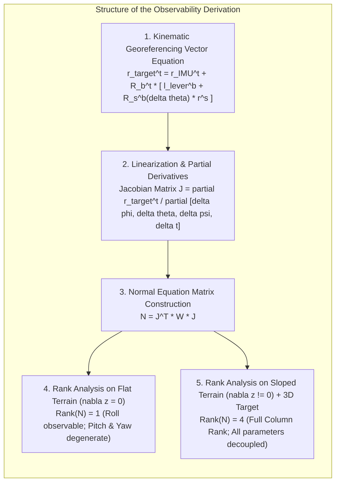
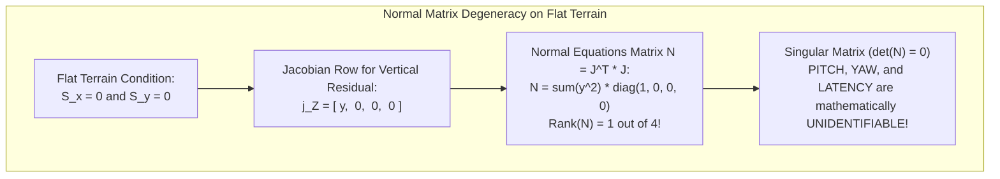
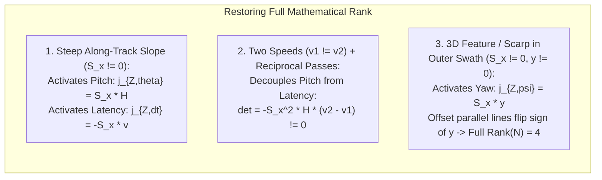

## 13.5 Mathematical Foundations of Boresight Calibration and Parameter Observability

A central question in survey planning is: *Why can't we solve for roll, pitch, heading, and latency simultaneously over any arbitrary patch of ground?* The answer lies in linear algebra and parameter observability. If survey lines and terrain geometries are chosen naively, the normal equations become mathematically singular (rank-deficient), or suffer from near-unity parameter correlations that prevent the least-squares solver from separating physical mounting misalignments from natural terrain features.

This section provides the rigorous derivation of the 3D boresight georeferencing Jacobian, followed by a formal rank and conditioning analysis of the normal equation matrix $\mathbf{N} = \mathbf{J}^T \mathbf{W} \mathbf{J}$ over flat versus sloped terrain.



---

### 13.5.1 The Kinematic Direct Georeferencing Equation

Let the coordinates of a mapped ground or seafloor point in a local right-handed **track-aligned horizon frame** $t = (x, y, z)$ (where $x$ is horizontal **along-track forward** in the direction of platform travel, $y$ is horizontal **across-track to port/left**, and $z$ is **vertical upward** $\uparrow$, related to the local East-North-Up $[\text{ENU}]$ frame at compass heading $\psi$ by a planar rotation about the vertical axis, $\mathbf{R}_t^{\text{ENU}}(\psi) = \begin{bmatrix} \sin\psi & -\cos\psi & 0 \\ \cos\psi & \sin\psi & 0 \\ 0 & 0 & 1 \end{bmatrix}$) be denoted by $\mathbf{r}_{\text{target}}^t$. Consistent with `book/00-front-matter/notation-and-symbols.md` (Section 4.2), the 3D target coordinate is reconstructed from the platform trajectory, attitude, lever arm, and sensor measurement via:

$$\mathbf{r}_{\text{target}}^t(t_{\text{obs}}) = \mathbf{r}_{\text{IMU}}^t(t_{\text{obs}} + \delta t) + \mathbf{R}_b^t(t_{\text{obs}} + \delta t) \left[ \mathbf{l}_{\text{lever}}^b + \mathbf{R}_s^b (\boldsymbol{\delta\theta}) \, \mathbf{r}^s(t_{\text{obs}}) \right]$$

where:
* $\mathbf{r}_{\text{IMU}}^t = [x_{\text{IMU}}, y_{\text{IMU}}, z_{\text{IMU}}]^\top$ is the position of the IMU reference center in the track-aligned horizon frame $t$.
* $\mathbf{R}_b^t(t)$ is the time-varying attitude rotation matrix from the IMU body frame $b$ ($x_b$ forward, $y_b$ port, $z_b$ up; or equivalently via $\mathbf{P}_{\text{ENU}\leftrightarrow\text{NED}}$ from the marine $\text{NED}$ body frame) to the horizon frame $t$.
* $\mathbf{l}_{\text{lever}}^b = [l_x, l_y, l_z]^\top$ is the physical lever-arm offset vector from the IMU reference center to the sensor optical/acoustic origin, expressed in the body frame $b$.
* $\mathbf{R}_s^b(\boldsymbol{\delta\theta})$ is the static boresight misalignment rotation matrix from the sensor frame $s$ to the IMU body frame $b$. For small mounting misalignments $\boldsymbol{\delta\theta} = [\delta\phi, \delta\theta, \delta\psi]^\top$ (roll $\delta\phi$ about the forward $x$-axis, pitch $\delta\theta$ about the transverse $y$-axis, and yaw/heading $\delta\psi$ about the vertical $z$-axis, in radians), the rotation matrix is linearized via the small-angle skew-symmetric operator $[\boldsymbol{\delta\theta}]_\times$:
  $$\mathbf{R}_s^b(\boldsymbol{\delta\theta}) \approx \mathbf{I}_{3} + [\boldsymbol{\delta\theta}]_\times = \begin{bmatrix} 1 & -\delta\psi & \delta\theta \\ \delta\psi & 1 & -\delta\phi \\ -\delta\theta & \delta\phi & 1 \end{bmatrix}$$
* $\mathbf{r}^s = [x_s, y_s, z_s]^\top$ is the 3D target vector in the sensor frame. For a nadir-plane scanning LiDAR or multibeam echosounder sweeping perpendicular to the trajectory ($x_s = 0$) at scan/beam angle $\theta_b$ and slant range $\rho$ from flying height or water depth $H = \rho\cos\theta_b > 0$:
  $$\mathbf{r}^s = \begin{bmatrix} 0 \\ \rho \sin\theta_b \\ -\rho \cos\theta_b \end{bmatrix} = \begin{bmatrix} 0 \\ y \\ -H \end{bmatrix}$$
* $\delta t$ is the uncalibrated synchronization time latency between the IMU/GNSS clock and the sensor trigger.

---

### 13.5.2 Derivation of the 3D Boresight & Latency Jacobian Matrix ($\mathbf{J}$)

To solve for the unknown calibration parameter vector $\mathbf{p} = [\delta\phi, \delta\theta, \delta\psi, \delta t]^\top$ via least squares, we linearize $\mathbf{r}_{\text{target}}^t$ about nominal zero bias ($\mathbf{p}_0 = \mathbf{0}$) during straight-and-level survey flight ($\mathbf{R}_b^t \approx \mathbf{I}_3$, $\dot{\mathbf{R}}_b^t \approx \mathbf{0}$, and velocity vector $\dot{\mathbf{r}}_{\text{IMU}}^t = [\dot{x}, \dot{y}, \dot{z}]^\top = [v, 0, 0]^\top$).

#### General 3D Point Perturbation Equation
Using the cross-product anticommutativity identity $[\boldsymbol{\delta\theta}]_\times \mathbf{r}^s = \boldsymbol{\delta\theta} \times \mathbf{r}^s = -\mathbf{r}^s \times \boldsymbol{\delta\theta} = -[\mathbf{r}^s]_\times \boldsymbol{\delta\theta}$ and a first-order Taylor expansion in $\delta t$, the 3D coordinate perturbation $\Delta\mathbf{r}_{\text{tie}} = [\Delta x, \Delta y, \Delta z]^\top$ of any general 3D point $\mathbf{r}^s = [x, y, z]^\top$ is governed by the $3\times 4$ **Boresight-Latency Observability Matrix**:

$$\begin{bmatrix} \Delta x \\ \Delta y \\ \Delta z \end{bmatrix}_{\text{tie}} \approx \begin{bmatrix} 0 & z & -y & \dot{x} \\ -z & 0 & x & \dot{y} \\ y & -x & 0 & \dot{z} \end{bmatrix} \begin{bmatrix} \delta \phi \\ \delta \theta \\ \delta \psi \\ \delta t \end{bmatrix}$$

#### Specialization to a Nadir-Plane Swath Scanner ($x = 0, z = -H, \dot{\mathbf{r}} = [v, 0, 0]^\top$)
Substituting $x = 0$ (scan plane orthogonal to the trajectory), $z = -H$ (target at vertical distance $H > 0$ below the sensor), and level forward translation $\dot{x} = v, \dot{y} = 0, \dot{z} = 0$ yields the exact along-track ($\Delta x$), across-track ($\Delta y$), and vertical ($\Delta z$) coordinate shifts for each individual parameter:

$$\begin{bmatrix} \Delta x \\ \Delta y \\ \Delta z \end{bmatrix} = \begin{bmatrix} 0 & -H & -y & v \\ H & 0 & 0 & 0 \\ y & 0 & 0 & 0 \end{bmatrix} \begin{bmatrix} \delta \phi \\ \delta \theta \\ \delta \psi \\ \delta t \end{bmatrix}$$

Writing out each column of this Jacobian $\mathbf{J}_{\text{3D}} = \frac{\partial \mathbf{r}_{\text{target}}^t}{\partial \mathbf{p}}$ reveals the exact physical geometry of each bias:

$$\begin{aligned}
\frac{\partial \mathbf{r}_{\text{target}}^t}{\partial \delta \phi} &= \begin{bmatrix} 0 \\ H \\ y \end{bmatrix} \quad (\text{Roll }\delta\phi\text{: shifts beam across-track by }+H\delta\phi\text{ and vertically by }+y\delta\phi) \\
\frac{\partial \mathbf{r}_{\text{target}}^t}{\partial \delta \theta} &= \begin{bmatrix} -H \\ 0 \\ 0 \end{bmatrix} \quad (\text{Pitch }\delta\theta\text{: shifts beam purely along-track by }-H\delta\theta) \\
\frac{\partial \mathbf{r}_{\text{target}}^t}{\partial \delta \psi} &= \begin{bmatrix} -y \\ 0 \\ 0 \end{bmatrix} \quad (\text{Yaw }\delta\psi\text{: rotates outer beam }y\text{ along-track by }-y\delta\psi) \\
\frac{\partial \mathbf{r}_{\text{target}}^t}{\partial \delta t} &= \begin{bmatrix} v \\ 0 \\ 0 \end{bmatrix} \quad (\text{Latency }\delta t\text{: shifts entire swath along-track by }+v\,\delta t)
\end{aligned}$$

*(Note on Coordinate-Frame Sign Conventions: To express these perturbations in the topocentric East-North-Up $[\text{ENU}]$ frame on a survey line with compass azimuth $\psi$ measured clockwise from North, left-multiply by $\mathbf{R}_t^{\text{ENU}}(\psi)$; for example, when flying due North $[\psi = 0^\circ]$, along-track is North $[\Delta N = \Delta x]$, port across-track is West $[\Delta E = -\Delta y]$, and vertical is Up $[\Delta U = \Delta z]$. Conversely, in commercial marine/aerospace software using the standard $\text{NED}$ body frame of `notation-and-symbols.md` Table 1.2 $[x_{\text{NED}} = +x\text{ forward},\; y_{\text{NED}} = -y\text{ starboard},\; z_{\text{NED}} = -z\text{ down}]$, right-handed Euler misalignments satisfy $\delta\phi_{\text{NED}} = +\delta\phi$ [starboard down], $\delta\theta_{\text{NED}} = -\delta\theta$ [bow/nose up, shifting nadir forward by $+H\delta\theta_{\text{NED}}$], and $\delta\psi_{\text{NED}} = -\delta\psi$ [clockwise heading, shifting a port beam forward by $+y\delta\psi_{\text{NED}}$].)*

---

### 13.5.3 Jacobian Rank Analysis: Why Flat Terrain Fails

In digital elevation and bathymetric modeling, we compare the observed vertical coordinate $Z_{\text{obs}}(x_{\text{obs}}, y_{\text{obs}}) = Z_{\text{true}} + \Delta z$ against the true underlying terrain surface $Z_{\text{terrain}}(x, y)$ evaluated at the displaced horizontal coordinates $(x + \Delta x, y + \Delta y)$. By a first-order Taylor expansion of the terrain surface $Z_{\text{terrain}}(x + \Delta x, y + \Delta y) \approx Z_{\text{true}} + S_x \Delta x + S_y \Delta y$, where $S_x = \frac{\partial Z_{\text{terrain}}}{\partial x}$ is the **along-track terrain slope** and $S_y = \frac{\partial Z_{\text{terrain}}}{\partial y}$ is the **across-track terrain slope**, the apparent vertical surface elevation residual $\Delta Z = Z_{\text{obs}} - Z_{\text{terrain}}(x + \Delta x, y + \Delta y)$ is:

$$\Delta Z = \Delta z - S_x \Delta x - S_y \Delta y = (y - S_y H)\,\delta\phi + (S_x H)\,\delta\theta + (S_x y)\,\delta\psi - (S_x v)\,\delta t$$

Thus, the $1\times 4$ vertical-residual Jacobian row $\mathbf{j}_Z = \frac{\partial (\Delta Z)}{\partial [\delta\phi, \delta\theta, \delta\psi, \delta t]}$ at any sounding $(y, H, v, S_x, S_y)$ is:

$$\mathbf{j}_Z = \begin{bmatrix} y - S_y H & S_x H & S_x y & -S_x v \end{bmatrix}$$



#### Case 1: Perfectly Flat Terrain ($S_x = 0, S_y = 0$)
On a flat, horizontal airport runway or abyssal plain ($S_x = 0, S_y = 0$):
* $\frac{\partial (\Delta Z)}{\partial \delta\phi} = y$ (non-zero across the swath for off-nadir beams $y \ne 0$).
* $\frac{\partial (\Delta Z)}{\partial \delta\theta} = S_x H = 0$.
* $\frac{\partial (\Delta Z)}{\partial \delta\psi} = S_x y = 0$.
* $\frac{\partial (\Delta Z)}{\partial \delta t} = -S_x v = 0$.

The Jacobian row for vertical elevation observations on flat terrain collapses to:

$$\mathbf{j}_{Z,\text{flat}} = \begin{bmatrix} y & 0 & 0 & 0 \end{bmatrix}$$

Summing $\mathbf{j}_{Z,\text{flat}}^\top \mathbf{j}_{Z,\text{flat}}$ over all $M$ swath points yields the normal equation matrix:

$$\mathbf{N}_{\text{flat}} = \begin{bmatrix} \sum_{i=1}^M y_i^2 & 0 & 0 & 0 \\ 0 & 0 & 0 & 0 \\ 0 & 0 & 0 & 0 \\ 0 & 0 & 0 & 0 \end{bmatrix}, \qquad \text{Rank}(\mathbf{N}_{\text{flat}}) = 1 < 4$$

**Mathematical Conclusion:** Over flat terrain, the normal matrix has rank 1. **Roll ($\delta \phi$) is fully observable**, whereas Pitch ($\delta \theta$), Yaw ($\delta \psi$), and Latency ($\delta t$) lie entirely in the **three-dimensional null space** ($\dim\ker(\mathbf{N}_{\text{flat}}) = 3$) because horizontal shifts $(\Delta x, \Delta y)$ along a flat plane produce zero vertical elevation change.

---

### 13.5.4 Restoring Full Rank: Sloped Terrain and 3D Feature Geometry

To render all four parameters mathematically observable and well-conditioned, the survey plan must deliberately sample terrain with non-zero slopes ($S_x \neq 0$) across distinct speeds and lateral offsets:



#### Decoupling Pitch and Latency over Along-Track Slopes ($S_x \neq 0$)
When crossing a steep scarp or bank perpendicular to its contours ($S_x \ne 0$, near nadir $y \approx 0$), the pitch and latency sensitivities become non-zero:

$$\frac{\partial (\Delta Z)}{\partial \delta \theta} = S_x H, \qquad \frac{\partial (\Delta Z)}{\partial \delta t} = -S_x v$$

However, on a single constant-speed pass ($v = v_1$), the Pitch column and Latency column are scalar multiples of each other (rank 1 for 2 unknowns) because both produce a uniform along-track shift:

$$\Delta x_{\text{nadir}} = -H\,\delta \theta + v\,\delta t$$

To break this collinearity, the patch test executes two maneuvers over the same slope ($S_x \neq 0$):
1. **Speed Variation ($v_1 \neq v_2$):** Running the same slope line in the same direction at two speeds ($v_1 \ll v_2$) yields the $2\times 2$ pitch-latency sub-system:
   $$\begin{bmatrix} \Delta Z_1 \\ \Delta Z_2 \end{bmatrix} = S_x \begin{bmatrix} H & -v_1 \\ H & -v_2 \end{bmatrix} \begin{bmatrix} \delta \theta \\ \delta t \end{bmatrix}, \qquad \det = -S_x^2 H (v_2 - v_1) \ne 0 \quad (\text{for } v_1 \ne v_2, S_x \ne 0)$$
   Taking the difference $\Delta Z_1 - \Delta Z_2 = S_x(v_2 - v_1)\delta t$ isolates $\delta t$ completely free of $\delta\theta$.
2. **Reciprocal Passes ($\psi$ vs. $\psi + 180^\circ$ at $v_1 = v_2$):** Reversing the vessel/aircraft direction reverses the sign of the along-track slope in the track-aligned frame ($S_x \to -S_x$). Once $\delta t$ is removed, differencing the two reciprocal passes doubles the pitch signal ($\Delta Z_{\text{fwd}} - \Delta Z_{\text{rev}} = 2 S_x H\,\delta\theta$).

#### Restoring Yaw Observability over 3D Features ($S_x \neq 0, y \neq 0$)
A yaw misalignment $\delta \psi$ shifts an outer-swath sounding at cross-track distance $y$ along-track by $\Delta x = -y\,\delta\psi$, which over an along-track slope $S_x \ne 0$ (such as a boulder, wreck, or pitched gable roof positioned in the outer swath) induces a vertical residual:

$$\frac{\partial (\Delta Z)}{\partial \delta \psi} = S_x y$$

Notice that the Pitch Jacobian ($S_x H$) is **even** (symmetric) with respect to across-track coordinate $y$, whereas the Yaw Jacobian ($S_x y$) is **odd** (antisymmetric) in $y$. By running two parallel lines offset on opposite sides of the 3D feature ($y = +y_0 > 0$ on Line A and $y = -y_0 < 0$ on Line B), $S_x y$ flips sign while $S_x H$ remains invariant, guaranteeing orthogonal columns in $\mathbf{J}$ and elevating the normal matrix to full rank:

$$\text{Rank}(\mathbf{N}_{\text{patch test}}) = 4$$

```python
import numpy as np

def build_jacobian_row(y: float, H: float, v: float, Sx: float, Sy: float) -> np.ndarray:
    """Return 1x4 vertical residual Jacobian row [dZ/dphi, dZ/dtheta, dZ/dpsi, dZ/ddt]."""
    return np.array([y - Sy * H, Sx * H, Sx * y, -Sx * v], dtype=float)

if __name__ == "__main__":
    # 1. Flat terrain only (Sx = 0, Sy = 0): Rank = 1
    J_flat = np.vstack([build_jacobian_row(y, H=40.0, v=4.0, Sx=0.0, Sy=0.0) for y in [-30, -10, 10, 30]])
    # 2. Full 4-step patch test (flat + two speeds over slope Sx=0.35 + offset lines y=+-25 over Sx=0.35): Rank = 4
    J_full = np.vstack([
        J_flat,
        build_jacobian_row(0.0, H=40.0, v=2.0, Sx=0.35, Sy=0.0),   # Slow slope pass
        build_jacobian_row(0.0, H=40.0, v=6.0, Sx=0.35, Sy=0.0),   # Fast slope pass
        build_jacobian_row(25.0, H=40.0, v=4.0, Sx=0.35, Sy=0.0),  # Feature to port
        build_jacobian_row(-25.0, H=40.0, v=4.0, Sx=0.35, Sy=0.0), # Feature to starboard
    ])
    print(f"Flat Terrain Normal Matrix Rank: {np.linalg.matrix_rank(J_flat.T @ J_flat)} / 4")
    print(f"Full Patch-Test Normal Matrix Rank: {np.linalg.matrix_rank(J_full.T @ J_full)} / 4")
    print(f"Full Patch-Test Singular Values: {np.round(np.linalg.svd(J_full, compute_uv=False), 2)}")
```
