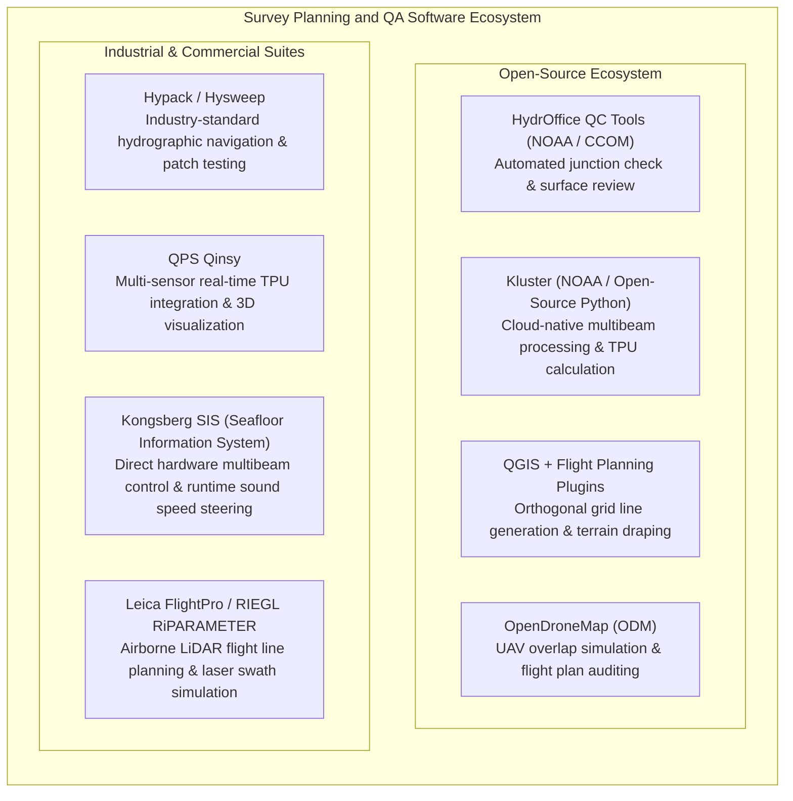
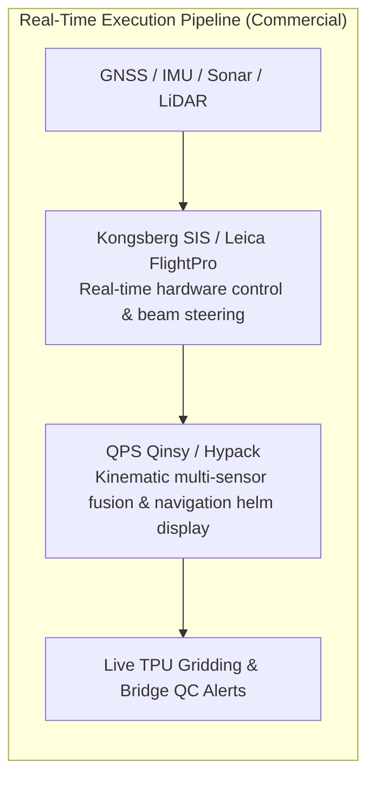

## 13.6 Software Ecosystem for Survey Planning, Execution, and Quality Control

Modern survey planning and real-time execution rely on specialized software architectures capable of simulating geometric coverage, ingesting high-bandwidth sensor streams, calculating live uncertainty, and auditing cross-line junctions. The software ecosystem is divided between open-source community frameworks and industrial-grade commercial survey navigation engines.



---

### 13.6.1 Open-Source Tools

#### HydrOffice QC Tools (NOAA / CCOM)
Developed collaboratively by NOAA's Office of Coast Survey and the Center for Coastal and Ocean Mapping (CCOM/JHC) at the University of New Hampshire, **HydrOffice QC Tools** is an open-source Python suite designed to standardize hydrographic quality control:
* **CrossCheck:** Performs automated statistical analysis of cross-line and production-line junctions, generating depth-difference histograms and evaluating compliance against IHO S-44 Order 1a and Special Order standards.
* **Flier Finder:** Scans gridded bathymetric surfaces (BAGs or GeoTIFFs) using Laplacian and elevation-gradient filters to identify artificial acoustic spikes, unrejected fish schools, and edge blunders.
* **Holiday Finder:** Automatically isolates voids and missing coverage within surveyed polygons, flagging cells that fail point density criteria before vessels depart the field.

#### Kluster (NOAA Open-Source Hydrographic Engine)
**Kluster** is a modern, distributed, open-source Python library developed by NOAA to process multibeam echosounder data:
* Built on `xarray`, `dask`, and `zarr`, Kluster parallelizes acoustic ray tracing, lever-arm rotations, and TPU calculations across multi-core CPUs and GPUs.
* Provides native modules for automated multibeam patch-test calibration, solving for roll, pitch, yaw, and latency using robust optimization algorithms on raw sensor data.

#### QGIS and Flight Planning Plugins
In airborne LiDAR and drone mapping, QGIS serves as the primary open-source planning hub:
* Tools like **QGIS Flight Planner** take digital surface models (SRTM, Copernicus, or national DEMs) and compute terrain-following flight lines.
* Computes real-time along-track and across-track overlap footprints based on camera sensor dimensions, focal lengths, flight speed, and camera trigger rates, ensuring consistent Ground Sample Distance (GSD) across rugged topography.

---

### 13.6.2 Commercial Survey Navigation and Execution Engines



#### Hypack and Hysweep
Hypack is one of the most widely deployed commercial hydrographic survey suites in the world:
* **Survey Planning:** Designs matrix lines, channel offset patterns, and automated cross-line layouts.
* **Hysweep Patch Test Wizard:** Guides hydrographers through latency, pitch, roll, and yaw test lines, providing automated graphical overlays where operators adjust angle sliders to align overlapping seafloor profiles visually and numerically.

#### QPS Qinsy
Qinsy is an advanced real-time data acquisition and navigation software package for hydrographic, offshore construction, and dredging operations:
* **Rigorous Kinematic Modeling:** Tracks complex multi-vessel and ROV/AUV operations, computing Kalman-filtered georeferencing solutions at up to $100\text{ Hz}$.
* **Real-Time Dynamic TPU:** Displays continuous Total Propagated Uncertainty heatmaps on the helmsman's heads-up display, color-coding areas where survey specifications are breached.

#### Kongsberg SIS (Seafloor Information System)
SIS is the proprietary hardware-control software interface for Kongsberg EM-series multibeam systems:
* Operates directly on the sonar transceiver unit, managing real-time acoustic beam steering and stabilization (pitch, roll, and yaw).
* Ingests real-time sound velocity measurements from the transducer face and updates water-column ray paths on a ping-by-ping basis.

#### Leica FlightPro and RIEGL RiPARAMETER
In airborne laser scanning:
* **Leica FlightPro:** Directs pilots along pre-planned flight tracks, adjusting scan rates and field-of-view (FOV) dynamically to maintain uniform point density over variable ground elevations.
* **RIEGL RiPARAMETER / RiACQUIRE:** Simulates airborne LiDAR scan patterns, multiple-pulses-in-the-air (MTA) zones, and laser swath overlap, warning flight planners of range ambiguities and blind zones before takeoff.

---

### 13.6.3 Software Comparison Matrix

| Software Suite | License | Domain | Key Capabilities | Primary Role |
| :--- | :--- | :--- | :--- | :--- |
| **HydrOffice QC Tools** | Open-Source (BSD-3) | Marine Bathymetry | Cross-line junction auditing, flier detection, holiday search | Post-acquisition and daily field QA compliance. |
| **Kluster** | Open-Source (BSD-3) | Marine Bathymetry | Cloud-native Dask/Zarr processing, automated patch tests, TPU | Automated multibeam calibration and pipeline processing. |
| **QGIS Flight Planner** | Open-Source (GPLv2) | Airborne LiDAR / UAV | Terrain-following flight paths, GSD/overlap simulation | Pre-mission airborne flight planning. |
| **OpenDroneMap (ODM)** | Open-Source (GPLv3) | UAV Photogrammetry | Orthomosaic generation, tie-point review, coverage simulation | Drone mission verification. |
| **Hypack / Hysweep** | Commercial (Xylem) | Hydrography / Dredging | Channel design, vessel steering, patch-test solver | Live survey execution and vessel helm guidance. |
| **QPS Qinsy** | Commercial (QPS) | Marine / Offshore | Live TPU mapping, complex multi-sensor Kalman filtering | Real-time survey execution and offshore positioning. |
| **Kongsberg SIS** | Commercial (Kongsberg) | Marine Bathymetry | Direct sonar hardware control, real-time beam steering | Multibeam acquisition and surface sound speed control. |
| **Leica FlightPro** | Commercial (Hexagon) | Airborne LiDAR | Pilot navigation guidance, dynamic FOV/pulse management | Aircraft cockpit guidance and sensor triggering. |

---

### 13.6.4 Reproducible Open-Source Workflows: Adaptive Swath Line Planning, Kluster TPU, and Least-Squares Boresight Solver

In production campaigns, survey engineers pair open-source Python tools with GeoTIFF/BAG elevation grids to automate adaptive line spacing before mobilization and to execute reproducible least-squares calibration and quality control in the field.

#### 1. Automated Multibeam Conversion, TPU Calculation, and QC in NOAA `Kluster` and `PDAL`
For hydrographic multibeam files (e.g., Kongsberg `.all` or `.kmall`) and airborne LiDAR strips (`.laz`), `Kluster` and `PDAL` automate trajectory integration, sound-velocity ray tracing, Total Propagated Uncertainty (TPU) computation, and strip-overlap verification:

```python
# --- A. NOAA Kluster: Convert raw Kongsberg .kmall, apply SBET + SVP, and compute 2D TPU ---
from HSTB.kluster.fqpr_convenience import perform_all_processing, generate_new_surface

# Convert raw multibeam logs, apply POSPac SBET trajectory, ray-trace SVP, and compute TVU/THU
# Note: 'filname' is the exact parameter spelling in HSTB.kluster.fqpr_convenience
fqpr = perform_all_processing(
    filname=["line_001.kmall", "line_002.kmall", "crossline_001.kmall"],
    navfiles=["mission_day1.sbet"],
    errorfiles=["mission_day1.smrmsg"],
    svfiles=["cast_0800.svp", "cast_1330.svp"],
    outfold="/tmp/kluster_project/vessel_launch_1",
    coord_system="NAD83",
    vert_ref="ellipse",  # Ellipsoidally Referenced Survey (ERS)
)

# Generate a Variable-Resolution Bathymetric Attributed Grid (VR-BAG) with CUBE uncertainty
surf = generate_new_surface(
    fqpr_inst=fqpr,
    grid_type="variable_resolution_tile",
    output_path="/tmp/kluster_project/vr_cube_surface",
)
```

```bash
# --- B. PDAL + GDAL: Compute swath-to-swath vertical difference grid in open overlap zones ---
pdal translate strip_101.laz strip_101_ground.tif range \
    --filters.range.limits="Classification[2:2]" \
    --writers.gdal.resolution=1.0 --writers.gdal.output_type=idw
pdal translate strip_102.laz strip_102_ground.tif range \
    --filters.range.limits="Classification[2:2]" \
    --writers.gdal.resolution=1.0 --writers.gdal.output_type=idw

# Audit relative swath agreement (USGS 3DEP LBS requires RMSDz <= 8.0 cm in smooth open overlap)
gdal_calc.py -A strip_101_ground.tif -B strip_102_ground.tif \
    --outfile=/tmp/swath_diff_101_102.tif --calc="A-B"
gdalinfo -stats /tmp/swath_diff_101_102.tif
```

#### 2. Python Implementation: Adaptive Swath Line Spacing and Weighted Least-Squares Boresight Solver
When planning a survey over variable topography (such as a shoaling continental shelf or a mountain valley), fixed line spacing either wastes budget in deep/high-clearance zones or creates coverage holidays over shallow shoals and high ridges where the effective height above terrain $H(x,y)$ shrinks. The self-contained script below: (1) computes an **adaptive survey line plan** over a shoaling seabed so that every line maintains a strict minimum $200\%$ multibeam overlap ($S_k \le d_{\min,k}\tan\theta_{\max}$) based on the shoalest depth along the swath, and (2) solves the **4-parameter weighted least-squares boresight/patch-test normal equations** ($\hat{\mathbf{p}} = (\mathbf{J}^\top \mathbf{W} \mathbf{J})^{-1} \mathbf{J}^\top \mathbf{W} \Delta\mathbf{Z}$) along with formal parameter standard errors and the parameter correlation matrix.

```python
import numpy as np

def plan_adaptive_mbes_lines(
    x_extent_m: float,
    shoal_depth_fn,
    theta_max_deg: float = 60.0,
    safety_margin: float = 0.90,
) -> list[float]:
    """Generate cross-shore line coordinates x_k guaranteeing 200% nadir-to-outer overlap."""
    tan_theta = np.tan(np.deg2rad(theta_max_deg))
    x_lines = [0.0]
    while x_lines[-1] < x_extent_m:
        d_shoal = max(3.0, float(shoal_depth_fn(x_lines[-1])))
        # 200% overlap: outer beam of line k reaches nadir of line k+1 -> spacing S = d * tan(theta)
        step_m = safety_margin * d_shoal * tan_theta
        x_next = x_lines[-1] + step_m
        if x_next >= x_extent_m:
            break
        x_lines.append(round(x_next, 2))
    return x_lines

def solve_boresight_patch_test(
    obs_table: np.ndarray, dz_obs: np.ndarray, sigma_z: np.ndarray
) -> tuple[np.ndarray, np.ndarray, np.ndarray]:
    """
    Solve weighted least-squares boresight [dphi, dtheta, dpsi, dt] from vertical residuals.
    obs_table columns: [y_m, H_m, v_ms, Sx, Sy]
    """
    y, H, v, Sx, Sy = obs_table.T
    J = np.column_stack([y - Sy * H, Sx * H, Sx * y, -Sx * v])
    W = np.diag(1.0 / (sigma_z**2))
    cov_p = np.linalg.inv(J.T @ W @ J)
    p_hat = cov_p @ (J.T @ W @ dz_obs)
    std_p = np.sqrt(np.diag(cov_p))
    corr_p = cov_p / np.outer(std_p, std_p)
    return p_hat, std_p, corr_p

if __name__ == "__main__":
    # 1. Adaptive line spacing over a shoaling shelf (depth shoals from 50 m at x=0 to 10 m at x=1000 m)
    lines = plan_adaptive_mbes_lines(1000.0, lambda x: 50.0 - 0.04 * x, theta_max_deg=60.0)
    print(f"Planned {len(lines)} adaptive MBES lines (m): {lines[:6]} ... {lines[-3:]}")

    # 2. Simulate and recover true boresight biases: dphi=-0.15 deg, dtheta=+0.20 deg, dpsi=+0.35 deg, dt=0.030 s
    p_true = np.array([np.deg2rad(-0.15), np.deg2rad(0.20), np.deg2rad(0.35), 0.030])
    obs = np.array([
        [-35.0, 40.0, 4.0,  0.00, 0.0], [ 35.0, 40.0, 4.0,  0.00, 0.0],  # Flat roll pass 1
        [-35.0, 40.0, 4.0,  0.00, 0.0], [ 35.0, 40.0, 4.0,  0.00, 0.0],  # Flat roll pass 2
        [  0.0, 35.0, 2.0,  0.30, 0.0], [  0.0, 35.0, 6.0,  0.30, 0.0],  # Slow & fast slope passes
        [  0.0, 35.0, 4.0, -0.30, 0.0],                                   # Reciprocal slope pass
        [ 28.0, 35.0, 4.0,  0.35, 0.0], [-28.0, 35.0, 4.0,  0.35, 0.0],  # Offset 3D feature passes
    ])
    y, H, v, Sx, Sy = obs.T
    J_sim = np.column_stack([y - Sy * H, Sx * H, Sx * y, -Sx * v])
    dz_sim = J_sim @ p_true
    p_est, std_est, _ = solve_boresight_patch_test(obs, dz_sim, np.full(len(obs), 0.02))
    print(f"Recovered (deg, deg, deg, ms): {np.rad2deg(p_est[0]):+.3f}, {np.rad2deg(p_est[1]):+.3f}, "
          f"{np.rad2deg(p_est[2]):+.3f}, {p_est[3]*1e3:+.1f}")
```
