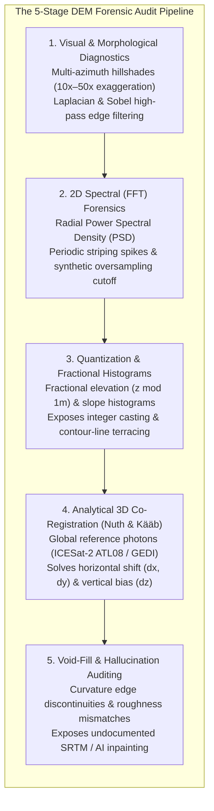
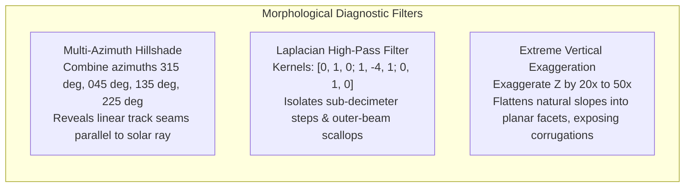
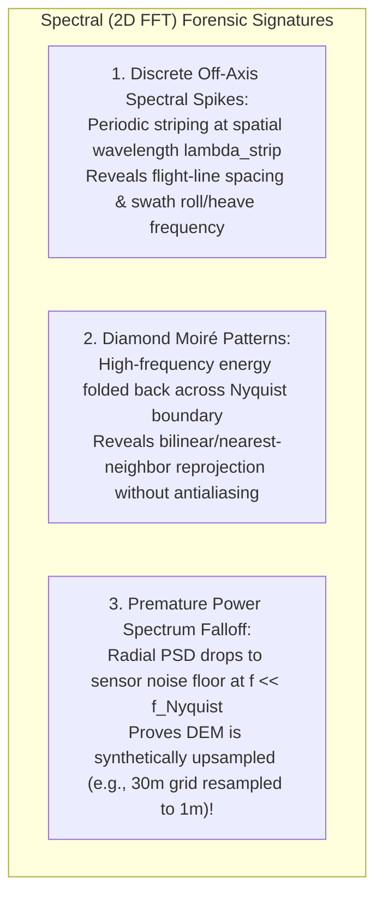
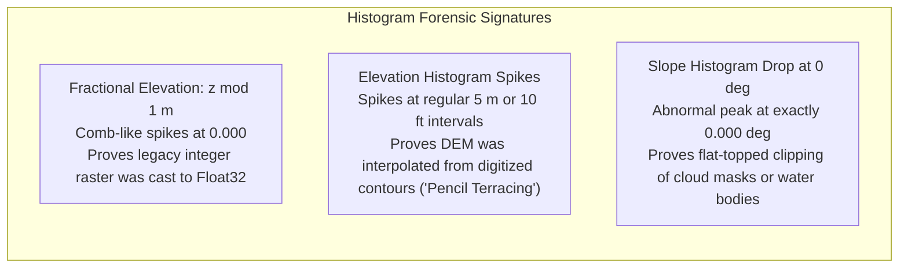
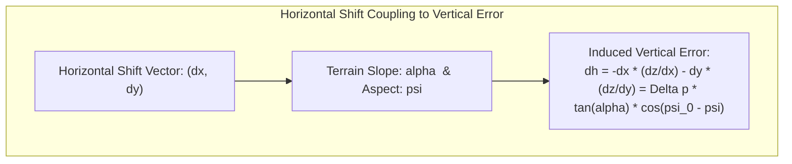
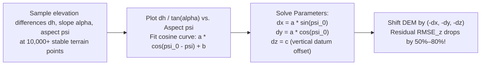

## 14.3 Forensic Evaluation: Auditing Third-Party DEMs Without Raw Telemetry

In practical geospatial engineering, practitioners rarely receive raw sensor telemetry, IMU logs, or calibration files. Instead, they are handed a compiled GeoTIFF or Cloud-Optimized GeoTIFF (COG), often accompanied by missing, conflicting, or overly optimistic metadata. Forensic evaluation is the science of reverse-engineering a digital elevation model's acquisition history, hidden blunders, processing artifacts, and geometric shifts using only the gridded surface itself and independent global references.



---

### 14.3.1 Visual and Morphological Diagnostics

The human visual cortex is an extraordinarily sensitive pattern detector when topography is illuminated dynamically:



1. **Multi-Azimuth Hillshading:** Standard single-direction hillshading (conventionally from the northwest at azimuth $315^\circ$) casts illumination parallel to features aligned northwest-southeast, rendering linear strip seams invisible. Multi-azimuth oblique illumination (or Principal Component Analysis of 16 illumination directions) highlights linear features regardless of orientation.
2. **Laplacian High-Pass Filtering:** Convolving the DEM with a $3 \times 3$ discrete Laplacian operator:
   $$\mathbf{K}_{\text{Laplacian}} = \begin{bmatrix} 0 & 1 & 0 \\ 1 & -4 & 1 \\ 0 & 1 & 0 \end{bmatrix}$$
   removes long-wavelength terrain slopes, leaving high-frequency surface discontinuities. Boresight roll errors appear as bright/dark line pairs along flight paths; multibeam refraction frowns appear as regular, scallop-shaped waves along swath boundaries.
3. **Extreme Vertical Exaggeration ($20\times\text{–}50\times$):** Viewing shallow marine shelves or flat alluvial plains at $30\times$ vertical exaggeration amplifies sub-decimeter surface corrugations, immediately exposing dredge drag marks, vessel heave artifacts, or interpolation triangular facets.

---

### 14.3.2 2D Spectral Forensics: Power Spectral Density and Synthetic Oversampling

Fourier transform analysis transforms the 2D elevation grid $z(x, y)$ into the spatial frequency domain:

$$Z(u, v) = \iint_{-\infty}^\infty z(x, y) \, e^{-i 2\pi (u x + v y)} \, dx \, dy$$

The **Power Spectral Density (PSD)** is the squared magnitude $|Z(u, v)|^2$:



#### Detecting Synthetic Oversampling
A common deceptive practice in third-party data distribution is taking a coarse $30\text{-meter}$ DEM (e.g., SRTM or ASTER GDEM), bicubic-spline interpolating it to a $1\text{-meter}$ grid, and advertising it as "1-meter High-Resolution DEM":
* Natural planetary topography follows power-law scale invariance across spatial frequencies $f = \sqrt{u^2 + v^2}$: for a 2D self-affine fractal surface of Hurst exponent $H \in (0, 1)$ and fractal dimension $D = 3 - H \in (2, 3)$, the **2D radially averaged** Power Spectral Density decays as $\text{PSD}_{\text{2D}}(f) \propto f^{-\beta_{\text{2D}}}$ with $\beta_{\text{2D}} = 2H + 2 = 8 - 2D \approx 3.0\text{–}3.5$ ($D = (8 - \beta_{\text{2D}})/2$), whereas a **1D transect** (or ring-integrated spectrum $2\pi f\,\text{PSD}_{\text{2D}}(f)$) scales as $\text{PSD}_{\text{1D}}(f) \propto f^{-\beta_{\text{1D}}}$ with $\beta_{\text{1D}} = 2H + 1 = 7 - 2D \approx 2.0\text{–}2.5$ ($D = (7 - \beta_{\text{1D}})/2$).
* In a genuine high-resolution LiDAR DEM, high-frequency power persists all the way to the grid Nyquist frequency $f_{\text{Nyquist}} = \frac{1}{2\Delta x}$.
* In a synthetically oversampled DEM, the power spectrum exhibits a precipitous, unnatural cliff at the true original resolution (e.g., $f = 1/30\text{ m}^{-1}$), followed by a flat zero-power floor out to $f = 1/1\text{ m}^{-1}$. Computing the 2D FFT unmasks fake resolution instantly.

---

### 14.3.3 Histogram and Quantization Forensics

Plotting the discrete frequency distribution of elevation values and derivatives exposes underlying digitizing and processing history:



1. **The Fractional Elevation Histogram ($z \bmod 1\text{ m}$):** By calculating the modulo remainder $r = z - \lfloor z \rfloor \in [0, 1)$ for every pixel and plotting the distribution:
   * A continuous, modern float32 elevation model produces a completely uniform, flat horizontal distribution across $[0, 1)$.
   * If the histogram exhibits a massive spike at $r = 0.000$, the data was historically quantized as integer meters (or integer feet) and subsequently converted to floating-point numbers without adding precision.
2. **Contour-Line "Pencil Terracing":** Many regional DEMs in developing nations were created by scanning historic paper topographic maps, vectorizing contour lines, and running Delaunay or spline interpolation:
   * The resulting surface suffers from "terracing" (stair-stepping between contours).
   * A histogram of elevation $z$ plotted with fine bins ($0.1\text{-m}$ width) will display sharp, periodic spikes at exactly the contour interval (e.g., $10\text{ m}, 20\text{ m}, 30\text{ m}$ or $20\text{ ft}, 40\text{ ft}, 60\text{ ft}$), proving the surface is not a true continuous remote sensing product.

---

### 14.3.4 Analytical 3D Co-Registration: The Nuth & Kääb (2011) Method

When comparing a third-party DEM against independent reference data (such as spaceborne laser altimeter photons from NASA's ICESat-2 ATL08 or GEDI), direct vertical subtraction produces massive errors if the two surfaces are horizontally misaligned by even a fraction of a pixel.



#### The Universal Co-Registration Equation
Nuth and Kääb (2011) demonstrated that an unmodeled horizontal shift of magnitude $\Delta p = \sqrt{\Delta x^2 + \Delta y^2}$ along direction $\psi_0$, combined with a vertical datum bias $c$, produces a vertical difference $dh = z_{\text{DEM}} - z_{\text{ref}}$ that varies sinusoidally as a function of terrain aspect $\psi$ and slope $\alpha$:

$$\frac{dh}{\tan\alpha} = a \cos(\psi_0 - \psi) + \frac{c}{\tan\alpha}$$

where:
* $a = \Delta p = \sqrt{\Delta x^2 + \Delta y^2}$ is the horizontal displacement magnitude.
* $\psi_0 = \arctan2(\Delta x, \Delta y)$ is the compass direction of the horizontal misregistration.
* $c = \Delta z$ is the constant vertical datum offset (e.g., ellipsoidal-to-orthometric bias).
* $\alpha$ is terrain slope, and $\psi$ is terrain aspect.



By extracting slope and aspect at thousands of points over stable bedrock or non-glaciated, non-vegetated terrain and fitting this closed-form trigonometric relationship, an analyst can solve for sub-pixel horizontal shifts down to $0.05\text{ pixels}$ without needing ground control points!

---

### 14.3.5 Detecting Hallucinations and Undocumented Void Fills

In many commercial and public DEMs, voids caused by cloud obscuration, water bodies, or radar layover/shadow are filled ("void-filled") using external datasets or generative AI inpainting without documenting the patch boundaries in metadata.

#### Forensic Techniques for Unmasking Silent Fills
1. **Curvature Edge Discontinuities:** Computing the profile curvature $\nabla^2 z$ exposes razor-sharp, polygonal boundary seams where external data (e.g., $90\text{-m}$ SRTM) was patched into a $10\text{-m}$ national DEM.
2. **Roughness and Fractal Mismatch:** High-resolution LiDAR terrain exhibits a characteristic micro-roughness (standard deviation of residual elevation in a $5 \times 5$ window $\sigma_{\text{rough}} \approx 0.15\text{–}0.30\text{ m}$). An infilled patch derived from smoothed radar or spline interpolation will suddenly drop to $\sigma_{\text{rough}} < 0.02\text{ m}$, forming an unnaturally glassy, smooth polygon surrounded by textured terrain.
3. **Multi-Temporal Difference Maps against Global Laser Altimetry:** Differencing the DEM against ICESat-2 laser profiles across seasons exposes void-fill artifacts as localized, anomalous vertical steps.

---

### 14.3.6 Reproducible Python Forensic Audit Toolkit: Spectral, Quantization, and Void-Fill Diagnostics

When an analyst receives an unverified third-party GeoTIFF DEM, the self-contained Python diagnostic suite below executes three automated forensic tests directly on the elevation array $z(x,y)$:
1. **Fractional-Elevation Uniformity Audit ($z \bmod 1\text{ m}$):** Computes the histogram entropy and maximum bin concentration of $r = z \bmod 1.0$. For a genuine floating-point DEM over relief $>5\text{ m}$, $r$ is uniformly distributed on $[0, 1)$ (across $B = 100$ bins of width $1\text{ cm}$, each bin contains $\approx 1\%$ of pixels); if maximum bin concentration exceeds $5\%\text{–}10\%$, the DEM suffers from legacy integer casting or contour terracing.
2. **2D Radial Power Spectral Density (PSD) Roll-Off Test:** Computes the 2D Hann-windowed Fast Fourier Transform $|\mathcal{F}\{z\}|^2$, radially averages power across spatial wavenumbers $f \in (0, f_{\text{Nyquist}}]$, and checks whether high-frequency spectral power drops prematurely below the fractal power-law trend $\text{PSD}(f) \propto f^{-\beta}$—unmasking coarse $30\text{ m}$ DEMs bicubically upsampled to $1\text{ m}$ grids.
3. **Local Laplacian Micro-Roughness Void-Fill Mask:** Computes the discrete $3\times 3$ Laplacian $\nabla^2 z$ and its moving local standard deviation $\sigma_{\nabla^2 z}$ to isolate abnormally smooth polygons where clouds or shadows were silently patched by spline or bilinear interpolation.

```python
import numpy as np
from scipy.ndimage import uniform_filter

def forensic_audit_dem(z: np.ndarray, dx_m: float = 1.0) -> dict[str, float]:
    """Run fractional quantization, radial 2D FFT PSD, and void-fill roughness forensics."""
    valid = z[np.isfinite(z)]
    # 1. Fractional-Elevation (z mod 1 m) Quantization Test
    frac = np.mod(valid, 1.0)
    hist, _ = np.histogram(frac, bins=100, range=(0.0, 1.0), density=False)
    max_bin_pct = 100.0 * float(np.max(hist)) / float(len(valid))

    # 2. 2D Windowed FFT Radial Power Spectral Density Slope (High-Freq vs. Mid-Freq)
    ny, nx = z.shape
    win = np.outer(np.hanning(ny), np.hanning(nx))
    z_detrend = np.nan_to_num(z - np.nanmean(z), nan=0.0) * win
    psd2d = np.abs(np.fft.fftshift(np.fft.fft2(z_detrend))) ** 2
    fy = np.fft.fftshift(np.fft.fftfreq(ny, d=dx_m))
    fx = np.fft.fftshift(np.fft.fftfreq(nx, d=dx_m))
    f_rad = np.hypot(fx[None, :], fy[:, None])
    f_nyq = 0.5 / dx_m
    mid_band = (f_rad >= 0.05 * f_nyq) & (f_rad <= 0.20 * f_nyq)
    high_band = (f_rad >= 0.60 * f_nyq) & (f_rad <= 0.95 * f_nyq)
    high_to_mid_psd_db = 10.0 * float(np.log10(np.mean(psd2d[high_band]) / np.mean(psd2d[mid_band])))

    # 3. Local Laplacian Roughness for Undocumented Smooth Void-Fill Detection
    lap = (
        np.roll(z, 1, axis=0) + np.roll(z, -1, axis=0)
        + np.roll(z, 1, axis=1) + np.roll(z, -1, axis=1) - 4.0 * z
    ) / (dx_m**2)
    local_rough_var = np.maximum(0.0, uniform_filter(lap**2, size=7) - uniform_filter(lap, size=7) ** 2)
    local_rough_std = np.sqrt(local_rough_var)
    smooth_void_fill_pct = 100.0 * float(np.mean(local_rough_std < 0.05 * np.median(local_rough_std)))

    return {
        "max_fractional_bin_pct": max_bin_pct,
        "high_to_mid_psd_db": high_to_mid_psd_db,
        "smooth_void_fill_area_pct": smooth_void_fill_pct,
    }

if __name__ == "__main__":
    rng = np.random.default_rng(14)
    y, x = np.mgrid[0:128, 0:128] * 1.0
    dem_sim = 120.0 + 0.08 * x + 0.05 * y + rng.normal(0.0, 0.12, size=(128, 128))
    # Inject a silent smooth spline void-fill patch in [40:70, 40:70]
    dem_sim[40:70, 40:70] = 120.0 + 0.08 * x[40:70, 40:70] + 0.05 * y[40:70, 40:70]
    metrics = forensic_audit_dem(dem_sim, dx_m=1.0)
    for k, v in metrics.items():
        print(f"{k:28s}: {v:+.2f}")
```
