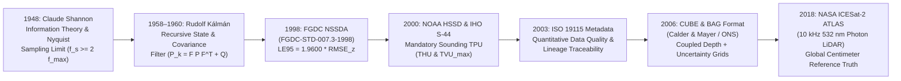
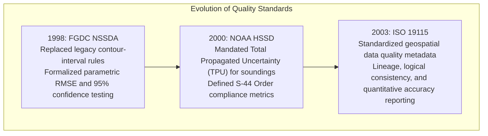

## 14.4 Historical Evolution of Error Theory, Geospatial Standards, and Uncertainty Modeling (`gis-history` Context)

The discipline of assessing, modeling, and validating elevation uncertainty transitioned across seven decades of `gis-history` milestones—from abstract mathematical communications theory and aerospace recursive state estimation into modern standardized metadata schemas, multi-hypothesis uncertainty grids, and spaceborne photon-counting validation.

---

### 14.4.1 Information Theory and State Estimation (1948–1958)

#### 1948: Claude Shannon and Information Theory
In 1948, Claude Shannon published *A Mathematical Theory of Communication* in the *Bell System Technical Journal*. Shannon formalized the concepts of information entropy, signal-to-noise ratio (SNR), and channel capacity:

$$C = B \log_2\left(1 + \frac{S}{N}\right)$$

In digital elevation modeling, Shannon's sampling theorem established the theoretical limit of surface reconstruction: a continuous terrain profile containing spatial frequencies up to $f_{\max}$ can be reconstructed completely without aliasing if and only if it is sampled at a spatial frequency $f_s \ge 2 f_{\max}$ (the Nyquist rate). Shannon's work established that when a sensor rasterizes topography into discrete pixels or soundings, information lost to noise or sub-Nyquist undersampling can never be mathematically recovered without introducing artificial assumptions.

#### 1958: Rudolf Kálmán and the Kalman Filter
In 1958–1960, mathematician Rudolf E. Kálmán developed the **Kalman filter**—a recursive, linear minimum mean-square error algorithm for estimating the state of a dynamic system from a series of noisy measurements. 

Initially developed for aerospace navigation (powering the Apollo Lunar Module descent computer), the Kalman filter became the mathematical heart of direct sensor georeferencing:
* Fusing high-frequency, drifting accelerometer/gyroscope signals from an IMU with low-frequency, high-accuracy GNSS carrier-phase measurements.
* Propagating the system covariance matrix $\mathbf{P}_{k|k-1}$ through dynamic motion equations, establishing the theoretical framework for real-time Total Propagated Uncertainty (TPU) tracking on mobile mapping platforms.

---

### 14.4.2 Standardizing Spatial Data Accuracy (1998–2003)

#### 1998: FGDC National Standard for Spatial Data Accuracy (NSSDA)
Prior to 1998, elevation accuracy in the United States was governed by the 1947 National Map Accuracy Standards (NMAS), which stated that $90\%$ of tested points must fall within one-half the contour interval (e.g., within $\pm 10\text{ ft}$ for a $20\text{-ft}$ contour map). As digital elevation grids replaced paper contour maps, this metric became useless.

In 1998, the Federal Geographic Data Committee (FGDC) promulgated the **NSSDA** (FGDC-STD-007.3-1998). The NSSDA:
* Eliminated contour-interval dependencies, replacing them with statistical **Root Mean Square Error ($\text{RMSE}_z$)**.
* Standardized reporting at the **$95\%$ confidence level**, defining $\text{Accuracy}_z = 1.9600 \cdot \text{RMSE}_z$ under Gaussian error distributions.
* Mandated testing against an independent check survey of higher accuracy.

#### 2000: NOAA Hydrographic Surveys Specifications and Deliverables (HSSD)
In 2000, NOAA formalised the annual HSSD, translating the International Hydrographic Organization's S-44 accuracy standards into rigorous operational mandates. For the first time, hydrographic mapping contracts required that every single acoustic sounding in a digital delivery contain an explicit calculation of Total Horizontal Uncertainty (THU) and Total Vertical Uncertainty (TVU).

#### 2003: ISO 19115: Geographic Information — Metadata
In 2003, the International Organization for Standardization published **ISO 19115:2003**, establishing the international schema for geospatial metadata:
* Structured data quality into five formal elements: completeness, logical consistency, positional accuracy, temporal accuracy, and thematic accuracy.
* Required explicit **data lineage** tracing: logging every sensor model, transformation parameter, and geoid model used in the production of a digital elevation model.

---

### 14.4.3 Statistical Surface Modeling and Global Spaceborne Truth (2006–2018)

#### 2006: The CUBE Algorithm and the BAG Format
In 2006, the Open Navigation Surface (ONS) working group—a consortium of NOAA, the U.S. Navy, the Canadian Hydrographic Service, and academic institutions—standardized the **Bathymetric Attributed Grid (BAG)** format and integrated the **CUBE (Combined Uncertainty and Bathymetry Estimator)** algorithm:
* Developed by Brian Calder and Larry Mayer at CCOM/JHC, CUBE broke with traditional deterministic grid averaging. 
* CUBE treats each incoming sounding as a Gaussian probability distribution with known TPU. Using a recursive multi-hypothesis tracking engine, it dynamically tracks multiple potential seabed elevations at each grid node. When conflicting acoustic returns occur (e.g., from fish schools or multiple bounces), CUBE maintains parallel hypotheses until subsequent pings provide sufficient statistical weight to resolve the true surface.
* The BAG format enshrined this by storing two coupled raster layers inside an open HDF5 container: an **Elevation** grid and an identical, co-registered **Uncertainty** grid.

#### 2018: ICESat-2 and the Era of Global Photon Validation
On September 15, 2018, NASA launched the **Ice, Cloud, and land Elevation Satellite-2 (ICESat-2)**, carrying the Advanced Topographic Laser Altimeter System (ATLAS). 

ATLAS marked a revolution in global elevation validation:
* Operating at $532\text{ nm}$ (green) with a $10\text{ kHz}$ repetition rate, ATLAS fires six separate laser beams arranged in three pairs, measuring individual photon time-of-flight with picosecond precision ($<800\text{ ps}$).
* Generating laser footprints of approximately $11\text{ m}$ diameter spaced every $0.7\text{ m}$ along-track, ICESat-2 achieves an absolute vertical accuracy of **$<5\text{–}10\text{ cm}$** globally.
* Products like **ATL08 (Land and Vegetation Elevation)** and **ATL03 (Global Geolocated Photons)** provide an uncorrupted, globally accessible "spaceborne ground truth" network. For the first time in geospatial history, analysts auditing third-party DEMs anywhere on Earth can extract coincident ICESat-2 ground photons to compute absolute vertical datum offsets and verify terrain fidelity without setting foot in the field.

---

### 14.4.4 Evolution of Uncertainty Representation: From Map-Sheet Legends to Per-Pixel Heteroscedastic Grids

Historically, elevation uncertainty was treated as a **single scalar attribute** attached to an entire map sheet or dataset header (e.g., "Vertical accuracy $\pm 3\text{ m}$ at $90\%$ confidence"). Over the past three decades, four generations of metrological standards transformed uncertainty from a static header note into a spatially varying, multi-scale tensor field:

1. **Generation 1 — Contour-Interval Fractional Rules (1947 U.S. NMAS):** Defined vertical tolerance solely as one-half of the printed contour interval ($\text{VMAS} = 0.5\,\text{CI}$ at $90\%$ confidence, equivalent to $\text{RMSE}_z \approx 0.304\,\text{CI}$). On flat coastal floodplains mapped with $10\text{ ft}$ contours, this permitted $\pm 5\text{ ft}$ ($1.52\text{ m}$) errors, whereas steep canyons with $80\text{ ft}$ contours carried $\pm 40\text{ ft}$ tolerances.
2. **Generation 2 — Global Parametric RMSE & Gaussian Multipliers (1998 FGDC NSSDA):** Decoupled digital elevation grids from contour intervals by mandating $\text{LE95} = 1.9600\,\text{RMSE}_z$ and circular horizontal accuracy $\text{CE95} = 2.4477\,\sigma_H = 1.7308\,\text{RMSE}_r$, evaluated against $\ge 20$ independent check points. However, NSSDA still assumed homoscedastic (spatially uniform) Gaussian errors across the entire project polygon.
3. **Generation 3 — Stratified Non-Parametric Quantiles & Per-Sounding TPU (2000 NOAA HSSD, 2006 CUBE/BAG, 2009 Höhle & Höhle, 2015/2023 ASPRS):**
   * In terrestrial mapping, Höhle & Höhle (2009) and the **ASPRS Positional Accuracy Standards** (2015; 2nd ed. 2023) introduced robust estimators ($\text{NMAD}$) and partitioned accuracy into **Non-Vegetated Vertical Accuracy ($\text{NVA} = 1.9600\,\text{RMSE}_z$)** and **Vegetated Vertical Accuracy ($\text{VVA} = Q_{0.95}(|\Delta z|)$)** across distinct land-cover strata.
   * In marine hydrography, **Hare, Godin, and Mayer (1995)**, **NOAA HSSD (2000)**, and **Calder and Mayer (2003, CUBE)** established per-sounding Total Propagated Uncertainty ($\sigma_{z,i}, \sigma_{xy,i}$). When propagating sounding $i$ at horizontal distance $d_i$ from a grid node with horizontal uncertainty $\sigma_{xy,i}$, CUBE inflates the sounding's effective vertical variance at the grid node via:

   $$\sigma_{\text{eff},i}^2 = \sigma_{z,i}^2 \left( 1 + \left( \frac{d_i + S_{\text{offset}}\,\sigma_{xy,i}}{S_{\text{scale}}} \right)^\alpha \right)^2$$

   and sequential Bayesian Kalman updating writes a dedicated **per-pixel uncertainty band** directly alongside the elevation band inside **BAG** (2006) and **IHO S-102** (HDF5) deliverables.
4. **Generation 4 — Heteroscedastic & Multi-Scale Spatial Covariance Models (2018–Present, `ICESat-2` & `xdem`):** Modern geostatistical frameworks (Hugonnet et al., 2022) model per-pixel vertical variance $\sigma_z^2(x,y) = f(\alpha(x,y), \kappa_{\max}(x,y), \text{SNR})$ as an explicit empirical function of terrain slope $\alpha$, maximum curvature $\kappa_{\max}$, and sensor signal quality, paired with nested spatial semivariograms $\gamma(h) = \sum_k c_k \gamma_k(h; r_k)$ audited globally against `ICESat-2` and `GEDI` reference tracks.

| Historical Milestone (`gis-history`) | Governing Equation / Standard | Spatial Representation of Error | Key Innovation for DEM Quality Assurance |
| :--- | :--- | :--- | :--- |
| **1948 Claude Shannon** | $f_s \ge 2 f_{\max}$ (Nyquist Theorem) | Spectral wavenumber domain $(k_x, k_y)$ | Proved undersampled terrain aliases high-frequency roughness into false long-wave undulations. |
| **1958 Rudolf Kálmán** | $\mathbf{P}_{k\mid k} = (\mathbf{I} - \mathbf{K}_k\mathbf{H}_k)\mathbf{P}_{k\mid k-1}$ | Time-varying state covariance $\mathbf{P}(t)$ | Enabled tightly coupled GNSS/INS trajectory smoothing and dynamic TPU variance propagation. |
| **1998 FGDC NSSDA** | $\text{LE95} = 1.9600\,\text{RMSE}_z$ | Single scalar per dataset polygon | Replaced paper contour-interval rules with independent checkpoint RMSE validation. |
| **2000 NOAA HSSD & 2003 ISO 19115** | $\text{TVU}_{\max}(d) = \sqrt{a^2 + (bd)^2}$ | Per-sounding $(\text{THU}_i, \text{TVU}_i)$ + XML lineage | Enforced contractual per-ping uncertainty budgets and standardized ISO 19115 lineage metadata. |
| **2006 CUBE / BAG & 2015 ASPRS** | Multi-hypothesis Kalman + $\text{NVA}/\text{VVA}$ | Co-registered 2D uncertainty raster band | Embedded node-level uncertainty grids in BAG/S-102 and separated bare-earth from vegetated tails. |
| **2018 ICESat-2 & 2022 `xdem`** | $\sigma_z(\alpha, \kappa)$ + nested $\gamma(h)$ | Heteroscedastic raster + variogram tensor | Provided global $<10\text{ cm}$ photon truth and rigorous spatially correlated volumetric error propagation. |
