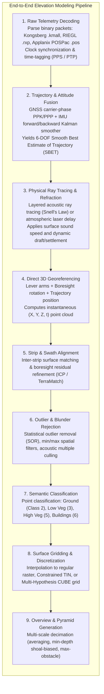

# Chapter 15: Point Clouds, Full Waveforms, Grids, TINs, Variable-Resolution Systems, and Overviews

*How raw sensor measurements are transformed, structured, and discretized into computational surface models.*

Before a digital elevation model can be queried in a GIS, analyzed in a hydraulic model, or rendered in a flight simulator, billions of unstructured physical measurements must undergo a multi-stage computational transformation. The raw outputs of physical sensors are not 3D spatial points; they are digitized voltage waveforms, nanosecond time intervals, and phase differences logged alongside asynchronous navigation telemetry. This chapter explores the mathematical representations, data structures, and spatial algorithms that transform raw sensor telemetry into structured point clouds, triangulated meshes, regular grids, variable-resolution hierarchies, and multi-scale pyramids.

---

## 15.1 From Raw Sensor Telemetry to Structured Products (The Processing Pipeline)

The generation of an elevation or bathymetric model follows an end-to-end processing pipeline that spans hardware signal decoding, kinematic trajectory fusion, physical propagation modeling, spatial cleaning, semantic classification, surface discretization, and multi-scale decimation.



---

### 15.1.1 Stage 1: Raw Telemetry Decoding and Clock Synchronization

Mapping platforms carry multiple independent hardware clocks. In an airborne LiDAR or multibeam survey:
* The GNSS receiver logs satellite carrier phases on GPS time.
* The IMU records gyro rates and accelerations at $200\text{–}1000\text{ Hz}$ on an internal quartz crystal clock.
* The laser scanner or multibeam transceiver logs detector pulses on a local field-programmable gate array (FPGA) timer.

The first stage parses vendor-specific raw binary packets (e.g., Kongsberg `.all`/`.kmall`, RIEGL `.rxp`, Leica `.scn`, Applanix `.pos`). Telemetry decoding aligns all sensor timestamps to a single geodetic time standard (GPS Time or UTC) using hardware **Pulse-Per-Second (PPS)** electrical pulses and **Precision Time Protocol (PTP, IEEE 1588)** or NMEA `$GPZDA` time-stamping. An uncorrected timing offset of just $1\text{ millisecond}$ at an aircraft speed of $75\text{ m/s}$ ($150\text{ knots}$) displaces the resulting point cloud by $7.5\text{ cm}$ along-track.

---

### 15.1.2 Stage 2: Trajectory and Attitude Fusion (The SBET)

Raw navigation data is processed post-mission using loosely coupled or tightly coupled inertial navigation algorithms. Kinematic GNSS carrier-phase processing (PPK or PPP) determines centimeter-level antenna positions. 

A bidirectional (forward and backward) **Extended Kalman Filter (EKF) and Rauch-Tung-Striebel (RTS) smoother** combines the high-frequency inertial angular rates and accelerations with the absolute GNSS positions:
* Computes the 6-Degrees-of-Freedom (6-DOF) **Smooth Best Estimate of Trajectory (SBET)**: position $(X(t), Y(t), Z(t))$ and attitude angles $(\phi(t), \theta(t), \psi(t))$ at $100\text{–}200\text{ Hz}$.
* Generates continuous variance-covariance time series quantifying trajectory position uncertainty ($\sigma_x, \sigma_y, \sigma_z$) and orientation uncertainty ($\sigma_\phi, \sigma_\theta, \sigma_\psi$).

---

### 15.1.3 Stages 3 & 4: Physical Wavefront Propagation and Direct Georeferencing

With the platform trajectory resolved, each individual measurement vector is projected into physical space:
* **Atmospheric / Acoustic / Optical-Water Refraction:** In hydrography, Snell's law ray tracing integrates the sound velocity profile (SVP, $c(d)$) through stratified oceanic layers, calculating circular-arc ray bending, two-way travel times, and dynamic vessel draft/squat relative to the ellipsoid or waterline (Chapters 7 and 10). In airborne topographic LiDAR, atmospheric pressure, temperature, and humidity corrections model the group refractive index of air ($n_g \approx 1.00028$), while bathymetric LiDAR ($532\text{ nm}$, Chapter 9) refracts rays across the tilted air-water wave facet ($n_p \approx 1.3420$, group slowdown $n_{g,w} \approx 1.3643$ in seawater at $15^\circ\text{C}, 35\text{ PSU}$, or $n_p \approx 1.3350, n_{g,w} \approx 1.3568$ in freshwater).
* **Direct Georeferencing Vector Summation:** Following the master convention of this handbook (`notation-and-symbols.md`), the 3D target coordinate $\mathbf{p}_{\text{target}}^l(t)$ in the local topocentric mapping frame $l$ (terrestrial $\text{ENU}$ with elevation $+z$ upward, or marine $\text{NED}$ with depth $+d$ downward) at sensor trigger epoch $t$ is computed via:
  $$\mathbf{p}_{\text{target}}^l(t) = \mathbf{p}_{\text{IMU}}^l(t + \delta t_{\text{lat}}) + \mathbf{R}_b^l\!\big(\phi(t + \delta t_{\text{lat}}), \theta(t + \delta t_{\text{lat}}), \psi(t + \delta t_{\text{lat}})\big) \left[ \mathbf{l}_{\text{lever}}^b + \mathbf{R}_s^b(\delta\phi, \delta\theta, \delta\psi) \, \mathbf{r}_{\text{target}}^s(t) \right]$$
  where $\delta t_{\text{lat}}$ is the residual hardware synchronization latency, $\mathbf{l}_{\text{lever}}^b = [\Delta x_b, \Delta y_b, \Delta z_b]^\top$ is the body-frame lever arm from the IMU reference center to the optical/acoustic center, and $\mathbf{R}_s^b(\delta\phi, \delta\theta, \delta\psi)$ is the calibrated boresight matrix—producing $10^5\text{–}2 \times 10^6$ georeferenced 3D points per second alongside per-point propagated covariance $\mathbf{\Sigma}_{xyz} = \mathbf{J}\,\mathbf{\Sigma}_{\text{params}}\,\mathbf{J}^\top$ (Chapter 14).

---

### 15.1.4 Stages 5 & 6: Strip Alignment and Outlier Rejection

* **Strip/Swath Matching:** Due to thermal flexure, landing shocks, and residual SVP or atmospheric refraction biases, overlapping swaths frequently exhibit decimeter-scale vertical steps or roll tilts at outer beams. Automated strip adjustment algorithms (`TerraMatch`, `BayesMap StripAlign`, or point-to-plane Iterative Closest Point [ICP]) solve for trajectory spline corrections and boresight residuals across overlapping planar facets, cross-lines, and hydrographic patch-test beds (Chapter 13).
* **Outlier Culling:** Gross blunders—clouds, low-flying birds, cooling-tower steam plumes, breaking-wave spray, acoustic second-bounce bottom multiples ($d_{\text{mult}} \approx 2 d_{\text{true}}$), and dense pelagic fish schools—are flagged (never silently deleted from archival point clouds; assigned ASPRS Class 7 Low Noise / Class 18 High Noise or GSF/KMALL reject flags) using $k$-nearest-neighbor Statistical Outlier Removal (SOR), CUBE multi-hypothesis disambiguation, and vertical surface-envelope gates.

---

### 15.1.5 Stages 7, 8 & 9: Semantic Classification, Gridding, and Pyramids

* **Semantic Classification:** Point clouds are segmented into standardized ontology classes (ASPRS LAS 1.4: Class 2 Bare Ground, Classes 3–5 Vegetation, Class 6 Building, Class 9 Water, Class 17 Bridge Deck, Class 40 Bathymetric Bottom, Class 41 Water Surface; Chapter 20). Bare-earth filters (`SMRF`, `CSF`, progressive TIN densification, or 3D point-cloud neural networks; Chapter 21) separate mineral terrain from off-terrain structures while preserving hydrographic designated soundings on wrecks and obstructions.
* **Surface Discretization:** Irregular classified points are discretized into a regular raster (`GeoTIFF`/`COG`), a vector Constrained Delaunay TIN with hard breaklines, or a multi-hypothesis / variable-resolution hydrographic surface (`BAG`, `VR-BAG`, **IHO S-102** Bathymetric Surface; note that both BAG and IHO S-102 store bathymetric elevation as **positive-up** $z = -d < 0$ alongside a mandatory co-registered uncertainty band).
* **Multi-Scale Pyramid Construction:** Hierarchical downsampled overview levels ($2\times, 4\times, 8\times, \dots$) are built using domain-safe kernels (`min` depth / `max` positive-up shoal elevation for navigation, `max` height for aviation obstacles, or uncertainty-weighted mean for geophysics; Section 15.5).

---

### 15.1.6 Data-Volume Transformation and Worked End-to-End Error Budget

| Pipeline Stage | Primary Data Artifact / Format | Typical Volume ($100\text{ km}^2$ Survey) | Dominant Error Introduced if Misconfigured | Open-Source / Commercial Engines |
| :--- | :--- | :--- | :--- | :--- |
| **1–2. Raw Telemetry & SBET** | `.rxp`/`.kmall` + RINEX + `.sbet`/`.smrmsg` | $120\text{–}450\text{ GB}$ (raw binary waveforms/WCI) | $1\text{ ms}$ latency $\to \pm 5\text{–}15\text{ cm}$ pitch washboard ripples | `RTKLIB`, `Kluster` / `POSPac MMS`, `Inertial Explorer` |
| **3–5. Georeferenced Cloud** | `.copc.laz` (LAS 1.4) / `.gsf` / Zarr | $18\text{–}45\text{ GB}$ (lossless LAZ $\sim 5\text{–}7\times$ smaller) | Uncalibrated $0.05^\circ$ roll $\to \pm 6.0\text{ cm}$ at $60^\circ$ in $40\text{ m}$ depth | `PDAL`, `MB-System`, `Kluster` / `RiPROCESS`, `CARIS` |
| **6–7. Classified Point Cloud** | Classified `.copc.laz` + `Extra Bytes` TPU | $18\text{–}45\text{ GB}$ (flags updated non-destructively) | Over-smoothing ridges (Type I) or leaving shrubs/bridges (Type II) | `PDAL` (`smrf`, `csf`), `CloudCompare` / `TerraScan` |
| **8–9. Surface & Overviews** | `Float32` `COG` (`DEFLATE`/`LERC`) or `VR-BAG` / `S-102` | $0.4\text{–}2.5\text{ GB}$ ($+33\%$ for full $2\times$ pyramid) | Half-pixel `Area`/`Point` shift; `average` pyramid erasing shoals | `GDAL`, `GMT`, `CGAL` / `Qimera`, `CARIS`, `ArcGIS Pro` |

#### Worked Numerical Example: End-to-End Coastal Multibeam ERS Pipeline Budget
Consider a hydrographic survey vessel mapping a harbor approach channel of depth $d = 30.0\text{ m}$ at $v = 4.0\text{ m}\cdot\text{s}^{-1}$ ($7.8\text{ knots}$), pitching sinusoidally with amplitude $\theta_0 = 3.0^\circ$ ($0.0524\text{ rad}$) and period $T_p = 5.0\text{ s}$ ($\max|\dot{\theta}| = \frac{2\pi}{T_p}\theta_0 = 0.0658\text{ rad}\cdot\text{s}^{-1}$):
1. **Stage 1 Timing Latency Audit:** Suppose a broken PPS cable leaves an uncompensated IMU-to-sonar clock latency of $\delta t_{\text{lat}} = 25\text{ ms}$ ($0.025\text{ s}$). At nadir ($R = d = 30.0\text{ m}$), pitch angular rate coupled with lever-arm and beam pointing induces an along-track horizontal oscillation $\Delta x = R\,\dot{\theta}\,\delta t_{\text{lat}} = 30.0 \times 0.0658 \times 0.025 = 4.9\text{ cm}$, while on a $15^\circ$ dredged channel bank or at outer swath angle $\beta = 60^\circ$ ($y = d\tan 60^\circ = 51.96\text{ m}$) a matching roll rate $\dot{\phi} = 0.0658\text{ rad}\cdot\text{s}^{-1}$ injects periodic seafloor washboard stripes of vertical amplitude $\Delta d_{\text{lat}} = y\,\dot{\phi}\,\delta t_{\text{lat}} = 51.96 \times 0.0658 \times 0.025 = \mathbf{\pm 8.55\text{ cm}}$ ($17.1\text{ cm}$ peak-to-peak!). Restoring hardware PPS/PTP synchronization ($\delta t_{\text{lat}} < 0.2\text{ ms}$) collapses $\Delta d_{\text{lat}}$ below $0.7\text{ mm}$.
2. **Stages 2–4 Propagated Sounding TVU vs. IHO S-44 Special Order:** With PPS restored, the $1\sigma$ component uncertainties at the $60^\circ$ outer beam ($d = 30.0\text{ m}$) are: PPK/SBET ellipsoidal height $\sigma_{h,\text{SBET}} = 0.025\text{ m}$; dynamic draft/heave residual $\sigma_{\text{heave}} = 0.020\text{ m}$; roll/boresight uncertainty $\sigma_\phi = 0.015^\circ = 2.618 \times 10^{-4}\text{ rad} \implies \sigma_{d,\text{roll}} = d\tan 60^\circ\,\sigma_\phi = 0.0136\text{ m}$; acoustic range & SVP ray-tracing $\sigma_{d,\text{SVP}} = 0.075\text{ m}$; and VDatum `SEP` transformation $\sigma_{\text{SEP}} = 0.050\text{ m}$. Combining independent $1\sigma$ variances in quadrature and scaling to $95\%$ confidence ($1.9600\,\sigma$):
   $$\sigma_{d,\text{total}} = \sqrt{0.025^2 + 0.020^2 + 0.0136^2 + 0.075^2 + 0.050^2} = \sqrt{0.009335} = 0.0966\text{ m} \implies \text{TVU}_{95\%} = 1.9600 \times 0.0966 = \mathbf{0.189\text{ m}}$$
   Comparing against **IHO S-44 (6th ed.) Special Order** at $d = 30.0\text{ m}$ ($\text{TVU}_{\max} = \sqrt{0.25^2 + (0.0075 \times 30.0)^2} = \mathbf{0.336\text{ m}}$) confirms that the outer beam passes Special Order with margin before entering Stage 8 CUBE gridding.

```python
# Open-source end-to-end hydrographic processing pipeline using NOAA HSTB Kluster (fqpr_convenience)
# Stage 1-4: Convert Kongsberg .kmall + POSPac .sbet + .svp -> 3D georeferenced soundings & TPU
# Stage 8: Grid to an Open Navigation Surface Variable-Resolution BAG (VR-BAG)
from HSTB.kluster.fqpr_convenience import perform_all_processing, generate_new_surface

fq = perform_all_processing(
    filname=["0001_20250614_120000_SurveyVessel.kmall"],
    navfiles=["20250614_pospac_sbet.out"],
    errorfiles=["20250614_pospac_smrmsg.out"],
    svfiles=["20250614_casts.svp"],
    outfold="/tmp/survey_fqpr",
    coord_system="NAD83",          # Auto-selects NAD83(2011) UTM zone; ERS vertical reference
    vert_ref="ellipse",            # Ellipsoidally Referenced Surveying (ERS)
)
surf = generate_new_surface(fq, grid_type="variable_resolution_tile", output_path="/tmp/harbor_vr")
surf.export("/tmp/harbor_vr.bag", export_format="bag")
```
