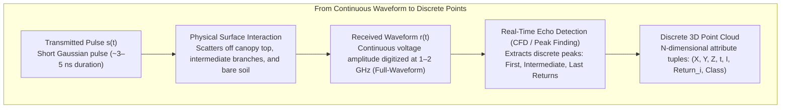
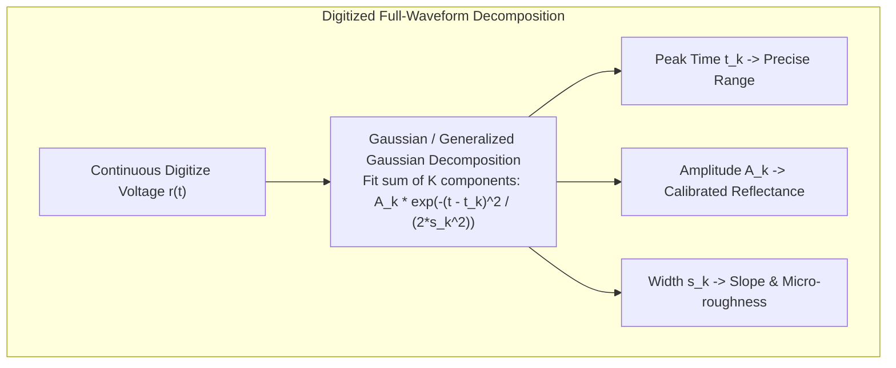
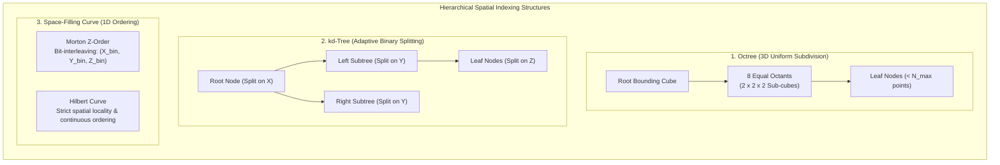

## 15.2 Point Clouds and Full Waveforms: Continuous Signals vs. Discrete Geometry

The fundamental raw spatial data structure generated by optical laser scanners and acoustic mapping systems is the point cloud. However, representing the Earth as discrete coordinates is itself an abstraction. The true physical interaction between an interrogating electromagnetic or acoustic pulse and the natural surface is a continuous time-varying signal: the **full waveform**.



---

### 15.2.1 Discrete Returns vs. Digitized Full Waveforms

#### Discrete Return Systems
In standard commercial LiDAR and multibeam systems, real-time hardware signal processors analyze the returning electrical signal using a **Constant Fraction Discriminator (CFD)** or peak-detection algorithm. When the returned signal amplitude crosses an adaptive threshold, the hardware logs a discrete time-of-flight:
1. **First Return:** The highest physical surface encountered by the pulse footprint (typically the top of the tree canopy or building roof).
2. **Intermediate Returns:** Internal vegetation layers, tree limbs, or suspended power lines.
3. **Last Return:** The deepest physical surface reached by the remaining pulse energy (typically the bare ground or seafloor, provided the canopy is not completely opaque).
4. **Single Return:** A pulse striking a solid, impermeable planar surface (e.g., bare asphalt or open rock) where the entire reflected energy returns in a single discrete echo.

While discrete return logging compresses data volume by orders of magnitude (enabling lightweight real-time storage), it discards critical physical information: pulse broadening caused by ground slope, weak understory echoes below the detection threshold, and surface roughness.

#### Full-Waveform Digitization
Full-waveform LiDAR systems (such as RIEGL LMS-Q series, Teledyne Optech Titan, and NASA's spaceborne GEDI) digitize the continuous backscattered optical power $P_{\text{rx}}(t)$ at ultra-high sampling rates ($1\text{–}2\text{ GHz}$, capturing voltage samples every $0.5\text{–}1.0\text{ ns}$):

$$P_{\text{rx}}(t) = P_{\text{tx}}(t) * \sigma(t) * h_{\text{sys}}(t) + N(t)$$

where $\sigma(t)$ is the vertical cross-section distribution of the target, $h_{\text{sys}}(t)$ is the system impulse response, and $N(t)$ is receiver noise.



By decomposing the continuous waveform post-mission using **non-linear Gaussian mixture fitting** (Wagner et al., 2006), analysts extract:
* **Sub-Canopy and Shallow-Water Ground Detection:** Resolves weak bare-earth returns beneath dense tropical canopy ($< 2\text{–}5\%$ canopy gap fraction) as well as overlapping air-water surface and shallow benthic bottom echoes ($d < 0.30\text{ m}$ "white ribbon") in $532\text{ nm}$ Airborne Lidar Bathymetry (ALB, Chapter 9), where real-time CFD gates merge the two peaks into a single biased echo. Similarly, in multibeam sonar **Water-Column Imaging (WCI)**, digitizing the full acoustic amplitude/phase time series across all beams detects sparse gas seeps, kelp fronds, and thin shipwreck masts missed by bottom-detection trackers.
* **Surface Roughness and Slope:** The echo standard deviation $\sigma_{\text{echo}}$ (in seconds) broadens quadratically with transmitted pulse width $\sigma_{\text{laser}}$, local terrain slope $\alpha$ across the $1\sigma$ spatial footprint radius $\sigma_r$ (where $\sigma_r = R\beta_t / 4 = w_0 / 2$ for full-angle $1/e^2$ divergence $\beta_t$ and $1/e^2$ radius $w_0$, Chapter 9), and within-footprint vertical micro-roughness $\sigma_z$:
  $$\sigma_{\text{echo}}^2 \approx \sigma_{\text{laser}}^2 + \left( \frac{2 \sigma_r \tan\alpha}{c_0} \right)^2 + \left( \frac{2 \sigma_z}{c_0} \right)^2$$
  providing direct physical estimates of sub-footprint roughness $\sigma_z$ once terrain slope $\alpha$ is known.
* **Parametric Ray-Vector Storage (LAS 1.3/1.4 WDP & PulseWaves):** Rather than storing only discrete points, full-waveform containers (`LAS 1.4` Point Data Record Formats 4, 5, 9, and 10 with Waveform Data Packets [WDP], or the open `PulseWaves` format) store an anchor coordinate $\mathbf{X}_0 = [X_0, Y_0, Z_0]^\top$, a 3D propagation direction vector $\mathbf{v}_{\text{ray}} = [dx, dy, dz]^\top$ ($\text{m}\cdot\text{ns}^{-1}$, with $\|\mathbf{v}_{\text{ray}}\| = c_0 / (2 n_g) \approx 0.14985\text{ m}\cdot\text{ns}^{-1}$ in air and $\approx 0.10987\text{ m}\cdot\text{ns}^{-1}$ at seawater group index $n_g = 1.3643$ after Snell refraction in water), sample interval $\Delta\tau$ (typically $1.0\text{ ns}$), and digitized sample array $w[0 \dots K-1]$ so any sample $k$ maps to $\mathbf{X}(\tau_k) = \mathbf{X}_0 + (k\,\Delta\tau)\,\mathbf{v}_{\text{ray}}$.

---

### 15.2.2 Point Cloud Attributes, Uncertainty Extra-Bytes, and Data Schemas

Modern elevation point clouds are not simple $(X, Y, Z)$ triplets; they are rich, multi-dimensional relational tuples. **ASPRS LAS 1.4** (Extended Point Data Record Formats 6–10, required by **USGS 3DEP Lidar Base Specification TM 11-B4**) expanded return counters, scan angle precision, and classification codes beyond legacy LAS 1.0–1.3 Formats 0–5, while **Extra Bytes VLRs** (and hydrographic **GSF / Kongsberg `.kmall`** records) attach per-point propagated uncertainty:

| Attribute Name | LAS 1.4 Type (PDRF 6–10) | Physical Meaning and Operational Role in DEM Production |
| :--- | :--- | :--- |
| **$X, Y, Z$** | $3 \times 32\text{-bit}$ Signed Int | Stored as integers; true coordinate $X = X_{\text{int}} \cdot s_x + X_{\text{offset}}$ (e.g., $s_x = 0.001\text{ m}$ gives $\text{mm}$ precision over $\pm 2{,}147\text{ km}$ without `float32` mantissa truncation!). |
| **GPS Time** | 64-bit IEEE `float64` | Adjusted Standard GPS Time ($\text{GPST} - 10^9\text{ s}$); links every point back to the SBET trajectory, SVP cast, and tide stage. |
| **Intensity / Backscatter** | 16-bit Unsigned Int | Radiometrically calibrated optical return amplitude or sonar $\text{dB}$ backscatter; separates wet vs. dry soil, asphalt, and substrate type. |
| **Return Number / Total ($n, N$)** | $2 \times 4\text{-bit}$ Unsigned Int | Echo index $1 \le n \le 15$ (expanded from 3-bit $1\text{–}7$ in legacy PDRF 0–5); `n == N` isolates potential sub-canopy last returns. |
| **Scan Angle** | 16-bit Signed Int | Off-nadir angle in $0.006^\circ$ increments ($\pm 30{,}000 = \pm 180^\circ$; upgraded from $1^\circ$ 8-bit `Scan Angle Rank` in PDRF 0–5); flags wide-angle TPU inflation. |
| **Point Source ID** | 16-bit Unsigned Int | Unique flightline or multibeam swath ID; mandatory for inter-strip alignment (`TerraMatch`), cross-line QC, and provenance auditing. |
| **Classification** | 8-bit Unsigned Int ($0\text{–}255$) | Semantic code: `2`=Ground, `3–5`=Veg, `6`=Building, `7/18`=Noise, `9`=Water, `17`=Bridge Deck, `40`=Bathymetric Bottom, `41`=Water Surface. |
| **Per-Point TPU (`THU`, `TVU` / $\mathbf{\Sigma}_{xyz}$)** | `Extra Bytes` VLR (`float32`) / GSF | $95\%$ $\text{THU}$ and $\text{TVU}$ (or $1\sigma$ $\sigma_X, \sigma_Y, \sigma_Z$); required input to CUBE Bayesian gridding and uncertainty-weighted DEMs. |
| **RGB / NIR** | $4 \times 16\text{-bit}$ Unsigned Int | Co-registered multispectral radiance (`PDRF 8/10`) for NDWI water masking and photorealistic 3D meshes. |

---

### 15.2.3 Spatial Indexing: Octrees, kd-Trees, and Space-Filling Curves

A modern airborne LiDAR or mobile mapping project generates between $10^9$ and $10^{11}$ points (hundreds of gigabytes to terabytes). Storing these points in sequential, unstructured arrays makes spatial queries (e.g., "find all ground points within $5\text{ m}$ of coordinate $(X, Y)$") prohibitively slow, requiring full linear scans of $\mathcal{O}(N)$ computational complexity. Efficient spatial access requires hierarchical spatial indexing.



#### 1. Octrees (3D Hierarchical Cubes)
An octree recursively partitions a 3D bounding box into eight equal child cubes (octants). In modern point cloud streaming formats like **Cloud-Optimized Point Clouds (COPC)** and **Entwine Point Tile (EPT)**:
* Each octree node contains a subset of points downsampled to represent the entire spatial extent at that hierarchy level.
* Web viewers (e.g., Potree, Cesium) can stream and render low-resolution octree root nodes instantly over HTTP range requests, fetching finer child nodes only as the user zooms in.

#### 2. kd-Trees ($k$-Dimensional Trees)
A kd-tree is a binary search tree that recursively bisects points along orthogonal axes $(X \to Y \to Z \to X)$ at the median point coordinate. A balanced kd-tree reduces the computational complexity of $k$-nearest-neighbor ($k$-NN) and spherical range queries from $\mathcal{O}(N)$ to **$\mathcal{O}(\log N)$**, making it the optimal structure for normal estimation, surface curvature calculation, and ICP registration.

#### 3. Space-Filling Curves (Morton Z-Order and Hilbert Curves)
Space-filling curves map multi-dimensional coordinates $(X, Y, Z)$ to a single 1D scalar index while preserving spatial locality:
* **Morton Z-Order:** Formed by interleaving the binary bits of the quantized integer coordinates:
  $$\text{Morton}(X, Y) = \sum_{j=0}^{B-1} \left( x_j \cdot 2^{2j} + y_j \cdot 2^{2j+1} \right)$$
* **Hilbert Curve:** A continuous, fractal space-filling curve that eliminates the large spatial jumps present in Morton Z-order, maximizing 1D memory locality.
* By sorting billions of points along a Hilbert or Morton curve and storing them in linear disk blocks, 2D and 3D spatial range queries can be resolved using fast 1D range scans on B-trees (or GeoParquet row groups), enabling serverless cloud-native point cloud analytics.

#### Worked Numerical Example: Spatial Indexing & Lossless Compression of a $10^9$-Point Survey
Suppose a USGS 3DEP QL1 airborne LiDAR campaign ($10\text{ pts}\cdot\text{m}^{-2}$ over $100\text{ km}^2$) produces $N = 10^9$ points in LAS 1.4 Point Data Record Format 6 ($30\text{ bytes/point}$ uncompressed):
1. **Storage & Arithmetic Compression (`LAZ` / `COPC`):** Uncompressed LAS 1.4 requires $10^9 \times 30\text{ B} = \mathbf{30.0\text{ GB}}$. Applying Martin Isenburg's lossless delta-predictor + arithmetic entropy coder (`LASzip` / `COPC`, 50,000-point variable chunks; Isenburg, 2013) exploits strong spatial-temporal correlation along scanlines to achieve a $\sim 6.5:1$ compression ratio ($\approx 4.6\text{ bytes/point}$), shrinking the archive to **$\mathbf{4.62\text{ GB}}$** with *zero* loss of millimeter precision.
2. **Window Query Cost (Unindexed LAS vs. COPC Octree):** Extracting a $200\text{ m} \times 200\text{ m}$ bridge-site window ($4 \times 10^5$ points, $0.04\%$ of the area) from an unindexed `.laz` file requires scanning all $10^9$ points ($4.62\text{ GB}$ read I/O). Organized as a **COPC** clustered octree of depth $D = \lceil \log_2(10{,}000 / 200) \rceil = 6$, an HTTP `Range` client reads the $64\text{ KB}$ root hierarchy VLR plus only the $\sim 6\text{–}9$ intersecting octree chunks ($\approx \mathbf{2.1\text{ MB}}$ total network transfer—a **$2{,}200\times$ I/O reduction**!).

```python
import numpy as np

def encode_morton_3d(x: np.ndarray, y: np.ndarray, z: np.ndarray, mins: np.ndarray, maxs: np.ndarray) -> np.ndarray:
    """Quantize 3D coordinates (X, Y, Z) into 21-bit integers and interleave into 63-bit Morton Z-order keys."""
    scale = (1 << 21) - 1
    qx = np.clip(((x - mins[0]) / (maxs[0] - mins[0]) * scale), 0, scale).astype(np.uint64)
    qy = np.clip(((y - mins[1]) / (maxs[1] - mins[1]) * scale), 0, scale).astype(np.uint64)
    qz = np.clip(((z - mins[2]) / (maxs[2] - mins[2]) * scale), 0, scale).astype(np.uint64)

    def _split_by_3(v: np.ndarray) -> np.ndarray:
        v = v & np.uint64(0x1FFFFF)
        v = (v | (v << np.uint64(32))) & np.uint64(0x1F00000000FFFF)
        v = (v | (v << np.uint64(16))) & np.uint64(0x1F0000FF0000FF)
        v = (v | (v << np.uint64(8)))  & np.uint64(0x100F00F00F00F00F)
        v = (v | (v << np.uint64(4)))  & np.uint64(0x10C30C30C30C30C3)
        v = (v | (v << np.uint64(2)))  & np.uint64(0x1249249249249249)
        return v

    return _split_by_3(qx) | (_split_by_3(qy) << np.uint64(1)) | (_split_by_3(qz) << np.uint64(2))
```
