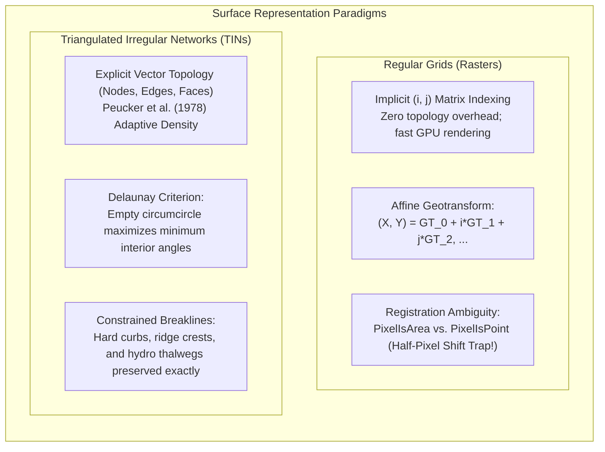
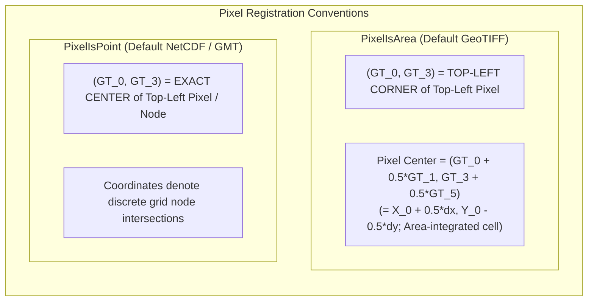
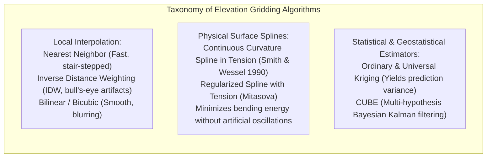
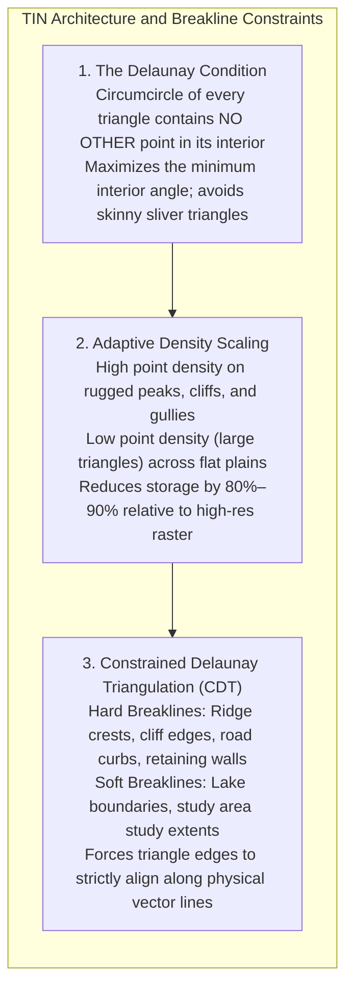

## 15.3 Regular Grids (Rasters) vs. Triangulated Irregular Networks (TINs)

Once an elevation point cloud has been cleaned and classified, it must be discretized into a continuous mathematical surface for terrain modeling, hydrologic simulation, or navigation. The two dominant paradigms for representing continuous 2.5D surfaces are **Regular Rectilinear Grids (Rasters)** and **Triangulated Irregular Networks (TINs)**. Choosing between them involves fundamental trade-offs between computational simplicity and geometric fidelity.



---

### 15.3.1 Regular Grids: Georeferencing and the Half-Pixel Registration Trap

A regular elevation grid structures space into a 2D matrix of $M \times N$ elevation values $Z[i, j]$. 

#### The Affine Geotransform
Spatial coordinates are mapped to matrix indices via the standard 6-parameter affine transformation:

$$\begin{bmatrix} X \\ Y \end{bmatrix} = \begin{bmatrix} \text{GT}_0 \\ \text{GT}_3 \end{bmatrix} + \begin{bmatrix} \text{GT}_1 & \text{GT}_2 \\ \text{GT}_4 & \text{GT}_5 \end{bmatrix} \begin{bmatrix} i \\ j \end{bmatrix}$$

where $\text{GT}_0, \text{GT}_3$ are the origin coordinates, $\text{GT}_1, \text{GT}_5$ are pixel width and height (with $\text{GT}_5 < 0$ for north-up rasters), and $\text{GT}_2, \text{GT}_4$ are rotational shearing terms (typically zero).

#### The Half-Pixel Registration Trap: `PixelIsArea` vs. `PixelIsPoint`
One of the most persistent, multi-meter error sources in geospatial analysis arises from the confusion between two conflicting pixel registration conventions:



* **`PixelIsArea` (Cell / Pixel Registered):** The coordinate $(\text{GT}_0, \text{GT}_3)$ defines the **top-left corner** of the upper-left bounding pixel. The elevation sample value is conceptually centered at $(X + \frac{1}{2}\Delta x, Y - \frac{1}{2}\Delta y)$. This is the default in GeoTIFF and GDAL.
* **`PixelIsPoint` (Grid-Node Registered):** The coordinate $(\text{GT}_0, \text{GT}_3)$ defines the **exact point location** of the top-left data sample. This is the default convention in GMT (Generic Mapping Tools) and many NetCDF climate/elevation models.

#### The Fatal Operational Trap
If an analyst converts a GeoTIFF (`PixelIsArea`) into a NetCDF grid (`PixelIsPoint`) without explicitly declaring or shifting the origin, the raster software misinterprets the bounding corner as the grid node center. 
* This silently shifts the entire digital elevation model horizontally by **exactly half a pixel** along both axes:
  $$\Delta X = +\frac{1}{2}\text{GSD}, \quad \Delta Y = -\frac{1}{2}\text{GSD}$$
* On a $30\text{-m}$ global DEM (e.g., SRTM or Copernicus GLO-30, noting that SRTM HGT/GeoTIFF tiles are `PixelIsPoint` at $1''$ corners whereas standard orthophoto/UTM GeoTIFFs default to `PixelIsArea`!), this induces an undocumented diagonal horizontal shift of $\|\Delta\mathbf{x}\|_2 = \sqrt{15^2 + (-15)^2} = \mathbf{21.21\text{ m}}$ toward the southeast ($135^\circ$ azimuth).
* **Worked Slope-Coupled Vertical Error Check:** On an alpine or submarine canyon wall sloping at $\alpha = 30^\circ$ facing southeast ($\psi_{\text{aspect}} = 135^\circ$, so $\nabla z$ points upslope toward $315^\circ$), first-order Taylor expansion gives an apparent vertical DEM bias of:
  $$\Delta z_{\text{shift}} \approx -\nabla z \cdot \Delta\mathbf{x} = \pm \|\nabla z\|_2 \|\Delta\mathbf{x}\|_2 = \pm \tan(30^\circ) \times 21.213\text{ m} = \mathbf{\pm 12.25\text{ m}}!$$
  To audit and convert registration metadata losslessly without resampling pixel values, always inspect `AREA_OR_POINT` via `gdalinfo` and use `gmt grdedit -T` (to toggle GMT gridline vs. pixel registration) or update the GeoTIFF affine origin explicitly when translating between node-registered (`PixelIsPoint`) and cell-registered (`PixelIsArea`) conventions:

```bash
# Inspect GeoTIFF registration tag (AREA_OR_POINT=Area vs. AREA_OR_POINT=Point) and origin
gdalinfo -json input_dem.tif | grep -E "AREA_OR_POINT|geoTransform"

# Convert GMT gridline/node registration (-r0) <-> pixel/area registration (-r1) properly
gmt grdedit node_registered_bathy.nc -T -Gpixel_area_registered_bathy.nc
```

---

### 15.3.2 Gridding and Spatial Interpolation Algorithms

Transforming irregular point clouds into regular rasters requires spatial interpolation. The mathematical formulation of the interpolation algorithm dictates the physical realism of the surface:



| Gridding Algorithm | Mathematical Formulation | Primary Advantages | Severe Artifacts / Failure Modes |
| :--- | :--- | :--- | :--- |
| **Nearest Neighbor** | $z(\mathbf{x}) = z(\mathbf{x}_k)$ where $\|\mathbf{x} - \mathbf{x}_k\| = \min$ | Ultra-fast; preserves original measured values without smoothing. | Discontinuous, blocky Voronoi facets; jagged contours and false slope steps. |
| **Inverse Distance Weighting (IDW)** | $z(\mathbf{x}) = \frac{\sum w_i z_i}{\sum w_i}, \quad w_i = d_i^{-p}$ | Computationally simple; bounded within $[\min(z_i), \max(z_i)]$. | Creates artificial circular "bull's-eyes" around data points; cannot extrapolate trends. |
| **Natural Neighbor (Sibson)** | $z(\mathbf{x}) = \sum \frac{\text{Area}(\text{overlap}_i)}{\text{Total Area}} z_i$ | Local Voronoi area weighting; smooth $C^1$ continuity; no user tuning parameters. | Computationally intensive; slow on massive point clouds $>10^8$ points. |
| **Spline in Tension (GMT `surface`)** | $(1 - T)L_c^2\nabla^4 z - T \nabla^2 z = 0$ ($L_c = \Delta x$) | Physical elastic plate + membrane; smooth $C^2$ surface over sparse tracks. | Exact data-passing spline overshoots near steep cliffs if tension $T \approx 0$ or un-blockmedianed. |
| **Regularized Spline w/ Tension (RST, GRASS `v.surf.rst`)** | $\min \sum_i (z_i - z(\mathbf{x}_i))^2 + w_0 I_{\text{smooth}}[z; \varphi_t]$ | Smoothing parameter $w_0$ filters measurement noise; analytic slope/curvatures on the fly (Mitasova et al., 2005). | Sensitive to cross-validation tuning of tension $\varphi_t$ and smoothing $w_0$ across heterogeneous density. |
| **Ordinary / Universal Kriging** | $\hat{z}(\mathbf{x}_0) = \sum \lambda_i z_i$; $\sigma_{\text{OK}}^2 = C(\mathbf{0}) - \mathbf{c}_0^\top\mathbf{C}^{-1}\mathbf{c}_0 + \mu$ | Best Linear Unbiased Predictor (BLUP); outputs exact spatial interpolation variance $\sigma_{\text{OK}}^2(\mathbf{x}_0)$ (and Co-Kriging fuses auxiliary depth/gravity). | Requires valid positive-definite variogram model; global inversion $\mathcal{O}(N^3)$ requires local moving neighborhoods. |
| **CUBE (Calder & Mayer 2003)** | Recursive Bayesian Kalman filter tracking competing depth hypotheses | Specifically engineered for hydrography; isolates true seabed from acoustic multiples, kelp, and fish. | Requires calibrated $1\sigma$ per-sounding THU/TVU inputs; smooths sub-grid boulder tips unless overridden by designated soundings. |

---

### 15.3.3 Triangulated Irregular Networks (TINs) and Constrained Breaklines

First introduced to computerized terrain analysis by Thomas Peucker, R. J. Fowler, J. J. Little, and D. M. Mark in 1978, the **Triangulated Irregular Network (TIN)** represents topography as a contiguous vector mesh of non-overlapping triangular facets.



#### The Delaunay Triangulation Condition
A triangulation of point set $P$ in $\mathbb{R}^2$ is Delaunay if the circumcircle of any triangle $T(p_i, p_j, p_k)$ contains no other point of $P$ in its interior:

$$\operatorname{Interior}(\operatorname{Circumcircle}(p_i, p_j, p_k)) \cap P = \emptyset \quad \Longleftrightarrow \quad \det\begin{bmatrix} x_i - x_q & y_i - y_q & (x_i - x_q)^2 + (y_i - y_q)^2 \\ x_j - x_q & y_j - y_q & (x_j - x_q)^2 + (y_j - y_q)^2 \\ x_k - x_q & y_k - y_q & (x_k - x_q)^2 + (y_k - y_q)^2 \end{bmatrix} \le 0$$

for every counter-clockwise oriented triangle $(p_i, p_j, p_k)$ and every test vertex $p_q \notin \{p_i, p_j, p_k\}$. The Delaunay criterion guarantees:
1. The triangulation is unique (assuming non-degenerate point sets where no four points are strictly co-circular).
2. Among all possible triangulations of $P$, it **maximizes the minimum interior angle**, suppressing thin needle-like "sliver" triangles whose ill-conditioned barycentric gradients amplify vertical measurement noise $\sigma_z$ into extreme slope spikes.

#### Constrained Breaklines and the Contour "Flat-Triangle" Pathology
In regular rasters, linear features like road curbs ($15\text{ cm}$ vertical step), retaining walls, and stream channels (thalwegs) are blurred across grid cells unless the entire raster is oversampled at sub-decimeter resolution. Conversely, when building an unconstrained Delaunay TIN from **digitized topographic or nautical depth contours**, triangles frequently connect three vertices lying on the *same* contour loop ($z_i = z_j = z_k = c_m$) across valley bends or ridge noses, creating horizontal $\nabla z = \mathbf{0}$ **"wedding-cake" flat triangles**!

A **Constrained Delaunay Triangulation (CDT)** solves both problems by enforcing vector breaklines:
* **Hard Breaklines:** 3D vector polylines representing abrupt slope discontinuities or skeletal drainage/ridge axes (thalwegs, ridge crests, pavement curbs, fault scarps, seawalls). Triangle edges are mathematically forced to coincide with the breakline segments via constrained edge-flipping, overriding the empty-circumcircle rule across the breakline so linear facet interpolation never bridges across a channel or rounds off a vertical wall.
* **Soft Breaklines:** Enforce planar boundary or seamline geometry (e.g., survey extent polygons or hydro-flattened lake shorelines) without introducing artificial slope breaks across continuous terrain.
