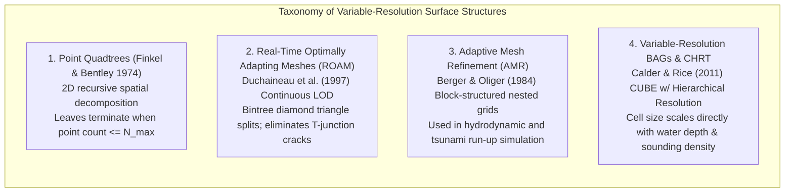
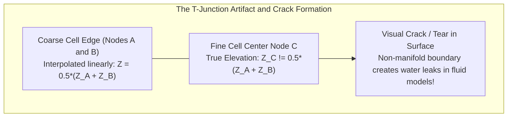
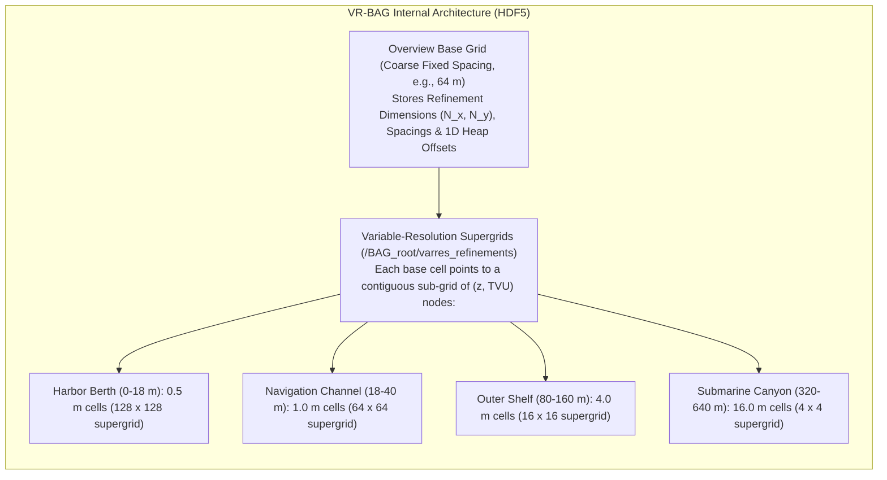

## 15.4 Variable-Resolution Systems and Multi-Resolution Hierarchies

A single survey project often spans radical variations in physical scale: a coastal survey vessel maps a shallow commercial harbor berth at $0.5\text{-meter}$ point spacing, navigates a shipping channel at $2\text{-meter}$ resolution, and surveys the outer continental shelf at depths of $1000\text{ m}$ where acoustic footprint spreading limits true spatial resolution to $30\text{–}50\text{ m}$. 

Forcing this dataset into a single, uniform regular raster forces a false, unacceptable compromise:
1. **The Oversampling Trap:** If the entire survey is gridded at $0.5\text{ m}$ to preserve harbor detail, the deep offshore areas are bloated by massive, redundant arrays of interpolated cells containing zero new information. File sizes explode from megabytes to hundreds of gigabytes.
2. **The Undersampling Trap:** If the survey is gridded at $30\text{ m}$ to match offshore depth, critical navigation hazards, harbor pilings, and shallow shoals are averaged into oblivion.

Variable-resolution data structures solve this dilemma by allowing spatial cell dimensions to adapt dynamically to local data density, terrain curvature, and physical sensor physics.



---

### 15.4.1 Quadtrees and Continuous Level-of-Detail (ROAM)

#### Point and Region Quadtrees
First formalized by Raphael Finkel and Jon Bentley in 1974, the **quadtree** is a hierarchical tree data structure in which every internal node has exactly four children: North-West (NW), North-East (NE), South-West (SW), and South-East (SE). 

In terrain modeling:
* Space is recursively subdivided into quadrants until each leaf node satisfies a termination threshold: either containing fewer than a threshold number of points ($N \le N_{\max}$), or exhibiting elevation variance below a target error tolerance ($\sigma_z^2 \le \epsilon^2$).
* Flat alluvial plains remain undivided as large root quadrants, while complex ravines and rocky coastlines are subdivided into deep, fine leaf nodes.

#### The "T-Junction" Crack Problem and ROAM
When rendering or modeling quadtree-based variable-resolution meshes, an adjacent fine quadtree cell sharing a boundary with a coarse quadtree cell creates a **T-junction** (where a vertex in the fine mesh lies along the continuous edge of a coarse triangle):



To eliminate T-junction tears without manual stitching, Mark Duchaineau et al. (1997) developed **ROAM (Real-Time Optimally Adapting Meshes)**:
* Uses binary triangle trees (bintrees) that split right-angled isosceles triangles along their hypotenuse.
* By enforcing a strict rule that no triangle may be split unless its neighbor across the hypotenuse is split simultaneously (forming a "diamond"), ROAM mathematically guarantees **crack-free, continuous $C^0$ surface topology** across arbitrary level-of-detail (LOD) transitions, prioritizing splits using nested world-space **wedgie** error bounds $e_{\text{tri}}$ projected into screen-space pixel error.

---

### 15.4.2 Block-Structured Adaptive Mesh Refinement (AMR) in Hydrodynamic Modeling

Whereas quadtrees and ROAM optimize static terrain storage and rendering, **Block-Structured Adaptive Mesh Refinement (AMR)**—pioneered by Marsha Berger and Joseph Oliger (1984) for hyperbolic partial differential equations—dynamically refines and coarsens nested rectilinear elevation/flow patches $\Omega_{\ell, k}$ (refinement ratio $r = \Delta x_{\ell-1} / \Delta x_\ell \in \{2, 4, 6\}$) in both *space and time* during tsunami propagation, dam-breach, and storm-surge simulations (`GeoClaw`, `Basilisk`):

1. **Dynamic Feature Tracking & Bathymetric Sampling:** Across the deep abyssal Pacific ($d \approx 4{,}000\text{ m}$), a tsunami wave has a wavelength $\lambda \approx 200\text{ km}$ and requires only a coarse Level-0 grid ($\Delta x_0 \approx 4\text{ arcmin} \approx 7.4\text{ km}$). As the leading wave crest shoals onto a continental shelf and enters a coastal harbor, AMR automatically spawns nested child patches down to $\Delta x_4 \approx 1\text{–}10\text{ m}$, sampling the underlying high-resolution coastal TBDEM (`CUDEM` / `VR-BAG`) on demand via area-conservative integral averages so wet/dry shoreline geometry is never aliased.
2. **CFL Sub-Cycling and Conservative Flux Fixing:** Explicit finite-volume shallow-water solvers are constrained by the **Courant–Friedrichs–Lewy (CFL)** stability condition:
   $$\text{CFL} = \frac{\Delta t_\ell}{\Delta x_\ell}\left(\|\mathbf{u}\|_2 + \sqrt{g h}\right) \le 1$$
   Because AMR refines *both* grid spacing ($\Delta x_\ell = \Delta x_{\ell-1} / r$) and time step ($\Delta t_\ell = \Delta t_{\ell-1} / r$) solely inside active coastal/wavefront patches—and applies conservative **Berger–Colella refluxing** along coarse–fine patch boundaries so total water mass $\iint h\,dx\,dy$ is conserved to machine precision—AMR achieves $10^2\text{–}10^4\times$ speedups over uniform $1\text{ m}$ trans-oceanic grids.

---

### 15.4.3 Variable-Resolution Bathymetric Attributed Grids (VR-BAG) and CHRT

In modern hydrographic production, the Open Navigation Surface (ONS) consortium standardized the **Variable-Resolution Bathymetric Attributed Grid (VR-BAG)** format (BAG v1.5+), powered by the **CHRT (CUBE with Hierarchical Resolution Techniques)** algorithm developed by Brian Calder and Glen Rice (2011).



#### How CHRT Adapts Cell Size to Acoustic Physics and NOAA HSSD Standards
The CHRT engine computes optimal supergrid spacing dynamically from local multibeam sounding geometry and **NOAA HSSD Complete Coverage** depth-band specifications:
1. **Beam-Footprint & Depth Scaling:** An across-track multibeam receive beam of width $\psi_{\text{rx}}$ at depth $d$ and off-nadir angle $\theta$ projects a seabed footprint of width $W_{\text{fp}} = \frac{d\,\psi_{\text{rx}}}{\cos^2\theta}$. For a $1^\circ$ ($0.01745\text{ rad}$) sonar at $d = 500\text{ m}$ and $\theta = 45^\circ$, $W_{\text{fp}} \approx 17.5\text{ m}$—gridding at $0.5\text{ m}$ creates $99.9\%$ empty cells! Under NOAA HSSD Complete Coverage rules, required resolution scales systematically with positive-down water depth $d$: $0.5\text{ m}$ ($0\text{–}18\text{ m}$), $1.0\text{ m}$ ($18\text{–}40\text{ m}$), $2.0\text{ m}$ ($40\text{–}80\text{ m}$), $4.0\text{ m}$ ($80\text{–}160\text{ m}$), $8.0\text{ m}$ ($160\text{–}320\text{ m}$), and $16.0\text{ m}$ ($320\text{–}640\text{ m}$).
2. **Density-Driven CHRT Refinement:** Rather than relying on depth alone, CHRT conducts a coarse pre-pass to measure local sounding density $\rho_{\text{pts}}$ ($\text{soundings}\cdot\text{m}^{-2}$). Requiring at least $N_{\min}$ independent soundings (typically $N_{\min} = 5\text{–}11$) within each node's capture radius to guarantee statistical stability of the CUBE Kalman filter, CHRT sets the local refinement spacing to:
   $$\Delta x_{\text{CHRT}}(x, y) = \operatorname{clip}\!\left(\sqrt{\frac{N_{\min}}{\rho_{\text{pts}}(x, y)}},\; \Delta x_{\min},\; \Delta x_{\max}\right)$$
   If an AUV or low-pass wreck investigation collects ultra-dense soundings over a submerged wreck at $d = 250\text{ m}$ depth, CHRT automatically refines that specific $64\text{ m}$ base cell to $0.5\text{ m}$ while leaving surrounding abyssal mud at $8\text{–}16\text{ m}$!
3. **HDF5 Supergrid Layout (`varres_metadata` & `varres_refinements`):** Inside the VR-BAG HDF5 container, `/BAG_root/varres_metadata` stores per-base-cell refinement dimensions $(N_{x,c}, N_{y,c})$, spacings $(\delta x_c, \delta y_c)$, southwest corner offsets, and a 1D index pointer into `/BAG_root/varres_refinements`, which packs all `(elevation, uncertainty)` pairs contiguously with zero wasted padding (storing positive-up elevation $z = -d < 0$ and $95\%$ $\text{TVU}$).

#### Worked Numerical Comparison: Uniform $0.5\text{ m}$ Grid vs. VR-BAG Over a $400\text{ km}^2$ Shelf-Canyon Survey
Consider a $20\text{ km} \times 20\text{ km}$ ($400\text{ km}^2$) coastal-to-canyon hydrographic survey partitioned into four depth zones: $5\%$ shallow harbor ($0\text{–}18\text{ m}$ at $0.5\text{ m}$ spacing: $20\text{ km}^2$), $15\%$ inner shelf ($18\text{–}40\text{ m}$ at $1.0\text{ m}$: $60\text{ km}^2$), $30\%$ mid-shelf ($40\text{–}80\text{ m}$ at $2.0\text{ m}$: $120\text{ km}^2$), and $50\%$ submarine canyon ($160\text{–}320\text{ m}$ at $8.0\text{ m}$: $200\text{ km}^2$), storing two `float32` bands (`elevation` + `uncertainty` = $8\text{ bytes/node}$):
* **Uniform $0.5\text{ m}$ Raster:** $N_{\text{uniform}} = \frac{400 \times 10^6\text{ m}^2}{(0.5\text{ m})^2} = \mathbf{1.60 \times 10^9\text{ nodes}}$ ($\mathbf{12.80\text{ GB}}$ uncompressed), of which $> 91\%$ of offshore nodes contain *zero* acoustic hits and must either remain `NoData` swiss-cheese holes or be hallucinated via interpolation!
* **CHRT VR-BAG:** Summing true physics-resolved supergrid nodes across the four zones gives $N_{\text{VR}} = \frac{20\times 10^6}{0.25} + \frac{60\times 10^6}{1.0} + \frac{120\times 10^6}{4.0} + \frac{200\times 10^6}{64.0} = (80.0 + 60.0 + 30.0 + 3.125) \times 10^6 = \mathbf{1.731 \times 10^8\text{ nodes}}$ ($\mathbf{1.38\text{ GB}}$ uncompressed, $\approx \mathbf{380\text{ MB}}$ with HDF5 `DEFLATE` compression)—achieving a **$9.2\times$ node reduction** while preserving $100\%$ of $0.5\text{ m}$ harbor shoal detail and zero offshore void hallucination!

```bash
# Inspect all variable-resolution supergrids inside an ONS VR-BAG using GDAL's BAG driver
gdalinfo -oo MODE=LIST_SUPERGRIDS survey_H13500_VR.bag

# Flatten VR-BAG to a 2.0 m shoal-biased GeoTIFF WITHOUT synthetic gap interpolation
# Note: BAG elevations are positive-up (z < 0 underwater), so VALUE_POPULATION=MAX selects the shoalest depth!
gdal_translate survey_H13500_VR.bag survey_H13500_2m_shoal.tif \
    -oo MODE=RESAMPLED_GRID -oo RESX=2.0 -oo RESY=2.0 -oo VALUE_POPULATION=MAX \
    -co TILED=YES -co COMPRESS=DEFLATE -co PREDICTOR=3
```

```python
# Worked Python Verification: CHRT Variable-Resolution Cell Sizing & Storage Reduction
import numpy as np


def compute_chrt_vr_spacing(
    depth_m: np.ndarray,
    sounding_density_m2: np.ndarray,
    n_min: int = 7,
    dx_min: float = 0.5,
    dx_max: float = 16.0,
) -> np.ndarray:
  """Computes CHRT supergrid node spacing (m) from sounding density and NOAA HSSD depth bands."""
  # Density-driven CHRT spacing ensuring >= n_min soundings per node
  dx_density = np.sqrt(n_min / np.maximum(sounding_density_m2, 1e-6))
  # NOAA HSSD Complete Coverage depth-band resolution floor
  dx_hssd = np.select(
      [depth_m <= 18, depth_m <= 40, depth_m <= 80, depth_m <= 160, depth_m <= 320],
      [0.5, 1.0, 2.0, 4.0, 8.0],
      default=16.0,
  )
  return np.clip(np.maximum(dx_density, dx_hssd), dx_min, dx_max)
```
