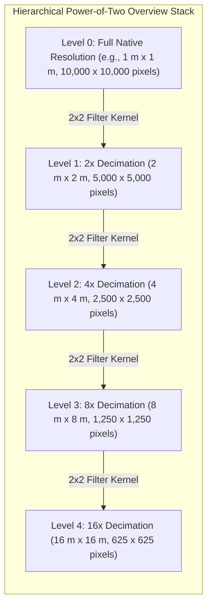
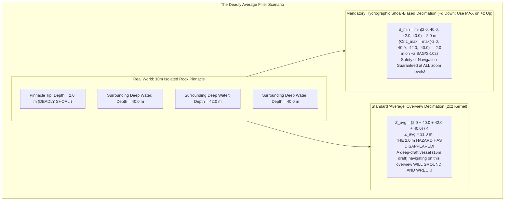
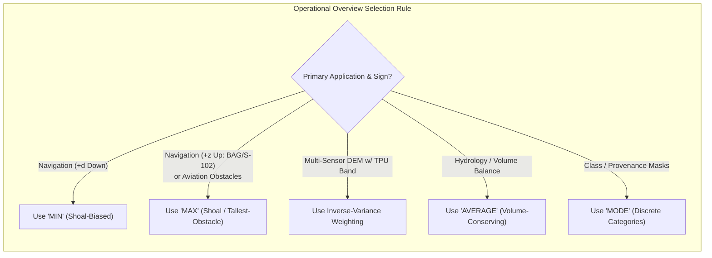

## 15.5 Overviews (Pyramids) and Multi-Scale Decimation: The Life-or-Death Decimation Trap

Digital elevation rasters frequently exceed dozens of gigabytes in size, containing hundreds of millions or billions of pixels. To enable fluid, interactive pan-and-zoom in web viewers, GIS software, and navigation systems, rasters are pre-computed with a hierarchical stack of downsampled overview images—commonly known as **pyramids** (or internal overviews in Cloud-Optimized GeoTIFFs [COGs]).

However, the mathematical decimation algorithm used to downsample a high-resolution grid into its overview hierarchy is not a trivial display choice: in safety-critical domains (maritime navigation, commercial aviation, and flood engineering), selecting the wrong decimation kernel can be fatal.



---

### 15.5.1 The Decimation Trap: Why Average Downsampling Kills Ships and Planes

By far the most common default resampling kernel in GIS software (including standard GDAL `gdaladdo` commands) is the **arithmetic average** (or bilinear/cubic filtering):

$$Z_{\text{parent}} = \frac{1}{4} \sum_{i=1}^2 \sum_{j=1}^2 Z_{\text{child}}[i, j]$$

While averaging produces visually smooth, aesthetically pleasing overviews for cartographic presentation, it acts as a low-pass spatial filter that completely extinguishes sharp, localized topographic extrema:



#### The Maritime Grounding Disaster
Consider a dangerous, isolated granite pinnacle rising to within $d = 2.0\text{ m}$ of the sea surface ($z = -2.0\text{ m}$) in a coastal shipping fairway where the surrounding seafloor depth is $d = 40.0\text{ m}$ ($z = -40.0\text{ m}$). In a $1\text{-meter}$ native bathymetric model, the pinnacle occupies a single cell surrounded by deep soundings.
* When downsampled to Level 1 ($2\times 2$ kernel) using an **Average** filter, the cell depth becomes:
  $$d_{\text{avg}} = \frac{2.0 + 40.0 + 42.0 + 40.0}{4} = 31.0\text{ m} \quad \left(z_{\text{avg}} = -31.0\text{ m}\right)$$
* When downsampled to Level 2 ($4\times 4$ kernel), the pinnacle's signature is diluted across 16 cells:
  $$d_{\text{avg}} \approx \frac{2.0 + 15 \times 40.0}{16} = 37.6\text{ m} \quad \left(z_{\text{avg}} \approx -37.6\text{ m}\right)$$
* In the zoomed-out overview display, the $2.0\text{-m}$ pinnacle has completely vanished! A commercial tanker with a $14\text{-meter}$ under-keel draft navigating on the overview display sees a seemingly safe $37\text{-meter}$ channel, proceeds forward, and tears its hull open on the rock. Conversely, shoal-biased decimation (`min` on $+d$ depth rasters, or `max` on $+z$ positive-up `BAG`/`IHO S-102` rasters) preserves $d_{\text{min}} = 2.0\text{ m}$ ($z_{\text{max}} = -2.0\text{ m}$) at every zoom level.

#### The Aviation Obstacle Collision
The identical catastrophe occurs in aviation terrain models (e.g., FAA Digital Terrain Elevation Data [DTED] or helicopter emergency flight systems):
* A $300\text{-meter}$ communications tower or narrow volcanic knife-ridge rising above a flat valley floor is averaged out in higher overview pyramids.
* Terrain-avoidance flight guidance computers relying on an average-downsampled DEM will route aircraft directly into the unrepresented spire.

---

### 15.5.2 Purpose-Built Decimation Kernels and the Vertical Sign-Convention Trap

> [!CAUTION]
> **The Positive-Down Depth ($+d$) vs. Positive-Up Elevation ($+z$) Overview Sign Trap**
> Before running `gdaladdo` on any bathymetric raster, **verify the vertical sign convention** (`notation-and-symbols.md`):
> * **Positive-Down Depth Rasters ($d > 0$ underwater, legacy hydrographic grids):** A $2.0\text{ m}$ pinnacle has $d = +2.0\text{ m}$ while $40.0\text{ m}$ deep water has $d = +40.0\text{ m}$. **Shoal-biased** decimation requires **`min`** ($\min(+2.0, +40.0) = +2.0\text{ m}$).
> * **Positive-Up Elevation Rasters ($z < 0$ underwater — mandatory in `BAG`, `IHO S-102`, `NOAA CUDEM`, and `GEBCO`):** The $2.0\text{ m}$ pinnacle has $z = -2.0\text{ m}$ while $40.0\text{ m}$ deep water has $z = -40.0\text{ m}$! Running `gdaladdo -r min` computes $\min(-2.0, -40.0) = -40.0\text{ m}$—**erasing the shoal and replacing it with the deepest abyss!** On positive-up bathymetry and seamless topo-bathy DEMs, **shoal-biased decimation requires `max`** ($\max(-2.0, -40.0) = -2.0\text{ m}$)!

To prevent catastrophic loss of critical topographic features, geospatial engineers must select decimation algorithms aligned with both operational intent and vertical sign convention:

| Overview Kernel | Mathematical Rule ($m \times m$ Block) | Operational Domain & Sign Convention | Critical Safety / Statistical Justification |
| :--- | :--- | :--- | :--- |
| **Shoal-Biased (`min` on $+d$, `max` on $+z$)** | $d_{\text{out}} = \min_k d_k$ or $z_{\text{out}} = \max_k z_k$ | **Marine Hydrography / Nautical Charting (`S-102`, `BAG`)** | Guarantees the shallowest navigation hazard survives across every zoom level. |
| **Tallest-Obstacle (`max` on $+z$)** | $z_{\text{out}} = \max_k z_k$ | **Aviation (`DTED`, `EGPWS`) & Powerline Corridors** | Guarantees radio masts, wires, and knife-ridges are never smoothed downward. |
| **Uncertainty-Weighted (`inv-var`)** | $z_{\text{out}} = \frac{\sum_k z_k / \sigma_k^2}{\sum_k 1 / \sigma_k^2}$ | **Multi-Sensor Composite DEMs (`BAG`, `CUDEM`)** | Suppresses noisy outer-beam or interpolated cells in favor of low-TVU soundings. |
| **Arithmetic Mean (`average`)** | $z_{\text{out}} = \frac{1}{M} \sum_{k=1}^M z_k$ | **Earthwork Cut-and-Fill & Watershed Mass Balance** | Unbiased linear operator: preserves regional volume integral $\iint z\,dA$. |
| **Majority Vote (`mode`)** | $c_{\text{out}} = \operatorname{argmax}_c \sum_k \mathbb{I}(c_k = c)$ | **Semantic Classification & Provenance (`TID`) Masks** | Prevents invalid fractional class IDs (e.g., averaging Class 2 Ground and Class 6 Building into Class 4 Medium Vegetation!). |

---

### 15.5.3 Uncertainty-Weighted Overview Pyramids and Spatial Autocorrelation

When a DEM carries a co-registered $1\sigma$ vertical uncertainty band $\sigma_z(i, j)$ (such as `BAG`, `IHO S-102`, or multi-sensor `CUDEM` mosaics fusing $\sigma_z = 0.08\text{ m}$ multibeam with $\sigma_z = 1.50\text{ m}$ satellite-derived bathymetry along cell boundaries), unweighted `average` decimation gives noisy interpolated pixels equal weight to survey-grade soundings. Instead, **inverse-variance uncertainty-weighted decimation** computes the minimum-variance Best Linear Unbiased Estimate (BLUE) over the $M = m^2$ valid child cells in each parent block:

$$z_{\text{parent}} = \frac{\sum_{k=1}^{M} w_k z_k}{\sum_{k=1}^{M} w_k}, \qquad w_k = \frac{1}{\sigma_k^2}$$

Propagating the child covariance matrix $\mathbf{\Sigma}_{\text{block}}$ ($[\mathbf{\Sigma}_{\text{block}}]_{k\ell} = \rho_{k\ell}\sigma_k\sigma_\ell$, where $\rho_{k\ell} \in [0, 1]$ is the spatial error correlation between child cells $k$ and $\ell$) with normalized weights $\tilde{w}_k = w_k / \sum_j w_j$ yields the exact parent vertical variance:

$$\sigma_{\text{parent}}^2 = \sum_{k=1}^{M} \sum_{\ell=1}^{M} \tilde{w}_k \tilde{w}_\ell \rho_{k\ell} \sigma_k \sigma_\ell \quad \Longrightarrow \quad \begin{cases} \left(\sum_{k=1}^M \sigma_k^{-2}\right)^{-1} & \text{if } \rho_{k\ell} = \delta_{k\ell} \text{ (uncorrelated white noise)} \\[6pt] \left(\sum_{k=1}^M \tilde{w}_k \sigma_k\right)^2 & \text{if } \rho_{k\ell} = 1 \text{ (fully correlated datum/SVP bias)} \end{cases}$$

**Worked Numerical Example:** Suppose a $2 \times 2$ coastal transition block ($M = 4$) contains three multibeam cells ($z_1 = -10.10\text{ m}, z_2 = -10.20\text{ m}, z_3 = -10.15\text{ m}$, each with $\sigma_k = 0.10\text{ m} \implies w_k = 100\text{ m}^{-2}$) and one turbid SDB edge cell with a sediment-plume artifact ($z_4 = -6.50\text{ m}$ with $\sigma_4 = 1.50\text{ m} \implies w_4 = 0.444\text{ m}^{-2}$):
* **Naive `average` Pyramid:** $z_{\text{avg}} = (-10.10 - 10.20 - 10.15 - 6.50)/4 = \mathbf{-9.238\text{ m}}$—corrupting the parent cell by **$+0.91\text{ m}$**!
* **Uncertainty-Weighted Pyramid:** With $\sum w_k = 300.444\text{ m}^{-2}$, the noisy SDB cell receives only $0.444 / 300.444 = 0.15\%$ weight, yielding $z_{\text{parent}} = \mathbf{-10.145\text{ m}}$. Decomposing $\sigma_k^2 = \sigma_{\text{rand},k}^2 + \sigma_{\text{sys}}^2$ with systematic VDatum bias $\sigma_{\text{sys}} = 0.06\text{ m}$ ($\rho = 1$) prevents unrealistic $1/\sqrt{M}$ shrinkage of datum uncertainty across high-level pyramid layers!

---

### 15.5.4 Generating Safe Overviews with GDAL and Python

When building pyramids using GDAL (`gdaladdo`), engineers must match `-r` explicitly to the vertical sign convention and operational domain:

```bash
# 1A. NAUTICAL CHARTING (Positive-Down Depth Raster, d > 0): Force Minimum Depth
gdaladdo -r min -ro bathy_positive_down_depth.tif 2 4 8 16 32 64

# 1B. NAUTICAL CHARTING (Positive-Up Elevation Raster, z < 0, e.g., IHO S-102 / BAG / CUDEM): Force MAX!
gdaladdo -r max -ro bathy_positive_up_elev.tif 2 4 8 16 32 64

# 2. AVIATION & TERRAIN AVOIDANCE (Positive-Up Elevation, z > 0): Force Maximum Elevation
gdaladdo -r max -ro aviation_dted_elevation.tif 2 4 8 16 32 64

# 3. VOLUMETRIC EARTHWORK & WATERSHED MASS BALANCE: Average Pyramids
gdaladdo -r average -ro watershed_dem.tif 2 4 8 16 32 64

# 4. SEMANTIC CLASS & PROVENANCE (TID) RASTERS: Mode (Majority Vote) Pyramids
gdaladdo -r mode -ro classified_surface.tif 2 4 8 16 32 64
```

```python
import numpy as np

def decimate_uncertainty_weighted_2x2(
    z_fine: np.ndarray, sigma_rand: np.ndarray, sigma_sys: np.ndarray
) -> tuple[np.ndarray, np.ndarray]:
    """Downsample 2D (z, sigma) grids by 2x2 using inverse-variance weights while preserving correlated bias."""
    H2, W2 = (z_fine.shape[0] // 2) * 2, (z_fine.shape[1] // 2) * 2
    zb = z_fine[:H2, :W2].reshape(H2 // 2, 2, W2 // 2, 2).transpose(0, 2, 1, 3).reshape(H2 // 2, W2 // 2, 4)
    sr = sigma_rand[:H2, :W2].reshape(H2 // 2, 2, W2 // 2, 2).transpose(0, 2, 1, 3).reshape(H2 // 2, W2 // 2, 4)
    ss = sigma_sys[:H2, :W2].reshape(H2 // 2, 2, W2 // 2, 2).transpose(0, 2, 1, 3).reshape(H2 // 2, W2 // 2, 4)

    w = np.where(np.isfinite(zb), 1.0 / np.maximum(sr ** 2 + ss ** 2, 1e-8), 0.0)
    w_sum = np.sum(w, axis=-1, keepdims=True)
    w_norm = np.divide(w, w_sum, out=np.zeros_like(w), where=w_sum > 0)

    z_coarse = np.where(w_sum[..., 0] > 0, np.sum(w_norm * np.nan_to_num(zb), axis=-1), np.nan)
    var_rand_coarse = np.sum((w_norm ** 2) * np.nan_to_num(sr ** 2), axis=-1)   # Uncorrelated (rho = 0)
    var_sys_coarse = (np.sum(w_norm * np.nan_to_num(ss), axis=-1)) ** 2         # Fully correlated (rho = 1)
    sigma_coarse = np.where(w_sum[..., 0] > 0, np.sqrt(var_rand_coarse + var_sys_coarse), np.nan)
    return z_coarse, sigma_coarse
```


