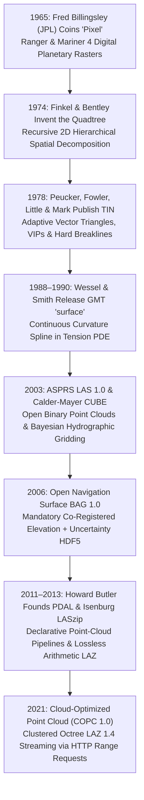
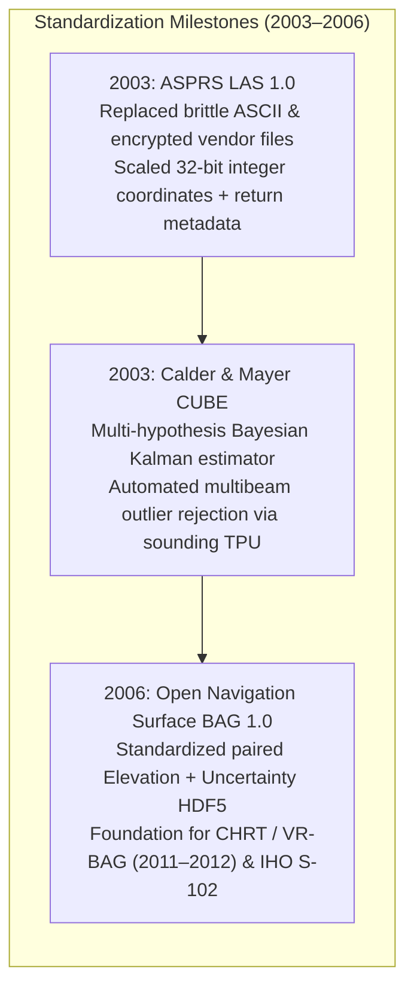

## 15.6 Historical Evolution (`gis-history` Context)

The representation of continuous planetary topography and bathymetry in digital computers spans six decades of algorithmic and data-format innovation. Anchored to milestones curated in [`schwehr/gis-history`](https://github.com/schwehr/gis-history), the evolution of elevation data structures reflects a recurring tension between **regular array hardware efficiency** (rasters), **adaptive geometric fidelity** (quadtrees and TINs), **physical uncertainty propagation** (CUBE and BAG), and **serverless HTTP cloud streaming** (COG and COPC).

---

### 15.6.1 The Discretization of Space: Pixels, Quadtrees, and TINs (1965–1978)

#### 1965: Fred Billingsley and the Birth of the "Pixel" (`gis-history`)
In **1965** (`gis-history` milestone: **1965 Fred Billingsley wrote the word pixel**), **Frederic C. Billingsley** at NASA's Jet Propulsion Laboratory (JPL) Image Processing Laboratory (`VICAR`, Chapter 8) presented *Processing Ranger and Mariner Photography* (SPIE, August 1965; published 1967), describing the digital reconstruction of the $200 \times 200$ 6-bit television frames transmitted from Mars by ***Mariner 4*** and from the Moon by the ***Ranger*** probes. Contracting *picture element* into **"pixel,"** Billingsley formalized the 2D rectilinear matrix of quantized samples as the universal computational primitive for digital imagery and gridded elevation models—simultaneously exposing the ambiguity between cell-area integration (`PixelIsArea`) and point-sample impulses (`PixelIsPoint`) that still haunts raster conversion workflows today.

#### 1974: Finkel and Bentley Invent the Quadtree (`gis-history`)
Uniform pixel matrices quickly exhausted the magnetic-core memories of 1970s minicomputers when storing sparse points or mixed-resolution maps. In **1974** (`gis-history` milestone: **1974 Quad tree invented**), **Raphael A. Finkel** and **Jon Louis Bentley** published *Quad Trees: A Data Structure for Retrieval on Composite Keys* in *Acta Informatica*. By recursively partitioning 2D space into four quadrants (`NW`, `NE`, `SW`, `SE`), the quadtree reduced 2D range-search complexity from $\mathcal{O}(N)$ to logarithmic tree traversal and laid the exact topological foundation for raster tile pyramids (Web Mercator `z/x/y` slippy tiles), adaptive mesh refinement, and 3D octree point-cloud engines.

#### 1978: Peucker, Fowler, Little, and Mark Formulate the TIN (`gis-history`)
In **May 1978** (`gis-history` milestone: **1978 TIN, Peucker et al.**), working under an Office of Naval Research automated cartography contract at Simon Fraser University, **Thomas K. Peucker** (later Poiker), **Robert J. Fowler**, **James J. Little**, and **David M. Mark** presented *The Triangulated Irregular Network* at the ASP Digital Terrain Models Symposium in St. Louis, Missouri. Recognizing that a regular grid either massively oversamples flat floodplains or catastrophically aliases sharp alpine ridges and canyon thalwegs, Peucker et al. introduced:
* **Very Important Points (VIPs):** Automated high-pass local-relief filters selecting surface-specific peaks, pits, passes (saddles), ridges, and channel vertices directly from dense elevation arrays.
* **Explicit Planar Facet Topology:** Storing vertex coordinates alongside triangle neighbor pointers so slope $\nabla z$ and aspect remain piecewise constant on each facet while adapting triangle size across three orders of magnitude.
* **Structural Breaklines:** Enforcing ridge crests, shorelines, and engineered embankments as uncrossable triangle edges—establishing the core terrain engine of modern civil engineering CAD (`Civil 3D`, `OpenRoads`) and unstructured hydrodynamic meshes (`ADCIRC`, `TELEMAC`, `ANUGA`).

---

### 15.6.2 Physical Splines and Open-Source Geophysics (1988–1990)

#### 1988: Wessel, Smith, and the GMT `surface` Spline in Tension (`gis-history`)
In **1988** (`gis-history` milestone: **1988 Generic Mapping Tools initial release**), Lamont-Doherty graduate students **Paul Wessel** and **Walter H. F. Smith** released **GMT 1.0**—the exact same year UCAR initiated **NetCDF** (`gis-history` 1988), soon followed by NCSA **HDF** (`1990`), Sam Leffler's **`libtiff`** (`1991`), **GeoTIFF** (`1995`), and the **CGAL** computational geometry project (`1996`). Gridding sparse single-beam ship soundings and GEOSAT altimetry profiles exposed a severe pathology in Briggs' (1974) minimum-curvature biharmonic gridding ($\nabla^4 z = 0$): across the base of steep oceanic trenches or seamount flanks, pure thin-plate splines flexed past the observations to create $200\text{–}800\text{ m}$ deep artificial moats. By adding a tunable harmonic membrane-tension term $T \in [0, 1]$ ($(1-T)L_c^2\nabla^4 z - T\nabla^2 z = 0$; Smith & Wessel, 1990) preceded by spatial anti-aliasing (`blockmedian`) and backed by self-describing NetCDF array storage, GMT `surface` became the global standard for potential-field and bathymetric interpolation (`GEBCO`, `SRTM15+`). Meanwhile, the convergence of `libtiff`/`GeoTIFF` internal tiling with HDF5 hierarchical chunking directly laid the binary storage groundwork for both terrestrial Cloud-Optimized GeoTIFFs (`COG`) and hydrographic `BAG` / **IHO S-102** Bathymetric Surface containers.

---

### 15.6.3 Point-Cloud Standardization and Statistical Hydrography (2003–2006)

* **2003: ASPRS `LAS 1.0` (`gis-history`):** Prior to 2003, airborne LiDAR surveys were delivered either as multi-gigabyte untyped ASCII CSV tables (prone to Easting/Northing column swaps and floating-point text bloat) or locked inside vendor-proprietary binary formats. Released by ASPRS in **May 2003**, `LAS 1.0` standardized a public binary header, Variable Length Records (VLRs) for projection metadata, 32-bit scaled integer coordinates (preserving sub-millimeter precision without 64-bit float storage), return numbers, scan angles, and semantic classification codes (expanded in `LAS 1.4` to support full waveforms and bathymetric classes 40–45).
* **2003: Calder & Mayer's `CUBE` Algorithm:** Published in June 2003 at the University of New Brunswick / University of New Hampshire Center for Coastal and Ocean Mapping (CCOM/JHC), **Brian Calder** and **Larry Mayer**'s **Combined Uncertainty and Bathymetry Estimator (`CUBE`)** shifted hydrography from subjective human ping-by-ping editing to objective metrological estimation—assimilating millions of multibeam soundings weighted by their propagated IHO S-44 THU/TVU into competing depth hypotheses.
* **2006: The Bathymetric Attributed Grid (`BAG 1.0`):** Initiated by the **Open Navigation Surface (ONS)** working group, `BAG 1.0` codified the principle that *an elevation grid without a co-registered uncertainty grid is incomplete*. Stored in self-describing HDF5 with embedded ISO 19115 XML lineage and an immutable Designated Sounding tracking list (allowing verified boulder or mast shoals to override smoothed grid estimates without losing statistical provenance), `BAG`—subsequently extended with Calder and Rice's (2011) `CHRT` variable-resolution supergrids in `BAG 1.5` (`VR-BAG`)—directly inspired the **IHO S-102** Bathymetric Surface standard for S-100 Electronic Navigational Charts and dynamic Under-Keel Clearance routing.

---

### 15.6.4 Declarative Pipelines and the Cloud-Native Octree Era (2011–2021)

* **2011–2013: `PDAL` (`gis-history` 2011) and `LASzip` (`LAZ`):** Founded by **Howard Butler** in **2011** (`gis-history` milestone: **2011 Point Data Abstraction Library initial release**; Butler et al., 2021), **PDAL** brought GDAL's composable driver-and-filter architecture to 3D point clouds, while **Martin Isenburg**'s open-source **`LASzip`** (2013) introduced lossless delta-prediction and arithmetic coding, shrinking LAS volumes by $5\text{–}8\times$ into `.laz` files.
* **2021: Cloud-Optimized Point Cloud (`COPC 1.0`, `gis-history` 2021):** Standardized in **2021** by Hobu, Inc. and community contributors (`gis-history` milestone: **2021 Cloud Optimized Point Cloud specification 1.0**), **COPC** embeds an octree-indexed chunk hierarchy inside a 100% backward-compatible `LAZ 1.4` file via Extended VLRs. Just as Cloud-Optimized GeoTIFF (`COG`) eliminated download-before-read bottlenecks for 2D DEM rasters, `COPC` enables QGIS, PDAL, and browser WebGL engines (`Potree`, `CesiumJS`) to execute spatial-window and level-of-detail queries directly against object storage (`S3`, `GCS`) via byte-range `HTTP GET` requests.

| Year | `gis-history` / Domain Milestone | Architects / Body | Geometric & Metrological Breakthrough |
| :--- | :--- | :--- | :--- |
| **1965** | Coinage of **"pixel"** | Fred C. Billingsley (JPL) | Established discrete 2D raster arrays for *Ranger* and *Mariner 4* planetary imaging. |
| **1974** | **Quadtree** data structure | R. A. Finkel & J. L. Bentley | Recursive $2^2$ spatial subdivision enabling adaptive grids and logarithmic queries. |
| **1978** | **Triangulated Irregular Network (TIN)** | Peucker, Fowler, Little & Mark | Adaptive planar facets, VIP feature selection, and topological hard breaklines. |
| **1988 / 1990** | **GMT `surface`** spline in tension | P. Wessel & W. H. F. Smith | Tunable tension $T \in [0, 1]$ suppressing biharmonic overshoot near steep scarps. |
| **2003** | **ASPRS `LAS 1.0`** & **`CUBE`** | ASPRS; B. Calder & L. Mayer | Standardized binary LiDAR point records & Bayesian multi-hypothesis sonar gridding. |
| **2006 / 2011** | **`BAG 1.0`** & **`VR-BAG` (`CHRT`)** | Open Navigation Surface; Calder & Rice | Paired positive-up elevation + TVU HDF5 grids and density-adaptive supergrids. |
| **2011 / 2013** | **`PDAL`** & **`LASzip` (`.laz`)** | H. Butler et al.; M. Isenburg | Composable C++/JSON point-cloud pipelines and $6\text{–}8\times$ lossless compression. |
| **2021** | **`COPC 1.0`** | Hobu, Inc. & Open Spec Group | Single-file octree-clustered `LAZ 1.4` for serverless HTTP `Range` streaming. |
