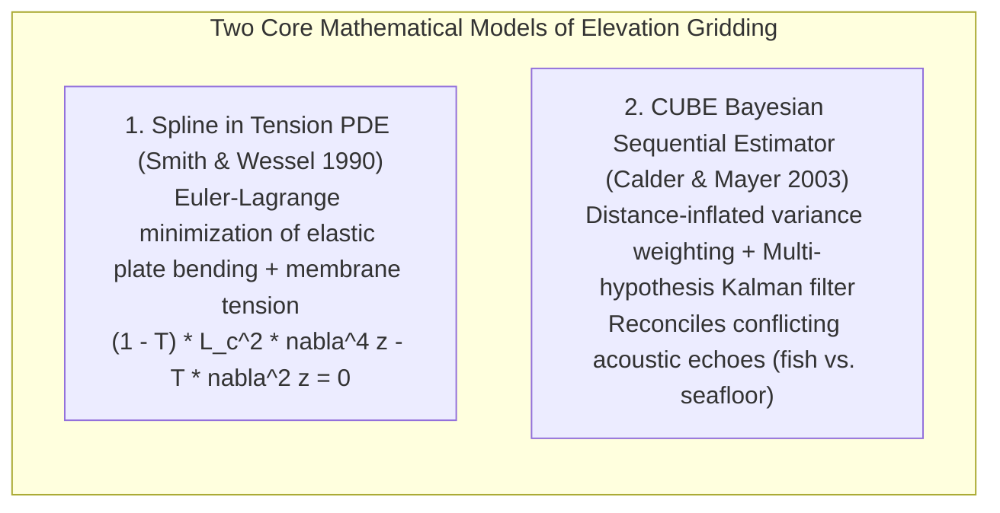
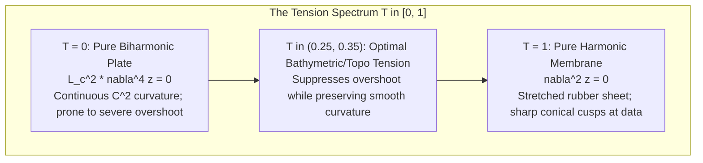
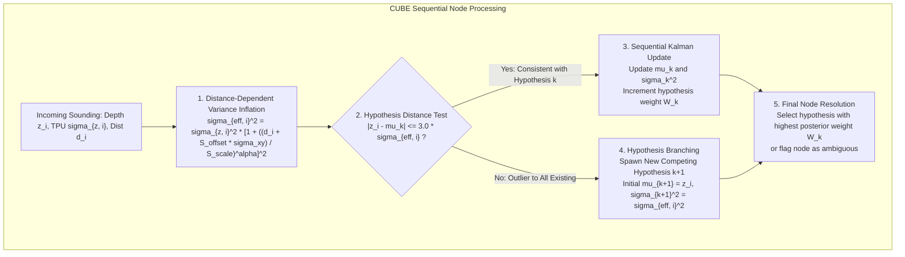

## 15.7 Mathematical Foundations of Surface Gridding and Hypothesis Estimation

Discretizing unstructured physical measurements into an elevation grid requires solving fundamental partial differential equations (PDEs) or evaluating sequential Bayesian estimators. This section derives the two foundational mathematical models of elevation gridding: the continuous curvature spline in tension partial differential equation, and the sequential Kalman updating equations governing hydrographic multi-hypothesis CUBE estimation.



---

### 15.7.1 The Continuous Curvature Spline in Tension PDE (Smith & Wessel 1990)

When interpolating sparse geoscientific observations, a classic cubic spline or biharmonic plate produces a smooth surface with continuous second derivatives ($C^2$). However, over rugged topography or steep ocean trenches, unconstrained biharmonic splines suffer from **spline overshoot**—the interpolated surface oscillates wildly beyond data points, generating phantom depressions or artificial ridges.

#### Step 1: Dimensionally Consistent Variational Energy Functional
Smith and Wessel (1990) modeled the interpolated surface $z(x, y)$ as a physical thin elastic plate subjected to horizontal membrane tension. Because the 2D Laplacian $\nabla^2 z$ carries SI units of $\text{m}^{-1}$ while the gradient $\|\nabla z\|$ is dimensionless ($\text{m}\cdot\text{m}^{-1}$), combining them with a dimensionless tension parameter $T \in [0, 1]$ requires scaling the plate-bending term by a **characteristic length scale squared $L_c^2$** ($\text{m}^2$, defined in GMT `surface` as the nominal grid spacing $L_c = h = \Delta x$; see `notation-and-symbols.md`):

$$E[z] = \iint_{\Omega} \left[ (1 - T) L_c^2 \left( \nabla^2 z \right)^2 + T \left( \|\nabla z\|_2 \right)^2 \right] dx \, dy \quad (\text{m}^2)$$

where:
* $\nabla^2 z = \frac{\partial^2 z}{\partial x^2} + \frac{\partial^2 z}{\partial y^2}$ is the 2D Laplacian operator ($\text{m}^{-1}$).
* $\|\nabla z\|_2^2 = \left(\frac{\partial z}{\partial x}\right)^2 + \left(\frac{\partial z}{\partial y}\right)^2$ is the squared surface gradient (dimensionless).
* $L_c = h = \Delta x$ ($\text{m}$) is the characteristic grid length scale ensuring dimensional homogeneity across both terms.
* $T \in [0, 1]$ is the dimensionless **tension parameter**.



#### Step 2: Deriving the Euler-Lagrange Partial Differential Equation
To find the surface $z(x, y)$ that minimizes $E[z]$ subject to interpolating the observations $z(x_k, y_k) = z_k$, we apply the calculus of variations. Let $\delta z$ be an arbitrary smooth perturbation vanishing on the boundary $\partial\Omega$ and at all constrained data nodes:

$$\delta E = 2 \iint_{\Omega} \left[ (1 - T) L_c^2 (\nabla^2 z) \nabla^2 (\delta z) + T \nabla z \cdot \nabla(\delta z) \right] dx \, dy = 0$$

Applying Green's second identity twice to the bending term:

$$\iint_{\Omega} (\nabla^2 z) \nabla^2 (\delta z) \, dx \, dy = \iint_{\Omega} \left( \nabla^2 (\nabla^2 z) \right) \delta z \, dx \, dy + \oint_{\partial\Omega} \dots = \iint_{\Omega} (\nabla^4 z) \delta z \, dx \, dy$$

where $\nabla^4 z = \frac{\partial^4 z}{\partial x^4} + 2\frac{\partial^4 z}{\partial x^2 \partial y^2} + \frac{\partial^4 z}{\partial y^4}$ ($\text{m}^{-3}$) is the **biharmonic operator**. Applying the divergence theorem to the membrane tension term yields $\iint_{\Omega} \nabla z \cdot \nabla(\delta z)\,dx\,dy = -\iint_{\Omega} (\nabla^2 z)\,\delta z\,dx\,dy + \oint_{\partial\Omega} \dots$. Substituting both identities gives:

$$\delta E = 2 \iint_{\Omega} \left[ (1 - T) L_c^2 \nabla^4 z - T \nabla^2 z \right] \delta z \, dx \, dy = 0$$

For $\delta E$ to vanish for arbitrary $\delta z$, the homogeneous governing PDE between data points is:

$$(1 - T) L_c^2 \nabla^4 z - T \nabla^2 z = 0 \quad \left(\text{both terms in }\text{m}^{-1}\right)$$

*(Note: Transforming to dimensionless grid-step coordinates $(\tilde{x}, \tilde{y}) = (x/h, y/h)$ absorbs $L_c^2 = h^2$ into the dimensionless operators $(1 - T)\tilde{\nabla}^4 z - T\tilde{\nabla}^2 z = 0$, which is the scale-free form often abbreviated in the literature.)*

#### Step 3: 13-Point Finite Difference Discretization
On a uniform grid with spacing $h = L_c = \Delta x = \Delta y$, substituting the 5-point Laplacian and 13-point biharmonic central-difference stencils cancels $h^2$ cleanly, yielding a single linear algebraic relation at every unconstrained node $(i, j)$:

$$\nabla^2 z_{i, j} \approx \frac{1}{h^2} \left[ z_{i+1, j} + z_{i-1, j} + z_{i, j+1} + z_{i, j-1} - 4 z_{i, j} \right]$$

$$\nabla^4 z_{i, j} \approx \frac{1}{h^4} \Big[ 20 z_{i, j} - 8(z_{i+1, j} + z_{i-1, j} + z_{i, j+1} + z_{i, j-1}) + 2(z_{i+1, j+1} + z_{i+1, j-1} + z_{i-1, j+1} + z_{i-1, j-1}) + (z_{i+2, j} + z_{i-2, j} + z_{i, j+2} + z_{i, j-2}) \Big]$$

GMT `surface` solves this sparse linear system across a multi-grid hierarchy ($64\times \to 32\times \to \dots \to 1\times$ spacing) via Successive Over-Relaxation (SOR) with Chebyshev acceleration, setting $T \approx 0.25$ for smooth potential fields and $T \approx 0.35$ for steep topographic/bathymetric scarps.

---

### 15.7.2 The CUBE Bayesian Multi-Hypothesis Estimator (Calder & Mayer 2003)

In acoustic bathymetry, gridding cannot assume that all soundings within a cell are noisy samples of a single physical surface. False echoes from fish schools, submerged cables, and acoustic multiples contaminate the data. The **Combined Uncertainty and Bathymetry Estimator (CUBE)** maintains multiple competing depth hypotheses at each grid node using sequential Bayesian updating.



#### Step 1: Distance-Dependent $1\sigma$ TPU Variance Inflation
Consider a grid node at $(X_{\text{node}}, Y_{\text{node}})$ with spacing $\Delta_{\text{grid}}$. An incoming sounding $i$ has measured depth $d_{\text{obs}, i}$ (or positive-up elevation $z_i = -d_{\text{obs}, i}$), **$1\sigma$ vertical standard deviation** $\sigma_{z, i} = \text{TVU}_{95\%, i} / 1.9600$, **$1\sigma$ horizontal radial/axis uncertainty** $\sigma_{xy, i} = \text{THU}_{95\%, i} / 2.4477$, and horizontal Euclidean distance $r_i = \sqrt{(X_i - X_{\text{node}})^2 + (Y_i - Y_{\text{node}})^2}$ from the node. To account for unmodeled seabed slope between $(X_i, Y_i)$ and the node, CUBE inflates the sounding's effective $1\sigma$ vertical variance:

$$\sigma_{\text{eff}, i}^2 = \sigma_{z, i}^2 \left[ 1 + \left( \frac{r_i + S_{\text{offset}} \sigma_{xy, i}}{S_{\text{scale}}} \right)^\alpha \right]^2$$

where $S_{\text{scale}} \approx \Delta_{\text{grid}}$ is the node capture scale, $S_{\text{offset}} \approx 1.96\text{–}2.45$ converts horizontal uncertainty into a conservative worst-case radial offset, and $\alpha \approx 2.0$ is the distance-dilution exponent.

#### Step 2: Sequential Dynamic Linear Model Updating & Bayes-Factor Intervention
At each node, CUBE maintains $M$ active competing hypotheses $H_k = (\mu_k, \sigma_k^2, N_k)$ for $k \in \{1, \dots, M\}$, where $\mu_k$ is the posterior mean depth, $\sigma_k^2$ is the posterior estimation variance, and $N_k$ is the assimilated sounding count. When sounding $z_i$ arrives (after median pre-filtering queue):
1. **Normalized Innovation & West–Harrison Bayes-Factor Monitor:** Against the closest hypothesis $H_k$, CUBE computes the one-step forecast variance $Q_{k,i} = \sigma_k^2 + \sigma_{\text{eff}, i}^2$ and normalized innovation $e_{k,i} = (z_i - \mu_k) / \sqrt{Q_{k,i}}$. Under West and Harrison's (1997) Bayesian Dynamic Linear Model monitor (Calder & Mayer, 2003), if $|e_{k,i}| \le \tau_{\text{gate}}$ (e.g., Bayes factor $B_{k,i} \ge \tau_B \iff |e_{k,i}| \lesssim 2.5\text{–}3.0$, with cumulative run-length check against slow drift), the sounding is statistically consistent with $H_k$.
2. **Sequential Kalman Assimilation:** If accepted into $H_k$, the hypothesis state updates recursively in $\mathcal{O}(1)$ operations:
   $$K_i = \frac{\sigma_{k,\text{old}}^2}{\sigma_{k,\text{old}}^2 + \sigma_{\text{eff}, i}^2}, \qquad \mu_{k,\text{new}} = \mu_{k,\text{old}} + K_i(z_i - \mu_{k,\text{old}}), \qquad \sigma_{k,\text{new}}^2 = (1 - K_i)\sigma_{k,\text{old}}^2, \qquad N_{k,\text{new}} = N_{k,\text{old}} + 1$$
3. **Hypothesis Intervention (Branching):** If $z_i$ fails the consistency gate across all $M$ existing hypotheses, CUBE triggers an intervention and spawns a new hypothesis $H_{M+1} = (z_i, \sigma_{\text{eff}, i}^2, 1)$.

#### Step 3: Hypothesis Disambiguation and Hypothesis Strength (`HS`)
Once all swaths are ingested, CUBE resolves multi-hypothesis nodes ($M > 1$) using one of three disambiguation rules (`Calder & Mayer, 2003`):
* **Prior (`Sample Count`):** $P(H_k) \propto N_k$ (selects the most densely populated surface).
* **Spatial Context (`Likelihood`):** Finds the nearest single-hypothesis ($M=1$) neighbor node at guide depth $\mu_{\text{guide}}$ and evaluates $L(H_k) \propto \exp\big(-(\mu_k - \mu_{\text{guide}})^2 / (2\sigma_{\text{guide}}^2)\big)$.
* **Posterior (Default):** Maximizes $P(H_k \mid \text{context}) \propto N_k \cdot L(H_k)$, while reporting **Hypothesis Strength** on a $[0.0, 5.0]$ ambiguity index ($\text{HS} = 0.0$ for a single unambiguous $M = 1$ hypothesis; $\text{HS} = \operatorname{clip}\!\big(5.0 - N_{\text{chosen}} / (N_{\text{total}} - N_{\text{chosen}}),\; 0.0,\; 5.0\big)$ when $M > 1$, so $\text{HS} = 0.0$ for $\ge 5:1$ majority support and rises toward $5.0$ as competing hypotheses challenge or outnumber the chosen surface)—flagging ambiguous nodes (e.g., shipwreck masts vs. surrounding seabed) for hydrographer review and Designated Sounding override.

```python
import numpy as np

def run_cube_node_estimator(
    depths_m: list[float], tvu95_m: list[float], thu95_m: list[float], dist_m: list[float],
    s_scale: float = 1.0, s_offset: float = 2.45, alpha: float = 2.0, gate_sigma: float = 3.0
) -> list[dict]:
    """Reference CUBE single-node multi-hypothesis sequential Kalman filter (Calder & Mayer, 2003)."""
    hypotheses = []  # Each entry: {"mu": float, "var": float, "n": int}
    for z_i, tvu, thu, r_i in zip(depths_m, tvu95_m, thu95_m, dist_m):
        sig_z = tvu / 1.9600
        sig_xy = thu / 2.4477
        var_eff = (sig_z * (1.0 + ((r_i + s_offset * sig_xy) / s_scale) ** alpha)) ** 2

        best_k, best_norm_err = None, np.inf
        for k, h in enumerate(hypotheses):
            norm_err = abs(z_i - h["mu"]) / np.sqrt(h["var"] + var_eff)
            if norm_err <= gate_sigma and norm_err < best_norm_err:
                best_k, best_norm_err = k, norm_err

        if best_k is not None:
            h = hypotheses[best_k]
            gain = h["var"] / (h["var"] + var_eff)
            h["mu"] = h["mu"] + gain * (z_i - h["mu"])
            h["var"] = (1.0 - gain) * h["var"]
            h["n"] += 1
        else:
            hypotheses.append({"mu": float(z_i), "var": float(var_eff), "n": 1})
    return hypotheses

if __name__ == "__main__":
    # 6 true seabed soundings (~20.0 m) interleaved with 2 pelagic fish echoes (~13.5 m)
    hyps = run_cube_node_estimator(
        depths_m=[20.05, 19.96, 13.40, 20.02, 13.62, 19.98, 20.04, 20.01],
        tvu95_m=[0.24]*8, thu95_m=[0.80]*8, dist_m=[0.2, 0.3, 0.25, 0.15, 0.3, 0.2, 0.35, 0.1]
    )
    for idx, h in enumerate(hyps, 1):
        print(f"H{idx}: depth={h['mu']:.3f}m, TVU_95={1.96*np.sqrt(h['var']):.3f}m, N={h['n']}")
```
