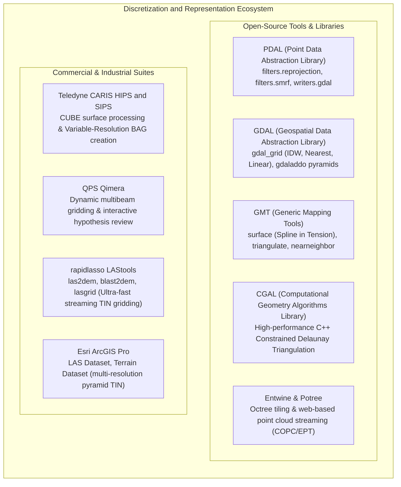

## 15.8 Software Ecosystem for Point Clouds, Meshes, and Raster Discretization

The transformation of raw spatial coordinates into continuous digital surface models is powered by an extensive ecosystem of command-line tools, computational geometry libraries, and proprietary hydrographic suites.



---

### 15.8.1 Open-Source Tools and Pipelines

#### PDAL: End-to-End Point Cloud Filtering and Gridding
PDAL provides declarative JSON pipelines that chain point cloud filtering, ground classification, and raster surface generation:

```json
{
  "pipeline": [
    {
      "type": "readers.copc",
      "filename": "https://s3.amazonaws.com/elevation-tiles-prod/copc/project_tile.copc.laz"
    },
    {
      "type": "filters.range",
      "limits": "Classification[2:2]"
    },
    {
      "type": "writers.gdal",
      "filename": "bare_earth_dtm.tif",
      "resolution": 1.0,
      "output_type": "min",
      "data_type": "float32",
      "gdalopts": "COMPRESS=DEFLATE,PREDICTOR=3,TILED=YES"
    }
  ]
}
```

* The pipeline streams points directly from a cloud-optimized COPC URL over HTTP.
* It filters exclusively for **Class 2 (Bare Earth)** ground returns.
* `writers.gdal` bins the points into a $1.0\text{-meter}$ raster, resolving cell elevations using the minimum return elevation (`output_type: "min"`), and writing a compressed GeoTIFF.

#### GMT: Rigorous Spline in Tension (`surface`) and Sector-Constrained Gridding (`nearneighbor`)
To grid irregularly spaced geophysical or bathymetric soundings into a continuous surface using the Smith and Wessel (1990) biharmonic spline-in-tension PDE—or to restrict interpolation strictly to densely sampled multibeam corridors without hallucinating values across offshore track gaps using `gmt nearneighbor` (which divides a search radius `-S` into $N_s$ azimuthal sectors via `-N` and emits `NaN` unless at least $N_{\min}$ sectors contain data):

```bash
# 1. Pre-filter spatial soundings into 100 m block medians to prevent short-wavelength spatial aliasing
gmt blockmedian soundings.xyz -R-122.5/-122.0/37.5/38.0 -I100e -V > soundings_block.xyz

# 2A. Continuous regional surface: fit spline in tension (T = 0.35) across the full domain
gmt surface soundings_block.xyz -R-122.5/-122.0/37.5/38.0 -I100e -T0.35 -Gbathymetry_spline.nc -V

# 2B. Strict measured-only surface: require data in >= 3 of 4 azimuthal quadrants within 250 m (-S250e -N4/3)
gmt nearneighbor soundings_block.xyz -R-122.5/-122.0/37.5/38.0 -I100e -S250e -N4/3 -Gbathymetry_measured.nc

# 3. Compute directional gradient grid (slope illumination)
gmt grdgradient bathymetry_spline.nc -A315 -Ne0.8 -Ggradient_shade.nc
```

*(For multibeam swath mosaicking, **`MB-System`'s `mbgrid`** extends GMT's spline-in-tension engine by weighting each sounding by its actual 2D acoustic beam footprint rather than treating soundings as zero-area points, seamlessly blending high-resolution swaths into background bathymetry when `-K` background grid mode is enabled.)*

#### CGAL, WhiteboxTools, Entwine, and PotreeConverter: TINs, Hydrological Gridding, and Cloud Octrees
Beyond `PDAL`, `GDAL`, and `GMT`, four open-source engines complete the modern discretization stack:
* **CGAL (Computational Geometry Algorithms Library):** Provides exact-predicate, exact-construction 2D and 2.5D **Constrained Delaunay Triangulation (`CGAL::Constrained_Delaunay_triangulation_2`)** kernels in C++ and Python (`cgal` / `startinpy`). By evaluating orientation and in-circle determinants using adaptive multi-precision arithmetic (Shewchuk predicates), CGAL eliminates collinear degeneracy crashes when intersecting dense LiDAR points with millions of vector road-curb, levee, and stream-thalweg breaklines.
* **WhiteboxTools (John Lindsay, University of Guelph):** Written in compiled, zero-dependency multi-threaded Rust with a lightweight Python wrapper (`whitebox`), `WhiteboxTools` provides high-speed bare-earth point-cloud gridding modules (`LidarTinGridding`, `LidarNearestNeighbourGridding`, `LidarIdwInterpolation`, and `LidarSibsonInterpolation` natural-neighbor gridding) alongside automated triangular-artifact facet removal and hydrological depression breaching.
* **Entwine, PDAL `writers.copc`, and `PotreeConverter 2.0`:** **Entwine** (Hobu, Inc.) and `pdal translate input.laz output.copc.laz` reorganize billions of unordered LAS/LAZ returns into out-of-core **Entwine Point Tiles (`EPT`)** or single-file **Cloud-Optimized Point Clouds (`COPC`)**, while **`PotreeConverter 2.0`** (Schütz et al., 2020) uses Morton-order counting sort to index up to $10^9$ points per minute for 60-fps WebGL rendering in **Potree** with real-time Eye-Dome Lighting (EDL) hillshading.
* **GDAL `gdal_grid` and `BAG` / `S-102` Drivers:** `gdal_grid` rasterizes scattered vector/XYZ points via moving average (`average`), inverse distance (`invdist`, `invdistnn`), linear Delaunay TIN (`linear`), or nearest neighbor (`nearest`), while GDAL's native `BAG` and `S102` drivers expose variable-resolution hydrographic supergrids (`-oo MODE=RESAMPLED_GRID`, `-oo MODE=LIST_SUPERGRIDS`, `-oo VALUE_POPULATION=MAX`).
* **Open Navigation Surface `BAG` Library, `HydrOffice`, and NOAA `HSTB Kluster`:** In the open-source hydrographic stack, the ONS C++/Python `bag` reference library, `HydrOffice BAG Explorer / QC Tools`, and NOAA's `HSTB Kluster` (`Bathygrid`, built atop `Dask` and `Zarr`) implement open-source CUBE and variable-resolution tile gridding (`generate_new_surface(grid_type="variable_resolution_tile")`), validating output surfaces directly against NOAA HSSD density ($N \ge 5$ soundings per node in $\ge 95\%$ of populated nodes) and IHO S-44 TVU thresholds prior to chart submission.

```bash
# 1. Merge raw LAZ tiles, build a single-file COPC octree via PDAL, and build a Potree 2.0 octree
pdal merge raw_flightlines/*.laz merged_survey.laz
pdal translate merged_survey.laz project_cloud.copc.laz \
    --writers.copc.threads=8 --writers.copc.forward="all"
PotreeConverter merged_survey.laz -o ./potree_web_octree --encoding BROTLI

# 2. Delaunay linear TIN gridding in GDAL with explicit NoData radius cap (avoids bridging wide voids!)
#    Note: -txe <xmin> <xmax> and -tye <ymin> <ymax>
gdal_grid -a linear:radius=15.0:nodata=-9999.0 -txe 500000 505000 -tye 4200000 4205000 \
    -tr 1.0 1.0 -of COG -co COMPRESS=DEFLATE -co PREDICTOR=3 ground_points.gpkg tin_dem_cog.tif
```

```python
# 3. Multi-threaded Rust LiDAR TIN gridding + long-edge void masking via WhiteboxTools Python API
import whitebox

wbt = whitebox.WhiteboxTools()
wbt.set_verbose_mode(False)
wbt.lidar_tin_gridding(
    i="/data/tile_classified.laz",
    output="/data/bare_earth_tin_1m.tif",
    parameter="elevation",
    returns="last",
    resolution=1.0,
    exclude_cls="0,1,3,4,5,6,7,9,17,18",  # Retain Class 2 (Bare Ground) only; exclude bridge decks (17)
    max_triangle_edge_length=25.0,        # Prevent long sliver triangles from bridging across lakes/rivers!
)
```

---

### 15.8.2 Commercial and Industrial Suites

#### Teledyne CARIS HIPS and SIPS
CARIS is the premier software suite used by national hydrographic offices (NOAA, UKHO, CHS):
* Native implementation of the CUBE algorithm and the Variable-Resolution Bathymetric Attributed Grid (VR-BAG).
* Allows hydrographers to navigate complex multi-hypothesis nodes, resolving ambiguous seabed features (such as thin mast structures on wrecks) with visual 3D slice tools.

#### QPS Qimera
QPS Qimera is designed for rapid multibeam bathymetric processing:
* **Dynamic Surface Engine:** Grids soundings on-the-fly during data ingestion.
* When soundings are cleaned or motion parameters are updated, Qimera updates only the affected surface tiles incrementally, eliminating full-project re-gridding bottlenecks.

#### rapidlasso LAStools (`las2dem` and `blast2dem`) and Streaming Memory Scaling
Developed by Martin Isenburg, `LAStools` pioneered **spatial-finalization streaming TIN architectures** (Isenburg et al., 2006):
* Whereas a naive in-memory 2D Delaunay triangulation of $N = 2 \times 10^9$ ground points requires $\approx 36\text{–}48\text{ bytes/vertex}$ plus $2N$ triangle structs ($\approx \mathbf{160\text{–}220\text{ GB}}$ of RAM!), `blast2dem` orders points along space-filling quadtree cells with explicit *finalization tags*. Once the last point inside a $50\text{ m} \times 50\text{ m}$ cell enters the active wavefront buffer, all incident Delaunay triangles are rasterized to the output GeoTIFF scanline and immediately freed—bounding peak RAM at $O(\sqrt{N}) < \mathbf{250\text{ MB}}$ regardless of whether the survey contains $10^7$ or $10^{10}$ points!

#### Esri ArcGIS Pro (Terrain Datasets)
Esri's **Terrain Dataset** is a multi-resolution, triangulated irregular network data structure stored inside an enterprise geodatabase:
* Constructs vector pyramids: fine triangles are simplified into generalized, coarser Delaunay facets at smaller display scales.
* Integrates 3D feature classes (curbs, water bodies, spot heights, and hydro-enforcement polygons) directly as hard and soft breaklines inside the geodatabase pyramid, supporting on-the-fly rasterization to any target cell size without duplicating raw point clouds.

---

### 15.8.3 Feature Comparison Matrix

| Software Suite | License Model | Primary Representations | Key Mathematical Engine | Best-Suited Application |
| :--- | :--- | :--- | :--- | :--- |
| **PDAL** | Open-Source (BSD) | Point Cloud, Mesh, Raster | Octrees, SMRF filtering, GDAL rasterization | Automated batch point cloud filtering and DTM generation. |
| **GDAL** | Open-Source (MIT/X) | Regular Raster (GeoTIFF/COG) | Moving-average, IDW, nearest, bicubic | Geotransform conversion, format translation, overview creation. |
| **GMT** | Open-Source (LGPLv3) | NetCDF Grids | Smith & Wessel biharmonic spline-in-tension | Regional geophysical, tectonic, and bathymetric gridding. |
| **WhiteboxTools** | Open-Source (MIT) | LAS/LAZ $\to$ GeoTIFF | Multi-threaded Rust TIN, Sibson & IDW gridding | High-speed hydrological DTM generation with max-edge void clipping. |
| **CGAL** | Open-Source (GPL/LGPL) | Vector TINs / 3D Meshes | Exact arithmetic Constrained Delaunay Triangulation | High-precision computational geometry and CAD breakline modeling. |
| **Entwine / Potree** | Open-Source (MIT/BSD) | COPC / EPT / Potree Octrees | Morton/octree hierarchical spatial indexing | Cloud HTTP `Range` streaming and 60-fps WebGL rendering of $10^{10}+$ points. |
| **HSTB Kluster (`Bathygrid`)** | Open-Source (CC0 / Public) | Zarr Soundings, BAG, VR-BAG | Distributed Dask CUBE & variable-resolution tiling | Open-source multibeam TPU propagation, VR-BAG creation, and NOAA HSSD QC. |
| **CARIS HIPS** | Commercial (Teledyne) | CUBE Grids, VR-BAG | Bayesian Kalman multi-hypothesis CUBE | Nautical charting, hydrographic compliance, and VR-BAG creation. |
| **QPS Qimera** | Commercial (QPS) | Dynamic Multi-Res Grids | CUBE + dynamic incremental surface updates | Vessel-board multibeam QA and rapid chart production. |
| **LAStools** | Commercial / Core Open | LAS / LAZ / GeoTIFF | Streaming buffer Delaunay TIN rasterization | High-throughput LiDAR point cloud gridding on modest hardware. |
| **Esri ArcGIS Pro** | Commercial (Esri) | Terrain Dataset, Raster | Triangulated vector pyramids with breaklines | Integrated GIS civil infrastructure and floodplain analysis. |
