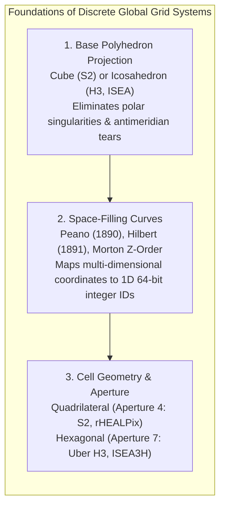
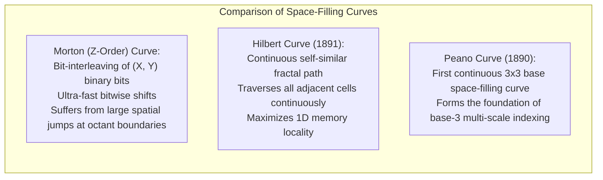
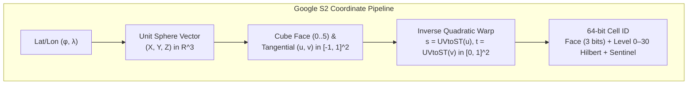
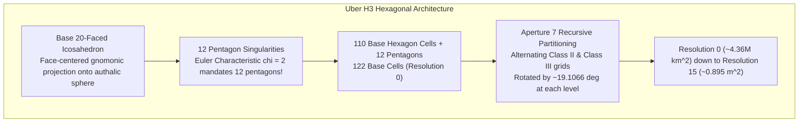

# Chapter 16: Discrete Global Grid Systems (S2, H3) and Special Location Coding Schemes

*Indexing a spherical/ellipsoidal planet without polar singularities or projection seams—and the pitfalls of geocoding schemes.*

Traditional digital elevation modeling relies on map projections (such as Universal Transverse Mercator [UTM] or Web Mercator) that flatten the curved Earth onto a 2D Euclidean plane. However, all planar map projections introduce geometric distortion: scale distortion, area distortion, tear seams along the $180^\circ$ antimeridian, and extreme singularities at the North and South Poles. When elevation models span continents, ocean basins, or planetary bodies, planar rasters become mathematically and computationally fragile.

To overcome these distortions, modern geospatial architectures increasingly represent topography directly on the sphere or ellipsoid using **Discrete Global Grid Systems (DGGS)**. Powered by fractal space-filling curves and polyhedral projections, DGGS frameworks partition the entire planetary surface into hierarchical, tessellated cells, transforming 2D spatial indexing into lightning-fast 64-bit integer queries.

---

## 16.1 Space-Filling Curves and Discrete Global Grid Systems (DGGS)

A Discrete Global Grid System (standardized by the Open Geospatial Consortium in OGC Topic 21 / ISO 19170-1) is a spatial reference system that uses a hierarchical tessellation of cells to partition and address the globe.

---

### 16.1.1 The Mathematics of Space-Filling Curves (Peano, Hilbert, Morton)

A space-filling curve is a continuous mathematical mapping from the unit interval $I = [0, 1]$ onto the higher-dimensional unit hypercube $I^n = [0, 1]^n$:

$$\gamma: [0, 1] \to [0, 1]^n \quad \text{such that } \gamma([0, 1]) = [0, 1]^n$$

#### 1. Giuseppe Peano (1890)
In 1890, Italian mathematician Giuseppe Peano discovered the first continuous space-filling curve. Peano constructed a surjective mapping using base-3 arithmetic that completely fills a 2D square, disproving the historical assumption that a 1D continuous curve could never have non-zero 2D area.

#### 2. David Hilbert (1891)
In 1891, David Hilbert developed a geometric, base-2 space-filling curve that eliminated Peano's coordinate inversions. The **Hilbert curve** is generated recursively by rotating and reflecting four quadrant sub-curves. Crucially, the Hilbert curve is **spatially continuous**: points that are adjacent along the 1D curve are guaranteed to be adjacent in 2D space, minimizing the bounding-box perimeter of contiguous 1D memory segments.

#### 3. Morton Z-Order
Guy Macdonald Morton (1966) introduced the **Z-order curve**, constructed by interleaving the binary bits of coordinate values:
$$\text{Morton}(X, Y) = \text{interleave}(\text{binary}(X), \, \text{binary}(Y))$$
While computationally trivial to evaluate using SIMD bit-manipulation instructions (e.g., `PEXT`/`PDEP` on modern x86 CPUs), the Z-order curve suffers from severe **discontinuities**: jumping across quadrant boundaries involves massive 1D index leaps between points that are immediate 2D neighbors.

---

### 16.1.2 Google S2 Geometry: Cube-Hilbert Quadtrees

The **Google S2 Geometry** library (released as open-source C++ in 2011) models the Earth as a sphere inscribed within a regular cube.

#### 1. Cube-to-Sphere Projection and Non-Linear Warping
The Earth is enclosed in a unit sphere $\mathbb{S}^2 \subset \mathbb{R}^3$ inscribed within a cube of 6 faces (numbered $0$ to $5$). A 3D unit vector $\mathbf{p} = (X, Y, Z)$ is projected onto the dominant cube face into tangential coordinates $(u, v) \in [-1, 1]^2$. However, a direct gnomonic projection from the sphere center onto flat cube faces produces significant area distortion: the differential surface area element on the unit sphere is $d\Omega = (1 + u^2 + v^2)^{-3/2}\,du\,dv$, meaning a cell at the corner of a cube face ($u = \pm 1, v = \pm 1$, where $1 + u^2 + v^2 = 3$) would be $3^{3/2} = 3\sqrt{3} \approx 5.196$ times smaller in spherical area than an equal-$\Delta u\,\Delta v$ cell at the face center ($u = 0, v = 0$).

To equalize cell areas across the sphere, S2 introduces normalized cell coordinates $(s, t) \in [0, 1]^2$ (or symmetric coordinates $s_{\text{sym}} = 2s - 1 \in [-1, 1]$) and applies a non-linear coordinate warp $u = \text{STtoUV}(s), v = \text{STtoUV}(t)$ before projecting to $(X, Y, Z)$:
* **Linear projection (`S2_LINEAR_PROJECTION`):** $u = 2s - 1 = s_{\text{sym}}$. Simplest arithmetic, but suffers from a $5.20:1$ maximum-to-minimum cell area ratio between face centers and face corners.
* **Tangent projection (`S2_TAN_PROJECTION`):** $u = \tan\left(\frac{\pi}{4}(2s - 1)\right) = \tan\left(\frac{\pi}{4}s_{\text{sym}}\right)$. Spaces cells by equal angles along the central meridians of each cube face, reducing the global max-to-min area ratio to $\approx 1.41:1$, at the cost of slow transcendental `tan()` and `atan()` evaluations on every coordinate conversion.
* **Quadratic projection (`S2_QUADRATIC_PROJECTION`, S2 default):** Approximates the tangent curve using a piecewise quadratic polynomial in $s \in [0, 1]$ (implemented in `s2coords.h`):
  $$u = \text{STtoUV}(s) = \begin{cases} \frac{1}{3}\left(4s^2 - 1\right) & \text{if } s \ge \frac{1}{2} \\[4pt] \frac{1}{3}\left(1 - 4(1 - s)^2\right) & \text{if } s < \frac{1}{2} \end{cases} \equiv \frac{1}{3} s_{\text{sym}}\left(2 + |s_{\text{sym}}|\right)$$
  with exact closed-form inverse $s = \text{UVtoST}(u) = \frac{1}{2}\sqrt{1 + 3u}$ for $u \ge 0$ and $1 - \frac{1}{2}\sqrt{1 - 3u}$ for $u < 0$. This achieves a $2.08:1$ max-to-min cell area ratio across the globe while running $\sim 3\times$ faster than trigonometric tangent evaluation.

#### 2. 64-Bit S2 Cell Hierarchy and Bit Layout
Each cube face is recursively subdivided into an **Aperture 4 Quadtree** indexed by a 1D Hilbert curve:
* **Level 0** consists of the 6 primary cube faces ($\approx 85.01 \times 10^6\text{ km}^2$ per face).
* Each successive level $L \in \{0, \dots, 30\}$ subdivides every parent cell into 4 children ($6 \times 4^L$ total cells globally).
* **Level 30** reaches leaf cell areas spanning **$0.48\text{ cm}^2$ (min) to $0.93\text{ cm}^2$ (max)** with a global mean area of **$\approx 0.74\text{ cm}^2$** (linear cell edge lengths $\approx 0.68\text{ cm}$ to $0.97\text{ cm}$, mean $\approx 0.85\text{ cm}$), fine enough to index individual millimeter-scale terrestrial laser scanner returns.
* Every S2 cell across all 31 levels is uniquely represented by a single **64-bit unsigned integer (`uint64`)**:
  * **Bits 63–61 (3 bits):** Base cube face index $f \in \{0, 1, 2, 3, 4, 5\}$.
  * **Bits 60–1 ($2L$ bits):** Hilbert curve quadrant indices $(q_1, q_2, \dots, q_L)$, using 2 bits per resolution level up to $L \le 30$.
  * **Sentinel Bit at Position $2(30 - L)$:** A single trailing `1` bit followed by zeroes, which self-describes the cell's resolution level $L = 30 - \frac{1}{2}\text{ctz}(\text{id})$ (where $\text{ctz}$ counts trailing zero bits) and guarantees that a parent cell's numeric range `[id_min, id_max]` encompasses all of its descendant cells at every finer level.
* **Exact Containment:** Because S2 is a true rectilinear quadtree in $(s, t)$ space whose cell edges are great-circle arcs (geodesics) on the sphere, every child cell is geometrically **$100\%$ contained** within its parent cell.

---

### 16.1.3 Uber H3: Icosahedral Hierarchical Hexagonal Grids

Developed by Uber and open-sourced in 2018, **H3** partitions the globe into a hierarchical hexagonal grid based on a regular **icosahedron** (a 20-faced Platonic solid with 12 vertices) oriented using R. Buckminster Fuller's Dymaxion orientation so that all 12 vertices fall in the ocean.

#### Why Hexagons?
1. **Isotropic Adjacency:** In a square grid, a cell has 4 edge-sharing orthogonal neighbors (distance $d = \Delta x$) and 4 corner-sharing diagonal neighbors (distance $d = \sqrt{2}\,\Delta x$). This anisotropic distance distortion complicates gradient calculations and creates topological ambiguity across corner contacts in hydrologic flow routing. In a hexagonal grid, every interior cell has **exactly 6 equidistant neighbors** sharing full edges of equal length and equal center-to-center distance ($d = \sqrt{3}\,r_{\text{hex}}$).
2. **Minimal Perimeter-to-Area Ratio and Optimal Quantization:** By the hexagonal honeycomb theorem (conjectured in antiquity and proved by Thomas C. Hales in 1999/2001), a regular hexagonal tessellation minimizes total boundary perimeter per unit area and minimizes mean squared quantization error (second moment of inertia) among all congruent planar tilings.

#### The 12 Unavoidable Pentagons
A topological sphere cannot be tiled purely with hexagons. For any polyhedral tiling of a sphere with $F_5$ pentagons and $F_6$ hexagons meeting three at each vertex ($3V = 2E$ and $\sum (6 - n_i)F_{n_i} = 6\chi$), Euler's polyhedral formula ($\chi = V - E + F = 2$) requires:
$$F_5 = 6\chi = 12 \quad \text{pentagons (independent of the number of hexagons } F_6\text{!)}$$
At every resolution $R \in \{0, \dots, 15\}$, an H3 grid contains $12$ pentagons (each having 5 neighbors instead of 6) centered at the 12 icosahedron vertices, plus $110 \times 7^R + 10(7^R - 1) = 120 \times 7^R - 10$ hexagons (totalling $2 + 120 \times 7^R$ cells: $122$ base cells at Resolution 0, up to $569,707,381,193,150$ hexagons and $569,707,381,193,162$ total cells at Resolution 15).

#### Aperture 7 Scaling, 64-Bit H3 Index Layout, and Non-Exact Containment
H3 scales across 16 resolution levels (Resolution 0 to 15) using an **Aperture 7** hierarchy encoded in a 64-bit integer (`uint64`):
* **Bits 63 (1 bit):** Reserved (`0`).
* **Bits 62–59 (4 bits):** Index mode (`1` for H3 cell, `2` for directed edge, `4` for vertex).
* **Bits 58–56 (3 bits):** Mode-dependent flags.
* **Bits 55–52 (4 bits):** Resolution $R \in \{0, \dots, 15\}$.
* **Bits 51–45 (7 bits):** Base cell number $b \in \{0, \dots, 121\}$.
* **Bits 44–0 (45 bits = $15 \times 3$ bits):** Fifteen 3-bit octal digits $d_r \in \{0, \dots, 6\}$ specifying the local `[i, j, k]` child slot at each resolution $r \le R$ (with unused finer digits set to `7` = `0b111`).
* At each finer level, cell area decreases by a factor of $7$ ($A_{R+1} = \frac{1}{7} A_R$), and the hexagonal grid alternates between **Class II** and **Class III** orientations, rotating by $\Delta\theta = \arcsin\left(\sqrt{\frac{3}{28}}\right) \approx 19.1066^\circ$ at every step. Because regular hexagons cannot tile a larger regular hexagon without remainder, an H3 parent cell **does not strictly contain** its 7 children: the central child (`digit 0`) lies wholly inside the parent, while the 6 outer children (`digits 1..6`) are truncated across the parent's six edges, with approximately $1/7$ ($14.3\%$) of the parent's area exchanged with neighboring parents across each hierarchical step.

---

### 16.1.4 Equal-Area Polyhedral and Ellipsoidal DGGS: ISEA, DGGRID, and rHEALPix

While Google S2 and Uber H3 optimize for fast bit-level indexing and gnomonic/cubic geometry on a sphere, scientific mass-balance and climate elevation models often require **strictly equal-area** cells referenced directly to the **oblate ellipsoid of revolution**:
1. **ISEA3H / ISEA4D and `DGGRID` (Snyder, 1992; Sahr et al., 2003):** John P. Snyder's **Icosahedral Snyder Equal-Area (ISEA)** projection maps each spherical triangle of an icosahedron onto a planar equilateral triangle while preserving exact surface area ($\det \mathbf{J}_{\text{ISEA}} \equiv 1$ everywhere). The open-source `DGGRID` engine tessellates the ISEA faces into Aperture 3 (`ISEA3H`), Aperture 4 (`ISEA4H`/`ISEA4D`), or Aperture 7 (`ISEA7H`) equal-area cells.
2. **rHEALPix (Gibb, 2016; OGC Topic 21):** The **Rearranged Hierarchical Equal Area isoLatitude Pixelization (rHEALPix)** extends the astrophysical HEALPix projection directly onto the **WGS84/GRS80 reference ellipsoid**. It maps the ellipsoidal Earth onto 6 planar square faces (4 equatorial faces and 2 polar crown faces assembled from 4 triangular polar caps) using authalic latitude in the equatorial belt and Collignon's equal-area projection at the poles. Subdividing each face into an $N_{\text{side}} \times N_{\text{side}}$ Aperture 9 ($3 \times 3$) or Aperture 4 ($2 \times 2$) quadtree yields cells that simultaneously satisfy **100% exact hierarchical child containment**, **strict equal area on the oblate ellipsoid**, and **iso-latitude alignment** along parallels.

---

### 16.1.5 Comparison of Global Grid Architectures

| Characteristic | Google S2 Geometry | Uber H3 | rHEALPix | Classical UTM Raster |
| :--- | :--- | :--- | :--- | :--- |
| **Base Polyhedron** | Cube (6 faces) | Icosahedron (20 faces) | Spherical Cube (6 faces) | Transverse Mercator Cylinder |
| **Cell Geometry** | Quadrilateral (Curved square) | **Hexagon** (+ 12 pentagons) | Rectangles & Squares | Square / Rectangular Pixels |
| **Neighbor Symmetry**| 4 edge + 4 diagonal (Anisotropic) | **6 Equidistant (Isotropic)** | 4 edge + 4 diagonal | 4 edge + 4 diagonal |
| **Aperture Ratio** | **Aperture 4** (Exact $1:4$) | **Aperture 7** ($\approx 1:7$) | **Aperture 9** (Exact $1:9$) | None (Planar tiles) |
| **Child Containment**| **100% Exact** (True Quadtree) | Overlapping / Approximate | **100% Exact** | Exact |
| **Area Distortion** | Moderate ($2.08:1$ max/min) | Moderate ($1.99:1$ hex max/min) | **Strictly Equal-Area ($1.00:1$)** | Extreme at zone margins |
| **Polar Behavior** | Continuous (no singularities) | Continuous (hexagons at poles)| Continuous | Fails ($>84^\circ\text{ N} / 80^\circ\text{ S}$) |
| **Primary Elevation Use**| Planetary quadtree DEM tiles | Isotropic hydrology & slope | Global climate & terrain rasters| Local high-res engineering |
