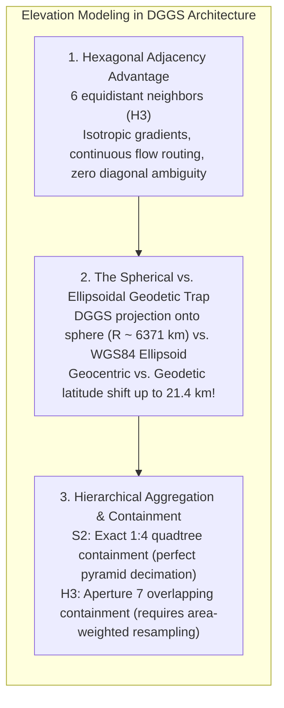
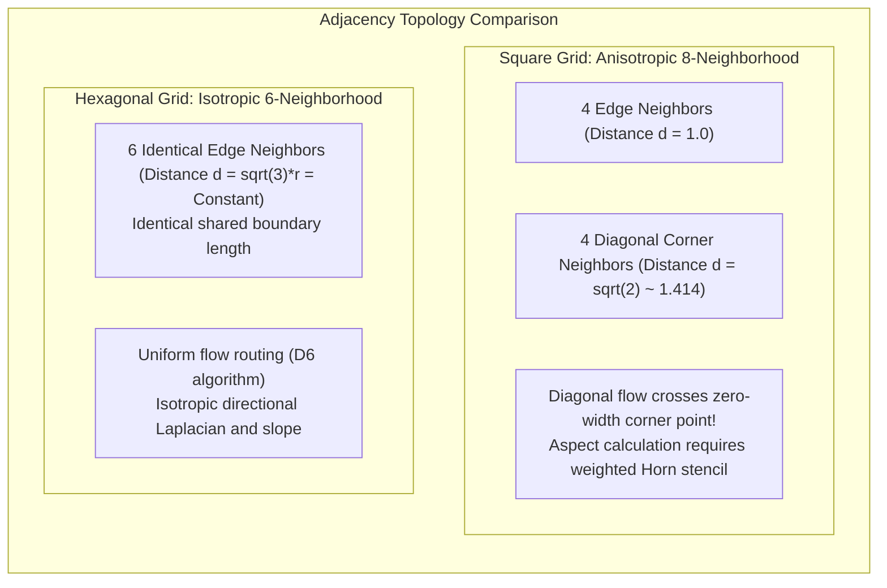
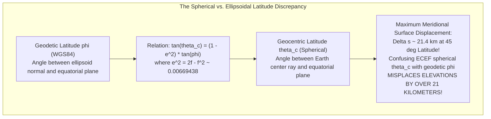
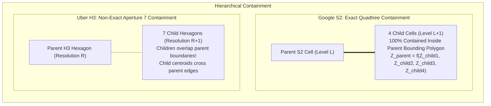

# Chapter 16: Discrete Global Grid Systems (S2, H3) and Special Location Coding Schemes

*Indexing a spherical/ellipsoidal planet without polar singularities or projection seams—and the pitfalls of geocoding schemes.*

---

## 16.2 Storing and Analyzing Elevation on S2 and H3 Cells

While Discrete Global Grid Systems (DGGS) were originally popularized for point geofencing, ride-hailing demand modeling, and satellite imagery indexing, their application to continuous elevation modeling offers profound analytical advantages—alongside unique geometric and computational challenges. Storing elevation on S2 or H3 cells requires addressing the fundamental trade-off between hexagonal isotropic symmetry and hierarchical containment, as well as bridging the mathematical gap between spherical DGGS coordinate models and the ellipsoidal Earth.

---

### 16.2.1 The Hexagonal Adjacency Advantage: Isotropic Gradients and Hydrology

In traditional square elevation rasters, spatial operators suffer from **directional anisotropy**:

#### Directional Slope, Aspect, and Curvature on H3 vs. Square Rasters
Because all six immediate neighbors in a local planar H3 neighborhood share identical center-to-center distances ($d = \sqrt{3}\,r_{\text{hex}}$, where $r_{\text{hex}}$ is the hexagon circumradius / edge length) and equal shared edge lengths ($r_{\text{hex}}$), finite-difference differential operators achieve fourth-order directional isotropy:
* In a traditional square raster of spacing $\Delta x$, the 4 cardinal neighbors sit at distance $\Delta x$ sharing an edge of length $\Delta x$, whereas the 4 diagonal neighbors sit at distance $\sqrt{2}\,\Delta x$ touching only at a zero-length corner point. Estimating the gradient $\nabla z = [z_x, z_y]^\top$ requires Horn's weighted $3\times 3$ stencil ($z_x \approx \frac{(z_{\text{NE}} + 2z_{\text{E}} + z_{\text{SE}}) - (z_{\text{NW}} + 2z_{\text{W}} + z_{\text{SW}})}{8\Delta x}$), and deterministic D8 overland flow routing exhibits a notorious $45^\circ$ grid-bias artifact across hillslopes.
* On a hexagonal grid, let $z_0$ denote the elevation of the central hexagon, and let $z_1, z_2, \dots, z_6$ denote the elevations of its six neighbors ordered sequentially by local azimuth ($\theta_k = \frac{k-1}{3}\pi$). The discrete gradient vector $\nabla z$ and scalar Laplacian $\nabla^2 z$ (derived in Section 16.5.2) are:

$$\nabla z = \frac{1}{3 d} \sum_{k=1}^6 (z_k - z_0)\,\hat{\mathbf{e}}_k, \qquad \nabla^2 z = \frac{2}{3 d^2} \sum_{k=1}^6 \left( z_k - z_0 \right)$$

Both operators are rotationally invariant to second order, eliminating the directional dampening and diagonal corner-jumping ambiguity that plague square rasters in D8 and multiple-flow-direction (MFD) hydrologic routing. Furthermore, when propagating uncorrelated random vertical measurement noise $\sigma_z^2$ (e.g., LiDAR photon range variance or multibeam sounding TVU) through the 6-neighbor hexagonal stencil, the variance of each gradient component is isotropic in all azimuths:

$$\sigma_{\partial z/\partial x}^2 = \sigma_{\partial z/\partial y}^2 = \frac{\sigma_z^2}{(3d)^2}\sum_{k=1}^6 \cos^2\theta_k = \frac{3\,\sigma_z^2}{9 d^2} = \frac{\sigma_z^2}{3 d^2}, \qquad \sigma_{\nabla^2 z}^2 = \frac{4}{9 d^4}\left(6\sigma_z^2 + 36\sigma_z^2\right) = \frac{56}{3 d^4}\sigma_z^2$$

---

### 16.2.2 The Geodetic Trap: Spherical DGGS vs. The Ellipsoidal Earth

The most dangerous pitfall in ingesting high-precision elevation data into DGGS frameworks is the **Spherical vs. Ellipsoidal Latitude Discrepancy**.

Both Google S2 and Uber H3 perform their core polyhedral and trigonometric projections on an idealized **sphere** (unit sphere $\mathbb{S}^2$, scaled in H3 by the WGS84 authalic radius $R_q = 6,371,007.1809\text{ m}$). However, real-world digital elevation models (airborne LiDAR, photogrammetry, multibeam bathymetry, and GNSS-Acoustic seafloor benchmarks) are referenced to the **GRS80 or WGS84 reference ellipsoid** ($a = 6,378,137.0\text{ m}, b \approx 6,356,752.3142\text{ m}$, flattening $f = 1/298.257223563$).

#### The Mathematical Shift: Geodetic ($\varphi$), Parametric ($\beta$), Authalic ($\varphi_q$), and Geocentric ($\theta_c$) Latitudes
On an oblate ellipsoid of revolution with semi-major axis $a$, semi-minor axis $b = a(1-f)$, and first eccentricity squared $e^2 = 2f - f^2 = 0.00669437999014$ (WGS84), four distinct latitudes must never be confused when interfacing with spherical DGGS engines:
1. **Geodetic Latitude ($\varphi$):** Angle between the equatorial plane and the ellipsoidal surface normal (reported by GNSS and stored in `EPSG:4326`).
2. **Parametric (Reduced) Latitude ($\beta$):** Auxiliary angle projecting the ellipsoid onto a concentric sphere of radius $a$:
   $$\tan\beta = \sqrt{1 - e^2}\,\tan\varphi = (1 - f)\tan\varphi, \qquad (\varphi - \beta)_{\max} \approx 5.77' \implies \Delta s \approx 10.69\text{ km at } \varphi = 45^\circ$$
3. **Authalic (Equal-Area) Latitude ($\varphi_q$):** Maps the ellipsoid onto the authalic sphere of equal total surface area ($R_q = \sqrt{\frac{A_{\text{ellipsoid}}}{4\pi}} = 6,371,007.1809\text{ m}$) while preserving differential surface area:
   $$\sin\varphi_q = \frac{q(\varphi)}{q(\pi/2)}, \qquad q(\varphi) = (1 - e^2)\left(\frac{\sin\varphi}{1 - e^2\sin^2\varphi} - \frac{1}{2e}\ln\frac{1 - e\sin\varphi}{1 + e\sin\varphi}\right), \qquad (\varphi - \varphi_q)_{\max} \approx 7.69' \implies \Delta s \approx 14.25\text{ km}$$
4. **Geocentric Spherical Latitude ($\theta_c$):** Angle between the equatorial plane and the radial vector from the Earth's center of mass $(0,0,0)$ to the surface point $(X, Y, Z)$:
   $$\tan\theta_c = (1 - e^2) \tan\varphi = \left( \frac{b^2}{a^2} \right) \tan\varphi$$

The difference $\Delta\varphi = \varphi - \theta_c$ reaches its maximum at $\varphi = \arctan\left(\frac{1}{\sqrt{1 - e^2}}\right) \approx 45^\circ 05' 46''$:

$$\Delta\varphi_{\max} \approx \frac{e^2}{2} \sin(2\varphi) \approx \frac{0.00669438}{2} \sin(90^\circ) \approx 0.003347\text{ rad} \approx 11.51'\text{ (arcminutes)}$$

Multiplying this angular discrepancy by the Earth's mean radius $R_q$:

$$\Delta s = R_q \cdot \Delta\varphi_{\max} \approx 6,371,007\text{ m} \times 0.003347\text{ rad} \approx \mathbf{21,324\text{ m} \quad (\approx 21.4\text{ km})}$$

#### Operational Reality in S2 and H3 Libraries
When ingesting elevation or bathymetric points into an H3 or S2 index, practitioners must understand two distinct mechanisms:
1. **Direct Degree-to-Sphere Mapping in `s2geometry` and `h3`:** Both `S2LatLng::FromDegrees(lat, lng)` and H3's `latLngToCell` treat the input WGS84 geodetic coordinates $(\varphi, \lambda)$ directly as spherical angles $(\cos\varphi\cos\lambda, \cos\varphi\sin\lambda, \sin\varphi)$ on the unit sphere (with H3 scaling metric areas and edge lengths by the WGS84 authalic radius $R_q = 6,371,007.1809\text{ m}$). Because this skips the geodetic-to-authalic conversion ($\varphi \to \varphi_q$), round-trip `latLngToCell` $\leftrightarrow$ `cellToLatLng` is self-consistent in WGS84 degrees, but the true ellipsoidal area of an H3 or S2 cell varies with latitude by up to $\pm \frac{2}{3}f \approx \pm 0.22\%$ (and local meridional vs. prime-vertical metric scale differs by $M(\varphi)/N(\varphi) = 1 - e^2\cos^2\varphi$, up to $0.67\%$ at the Equator).
2. **The ECEF-to-Spherical Vector Conversion Blunder:** A catastrophic $21.4\text{ km}$ shift occurs when a 3D point cloud or satellite altimetry pipeline stored in ECEF Cartesian coordinates $(X, Y, Z)$ is normalized directly onto the unit sphere ($\hat{\mathbf{p}} = \mathbf{X} / \|\mathbf{X}\|_2$, which yields **geocentric** latitude $\theta_c = \arcsin(Z / \|\mathbf{X}\|_2)$) and passed to `S2CellId(S2Point)` or converted via $\arcsin(Z/r)$ before calling `h3.latlng_to_cell`! An elevation point from the summit of Mount Rainier ($\varphi = 46.8529^\circ\text{ N}$) converted from ECEF via $\arcsin(Z/r)$ lands at $\theta_c \approx 46.6610^\circ\text{ N}$ (at the $4,392\text{ m}$ summit, or $46.6608^\circ\text{ N}$ on the WGS84 ellipsoid)—misplacing the summit into an H3 or S2 cell **$21.3\text{ km}$ to the south**! Always convert ECEF $(X, Y, Z)$ to geodetic $(\varphi, \lambda, h)$ using Bowring's or Vermeille's ellipsoidal formula (Chapter 2) before indexing into S2 or H3.

---

### 16.2.3 Exact Quadtree Containment (S2) vs. Non-Exact Containment (H3)

Storing multi-resolution elevation pyramids and propagating Total Vertical Uncertainty ($\text{TVU}$) highlights a fundamental structural divergence between S2 and H3:

#### S2: Perfect Hierarchical Pyramids
Because S2 is an Aperture 4 quadtree, hierarchical decimation is exact and geometric boundaries align across all 30 levels:
* Every parent cell at Level $L$ is the exact geometric union of its four child cells at Level $L+1$.
* Computing **shoal-biased minimum depth** ($d_{\text{parent}} = \min_{k=1..4} d_{\text{child},k}$ for nautical charting), **maximum obstacle height** ($z_{\text{parent}} = \max_{k=1..4} z_{\text{child},k}$ for aviation), or **area-weighted mean elevation** for volumetric mass balance requires examining only the 4 immediate children, with zero boundary leakage into neighboring parent cells.

#### H3: The Aperture 7 Fractional Resampling Penalty and Worked Example
Regular hexagons cannot be partitioned into smaller regular hexagons. In an Aperture 7 hierarchy:
* A child hexagon at Resolution $R+1$ is rotated by $\Delta\theta = \arcsin(\sqrt{3/28}) \approx 19.1066^\circ$ relative to its Resolution $R$ parent.
* Only the central child hexagon (`digit 0`, area $\approx \frac{1}{7}A_{\text{parent}}$) is entirely contained within the parent; each of the six peripheral child hexagons (`digits 1..6`) has approximately $56.5\%$ of its area inside the nominal parent and $43.5\%$ protruding into two adjacent Resolution $R$ parent hexagons (while six child hexagons belonging to those adjacent parents protrude back into the central parent to make up the missing area).
* **Worked Volumetric & Shoal-Preservation Example:** Suppose a coastal hydrographic survey is gridded at H3 Resolution 10 (mean cell area $A_{10} = 15,047.5\text{ m}^2$, edge length $65.9\text{ m}$) over a submerged rock pinnacle of depth $d = 4.2\text{ m}$ ($z = -4.2\text{ m}$) surrounded by an $18.0\text{ m}$ flat seabed. If the pinnacle falls inside the outer $43.5\%$ lobe of a peripheral Resolution 10 child cell, its nominal H3 parent (`h3.cell_to_parent(c, 9)`) is the cell containing the child's centroid, even though parts of the child's footprint physically lie inside the neighboring Resolution 9 hexagon!
* Consequently, rigorous multi-scale elevation aggregation across H3 resolutions requires **polygon-intersection area weighting** over the 1-ring of candidate child cells $\mathcal{C}_{\text{cand}}$:
  $$z_{\text{parent}} = \frac{\sum_{j \in \mathcal{C}_{\text{cand}}} A\left(\Omega_{\text{parent}} \cap \Omega_{\text{child}, j}\right) z_{\text{child}, j}}{\sum_{j \in \mathcal{C}_{\text{cand}}} A\left(\Omega_{\text{parent}} \cap \Omega_{\text{child}, j}\right)}, \qquad \sigma_{z,\text{parent}}^2 = \sum_{j \in \mathcal{C}_{\text{cand}}} w_j^2 \sigma_{z,j}^2 + 2\sum_{i < j} w_i w_j \text{Cov}(e_i, e_j)$$
  where $w_j = \frac{A(\Omega_{\text{parent}} \cap \Omega_{\text{child},j})}{A(\Omega_{\text{parent}})}$. For safety-of-navigation shoal-biased pyramids, any Resolution $R$ parent cell whose geometric polygon $\Omega_{\text{parent}}$ intersects *any portion* of a Resolution $R+1$ child cell ($A(\Omega_{\text{parent}} \cap \Omega_{\text{child},j}) > 0$) must inherit the shoalest depth constraint $d_{\text{parent}} \le d_{\text{child},j}$ so a navigational hazard near a hexagon edge is never clipped during hierarchy traversal.

---

### 16.2.4 GPU Hardware Limitations and Indirection Textures for DGGS Meshes

A major bottleneck preventing DGGS from replacing regular rasters in real-time simulation (e.g., flight simulators, game engines, and GPU shallow-water hydraulic solvers) is **GPU memory and sampler architecture**:
* Modern Graphics Processing Units (GPUs) contain dedicated hardware **Texture Mapping Units (TMUs)** engineered specifically for 2D rectilinear arrays: Morton/swizzled 2D cache lines, hardware bilinear/anisotropic filtering, and power-of-two mipmap pyramids execute in a single clock cycle.
* Hexagonal H3 cells lack a 2D Cartesian $(i, j)$ stride and cannot use hardware bilinear texture samplers directly. Practical GPU terrain renderers overcome this either by adopting **Google S2** (where each of the 6 cube faces is a standard $2^k \times 2^k$ hardware quadtree texture map with $1\text{-pixel}$ halo borders across cube edges) or, for H3, by storing cell attributes in a 1D GPU storage buffer (`SSBO`) sorted by 64-bit H3 index and using a 3-axis $[i, j, k]$ local icosahedral face coordinate shader or binary search lookup to fetch the 6-neighbor stencil in compute shaders.
