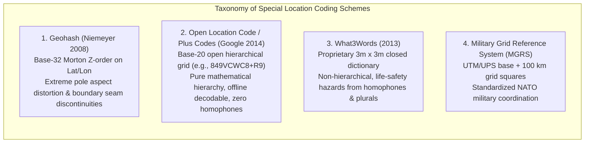
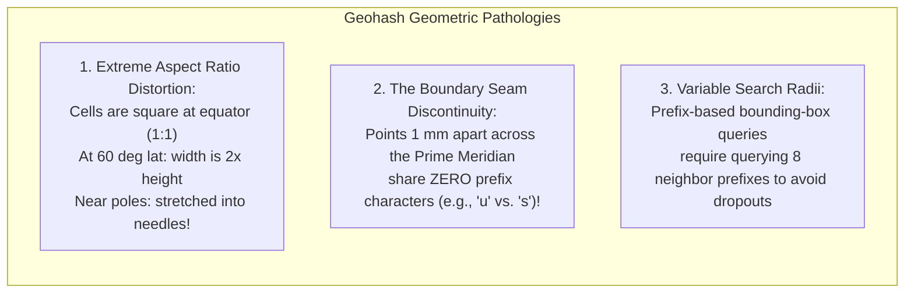
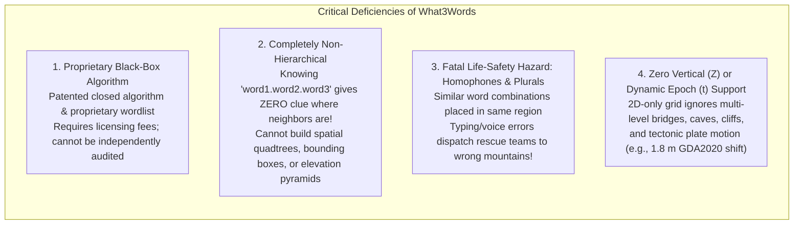

# Chapter 16: Discrete Global Grid Systems (S2, H3) and Special Location Coding Schemes

*Indexing a spherical/ellipsoidal planet without polar singularities or projection seams—and the pitfalls of geocoding schemes.*

---

## 16.3 Issues with Special Location Coding Schemes: Geohashes, Plus Codes, and Proprietary Word Grids

In parallel with mathematical Discrete Global Grid Systems (DGGS), the geospatial technology industry has developed numerous alphanumeric and linguistic location coding schemes designed to simplify coordinates for human communication, database indexing, and address geocoding. 

While schemes like **Geohash**, **Open Location Code (Plus Codes)**, and **What3Words** succeed in converting latitude and longitude into memorable strings, they introduce severe mathematical and operational pathologies when applied to digital elevation modeling, spatial analytics, or emergency dispatch.

---

### 16.3.1 Geohash: The Morton Z-Order Latitude/Longitude Trap

Invented by Gustavo Niemeyer in 2008, **Geohash** encodes latitude and longitude into an alphanumeric string using a base-32 character set (`0-9, b-z`, excluding `a, i, l, o` to avoid visual ambiguity). The encoding operates by interleaving bits of binary latitude and longitude in a 2D Morton Z-order curve.

While useful for simple key-value database queries, Geohash exhibits three fatal geometric flaws:

#### 1. Extreme Aspect Ratio Distortion
Because Geohash partitions geographic coordinates $(\varphi, \lambda)$ on an equirectangular plate carrée grid where each character appends 5 bits (alternating 3 longitude bits and 2 latitude bits on odd characters, and 2 longitude bits and 3 latitude bits on even characters), a Geohash of $n$ characters divides the globe into $2^{\lfloor (5n+1)/2 \rfloor}$ longitude intervals of $\Delta\lambda = 360^\circ / 2^{b_\lambda}$ and $2^{\lfloor 5n/2 \rfloor}$ latitude intervals of $\Delta\varphi = 180^\circ / 2^{b_\varphi}$. Because physical east-west distance scales with $\cos\varphi$, the cell aspect ratio $W / H = \frac{\Delta\lambda}{\Delta\varphi}\cos\varphi$ varies wildly across both character lengths and latitudes:
* At the Equator ($\varphi = 0^\circ$), a 6-character Geohash ($b_\lambda = 15, b_\varphi = 15$, so $\Delta\lambda = 2\,\Delta\varphi$) is already a $2:1$ rectangle ($1,223\text{ m}$ East-West $\times 610\text{ m}$ North-South).
* At $\varphi = 60^\circ\text{ N}$ (Seward, Alaska or Bergen, Norway), $\cos 60^\circ = 0.5$, making a 6-character Geohash nearly square ($612\text{ m} \times 611\text{ m}$), whereas a 5-character Geohash ($b_\lambda = 13, b_\varphi = 12$, where $\Delta\lambda = \Delta\varphi$ in degrees) becomes compressed to a $1:2$ narrow strip ($2.45\text{ km} \times 4.88\text{ km}$).
* Near the poles ($\varphi = 85^\circ$), $\cos 85^\circ \approx 0.0872$, stretching cells into thin $1:11.5$ wedges and rendering naive cell-based elevation slope or neighborhood filtering mathematically meaningless.

#### 2. The Boundary Seam Discontinuity (Equator, Prime Meridian, and Antimeridian)
In Geohash, prefix matching does **not** imply spatial proximity:
* Because the very first longitude bit splits the globe at the Prime Meridian ($\lambda = 0^\circ$) and wraps at the Antimeridian ($\lambda = \pm 180^\circ$), and the very first latitude bit splits the globe at the Equator ($\varphi = 0^\circ$), two points located $1\text{ millimeter}$ apart on opposite sides of any of these three global seams share **zero common prefix characters** (e.g., `s000000` just east/north of $(0^\circ, 0^\circ)$ vs. `ebpbpbp` just west/north, `kpbpbpb` just east/south, and `7zzzzzz` just west/south!).
* A spatial database query filtering by `WHERE geohash LIKE 's000%'` completely misses points separated by millimeters across the meridian or equator. Safe proximity queries require explicitly computing the Geohash strings of all 8 neighboring cells (handling $\pm 180^\circ$ wrap-around) before querying.

---

### 16.3.2 Open Location Code (OLC / Plus Codes)

Introduced by Doug Rinckes and Google's Zurich engineering team in October 2014, **Open Location Code (OLC)**—commonly known as **Plus Codes**—was engineered as an open, royalty-free public utility to provide short, unambiguous spatial addresses for regions lacking formal street addressing, as well as field survey benchmarks and remote tide gauges.

#### Key Engineering Features of Plus Codes
* **Open Standard & Offline Encoding:** OLC is defined by a concise mathematical specification (Apache 2.0 license). Conversion between WGS84 $(\varphi, \lambda)$ and Plus Codes requires zero network or database lookups and executes in microseconds on offline field microcontrollers.
* **Base-20 Clean Alphabet:** Uses 20 characters (`23456789CFGHJMPQRVWX`), excluding vowels and visually or acoustically ambiguous characters (`0, O, 1, I, l`), preventing both accidental natural-language profanity and handwritten transcription errors.
* **Strict Hierarchical Containment:** After shifting $(\varphi + 90^\circ, \lambda + 180^\circ)$ into positive degrees, the first four pairs of base-20 digits subdivide the globe by factors of $20 \times 20$ at each step ($20^\circ \to 1^\circ \to 0.05^\circ \to 0.0025^\circ \to 0.000125^\circ$). A 10-character Plus Code (e.g., `849VCWC8+R9`, with the `+` separator placed after the 8th character) defines a cell of $0.000125^\circ \times 0.000125^\circ$ ($\approx 13.9\text{ m} \times 13.9\text{ m}$ at the Equator), while an optional 11th character subdivides that square into a $4 \times 5$ grid ($\approx 3.5\text{ m} \times 2.8\text{ m}$). Truncating trailing characters yields the exact enclosing parent bounding box.

---

### 16.3.3 What3Words: Proprietary Locking, 3D/4D Blindness, and Life-Safety Hazards

Founded in March 2013, **What3Words (W3W)** partitions the globe into approximately 57 trillion $3\text{ m} \times 3\text{ m}$ squares and assigns each square a pseudo-random triplet of three dictionary words separated by dots (e.g., `filled.count.soap`).

While heavily marketed to consumer logistics and emergency services, What3Words exhibits five severe architectural and safety deficiencies when evaluated for surveying, digital elevation modeling, or search-and-rescue operations:

#### 1. Closed Proprietary Monopoly
Unlike latitude/longitude, UTM, MGRS, S2, H3, and Plus Codes—all of which are open public standards—What3Words is a proprietary, closed-source system covered by patents and copyright assertions. Agencies that store survey benchmarks or emergency waypoints exclusively as W3W triplets create a single-vendor lock-in where coordinates cannot be decoded without proprietary software or paid API keys.

#### 2. Total Lack of Spatial Hierarchy and Neighborhood Continuity
By design, W3W applies a pseudo-random block-shuffle hash to cell indices so that adjacent $3\text{ m}$ squares receive completely unrelated word triplets:
* Knowing `index.home.raft` provides **zero mathematical information** about the words of the square $1\text{ m}$ to the north.
* It is impossible to perform range scans, bounding-box queries, slope calculations, or multi-resolution DEM aggregation on W3W identifiers.

#### 3. The Homophone, Plural, and Typo Hazard in Emergency Dispatch
In mountain, cave, and maritime search-and-rescue, coordinates are transmitted over noisy VHF marine radio or weak cellular voice links under extreme stress. Peer-reviewed algorithmic analysis (Arthur, 2023) and independent security audits demonstrated that W3W's word list includes thousands of singular/plural pairs (e.g., `point` vs. `points`), homophones, and single-letter typos that resolve to valid squares within the **exact same metropolitan area or mountain range**, separated by $2\text{ to }50\text{ km}$—a distance close enough to look plausible to a dispatcher, yet far enough to be fatal for a stranded hiker or sinking vessel. Consequently, Mountain Rescue England and Wales, the British Cave Rescue Council, and maritime coast guards explicitly warn against relying on W3W without cross-checking numeric coordinates.

#### 4. Absence of Vertical ($z$) Dimension and Tectonic Epoch ($t$) Awareness
A $3\text{ m} \times 3\text{ m}$ horizontal square has **no vertical coordinate ($z$ or $d$)** and **no geodetic realization/epoch metadata**:
* On a vertical sea cliff, a multi-deck highway interchange, or a 40-story building, a single $3\text{ m} \times 3\text{ m}$ W3W square collapses hundreds of meters of vertical separation into one ambiguous token.
* Furthermore, W3W is tied to unversioned "WGS84" degrees. On fast-moving tectonic plates such as Australia ($\sim 7\text{ cm/yr}$ north-northeast, where switching from static `GDA94` to `GDA2020` shifted coordinates by $1.8\text{ m}$—more than half the width of a $3\text{ m}$ square!), a physical survey monument slowly drifts out of its original W3W square into an adjacent square with three completely different words!

---

### 16.3.4 Standardized Operational & Administrative Grid Codes: MGRS, USNG, Maidenhead, FIPS, and ISO 3166

In contrast to proprietary word hashes, operational defense, emergency management, radio propagation, and national elevation archives rely on open, hierarchical alphanumeric standards:
* **MGRS (Military Grid Reference System) and USNG (United States National Grid):** Built directly on the $6^\circ \times 8^\circ$ **UTM** Grid Zone Designator (e.g., `10T`, or Universal Polar Stereographic `UPS` zones `A, B, Y, Z` poleward of $84^\circ\text{ N}$ and $80^\circ\text{ S}$), followed by a 2-letter **$100\text{ km} \times 100\text{ km}$ square identifier** (e.g., `ET`), and an even number of metric Easting/Northing digits: 2 digits ($10\text{ km}$), 4 digits ($1\text{ km}$), 6 digits ($100\text{ m}$), 8 digits ($10\text{ m}$), or 10 digits (`10T ET 56789 12345`, $1\text{ m} \times 1\text{ m}$ precision). Because MGRS/USNG is a direct metric planar coordinates notation on the UTM/UPS projection, two points within the same $100\text{ km}$ square allow instant mental calculation of Euclidean distance $\Delta s = \sqrt{\Delta E^2 + \Delta N^2}$ and directly index USGS $1\text{ km} \times 1\text{ km}$ or $10\text{ km} \times 10\text{ km}$ 3DEP LiDAR tiles.
* **Maidenhead Locator System (1980):** An open alternating letter-digit-letter-digit hierarchical geocode (e.g., `CM87wk`) dividing the globe into $18 \times 18$ fields ($20^\circ \text{ lon} \times 10^\circ \text{ lat}$), $10 \times 10$ squares ($2^\circ \times 1^\circ$), and $24 \times 24$ subsquares ($5' \times 2.5'$), widely used in VHF/UHF radio line-of-sight terrain diffraction modeling.
* **ISO 3166 (1970) and FIPS / ANSI INCITS Codes (1974):** Administrative geocodes (`ISO 3166-1` alpha-2/alpha-3/numeric country codes and `ISO 3166-2` subdivision codes; U.S. 2-digit State + 3-digit County **FIPS 5-2 / 6-4** codes such as `06085` for Santa Clara County, CA). In national elevation programs (USGS 3DEP, FEMA Flood Insurance Rate Maps, NOAA CUDEM), FIPS and ISO 3166 codes serve as the primary catalog partitioning keys, though practitioners must never confuse administrative polygon keys with geometric grid cells (since county boundaries shift through annexation and coastal erosion).

---

### 16.3.5 Comparison of Special Coding Schemes

| Attribute | Geohash | Open Location Code (Plus Codes) | What3Words | Military Grid (MGRS) |
| :--- | :--- | :--- | :--- | :--- |
| **License / Status** | Open Domain | **Open Source (Apache 2.0)** | **Proprietary / Patented** | Open NATO Military Standard |
| **Underlying Geometry**| Morton Z-order on Lat/Lon | Hierarchical Quadtree-like | Arbitrary $3\text{ m} \times 3\text{ m}$ Grid | UTM / UPS Projection Grid |
| **Hierarchical?** | **Yes** (Prefix truncation) | **Yes** (Prefix truncation) | **No** (Zero spatial hierarchy)| **Yes** (Grid resolution digits) |
| **Offline Conversion** | Yes (Trivial math) | **Yes (Pure algorithm)** | No (Requires proprietary DB) | Yes (Standard map projection)|
| **Homophone Safe?** | Yes (No voice use) | **Yes (No vowels, clean base-20)**| **No (Severe homophone traps)**| Yes (Phonetic alphabet) |
| **Suitability for DEMs**| Poor (Aspect distortion)| Poor (Reference indexing only)| **Unusable** | Moderate (Local UTM tiles) |
