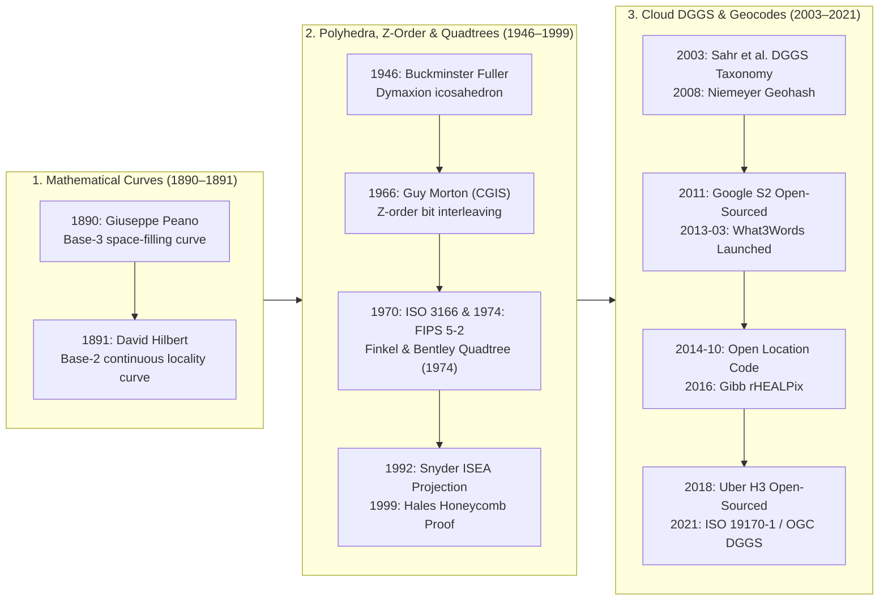
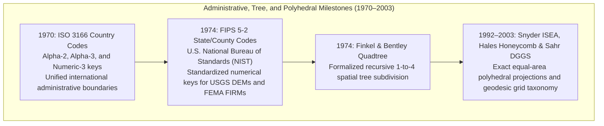

# Chapter 16: Discrete Global Grid Systems (S2, H3) and Special Location Coding Schemes

*Indexing a spherical/ellipsoidal planet without polar singularities or projection seams—and the pitfalls of geocoding schemes.*

---

## 16.4 Historical Evolution of Discrete Global Grids and Spatial Indexing (`gis-history` Context)

The emergence of Discrete Global Grid Systems and location coding schemes represents a 135-year convergence—cataloged in the [`gis-history`](../00-front-matter/gis-history-timeline.md) chronological archive—spanning abstract 19th-century set theory, mid-20th-century polyhedral cartography and early geodetic database design, administrative standardization, and 21st-century cloud-native planetary indexing.

---

### 16.4.1 Pure Mathematical Foundations and Polyhedral Globes (1890–1966)

#### 1890: Giuseppe Peano and the First Space-Filling Curve
In 1890, Italian mathematician Giuseppe Peano published *"Sur une courbe, qui remplit toute une aire plane"* in *Mathematische Annalen*, demonstrating a continuous surjective mapping from the unit line segment $[0, 1]$ onto the unit square $[0, 1]^2$. Constructed purely analytically using ternary (base-3) expansions without geometric illustrations, Peano's curve overturned the intuition that a 1D curve could not fill a 2D area—and laid the mathematical foundation for Aperture 9 ($3 \times 3$) multi-resolution indexing later used in `rHEALPix`.

#### 1891: David Hilbert and Geometric Locality
One year later, in 1891, David Hilbert published a two-page geometric construction in *Mathematische Annalen* introducing a recursive quadrant-subdivision curve using binary (base-2) reflections and $90^\circ$ rotations. Unlike Peano's curve or later bit-interleaving schemes, Hilbert's curve enters and exits each sub-quadrant at adjacent corners so that consecutive 1D steps always share an edge in 2D space. This **optimal spatial locality** ($\|\mathbf{p}(i) - \mathbf{p}(j)\|_2 \le \sqrt{6}\sqrt{|i-j|}$) became the direct mathematical engine for Google S2, Cloud-Optimized Point Clouds (`COPC`), and GeoParquet spatial sorting.

#### 1946 & 1966: Fuller's Dymaxion Icosahedron and Morton's CGIS Geodetic Index
* **1946 (Dymaxion Projection):** R. Buckminster Fuller patented the Dymaxion map projection, unfolding the sphere onto a 20-faced icosahedron oriented so that all 12 polyhedral vertices fall in ocean basins—the exact vertex orientation later adopted by Uber H3 to keep its 12 pentagon singularities off continental landmasses.
* **1966 (Morton Z-Order in CGIS):** Working with Roger Tomlinson on the **Canada Geographic Information System (CGIS)** at IBM Ottawa, Guy Macdonald Morton published *A Computer Oriented Geodetic Data Base and a New Technique in File Sequencing* (1966). To process continental elevation and land-inventory polygons stored on sequential magnetic tape, Morton interleaved the binary bits of $(x, y)$ tile coordinates to map 2D map sheets into a 1D sequential tape address—inventing the **Morton (Z-order) curve**.

---

### 16.4.2 Administrative Geocoding, Quadtrees, and Equal-Area Polyhedra (1970–2003)

#### 1970 & 1974: ISO 3166, FIPS 5-2, and Finkel & Bentley's Quadtree
* **1970 (ISO 3166):** The International Organization for Standardization initiated **ISO 3166** (first published in 1974), establishing standardized two-letter (`alpha-2`), three-letter (`alpha-3`), and three-digit numeric codes for countries and subdivisions.
* **1974 (FIPS 5-2 & The Quadtree):** The U.S. National Bureau of Standards (now NIST) standardized **FIPS PUB 5-2** (state codes) and **FIPS 6** (county codes), creating the universal tabular join keys for U.S. elevation and flood hazard catalogs. In the same year, Raphael Finkel and Jon Bentley published *"Quad trees a data structure for retrieval on composite keys"* in *Acta Informatica* (1974), formalizing recursive $1 \to 4$ planar subdivision in computer memory.

#### 1992, 1999 & 2003: Snyder's ISEA Projection, Hales's Honeycomb Proof, and Geodesic DGGS
* **1992 (Snyder Equal-Area Polyhedral Projection):** USGS cartographer John P. Snyder published *"An Equal-Area Map Projection for Polyhedral Globes"* in *Cartographica* (1992), deriving exact closed-form equations mapping spherical triangles onto flat icosahedral, octahedral, and tetrahedral faces with zero area distortion (**ISEA**).
* **1999/2001 (Hales's Honeycomb Theorem):** Mathematician Thomas C. Hales proved the 2,000-year-old Honeycomb Conjecture (published in *Discrete & Computational Geometry* in 2001), proving rigorously that regular hexagons provide the least-perimeter equal-area partitioning of the plane.
* **2003 (Sahr, White, & Kimerling DGGS Framework):** Kevin Sahr, Denis White, and A. Jon Kimerling published *"Geodesic discrete global grid systems"* (2003) along with the open-source `DGGRID` software, establishing the formal design taxonomy (base polyhedron, aperture ratio, cell topology, and projection) for modern Discrete Global Grid Systems.

---

### 16.4.3 The Cloud-Native Global Grid and Location Code Era (2008–2021)

#### 2008 & 2011: Geohash and Google S2 Geometry
* **2008 (Geohash):** Gustavo Niemeyer launched `geohash.org`, popularizing base-32 Morton Z-order string prefixes for web databases while exposing the high-latitude distortion and Prime Meridian/Equator seam pitfalls of equirectangular bit interleaving.
* **2011 (Google S2 Open-Sourced):** Google open-sourced the **S2 Geometry Library**, engineered by Eric Veach to power Google Maps, Google Earth, and distributed Bigtable/Spanner spatial indexes. By combining a 6-face cube projection, a fast piecewise-quadratic area-equalizing warp, and a 30-level 64-bit Hilbert curve quadtree, S2 turned complex spherical polygon and DEM tile queries into sub-millisecond 64-bit integer range scans (`S2RegionCoverer`).

#### 2013 & 2014: What3Words vs. Open Location Code (Plus Codes)
* **March 2013 (What3Words):** Chris Sheldrick and Jack Waley-Cohen launched **What3Words** as a proprietary $3\text{ m} \times 3\text{ m}$ three-word hash, drawing widespread consumer marketing alongside sharp technical warnings from mountain rescue and geospatial engineers over its closed licensing, lack of hierarchy, and homophone/plural dispatch errors.
* **October 2014 (Open Location Code / Plus Codes):** Doug Rinckes and Google's Zurich engineering team released **Open Location Code (OLC)** under the Apache 2.0 license, providing an open, offline, hierarchical, vowel-free base-20 alternative (`Plus Codes`).

#### 2016, 2018 & 2021: rHEALPix, Uber H3, and OGC / ISO Standardization
* **2016 (rHEALPix):** Robert G. Gibb (Landcare Research New Zealand) formulated **rHEALPix**, an ellipsoidal equal-area quadtree/aperture-9 DGGS anchored directly to WGS84/GRS80.
* **2018 (Uber H3 Open-Sourced):** Isaac Brodsky and Uber Engineering open-sourced **H3** under the Apache 2.0 license. Originally built for real-time dynamic surge pricing and ride dispatch, H3's 64-bit icosahedral Aperture 7 hexagonal index was rapidly integrated into PostGIS (`h3-pg`), DuckDB, BigQuery, and Snowflake for petabyte-scale point-cloud and terrain analytics.
* **2017–2021 (OGC Topic 21 / ISO 19170-1:2021):** The Open Geospatial Consortium and ISO published *Geographic Information — Discrete Global Grid Systems — Part 1: Core Reference System and Operations, and Equal-Area Earth Grid Systems*, codifying DGGS interoperability across international standards.

---

### 16.4.4 Chronological Summary of Global Grid and Spatial Indexing Milestones

| Year | Historical Milestone & Pioneers | Primary Mathematical / Architectural Innovation | Impact on Elevation & Bathymetric Modeling |
| :--- | :--- | :--- | :--- |
| **1890** | **Peano Curve** (*Giuseppe Peano*) | Continuous surjective base-3 mapping $[0,1] \to [0,1]^2$. | Establishes analytical space-filling curves and Aperture 9 ($3\times 3$) subdivision used in `rHEALPix`. |
| **1891** | **Hilbert Curve** (*David Hilbert*) | Recursive base-2 quadrant reflection/rotation curve with $\alpha = 1/2$ Hölder continuity. | Minimizes 1D-to-2D bounding perimeter; powers Google S2 cell IDs, `COPC` octrees, and GeoParquet spatial sorting. |
| **1946** | **Dymaxion Icosahedral Map** (*R. Buckminster Fuller*) | Unfolds sphere onto a 20-faced icosahedron with all 12 vertices placed in oceans. | Provides the vertex orientation adopted by Uber H3 so all 12 pentagon singularities avoid continental land. |
| **1966** | **Morton Z-Order Curve** (*Guy M. Morton*, CGIS / IBM) | Bitwise interleaving of binary $(x, y)$ coordinates into a 1D integer key. | Enables fast SIMD bit-interleaving for quadtrees and Geohashes, though subject to quadrant-boundary jumps. |
| **1970** | **ISO 3166 Country Codes** (*ISO*) | Standardized two-letter, three-letter, and numeric country/subdivision identifiers. | Universal administrative partition keys for international DEM and hydrographic catalog metadata. |
| **1974** | **Quadtree & FIPS 5-2** (*R. Finkel & J. Bentley*; *NBS/NIST*) | Formalizes recursive $1 \to 4$ tree subdivision; standardizes U.S. state/county FIPS codes. | Quadtrees underpin Variable-Resolution BAGs (`VR-BAG`), S2, and 3D terrain mesh Level-of-Detail (LoD) hierarchies. |
| **1980** | **Maidenhead Locator System** (*John Morris*, IARU) | Hierarchical alternating letter-digit-letter-digit global grid (`CM87wk`). | Standardizes global VHF/UHF radio propagation and terrain line-of-sight horizon indexing. |
| **1992** | **ISEA Polyhedral Projection** (*John P. Snyder*, USGS) | Exact area-preserving projection from sphere onto icosahedral/octahedral faces. | Enables unbiased global statistical aggregation of topography and climate variables (`ISEA3H`, `ISEA4D`). |
| **1999 / 2001** | **Honeycomb Conjecture Proof** (*Thomas C. Hales*) | Proves regular hexagons minimize perimeter-to-area ratio among equal-area planar tilings. | Provides the rigorous geometric foundation for hexagonal terrain discretization and 6-neighbor flow routing. |
| **2003** | **Geodesic DGGS Taxonomy & `DGGRID`** (*K. Sahr, D. White, & A. J. Kimerling*) | Formalizes polyhedron, aperture ($3, 4, 7$), topology, and equal-area design rules. | Establishes open-source generation of multi-resolution equal-area global grids for environmental modeling. |
| **2008** | **Geohash** (*Gustavo Niemeyer*) | Base-32 ASCII string encoding of interleaved latitude/longitude bits. | Popularizes prefix-based point indexing while exposing Prime Meridian, Equator, and polar aspect-ratio traps. |
| **2011** | **Google S2 Geometry Library** (*Eric Veach et al.*, Google) | Cube-to-sphere projection with piecewise quadratic warp and 64-bit Hilbert quadtree (Levels 0–30). | Provides exact 1:4 hierarchical containment down to $<1\text{ cm}^2$ and fast `S2RegionCoverer` range scans. |
| **2013 (Mar)** | **What3Words** (*C. Sheldrick & J. Waley-Cohen*) | Proprietary $3\text{ m} \times 3\text{ m}$ three-word hash table across 57 trillion squares. | Illustrates why closed-source, non-hierarchical, homophone-prone word grids are unsafe for rescue and surveying. |
| **2014 (Oct)** | **Open Location Code / Plus Codes** (*Doug Rinckes et al.*, Google Zurich) | Open Apache-2.0 base-20 hierarchical alphanumeric coordinate encoding (`849VCWC8+R9`). | Enables offline, royalty-free, typo-resistant human-readable addressing without database lookups. |
| **2016** | **rHEALPix DGGS** (*Robert G. Gibb*, Landcare Research NZ) | Equal-area, iso-latitude hierarchical grid defined directly on the oblate WGS84 ellipsoid. | Eliminates spherical-vs-ellipsoidal area distortion while preserving exact $1:9$ or $1:4$ quadtree containment. |
| **2018** | **Uber H3 Open-Sourced** (*Isaac Brodsky et al.*, Uber) | 64-bit icosahedral gnomonic Aperture 7 hexagonal hierarchy (Resolutions 0–15). | Becomes the de facto standard for isotropic 6-neighbor terrain analytics in DuckDB, PostGIS, BigQuery, and Snowflake. |
| **2021** | **ISO 19170-1 / OGC Topic 21** (*ISO / OGC*) | International abstract specification for Discrete Global Grid Systems. | Standardizes cell addressing, topological quantization, and equal-area conformance rules across vendors. |
