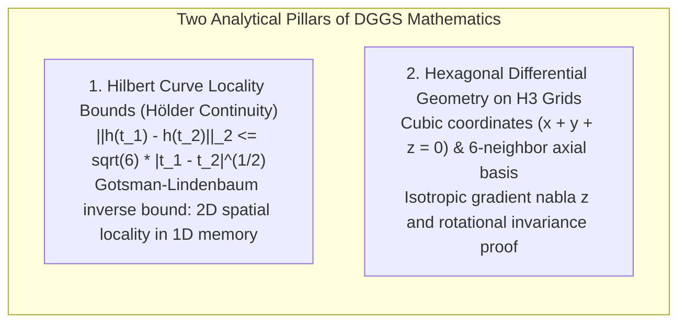
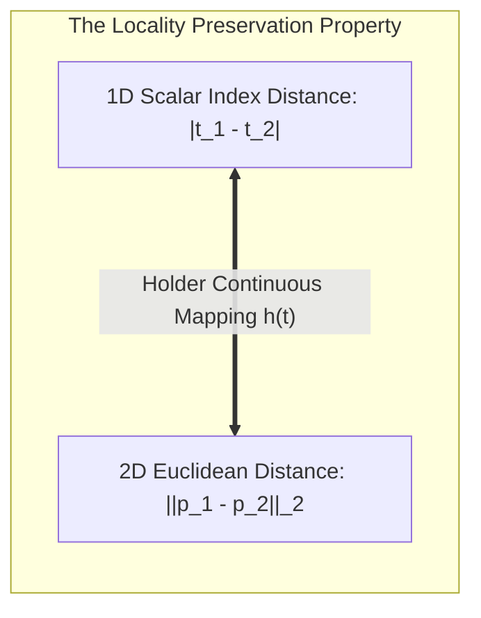
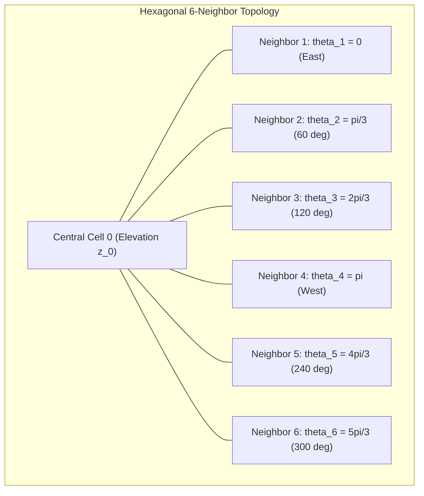

# Chapter 16: Discrete Global Grid Systems (S2, H3) and Special Location Coding Schemes

*Indexing a spherical/ellipsoidal planet without polar singularities or projection seams—and the pitfalls of geocoding schemes.*

---

## 16.5 Mathematical Foundations of Global Grid Systems

This section provides complete mathematical derivations for the two foundational analytical formulations in discrete global grids: the Hilbert space-filling curve locality theorem, and the derivation of isotropic gradient and discrete Laplacian operators on hexagonal H3 elevation meshes.

---

### 16.5.1 The Hilbert Space-Filling Curve Locality Theorem

Let $h: [0, 1] \to [0, 1]^2$ denote the continuous 2D Hilbert space-filling curve mapping a 1D scalar parameter $t \in [0, 1]$ to a 2D Euclidean coordinate $\mathbf{p} = [x, y]^\top \in [0, 1]^2$.

#### Step 1: Forward Hölder Continuity and Discrete Metric Bounds (Gotsman & Lindenbaum 1996)
For a discrete $2^k \times 2^k$ grid indexed by the bijective Hilbert mapping $H: [0, 4^k - 1] \to [0, 2^k - 1]^2$, let $\mathbf{p}(i) = [x(i), y(i)]^\top$ denote the 2D grid coordinates of 1D Hilbert index $i \in \{0, \dots, 4^k - 1\}$. In the continuous limit $t = i / 4^k \in [0, 1]$ and $h(t) = \mathbf{p}(i) / 2^k \in [0, 1]^2$, the forward mapping $h(t)$ is continuous everywhere (though nowhere differentiable) and satisfies a **Hölder continuity condition of exponent $\alpha = 1/2$**:

$$\|\mathbf{p}(i) - \mathbf{p}(j)\|_\infty \le 2\sqrt{|i - j|}, \qquad \|\mathbf{p}(i) - \mathbf{p}(j)\|_2 \le \sqrt{6}\sqrt{|i - j|}$$

$$\|h(t_1) - h(t_2)\|_2 \le \sqrt{6} \, |t_1 - t_2|^{1/2} \quad \forall t_1, t_2 \in [0, 1]$$

* **Proof and Gotsman–Lindenbaum Dilation Constant:** Gotsman and Lindenbaum (1996) formalized the worst-case discrete dilation metric $L_p(C) = \max_{i < j} \frac{\|\mathbf{p}(i) - \mathbf{p}(j)\|_p^m}{|i - j|}$ for an $m$-dimensional space-filling curve $C$. For the 2D ($m = 2$) Hilbert curve $H_2^k$ under the Euclidean ($p = 2$) and supremum ($p = \infty$) norms, they proved the tight bounds:
  $$6\left(1 - \mathcal{O}(2^{-k})\right) \le L_2(H_2^k) = \max_{i \ne j} \frac{\|\mathbf{p}(i) - \mathbf{p}(j)\|_2^2}{|i - j|} \le 6, \qquad L_\infty(H_2^k) = \max_{i \ne j} \frac{\|\mathbf{p}(i) - \mathbf{p}(j)\|_\infty^2}{|i - j|} \le 4$$
  By contrast, the Morton (Z-order) curve suffers from $L_2(Z_2^k) \to \infty$ as $k \to \infty$ because consecutive indices $i$ and $i+1$ jump across quadrant diagonals by distances up to $\mathcal{O}(2^k)$.

#### Step 2: Inverse Topological Non-Continuity and Expected Range-Cluster Bounds (Moon et al. 2001)
In spatial database indexing, we also ask the inverse question: *If two points $\mathbf{p}_1, \mathbf{p}_2$ are close in 2D space, what happens to their 1D Hilbert indices $t_1, t_2$?*

By **Netto's Theorem (1879)** on the topological invariance of dimension, no continuous bijection can exist between $[0, 1]$ and $[0, 1]^2$; therefore, the inverse mapping $h^{-1}: [0, 1]^2 \to [0, 1]$ **cannot be globally continuous**. Specifically, two points separated by an infinitesimal Euclidean distance $\|\mathbf{p}_1 - \mathbf{p}_2\|_2 = \epsilon \to 0$ on opposite sides of the central horizontal boundary separating Quadrant 0 ($t \in [0, 1/4]$) and Quadrant 3 ($t \in [3/4, 1]$) can have a worst-case 1D parameter jump approaching $|t_1 - t_2| \to 1$.

However, while a *single* 1D interval $[t_{\min}, t_{\max}]$ cannot tightly bound an arbitrary straddling 2D window, Gotsman and Lindenbaum (1996) and Moon et al. (2001) proved two remarkable **average-case and multi-interval clustering theorems**:
1. **Average-Case Inverse Locality:** Averaged over all point pairs separated by Euclidean distance $d = \|\mathbf{p}_1 - \mathbf{p}_2\|_2 \ll 1$, the expected 1D Hilbert index separation scales linearly with area ($d^2$) except for boundary crossings, which occur with probability $\mathcal{O}(d)$.
2. **Closed-Form Cluster Count for 2D Query Windows (Moon et al. 2001):** When decomposed into a minimal set of disjoint contiguous 1D Hilbert index ranges $\{[i_{\text{start},m}, i_{\text{end},m}]\}_{m=1}^{N_{\text{clusters}}}$, the exact asymptotic expected number of contiguous 1D disk/memory seeks required to retrieve any convex 2D query region $Q \subset [0, 2^k-1]^2$ is equal to **one-half of the region's boundary perimeter** $P_Q$:
   $$\mathbb{E}\left[N_{\text{clusters}}(Q)\right] = \frac{1}{2} P_Q \quad (\text{in grid cell units as } k \to \infty)$$
   Furthermore, in quadtree-aware indexers such as Google S2's `S2RegionCoverer`, any arbitrary 2D spherical cap or bounding polygon is covered by a small bounded set (typically $4\text{ to }8$) of multi-resolution Hilbert range intervals `[cell_id_min, cell_id_max]`, minimizing disk seeks and HTTP `Range` requests in cloud elevation archives.

---

### 16.5.2 Hexagonal Differential Geometry: Isotropic Gradients on H3

In digital elevation analysis, the continuous surface gradient $\nabla z = \left[ \frac{\partial z}{\partial x}, \frac{\partial z}{\partial y} \right]^\top = [p, q]^\top$ and Hessian matrix $\mathbf{H}(z) = \begin{bmatrix} z_{xx} & z_{xy} \\ z_{xy} & z_{yy} \end{bmatrix}$ determine terrain slope $\alpha = \arctan(\|\nabla z\|_2)$, downslope aspect $\psi_{\text{aspect}} = \text{atan2}(-z_x, -z_y)$, and curvature. We now derive the exact discrete gradient vector and Laplacian operator ($\nabla^2 z = \text{tr}(\mathbf{H}(z)) = z_{xx} + z_{yy}$) on a regular hexagonal grid with inter-cell center distance $d$.

#### Step 1: Directional Unit Vectors
Let cell $0$ be centered at the local tangent plane origin $(0,0)$ with elevation $z_0$. Its six immediate neighbors, indexed $k \in \{1, \dots, 6\}$, are located at radial distance $d$ along unit direction vectors $\hat{\mathbf{e}}_k$:

$$\hat{\mathbf{e}}_k = \begin{bmatrix} \cos\theta_k \\ \sin\theta_k \end{bmatrix} = \begin{bmatrix} \cos\left(\frac{k-1}{3}\pi\right) \\ \sin\left(\frac{k-1}{3}\pi\right) \end{bmatrix}, \quad \text{for } k = 1, \dots, 6$$

Explicitly:
* $\hat{\mathbf{e}}_1 = [1, 0]^\top$, $\quad \hat{\mathbf{e}}_2 = [\frac{1}{2}, \frac{\sqrt{3}}{2}]^\top$, $\quad \hat{\mathbf{e}}_3 = [-\frac{1}{2}, \frac{\sqrt{3}}{2}]^\top$
* $\hat{\mathbf{e}}_4 = [-1, 0]^\top$, $\quad \hat{\mathbf{e}}_5 = [-\frac{1}{2}, -\frac{\sqrt{3}}{2}]^\top$, $\quad \hat{\mathbf{e}}_6 = [\frac{1}{2}, -\frac{\sqrt{3}}{2}]^\top$

#### Step 2: Directional Taylor Series Expansion
Assuming the elevation surface $z(\mathbf{x})$ is twice continuously differentiable ($C^2$), the elevation at neighbor $k$ located at position $\mathbf{x}_k = d \, \hat{\mathbf{e}}_k$ is expanded in a second-order 2D Taylor series:

$$z_k = z(\mathbf{x}_k) = z_0 + d \, \hat{\mathbf{e}}_k^\top \nabla z + \frac{1}{2} d^2 \, \hat{\mathbf{e}}_k^\top \mathbf{H}(z) \hat{\mathbf{e}}_k + \mathcal{O}(d^3)$$

where $\nabla z = [z_x, z_y]^\top$ is the spatial gradient vector and $\mathbf{H}(z) = \begin{bmatrix} z_{xx} & z_{xy} \\ z_{xy} & z_{yy} \end{bmatrix}$ is the symmetric $2 \times 2$ Hessian matrix (per `notation-and-symbols.md` §2.3).

#### Step 3: Deriving the Discrete Gradient ($\nabla z$)
To isolate the first-order gradient $\nabla z$, notice that the second-order quadratic form $\hat{\mathbf{e}}_k^\top \mathbf{H}(z) \hat{\mathbf{e}}_k$ is even under inversion ($\hat{\mathbf{e}}_{k+3} = -\hat{\mathbf{e}}_k$) and cancels identically across opposing neighbor pairs ($180^\circ$ apart):
* Pair 1: $\hat{\mathbf{e}}_1 = -\hat{\mathbf{e}}_4 \implies z_1 - z_4 = 2 d \, \hat{\mathbf{e}}_1^\top \nabla z + \mathcal{O}(d^3)$
* Pair 2: $\hat{\mathbf{e}}_2 = -\hat{\mathbf{e}}_5 \implies z_2 - z_5 = 2 d \, \hat{\mathbf{e}}_2^\top \nabla z + \mathcal{O}(d^3)$
* Pair 3: $\hat{\mathbf{e}}_3 = -\hat{\mathbf{e}}_6 \implies z_3 - z_6 = 2 d \, \hat{\mathbf{e}}_3^\top \nabla z + \mathcal{O}(d^3)$

Summing the vector-weighted differences over all six neighbors:

$$\sum_{k=1}^6 (z_k - z_0) \hat{\mathbf{e}}_k = d \sum_{k=1}^6 (\hat{\mathbf{e}}_k^\top \nabla z) \hat{\mathbf{e}}_k + \mathcal{O}(d^3) = d \left[ \sum_{k=1}^6 \hat{\mathbf{e}}_k \hat{\mathbf{e}}_k^\top \right] \nabla z + \mathcal{O}(d^3)$$

We evaluate the $2 \times 2$ outer product structure tensor $\mathbf{M} = \sum_{k=1}^6 \hat{\mathbf{e}}_k \hat{\mathbf{e}}_k^\top$:

$$\mathbf{M} = \sum_{k=1}^6 \begin{bmatrix} \cos^2\theta_k & \cos\theta_k \sin\theta_k \\ \cos\theta_k \sin\theta_k & \sin^2\theta_k \end{bmatrix}$$

Using the exact trigonometric summation identities for 6-fold rotational symmetry:
$$\sum_{k=1}^6 \cos^2\left(\frac{k-1}{3}\pi\right) = 3, \qquad \sum_{k=1}^6 \sin^2\left(\frac{k-1}{3}\pi\right) = 3, \qquad \sum_{k=1}^6 \cos\theta_k \sin\theta_k = 0$$

Therefore, the structure tensor $\mathbf{M}$ is an exact isotropic scalar multiple of the identity matrix:

$$\mathbf{M} = \begin{bmatrix} 3 & 0 \\ 0 & 3 \end{bmatrix} = 3 \, \mathbf{I}_{2}$$

Substituting $\mathbf{M} = 3\mathbf{I}_2$ into the summation equation yields:

$$\sum_{k=1}^6 (z_k - z_0) \hat{\mathbf{e}}_k = 3 d \, \nabla z + \mathcal{O}(d^3)$$

Solving directly for the continuous gradient vector $\nabla z$ (and noting $\sum_{k=1}^6 z_0 \hat{\mathbf{e}}_k = \mathbf{0}$):

$$\nabla z = \frac{1}{3 d} \sum_{k=1}^6 (z_k - z_0) \hat{\mathbf{e}}_k = \frac{1}{3 d} \sum_{k=1}^6 z_k \hat{\mathbf{e}}_k + \mathcal{O}(d^2)$$

Expanding into explicit $x$ and $y$ components:

$$\frac{\partial z}{\partial x} \approx \frac{1}{3 d} \left( z_1 - z_4 + \frac{1}{2}(z_2 - z_3 - z_5 + z_6) \right)$$

$$\frac{\partial z}{\partial y} \approx \frac{1}{3 d} \left( \frac{\sqrt{3}}{2}(z_2 + z_3 - z_5 - z_6) \right) = \frac{1}{2\sqrt{3} d} (z_2 + z_3 - z_5 - z_6)$$

#### Step 4: Deriving the Discrete Laplacian ($\nabla^2 z$)
Summing the scalar elevation differences across all six neighbors:

$$\sum_{k=1}^6 (z_k - z_0) = d \, \nabla z^\top \left(\sum_{k=1}^6 \hat{\mathbf{e}}_k\right) + \frac{1}{2} d^2 \sum_{k=1}^6 \hat{\mathbf{e}}_k^\top \mathbf{H}(z) \hat{\mathbf{e}}_k + \mathcal{O}(d^4)$$

Because $\sum_{k=1}^6 \hat{\mathbf{e}}_k = \mathbf{0}$ (and all odd-order third derivative terms likewise cancel by central symmetry), the first- and third-order terms vanish identically! Expanding the second-order Hessian trace:

$$\sum_{k=1}^6 \hat{\mathbf{e}}_k^\top \mathbf{H}(z) \hat{\mathbf{e}}_k = \text{tr}\left(\mathbf{H}(z) \sum_{k=1}^6 \hat{\mathbf{e}}_k \hat{\mathbf{e}}_k^\top\right) = \text{tr}\big(\mathbf{H}(z) \cdot 3\mathbf{I}_2\big) = 3(z_{xx} + z_{yy}) = 3 \nabla^2 z$$

Substituting this into the elevation sum yields:

$$\sum_{k=1}^6 (z_k - z_0) = \frac{3}{2} d^2 \nabla^2 z + \mathcal{O}(d^4) \implies \nabla^2 z = \frac{2}{3 d^2} \sum_{k=1}^6 (z_k - z_0) + \mathcal{O}(d^2)$$

#### Step 5: Worked Numerical Example on a Coastal H3 Cell
Consider an H3 Resolution 11 cell on a coastal bluff where the mean hexagon edge length is $r_{\text{hex}} = 24.91\text{ m}$ and the center-to-center distance to its 6 neighbors is $d = \sqrt{3}\,r_{\text{hex}} = 43.15\text{ m}$. Suppose the central cell has orthometric elevation $z_0 = 12.00\text{ m}$ ($\sigma_z = 0.10\text{ m}$) and its six neighbors at local angles $\theta_1, \dots, \theta_6$ have elevations:
$$z_1 = 8.40\text{ m}, \quad z_2 = 10.10\text{ m}, \quad z_3 = 13.90\text{ m}, \quad z_4 = 15.80\text{ m}, \quad z_5 = 14.10\text{ m}, \quad z_6 = 10.30\text{ m}$$
1. **Gradient Components:**
   $$\frac{\partial z}{\partial x} = \frac{8.40 - 15.80 + 0.5(10.10 - 13.90 - 14.10 + 10.30)}{3 \times 43.15\text{ m}} = \frac{-7.40 + 0.5(-7.60)}{129.45\text{ m}} = \frac{-11.20}{129.45\text{ m}} = -0.08652\text{ m}\cdot\text{m}^{-1}$$
   $$\frac{\partial z}{\partial y} = \frac{10.10 + 13.90 - 14.10 - 10.30}{2\sqrt{3} \times 43.15\text{ m}} = \frac{-0.40}{149.48\text{ m}} = -0.00268\text{ m}\cdot\text{m}^{-1}$$
2. **Slope Angle ($\alpha$), Downslope Aspect ($\psi_{\text{aspect}}$), and Uncertainty:**
   $$\alpha = \arctan\left(\sqrt{(-0.08652)^2 + (-0.00268)^2}\right) = \arctan(0.08656) = 4.947^\circ, \qquad \sigma_{\partial z/\partial x} = \frac{0.10\text{ m}}{\sqrt{3} \times 43.15\text{ m}} = 0.00134\text{ m}\cdot\text{m}^{-1} \; (\approx 0.077^\circ)$$
   $$\psi_{\text{aspect}} = \text{atan2}(-z_x, -z_y) = \text{atan2}(+0.08652, +0.00268) = 88.23^\circ \quad (\text{steepest descent toward East})$$
3. **Discrete Laplacian ($\nabla^2 z$):**
   $$\nabla^2 z = \frac{2}{3 \times (43.15\text{ m})^2}\big((8.40 + 10.10 + 13.90 + 15.80 + 14.10 + 10.30) - 6(12.00)\big) = \frac{2 \times (+0.60\text{ m})}{5585.8\text{ m}^2} = +2.15 \times 10^{-4}\text{ m}^{-1}$$

#### Proof of Perfect Rotational Invariance
Notice that in both the gradient $\nabla z$ and Laplacian $\nabla^2 z$ derivations, the structure tensor $\mathbf{M} = 3\mathbf{I}_2$ is identical under any arbitrary rotation $\theta_0$ of the hexagonal grid axes:

$$\sum_{k=1}^6 \hat{\mathbf{e}}_k(\theta_k + \theta_0) \hat{\mathbf{e}}_k^\top(\theta_k + \theta_0) = 3 \, \mathbf{I}_{2} \quad \forall \theta_0 \in [0, 2\pi)$$

This proves mathematically that **the hexagonal discrete gradient and Laplacian operators are completely isotropic**: unlike square rasters, terrain slope and flow direction computed on an H3 hexagonal grid are invariant to the orientation of the local coordinate axes.
