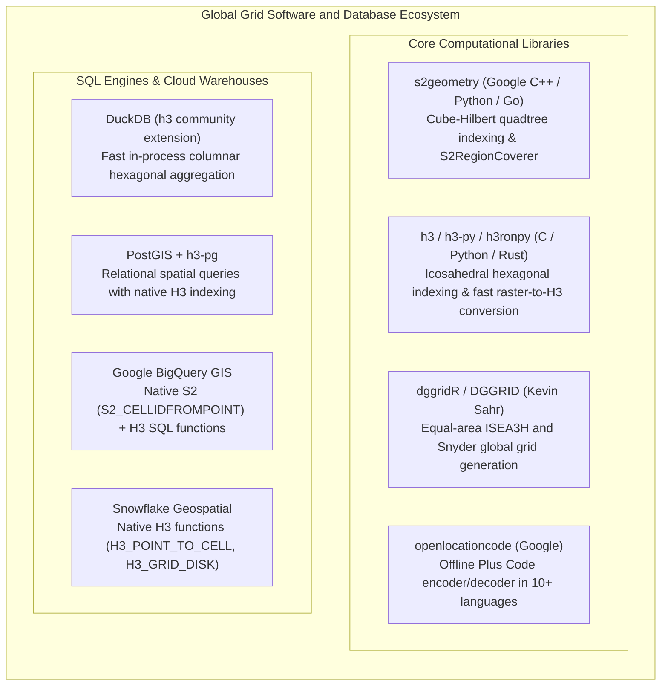

# Chapter 16: Discrete Global Grid Systems (S2, H3) and Special Location Coding Schemes

*Indexing a spherical/ellipsoidal planet without polar singularities or projection seams—and the pitfalls of geocoding schemes.*

---

## 16.6 Software Ecosystem for Global Grids, Spatial Indexing, and Cloud Databases

The adoption of Discrete Global Grid Systems has been driven by modern analytical databases and open-source libraries that replace complex spherical spatial joins with lightning-fast 64-bit integer hashing. This section explores the software ecosystem powering DGGS elevation indexing across Python, SQL databases, and cloud data warehouses.



---

### 16.6.1 Open-Source Core Libraries (`h3-py`, `h3ronpy`, `s2geometry`, `dggridR`)

#### 1. Uber H3 in Python (`h3-py`): Orientation-Aware Isotropic Elevation Gradients
The `h3-py` library wraps Uber's C core (`libh3`), providing sub-microsecond hexagonal indexing and ring traversal. Because H3 cells lie on 20 differently oriented icosahedral faces and alternate between Class II and Class III orientations ($\approx 19.1066^\circ$ rotation at each resolution), the 6 neighbors returned by `h3.grid_ring(center_hex, 1)` are not aligned with geographic East ($\theta_1 = 0^\circ$). To compute true local East-North-Up ($\text{ENU}$) elevation gradients $\nabla z = [\partial z/\partial E, \partial z/\partial N]^\top$ on any H3 cell (while also handling the 12 pentagon singularities), we project the 6 neighbor differences along their actual topocentric East and North offsets $(\Delta E_k, \Delta N_k)$:

```python
"""Orientation-aware elevation gradient and Laplacian on H3 cells using h3-py."""

import h3
import numpy as np

WGS84_A = 6378137.0
WGS84_E2 = 0.00669437999014


def compute_h3_elevation_gradient(
    center_hex: str,
    elevation_db: dict[str, float],
    uncertainty_db: dict[str, float] | None = None,
) -> dict:
  """Computes topocentric East-North gradient, slope, aspect, and Laplacian on H3."""
  z0 = elevation_db.get(center_hex)
  if z0 is None:
    return {"status": "ERROR", "reason": "Center cell missing elevation"}

  # 1. Check for the 12 icosahedral vertex pentagons (Euler characteristic chi=2)
  if h3.is_pentagon(center_hex):
    return {"status": "PENTAGON", "reason": "Cell is one of 12 H3 pentagons"}

  # 2. Retrieve the 6 immediate ring-1 neighbors and their elevations
  neighbors = list(h3.grid_ring(center_hex, 1))
  z_vals = [elevation_db.get(h) for h in neighbors]
  if any(v is None for v in z_vals):
    return {"status": "ERROR", "reason": "Missing neighbor elevations"}

  # 3. Convert neighbor (lat, lon) centroids to local topocentric (dE, dN) meters
  lat0_deg, lon0_deg = h3.cell_to_latlng(center_hex)
  lat0 = np.radians(lat0_deg)
  sin_lat = np.sin(lat0)
  # Ellipsoidal prime vertical N(phi) and meridional M(phi) radii of curvature
  n_rad = WGS84_A / np.sqrt(1.0 - WGS84_E2 * sin_lat**2)
  m_rad = WGS84_A * (1.0 - WGS84_E2) / ((1.0 - WGS84_E2 * sin_lat**2) ** 1.5)

  offsets_en = []
  dz_vec = []
  for h_k, z_k in zip(neighbors, z_vals):
    lat_k, lon_k = h3.cell_to_latlng(h_k)
    # Wrap longitude delta across +/-180 deg antimeridian seam!
    dlon_deg = (lon_k - lon0_deg + 180.0) % 360.0 - 180.0
    d_east = np.radians(dlon_deg) * n_rad * np.cos(lat0)
    d_north = np.radians(lat_k - lat0_deg) * m_rad
    offsets_en.append([d_east, d_north])
    dz_vec.append(z_k - z0)

  A_mat = np.array(offsets_en)  # Shape (6, 2): [dE_k, dN_k]
  dz_arr = np.array(dz_vec)  # Shape (6,)

  # 4. Solve isotropic linear least-squares gradient: A_mat @ [dz_dE, dz_dN] = dz
  # On a regular hexagon of radius d, A_mat.T @ A_mat == 3 * d^2 * I_2
  grad_en, _, _, _ = np.linalg.lstsq(A_mat, dz_arr, rcond=None)
  dz_de, dz_dn = float(grad_en[0]), float(grad_en[1])

  # 5. Compute slope angle (alpha), clockwise aspect from North, and Laplacian
  slope_rad = np.arctan(np.hypot(dz_de, dz_dn))
  aspect_deg = float(np.degrees(np.arctan2(-dz_de, -dz_dn)) % 360.0)
  d_mean = float(np.mean(np.linalg.norm(A_mat, axis=1)))
  laplacian = float((2.0 / (3.0 * d_mean**2)) * np.sum(dz_arr))

  # 6. Propagate 1-sigma vertical uncertainty into gradient standard error
  sigma_z = uncertainty_db.get(center_hex, 0.10) if uncertainty_db else 0.10
  sigma_grad = float(sigma_z / (np.sqrt(3.0) * d_mean))

  return {
      "status": "SUCCESS",
      "h3_index": center_hex,
      "resolution": h3.get_resolution(center_hex),
      "elevation_m": z0,
      "mean_neighbor_dist_m": round(d_mean, 3),
      "slope_deg": round(float(np.degrees(slope_rad)), 4),
      "aspect_deg": round(aspect_deg, 2),
      "laplacian_m_inv": laplacian,
      "sigma_grad_m_per_m": round(sigma_grad, 6),
  }
```

#### 2. High-Performance Raster-to-H3 Conversion (`h3ronpy`)
When converting gridded GeoTIFF DEMs (`rasterio` / `numpy` arrays) into millions of H3 cells, iterating pixel-by-pixel in Python is prohibitively slow. The open-source **`h3ronpy`** library (built in Rust on top of `h3o` and Apache Arrow/Polars/Pandas) vectorizes raster-to-H3 conversion and hierarchical compaction in native compiled code:

```python
"""Vectorized GeoTIFF DEM conversion to H3 cells using rasterio and h3ronpy."""

from h3ronpy.pandas.raster import raster_to_dataframe
import numpy as np
import rasterio

# Input raster transform must be in WGS84 (EPSG:4326) geographic degrees
with rasterio.open("coastal_tbdem_wgs84.tif") as src:
  z_band = src.read(1, masked=True).filled(np.nan)
  # Convert raster pixels directly to an H3 Resolution 11 DataFrame ('cell', 'value')
  df_h3 = raster_to_dataframe(
      in_raster=z_band,
      transform=src.transform,
      h3_resolution=11,
      nodata_value=np.nan,
      compact=False,
      geo=False,
  )
  # Aggregate per-cell mean, min, positive-up (+z) shoal max, and sub-grid std
  dem_h3 = df_h3.groupby("cell")["value"].agg(
      z_mean="mean", z_min="min", z_shoal_max="max", z_roughness="std", n_pixels="count"
  )
```

#### 3. Google S2 Geometry (`s2geometry`) and Region Covering
In C++, Go, Java, and Python (`s2sphere` or `pywraps2`), S2 indexes points into 64-bit Hilbert integers and computes compact multi-level quadtree coverings (`S2RegionCoverer`) for arbitrary bounding polygons:

```python
import s2sphere

# 1. Define a geodetic point (WGS84 lat, lon) at Mount Rainier summit
lat_lon = s2sphere.LatLng.from_degrees(46.8529, -121.7604)
point = lat_lon.to_point()

# 2. Create 64-bit S2 Cell ID at Level 14 (~520 m cell edge) and Level 30 (<1 cm)
cell_l14 = s2sphere.CellId.from_point(point).parent(14)
cell_l30 = s2sphere.CellId.from_point(point)
print(f"S2 L14 uint64: {cell_l14.id()} | token: {cell_l14.to_token()}")
print(
    f"S2 L14 descendant range: [{cell_l14.range_min().id()},"
    f" {cell_l14.range_max().id()}]"
)
assert cell_l14.range_min().id() <= cell_l30.id() <= cell_l14.range_max().id()
```

---

### 16.6.2 SQL Databases: DuckDB, PostGIS (`h3-pg`), BigQuery GIS, and Snowflake

Modern spatial databases and cloud data warehouses leverage 64-bit DGGS cell IDs to execute multi-billion-row elevation joins as integer hash or merge joins, bypassing expensive planar or spherical polygon-intersection predicates:

#### 1. DuckDB In-Process Hexagonal Point-Cloud Gridding
DuckDB's `h3` extension enables out-of-core SQL gridding of raw LiDAR or multibeam parquet files into both unbiased mean terrain cells and shoal-biased hydrographic navigation cells:

```sql
INSTALL h3 FROM community;
LOAD h3;

-- Grid 100M topo-bathymetric points into Resolution 10 (~65.9 m edge) H3 cells
-- Note: ANSI/DuckDB SQL forbids nested aggregates (MEDIAN(... - MEDIAN(...))),
-- so compute per-cell median via a window function or CTE before MAD aggregation!
CREATE TABLE tbdem_h3_res10 AS
WITH cell_points AS (
    SELECT
        h3_latlng_to_cell(latitude, longitude, 10) AS h3_cell,
        elevation_m,
        MEDIAN(elevation_m) OVER (
            PARTITION BY h3_latlng_to_cell(latitude, longitude, 10)
        ) AS cell_med
    FROM read_parquet('s3://survey-archive/coastal_points/*.parquet')
    WHERE classification IN (2, 40) -- ASPRS Class 2 (Ground) & Class 40 (Bathy Bottom)
)
SELECT
    h3_cell,
    COUNT(*) AS point_count,
    MIN(elevation_m) AS z_min,            -- Deepest pit / channel thalweg
    MAX(elevation_m) AS z_max_shoal,      -- Shallowest submerged shoal (positive-up z = -d)
    AVG(elevation_m) AS z_mean,           -- Unbiased volumetric mean
    ANY_VALUE(cell_med) AS z_median,      -- Robust central estimate
    1.4826 * MEDIAN(ABS(elevation_m - cell_med)) AS z_nmad
FROM cell_points
GROUP BY h3_cell;
```

#### 2. PostgreSQL / PostGIS (`h3-pg`), Google BigQuery GIS, and Snowflake
* **PostGIS (`h3-pg`):** The open-source `h3-pg` PostgreSQL extension provides native `h3index` data types, B-tree/BRIN/SP-GiST operator classes, `h3_lat_lng_to_cell(point, res)`, `h3_grid_disk(cell, k)`, and `postgis_raster` tile summaries directly inside transactional PostGIS databases:

```sql
-- PostgreSQL / PostGIS + h3-pg: Summarize a PostGIS DEM raster into H3 Resolution 9 cells
CREATE EXTENSION IF NOT EXISTS postgis;
CREATE EXTENSION IF NOT EXISTS postgis_raster;
CREATE EXTENSION IF NOT EXISTS h3;
CREATE EXTENSION IF NOT EXISTS h3_postgis CASCADE;

SELECT
    (ST_SummaryStatsAgg(
        ST_Clip(r.rast, ST_Transform(h3_cell_to_boundary_geometry(h.cell), ST_SRID(r.rast))),
        1, true
    )).*,
    h.cell AS h3_res9
FROM coastal_dem_tiles r
CROSS JOIN LATERAL h3_polygon_to_cells(ST_Transform(ST_Envelope(r.rast), 4326)::geography, 9) AS h(cell)
WHERE ST_Intersects(r.rast, ST_Transform(h3_cell_to_boundary_geometry(h.cell), ST_SRID(r.rast)))
GROUP BY h.cell;
```

* **Google BigQuery GIS:** Uses S2 64-bit Hilbert cells internally to partition and index `GEOGRAPHY` columns, and exposes native SQL functions for both S2 and Carto/BigQuery H3: `S2_CELLIDFROMPOINT(geog, level => 14)`, `S2_COVERINGCELLIDS(polygon_geog, min_level => 10, max_level => 14, max_cells => 8)`, and `ST_GEOHASH(geog, maxchars)`:

```sql
-- Google BigQuery GIS: Multi-scale S2 quadtree aggregation of ICESat-2 ATL08 ground photons
SELECT
    S2_CELLIDFROMPOINT(ST_GEOGPOINT(longitude, latitude), level => 12) AS s2_cell_l12,
    COUNT(*) AS n_photons,
    AVG(h_te_best_fit) AS mean_terrain_height_m,
    APPROX_QUANTILES(h_te_best_fit, 100)[OFFSET(50)] AS median_height_m
FROM `project.icesat2.atl08_global`
WHERE h_te_uncertainty < 1.5
GROUP BY s2_cell_l12;
```

* **Snowflake Geospatial:** Provides native C++ SQL functions `H3_LATLNG_TO_CELL(lat, lon, res)`, `H3_POINT_TO_CELL(geography_pt, res)`, `H3_GRID_DISK(cell, k)`, and `H3_CELL_TO_CHILDREN(cell, target_res)` for petabyte warehouse joins.

---

### 16.6.3 Software Comparison Matrix

| Software / Tool | License Model | Primary Geometry | Key APIs & SQL Functions | Key Elevation Modeling Strengths |
| :--- | :--- | :--- | :--- | :--- |
| **`h3` / `h3-py` / `h3ronpy`** | Open-Source (Apache 2.0) | Hexagonal (Aperture 7) | `latlng_to_cell`, `grid_ring`, `ndarray_to_h3` | Isotropic 6-neighbor gradients, flow routing, and Rust raster-to-H3 conversion. |
| **`s2geometry`** | Open-Source (Apache 2.0) | Quadrilateral (Aperture 4)| `S2CellId`, `S2RegionCoverer`, `STtoUV` | Exact 1:4 quadtree containment, lossless DEM pyramids, compact range coverings. |
| **`dggridR` / `rHEALPix`** | Open-Source (GPLv3 / BSD) | Equal-Area Hex / Quad | `dgconstruct`, `ISEA3H`, `rHEALPixDGGS` | Strict equal-area spherical (`ISEA3H`) and WGS84 ellipsoidal (`rHEALPix`) grids. |
| **DuckDB (`h3`)** | Open-Source (MIT) | Hexagonal (H3) | `h3_latlng_to_cell`, `h3_grid_disk` | Out-of-core columnar aggregation of billion-point Parquet/LAS clouds. |
| **PostGIS (`h3-pg`)** | Open-Source (PostgreSQL/Apache) | Hexagonal (H3) | `h3_lat_lng_to_cell`, `h3_cell_to_boundary` | Relational spatial joins, GiST/BRIN indexing, and PostGIS raster integration. |
| **BigQuery GIS** | Commercial (Google Cloud)| S2 (Native) + Geohash | `S2_CELLIDFROMPOINT`, `S2_COVERINGCELLIDS` | Petabyte serverless spatial joins backed by Hilbert S2 cell coverings. |
| **Snowflake** | Commercial (Snowflake) | H3 (Native) | `H3_POINT_TO_CELL`, `H3_GRID_DISK` | Cloud data warehouse analytics with native H3 integer clustering. |
