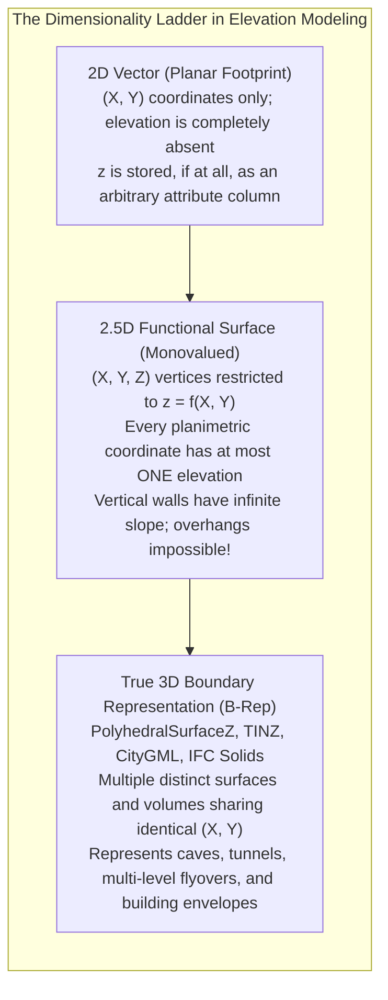
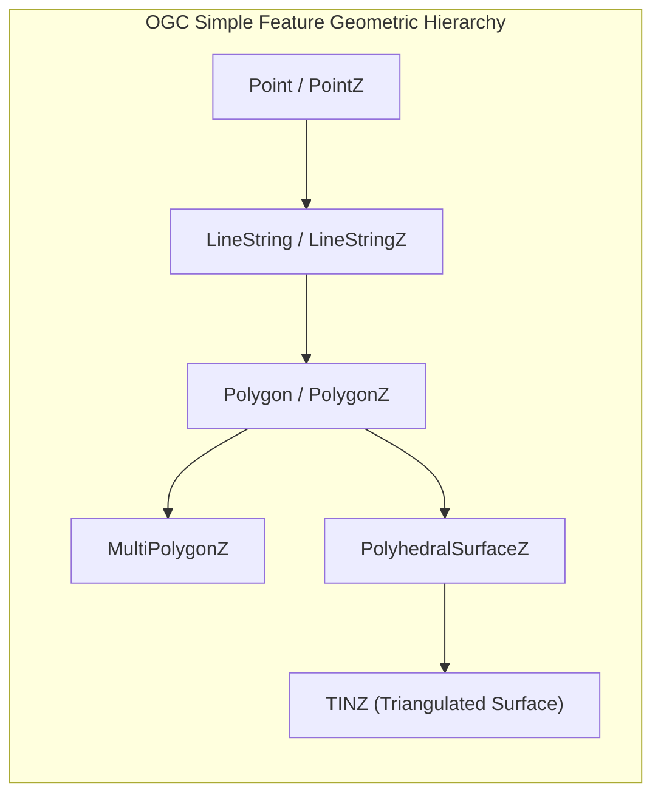
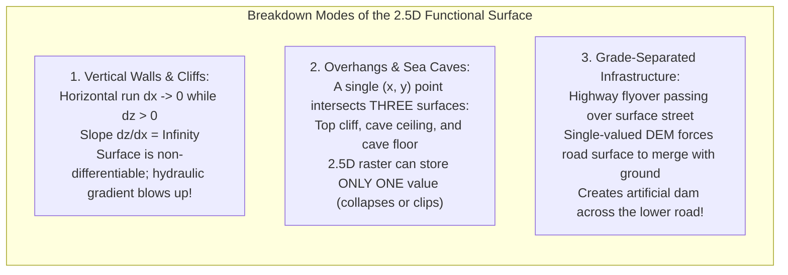
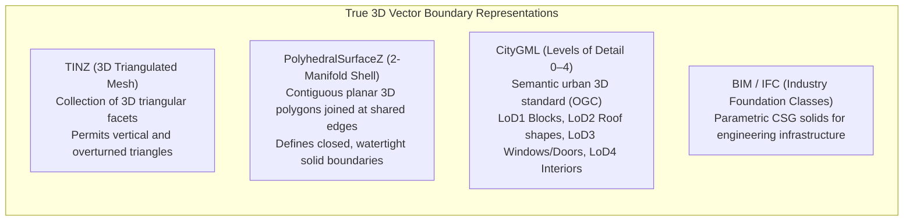

# Chapter 17: Vector Data Issues in Elevation Modeling

*Points, lines, polylines, polygons, multipolygons, breaklines, topology, and the breakdown of 2.5D assumptions when roads cross or pass under buildings.*

While digital elevation models are predominantly distributed as raster grids, the structural reality of the Earth's surface—and the human infrastructure built upon it—is fundamentally defined by vector geometry. Fault scarps, river thalwegs, drainage divides, road curbs, bridge decks, and building footprints are discrete geometric features whose linear and polygonal boundaries govern surface interpolation. However, integrating vector data with elevation modeling exposes the profound mathematical tension between single-valued "2.5D" functional surfaces and true three-dimensional geometry.

---

## 17.1 Vector Primitives and Dimensionality: 2D, 2.5D, and True 3D

In geographic information systems, vector data is defined by discrete vertices connected by linear or curvilinear segments. The dimensional handling of elevation within vector data structures dictates whether a feature can represent true 3D spatial reality or merely acts as a 2D footprint with an elevation attribute.

---

### 17.1.1 OGC Simple Features and Coordinate Dimensionality (`Z` and `M`)

The Open Geospatial Consortium (OGC) Simple Features Access standard (ISO 19125-1) formalizes vector primitives across 2D, 3D, and 4D coordinate spaces:

In the OGC specification, coordinates are extended beyond 2D $(X, Y)$ through two explicit optional dimensions:
1. **The `Z` Coordinate (Vertical Elevation):** Denotes the geometric vertical position in the declared vertical coordinate reference system (e.g., ellipsoidal height $h$ or orthometric height $H$):
   $$\mathbf{v} = [X, Y, Z]^\top$$
2. **The `M` Coordinate (Measure):** A non-coordinate attribute embedded directly into vertex arrays. In elevation and hydrographic modeling, `M` is frequently used to store **Total Propagated Uncertainty (TPU)**, acquisition timestamp ($t$), or linear referencing stationing (e.g., highway mileage along a corridor):
   $$\mathbf{v} = [X, Y, Z, M]^\top$$

#### Well-Known Text (WKT) Representations
* **2D Polygon:** `POLYGON ((0 0, 10 0, 10 10, 0 10, 0 0))`
* **3D Polygon with Elevation (`Z`):** `POLYGON Z ((0 0 15.2, 10 0 15.8, 10 10 18.1, 0 10 16.5, 0 0 15.2))`
* **4D LineString with Elevation and Uncertainty (`ZM`):** `LINESTRING ZM (0 0 10.5 0.08, 5 5 12.1 0.12, 10 5 14.3 0.09)`

---

### 17.1.2 The 2.5D Functional Surface Limitation ($z = f(x, y)$)

The vast majority of raster DEMs, TINs, and GIS terrain engines operate under the **2.5D functional surface assumption**:
> *Elevation is modeled as a single-valued, mathematical function of horizontal planar coordinates:*
> $$z = f(x, y)$$

While computationally efficient, the 2.5D formulation suffers from fatal physical and mathematical breakdowns in complex environments:

#### 1. Vertical Walls and Singular Slopes ($dz/dx \to \infty$)
In a 2.5D raster or TIN, a perfectly vertical retaining wall, building facade, or sheer canyon scarp cannot be represented directly. Because the horizontal distance between the top and bottom of the wall is zero ($\Delta x = 0$), the slope magnitude diverges to infinity:

$$\|\nabla z\| = \lim_{\Delta x \to 0} \frac{\Delta z}{\Delta x} = \infty$$

To prevent division-by-zero errors, GIS software is forced to introduce a slight horizontal tilt or "skirt" ($\Delta x \approx 1\text{–}5\text{ mm}$), transforming vertical walls into steep artificial ramps that misrepresent stormwater runoff velocities and structural loads.

#### 2. Multi-Valued Overhangs and Sea Caves
In coastal geomorphology and alpine terrain, wave action cuts deep sea caves into cliff bases, while tectonic folding creates overhanging cliffs. At an overhang, a vertical plumb line dropped from coordinate $(x_0, y_0)$ pierces the Earth's surface at multiple distinct elevations:
$$z_1 = \text{Cave Floor}, \quad z_2 = \text{Cave Ceiling}, \quad z_3 = \text{Cliff Top}$$
A 2.5D model is mathematically incapable of representing multi-valued relations. It must either discard the overhang (choosing the highest DSM surface) or carve away the roof (choosing the lowest DTM surface), misrepresenting both geotechnical stability and coastal cave habitats.

---

### 17.1.3 True 3D Vector Primitives: TINZ, PolyhedralSurfaces, and CityGML

To model true multi-valued geometry, geospatial databases employ true 3D vector representations:

1. **`TINZ`:** An OGC surface composed of triangular facets where each vertex has an independent $(x, y, z)$ coordinate. Unlike a 2.5D TIN (which projects all vertices onto the $(x, y)$ plane before running a 2D Delaunay triangulation), a true 3D `TINZ` mesh allows multiple triangles to overlap in the planimetric $(x, y)$ plane and permits vertical or overturned facets ($n_z \le 0$), enabling the exact boundary representation of folded geological strata, sea caves, undercut riverbanks, and cliff overhangs.
2. **`PolyhedralSurfaceZ` and 3D Boundary Representation (B-Rep):** A contiguous collection of planar polygonal facets sharing common boundary edges. When a `PolyhedralSurfaceZ` forms a closed, orientable, watertight 2-manifold shell ($\partial \mathcal{V}$ with zero boundary edges and non-self-intersecting faces), it bounds a true 3D volumetric solid $\mathcal{V} \subset \mathbb{R}^3$. By the **Euler–Poincaré formula** for a closed orientable 2-manifold of genus $g$ (number of topological handles/tunnels) with $V$ vertices, $E$ edges, and $F$ faces:
   $$\chi = V - E + F = 2(1 - g)$$
   and by the **Divergence Theorem (Gauss–Ostrogradsky)**, the exact 3D volume $V_{\text{solid}}$ enclosed by a watertight `PolyhedralSurfaceZ` composed of triangulated faces $\{\triangle_k (\mathbf{v}_{k,1}, \mathbf{v}_{k,2}, \mathbf{v}_{k,3})\}$ with outward-pointing normals is:
   $$V_{\text{solid}} = \frac{1}{3} \oiint_{\partial \mathcal{V}} \mathbf{x} \cdot \hat{\mathbf{n}}\,dA = \frac{1}{6} \sum_{k=1}^F \det\begin{bmatrix} \mathbf{v}_{k,1} & \mathbf{v}_{k,2} & \mathbf{v}_{k,3} \end{bmatrix}$$
3. **CityGML (OGC 2.0 & 3.0) and CityJSON:** The OGC **CityGML** standard (Gröger et al., 2012) and its compact JSON encoding **CityJSON** (Ledoux et al., 2019) standardize multi-scale semantic 3D vector representations of urban terrain, buildings, bridges, and tunnels across five **Levels of Detail (LoD)** (further refined into 16 sub-levels in Biljecki et al., 2016, and decoupled from interior-only LoD 4 in CityGML 3.0):
   * **LoD 0:** Regional 2.5D Digital Terrain Model (`ReliefFeature` / `TINRelief`) plus 2D/2.5D building footprint and roof-edge polygons.
   * **LoD 1:** Extruded prismatic "block" models (`Solid`) generated by extruding a 2D footprint from its ground intersection elevation $z_{\text{base}}$ to its median or maximum roof height $z_{\text{roof}}$.
   * **LoD 2:** Differentiated 3D roof geometry (`RoofSurface`—gabled, hipped, mansard, shed), outer `WallSurface`, and `GroundSurface` polygons semantically tagged per face.
   * **LoD 3:** Architectural exterior models including explicit 3D openings (windows, doors), balconies, dormers, and structural bridge piers/arches.
   * **LoD 4 (CityGML 2.0) / Indoor LoD 0–3 (CityGML 3.0):** Full indoor boundary representation of rooms, interior walls, floor slabs, stairwells, and subterranean utility vaults.
4. **BIM and IFC (Industry Foundation Classes — ISO 16739):** In civil infrastructure, bridge, tunnel, and port engineering, objects are authored not merely as surface meshes, but as parametric **Constructive Solid Geometry (CSG)** and swept-profile solids (`IfcExtrudedAreaSolid`, `IfcSectionedSolidHorizontal` along 3D highway/rail alignments, `IfcBridge`, `IfcMarineFacility`). Converting parametric BIM/IFC solids into GIS elevation models requires tessellating CSG boolean trees into watertight `PolyhedralSurfaceZ` shells while transforming local engineering site coordinates (often scaled by a Ground-to-Grid Combined Scale Factor, Chapter 2) into geodetic CRS coordinates.

---

### 17.1.4 Marine and Hydrographic Vector Primitives (IHO S-57 and S-101)

In the marine and estuarine domain, vector data plays an equally critical, safety-governed role alongside gridded bathymetry (`BAG` / `IHO S-102`). Under the **IHO S-57** Transfer Standard for Digital Hydrographic Data and its modern **IHO S-100 / S-101** Electronic Navigational Chart (ENC) successor, nautical charts are structured as a rigorous 2D/2.5D topological vector skin:
* **`SOUNDG` (Soundings):** Stored as 3D `MultiPointZ` clusters where the vertical coordinate is positive-down depth $d$ referenced to the local **Sounding Datum** (e.g., MLLW or LAT), and where every point is selected under a strict **shoal-biased invariant** ($d_{\text{SOUNDG}} \le d_{\text{true}}$).
* **`DEPCNT` (Depth Contours) and `DEPARE` (Depth Areas):** `DEPCNT` polylines represent equal-depth isobaths ($2\text{ m}, 5\text{ m}, 10\text{ m}, 20\text{ m}$) that partition the seabed into closed, non-overlapping topological `DEPARE` polygons (`DRVAL1` minimum depth to `DRVAL2` maximum depth). In an ECDIS (Electronic Chart Display and Information System), the mariner's selected **Safety Contour** dynamically queries the `DEPARE` topology to trigger grounding alarms.
* **`COALNE` (Coastline), `SLCONS` (Shoreline Construction), and `OBSTRN` / `WRECKS`:** Hard vector boundaries defining the High Water datum line (`COALNE`), vertical harbor bulkheads, breakwaters, and open-pile piers (`SLCONS`), and point/polygon submerged hazards (`VALSOU` value of sounding) that must override any smoothed bathymetric surface.

| Vector Primitive / Standard | Coordinate Dimension | Governing Surface Assumption | Primary Terrestrial Examples | Primary Marine / Bathymetric Examples |
| :--- | :--- | :--- | :--- | :--- |
| **`Point` / `MultiPoint` (2D)** | $(x, y)$ | Planar location only | Cadastral corners, 2D centroids | Buoys (`BOYSAW`), beacons, lighthouses |
| **`PointZ` / `PointZM` (3D/4D)** | $(x, y, z, [m])$ | Discrete 3D sample + uncertainty $m$ | GNSS checkpoints, LiDAR returns, spot heights | ENC `SOUNDG` soundings $(x, y, d, \text{TVU})$, `WRECKS` |
| **`LineStringZ` (2.5D / 3D)** | $\{(x_i, y_i, z_i)\}_{i=1}^N$ | Piecewise linear 3D curve | Hard/soft breaklines, road curbs, stream thalwegs | `DEPCNT` depth contours, dredged channel toe lines |
| **`PolygonZ` (2.5D Planar Ring)**| Exterior CCW + Holes CW | Bounded region on $z = f(x,y)$ | Hydro-flattened lake polygons ($z = \text{const}$), pads | `DEPARE` depth areas, `DRGARE` dredged channel areas |
| **`TINZ` / `PolyhedralSurfaceZ`**| 3D Facets & Shared Edges | 2-Manifold B-Rep in $\mathbb{R}^3$ | Overhanging cliffs, bridges, CityGML/IFC buildings | Subsea caves, oil platform jackets, vertical quay walls |
