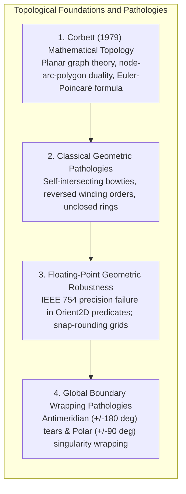
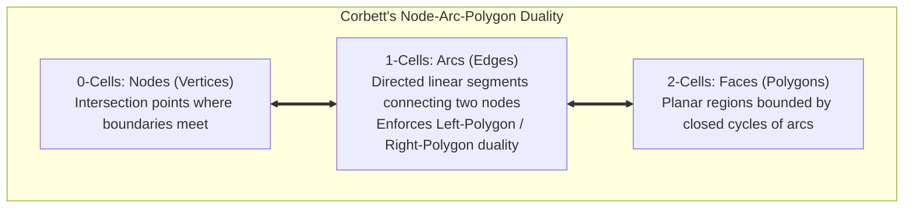
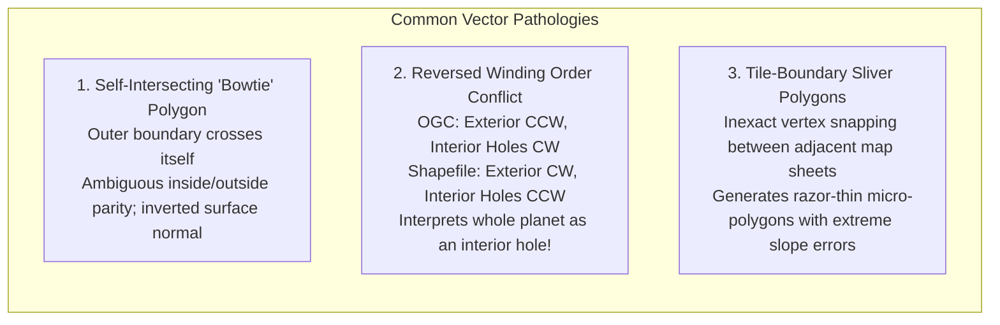
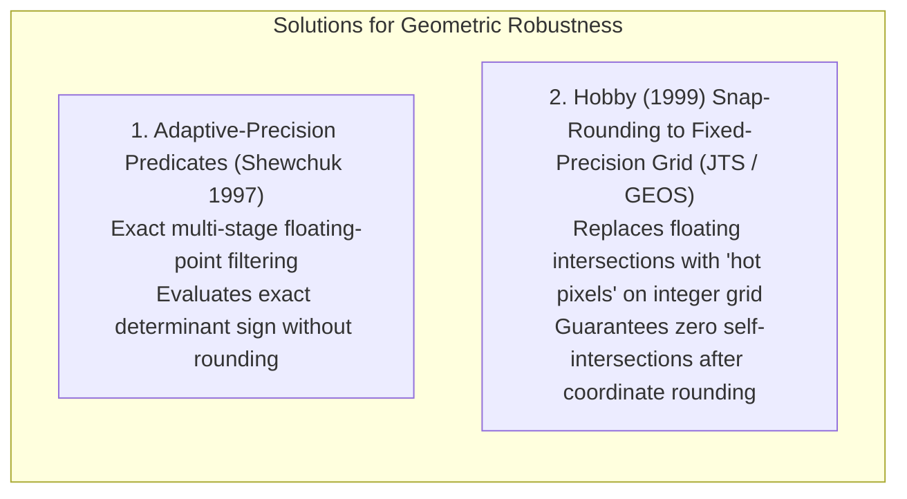
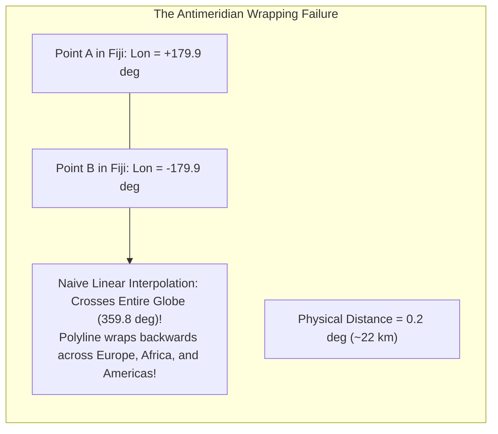

# Chapter 17: Vector Data Issues in Elevation Modeling

*Points, lines, polylines, polygons, multipolygons, breaklines, topology, and the breakdown of 2.5D assumptions when roads cross or pass under buildings.*

---

## 17.2 Topological Integrity and Vector Pathologies in Elevation Modeling

Vector features used in digital elevation modeling—such as lake boundary polygons, contour lines, building footprints, and highway breaklines—must adhere to strict mathematical rules of topology. When vector geometries suffer from topological defects (self-intersections, reversed winding orders, slivers, or floating-point round-off errors), surface interpolation algorithms produce severe anomalies: inverted triangles, corrupted drainage divides, and catastrophic computational crashes.

---

### 17.2.1 Corbett's Topological Principles in Cartography (1979)

In 1979, mathematician James P. Corbett of the U.S. Census Bureau published *Topological Principles in Cartography* (Census Bureau Technical Paper 48). Corbett established that a computer map is not merely a collection of geometric coordinates $(x, y)$; it is an **algebraic 2-manifold cellular complex** (a planar graph) that must satisfy exact topological invariants:

#### The Planar Graph Invariants
1. **No Edge Crossings:** Arcs (lines) may intersect only at shared nodes. If two breaklines or contour lines cross in the interior of a segment, the topology is invalid.
2. **Exhaustive Partitioning:** Every arc must bound exactly one polygon on its left and one polygon on its right (the Left/Right Polygon attribute).
3. **The Euler-Poincaré Characteristic:** For any valid planar cellular partition with $V$ vertices, $E$ edges, and $F$ faces (including the unbounded exterior face):
   $$V - E + F = 2$$

When vector boundaries are converted into Constrained Delaunay Triangulations (CDTs) or used to hydro-flatten elevation rasters, violating Corbett's topological invariants causes gridding engines to halt or generate non-orientable topological surfaces.

---

### 17.2.2 Vector Pathologies in Elevation Models

#### 1. Self-Intersecting "Bowtie" Polygons
A polygon whose linear boundary intersects itself (a "bowtie" or figure-eight loop) is topologically invalid under OGC Simple Features:
* The Jordan Curve Theorem, which guarantees that a simple closed curve partitions the plane into a well-defined "interior" and "exterior," breaks down.
* When gridding a lake or building footprint containing a bowtie self-intersection, the gridding engine calculates opposite surface normals across the crossover node, creating an inverted, twisted surface facet with corrupted volume calculations.

#### 2. The Winding Order (Ring Orientation) Conflict and Signed Shoelace Area
The direction in which vertices $\{(x_i, y_i)\}_{i=1}^n$ ($(x_{n+1}, y_{n+1}) = (x_1, y_1)$) are listed around a closed polygon ring defines its **signed planar area** $A_{\text{signed}}$ via the Gauss **Shoelace Formula** and determines its topological orientation:

$$A_{\text{signed}} = \frac{1}{2} \sum_{i=1}^n \left(x_i y_{i+1} - x_{i+1} y_i\right) = \begin{cases} > 0 & \text{if vertices run Counter-Clockwise (CCW)} \\ < 0 & \text{if vertices run Clockwise (CW)} \end{cases}$$

Two opposite industry standards govern polygon ring winding:
* **RFC 7946 GeoJSON (2016, §3.1.6) and PostGIS `ST_ForcePolygonCCW` (Right-Hand Rule):**
  * Exterior boundary ring must be wound **Counter-Clockwise (CCW)** ($A_{\text{signed}} > 0$, outward normal $+\hat{\mathbf{z}}$).
  * Interior hole boundary rings (e.g., an island inside a lake) must be wound **Clockwise (CW)** ($A_{\text{signed}} < 0$).
* **Esri Shapefile Technical Description (1998):**
  * Exterior boundary rings must be wound **Clockwise (CW)** ($A_{\text{signed}} < 0$; interior lies to the *right* of the directed boundary).
  * Interior hole boundary rings must be wound **Counter-Clockwise (CCW)** ($A_{\text{signed}} > 0$).

#### The Fatal Spherical Inversion Trap (Shapefile CW $\to$ Spherical Geography)
While 2D planar geometry engines (`GEOS`, `JTS`, PostGIS `GEOMETRY`) can distinguish an exterior ring from a hole by bounding-box containment regardless of winding order, **spherical geography engines** (`Google S2`, BigQuery `GEOGRAPHY`, SQL Server `GEOGRAPHY`) operate on a closed sphere $\mathbb{S}^2$ of surface area $4\pi R^2 \approx 510.06 \times 10^6\text{ km}^2$ where there is no unbounded exterior plane! On a sphere, the interior of any closed ring is defined strictly as the region to the **left** of the directed boundary (CCW when viewed from above). When a Clockwise (CW) Shapefile polygon of a $1\text{ km}^2$ alpine lake is ingested directly into a spherical engine without reversing vertex order (e.g., omitting `oriented => TRUE` or `ST_ForcePolygonCCW`), the engine interprets the CW ring as the **complement of the lake covering the entire planet** ($A = 510,064,471\text{ km}^2$)! In automated hydro-flattening or masking pipelines, this single winding error flattens or masks the entire continent while leaving the $1\text{ km}^2$ lake untouched.

#### 3. Sliver Polygons, Tile Seams, and the DE-9IM Topological Matrix
To formalize whether two vector geometries $A$ and $B$ (with interior $I(\cdot)$, boundary $B(\cdot)$, and exterior $E(\cdot)$) are topologically disjoint, touching, overlapping, or equal, Egenhofer & Franzosa (1991) and Clementini et al. (1993) established the **Dimensionally Extended 9-Intersection Model (DE-9IM)**:

$$\text{DE-9IM}(A, B) = \begin{bmatrix} \dim\big(I(A) \cap I(B)\big) & \dim\big(I(A) \cap B(B)\big) & \dim\big(I(A) \cap E(B)\big) \\ \dim\big(B(A) \cap I(B)\big) & \dim\big(B(A) \cap B(B)\big) & \dim\big(B(A) \cap E(B)\big) \\ \dim\big(E(A) \cap I(B)\big) & \dim\big(E(A) \cap B(B)\big) & \dim\big(E(A) \cap E(B)\big) \end{bmatrix} \in \{\emptyset, 0, 1, 2\}^{3\times 3}$$

When vector breaklines, hydro-flattening polygons, or dredged channel polygons (`DRGARE`) are digitized across adjacent map tiles or exported through formats with mismatched numeric precision, two polygons that should strictly **touch** along a shared 1D boundary ($\dim(I(A) \cap I(B)) = \emptyset, \dim(B(A) \cap B(B)) = 1$) instead develop $1\text{–}5\text{ mm}$ misalignments, creating **sliver overlaps** ($\dim(I(A) \cap I(B)) = 2$) or **sliver gaps**:
* When triangulated into a Constrained Delaunay TIN, a $2\text{ mm}$ wide sliver along a $50\text{ m}$ breakline edge generates an acute needle triangle with aspect ratio $25,000:1$ and minimum interior angle $\theta_{\min} \approx 0.0023^\circ$.
* If the two misaligned breaklines differ in elevation by even $\Delta z = 0.05\text{ m}$ (e.g., from independent LiDAR swath adjustments), the local TIN facet slope across the $2\text{ mm}$ sliver explodes to $\|\nabla z\| = \frac{0.05\text{ m}}{0.002\text{ m}} = 25.0$ ($87.7^\circ$ near-vertical wall)!
* In explicit 2D shallow-water hydrodynamic solvers (HEC-RAS, ANUGA, Delft3D FM), the Courant–Friedrichs–Lewy (CFL) maximum stable time step scales with minimum triangle inradius $r_{\text{in}}$ ($\Delta t_{\max} \le \frac{r_{\text{in}}}{\|\mathbf{u}\| + \sqrt{gh}}$); a single millimeter sliver triangle forces $\Delta t_{\max} \to 10^{-4}\text{ s}$, stalling or crashing the entire flood simulation.

---

### 17.2.3 Floating-Point Robustness, Catastrophic Cancellation, and Snap-Rounding

Geometric algorithms—such as determining whether a point lies to the left or right of a breakline (`Orient2D`), or whether a point lies inside a triangle's circumcircle (`InCircle`)—rely on evaluating the exact algebraic sign of polynomial determinants.

#### Worked Example of IEEE 754 `Float64` Catastrophic Cancellation in UTM Coordinates
Standard 64-bit IEEE 754 floating-point numbers (`Float64`) allocate 1 sign bit, 11 exponent bits, and 52 explicit fraction bits (53 bits of significand precision, giving unit roundoff $\mathbf{u} = 2^{-53} \approx 1.1102 \times 10^{-16}$, or $\approx 15.95$ decimal digits). Consider three nearly collinear breakline vertices in UTM Zone 10N at $(E, N) \approx (500\,000\text{ m}, 5\,000\,000\text{ m})$:
* At $N = 5 \times 10^6\text{ m} \approx 2^{22.25}\text{ m}$, the spacing between adjacent `Float64` numbers (1 Unit in the Last Place, $\text{ULP}$) is $2^{22 - 52} = 2^{-30}\text{ m} \approx 0.93\text{ nm}$.
* When evaluating $(a_x - c_x)(b_y - c_y) - (a_y - c_y)(b_x - c_x)$ for two nearly parallel segments of length $\sim 100\text{ m}$ where the true perpendicular offset of $\mathbf{c}$ from $\mathbf{a}\to\mathbf{b}$ is $10^{-12}\text{ m}$, both products $(a_x - c_x)(b_y - c_y)$ and $(a_y - c_y)(b_x - c_x)$ have magnitude $\sim 10^4\text{ m}^2$ ($\text{ULP} \approx 1.8 \times 10^{-12}\text{ m}^2$). Subtracting the two nearly equal products destroys all 53 bits of mantissa (**catastrophic cancellation**), causing hardware floating-point arithmetic to return `0.0` or the **wrong algebraic sign**!
* In an incremental Delaunay triangulation or polygon overlay, a single flipped `Orient2D` or `InCircle` sign violates topological transitivity: point $\mathbf{d}$ is judged inside triangle $T_1$ and outside $T_2$ simultaneously, causing infinite edge-flipping loops or dangling topological pointers.

Modern computational geometry engines combine two complementary defenses:
1. **Adaptive-Precision Exact Predicates (Shewchuk, 1997):** Used during predicate evaluation (`Orient2D`, `Orient3D`, `InCircle`) to guarantee the exact mathematical sign of determinants using multi-stage floating-point expansions (derived in Section 17.6.1).
2. **Hobby's Snap-Rounding (Hobby, 1999; implemented in `GEOS` `GeometryPrecisionReducer` and `JTS` `OverlayNG`):** Even if intersection points are computed exactly in rational arithmetic, rounding the new intersection coordinates back to IEEE 754 `Float64` can cause a rounded vertex to jump across an adjacent segment, creating a brand-new topological self-intersection! John D. Hobby's **Snap-Rounding** algorithm partitions the plane into a fixed-precision grid of pixel size $\delta_{\text{grid}}$ (e.g., $\delta_{\text{grid}} = 10^{-3}\text{ m} = 1\text{ mm}$), marks every grid cell containing a vertex or segment intersection as a **hot pixel**, and reroutes any segment passing through a hot pixel's Minkowski sum neighborhood directly through the hot pixel center—mathematically guaranteeing that the output rounded graph has zero unsplit intersections.

---

### 17.2.4 Antimeridian ($\pm 180^\circ$) and Polar Coordinate Wrapping

When vector breaklines, contour lines, or study polygons span across the **$180^\circ$ Antimeridian** (the International Date Line in the Pacific, traversing Fiji, Russia, and Alaska):

* **The Problem:** A survey line crossing from $+179.9^\circ$ to $-179.9^\circ$ spans a true physical distance of only $0.2^\circ$ ($\approx 22\text{ km}$). A naive vector engine connects these vertices by interpolating across the entire globe ($359.8^\circ$), creating an enormous vector strip that bisects the planet.
* **The Solution:** Vector engines must implement **antimeridian cutting** (e.g., using GDAL's `ogr2ogr -wrapdateline` or PostGIS's `ST_ShiftLongitude`), splitting lines and polygons into multi-geometries bounded at $\pm 180^\circ$.
