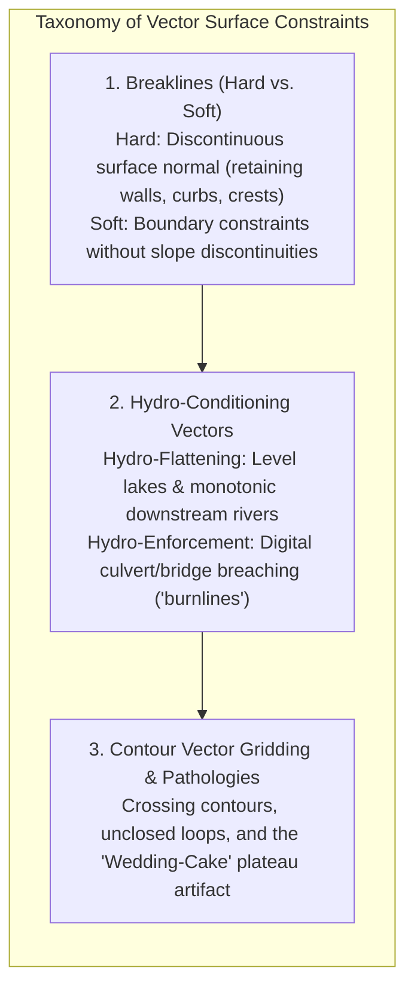
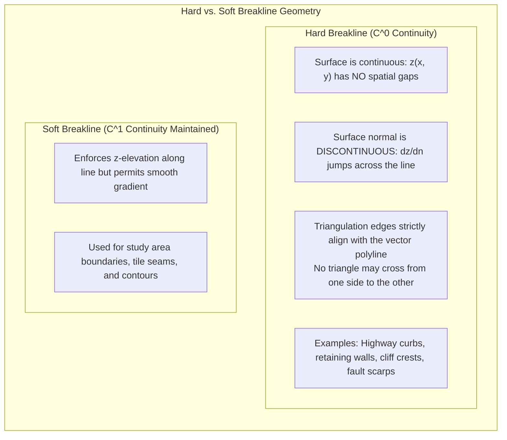
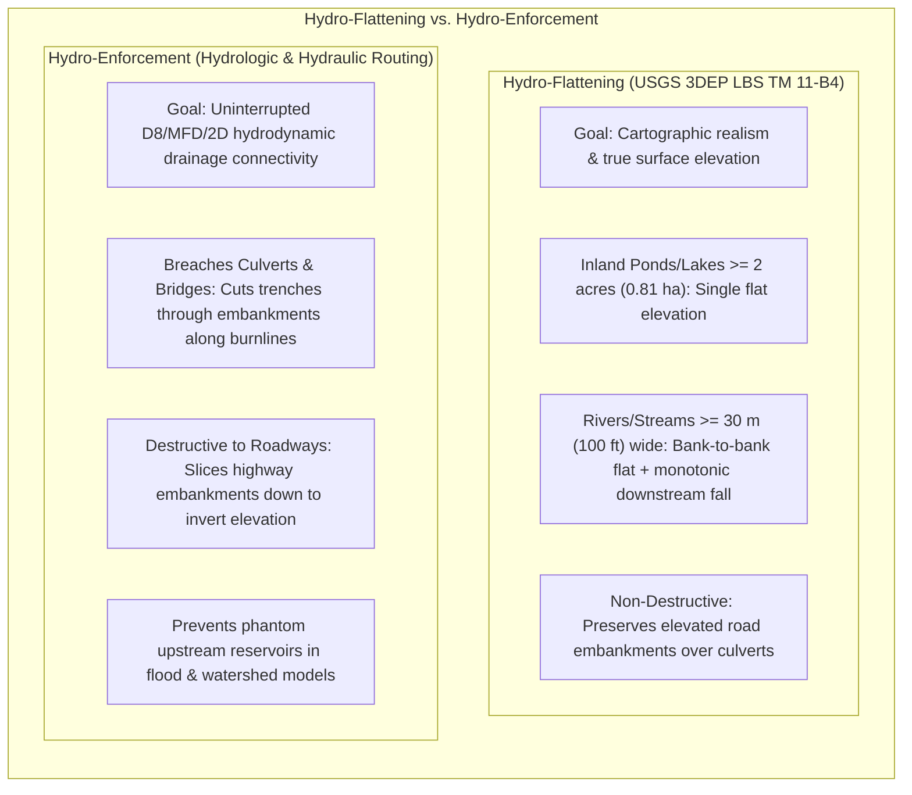
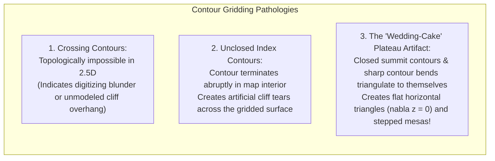

# Chapter 17: Vector Data Issues in Elevation Modeling

*Points, lines, polylines, polygons, multipolygons, breaklines, topology, and the breakdown of 2.5D assumptions when roads cross or pass under buildings.*

---

## 17.3 Breaklines, Contours, and Hydro-Enforcement Vectors

Vector constraints are the primary mechanism by which physical structural lines—drainage networks, road edges, lake perimeters, and retaining walls—are enforced during the generation of digital elevation models. Without vector constraints, raster interpolation algorithms blur distinct topographic steps into ramps and allow digital water to flow up hillslopes or pool behind artificial road embankments.

---

### 17.3.1 Hard Breaklines vs. Soft Breaklines

A breakline is a 3D polyline that controls the Delaunay triangulation or spline interpolation of a digital elevation surface:

#### Hard Breaklines and Constrained Delaunay Triangulation (Chew, 1989)
A **hard breakline** represents an abrupt, physical slope discontinuity across the landscape or seafloor. Mathematically:
* The surface elevation $z(x, y)$ is continuous ($C^0$, or stepped across a near-vertical offset $\Delta x \sim 1\text{ cm}$), but its directional spatial gradient across the breakline normal $\hat{\mathbf{n}}_\perp$ is **discontinuous**:
  $$\lim_{\epsilon \to 0^+} \nabla z(\mathbf{p} + \epsilon \hat{\mathbf{n}}_\perp) \cdot \hat{\mathbf{n}}_\perp \ne \lim_{\epsilon \to 0^-} \nabla z(\mathbf{p} - \epsilon \hat{\mathbf{n}}_\perp) \cdot \hat{\mathbf{n}}_\perp$$
* In an unconstrained 2D Delaunay triangulation, edges are chosen solely to satisfy the empty-circumcircle criterion ($\text{InCircle} < 0$), which routinely connects a point at the top of a road curb or dredged navigation channel wall directly to a point several meters out in the gutter or channel floor, beveling away the sharp geometric break!
* In a **Constrained Delaunay Triangulation (CDT)** (Chew, 1989), every segment $e \in \mathcal{E}_{\text{hard}}$ of a hard breakline is forced to remain an edge of the triangulation, and the empty-circumcircle criterion is relaxed to the **visibility-constrained circumcircle criterion**: a triangle $\triangle abc$ is constrained-Delaunay if its circumcircle contains no vertex $v$ that is *mutually visible* from the interior of $\triangle abc$ without intersecting any constraining breakline segment $e \in \mathcal{E}_{\text{hard}}$. Linear interpolation is strictly prohibited from crossing a hard breakline, preserving vertical road curbs ($15\text{ cm}$), levee crowns, quarry benches, and dredged shipping channel side-slopes.

#### Soft Breaklines
A **soft breakline** densifies vertices and forces triangle edges along a specified 3D polyline (such as a survey boundary, tile seam, or natural contour line) to ensure elevation continuity along the feature while allowing post-triangulation natural-neighbor or spline smoothing to maintain $C^1$ gradient continuity across the line.

---

### 17.3.2 Hydro-Flattening (USGS 3DEP LBS) vs. Hydro-Enforcement (Flood & Drainage Modeling)

In geospatial elevation processing, few concepts are as frequently confused as **hydro-flattening** and **hydro-enforcement**. They serve two fundamentally different operational purposes and are governed by distinct specifications:

#### USGS 3DEP Lidar Base Specification (TM 11-B4) Hydro-Flattening Rules
Because near-infrared ($1064\text{ nm}$) topographic LiDAR pulses are either absorbed by water (creating data voids) or specularly reflected at nadir (creating noisy, incomplete water returns that triangulate into jagged "tin-can" spikes across rivers and lakes), the **USGS Lidar Base Specification** mandates 3D vector breakline compilation and **hydro-flattening** for all standard bare-earth DEM deliverables:
1. **Inland Ponds and Lakes ($\ge 2\text{ acres} \approx 0.81\text{ ha}$):** Bounded by a closed 3D polygon breakline collected at a single constant elevation ($z_{\text{lake}} = \text{const}$) sitting at or immediately below the surrounding shore bank returns. All interior water returns are reclassified to ASPRS Class 9 (Water) and excluded from ground triangulation so the lake forms a perfectly flat, horizontal plane ($\nabla z = \mathbf{0}$).
2. **Inland Streams and Rivers ($\ge 30\text{ m} / 100\text{ ft}$ nominal width):** Bounded by 3D double-line bank breaklines where cross-channel vertices directly opposite each other share identical elevations (bank-to-bank horizontal flatness perpendicular to flow) and where longitudinal elevation is **strictly monotonic decreasing** (or flat) in the downstream direction ($\frac{\partial z}{\partial s} \le 0$—digital rivers must never step uphill!).
3. **Non-Tidal Boundary Waterbodies and Tidal Waters:** Flattened to the water surface observed during acquisition (or to a specified tidal datum polygon in seamless Topo-Bathymetric DEMs where subaqueous bathymetry replaces water-surface flattening).

| Operational Dimension | Hydro-Flattened DEM (USGS 3DEP Standard Deliverable) | Hydro-Enforced DEM (FEMA / HEC-RAS / Watershed Derivative) |
| :--- | :--- | :--- |
| **Primary Objective** | Cartographic realism; true geometric bare-earth topography. | Continuous overland and channel flow routing; watershed delineation. |
| **Lake Treatment** | Water surface forced to a single constant elevation ($\ge 2\text{ acres}$). | Level water surface, or drained to bathymetric thalweg / outlet invert. |
| **River Treatment** | Bank-to-bank flat ($\ge 30\text{ m}$ wide); monotonic downstream gradient. | Carved channel thalweg across all stream orders (including $<1\text{ m}$ ditches). |
| **Culvert Embankments**| **Preserved intact:** Road fill over buried culverts remains at road grade. | **Breached (cut):** Digital trench carved through road fill down to culvert invert. |
| **Free-Spanning Bridges**| Bridge deck removed (Class 17) via saddle breaklines at abutments. | Bridge deck removed AND any residual abutment constriction cleared. |
| **Hydraulic Flow Routing** | **Fails at Culverts:** Water pools behind unbreached road embankments. | **Succeeds:** Water drains continuously from headwaters to outlet. |

#### Worked Numerical Example: Phantom Reservoir Volume vs. Least-Cost Culvert Breaching
Consider a rural two-lane highway crossing a V-shaped creek valley on an earthen embankment of crest elevation $z_{\text{road}} = 105.00\text{ m}$ and road width $W_{\text{road}} = 18.0\text{ m}$ (at $1\text{ m}$ grid resolution $\Delta x = 1.0\text{ m}$). A corrugated steel culvert of diameter $D = 1.50\text{ m}$ is buried at the base of the embankment with upstream invert elevation $z_{\text{inv,up}} = 100.00\text{ m}$ and downstream invert $z_{\text{inv,dn}} = 99.80\text{ m}$ ($\Delta z_{\text{embankment}} = 5.00\text{ m}$ above the creek bed).
* **Error in an Unbreached Hydro-Flattened DTM:** Airborne LiDAR cannot see inside the buried pipe; the bare-earth DTM records $z = 105.00\text{ m}$ across the road embankment. Suppose the upstream valley has mean longitudinal slope $S_0 = 0.010$ ($1\%$) and side slopes forming a triangular impoundment prism of surface area $A(h_w) = 12,000\,h_w^2\text{ m}^2$ at water depth $h_w$ above the invert. If a naive pit-filling algorithm (`Priority-Flood`) or 2D overland flow solver runs on the unbreached DTM, water must rise $h_w = 5.00\text{ m}$ to overtop the road crest at $105.00\text{ m}$, fabricating a **phantom reservoir volume** of:
  $$V_{\text{phantom}} = \int_0^{5.00\text{ m}} 12,000\,h_w^2\,dh_w = 4,000 \times (5.00)^3 = \mathbf{500,000\text{ m}^3} \quad (\text{flooding } 500\text{ m upstream!})$$
* **Least-Cost Topological Breaching (Lindsay & Dhun, 2015):** Instead of raising the upstream valley by $+5.00\text{ m}$ (modifying $\sim 300,000$ grid cells at a total vertical elevation modification cost of $\sum |\Delta z| = 500,000\text{ m}^3 / 1\text{ m}^2$), a least-cost breaching algorithm evaluates the excavation cost along the $N_{\text{breach}} = 18$ cells of the vector culvert burnline:
  $$C_{\text{breach}} = \sum_{k=1}^{18} \left(z_k - z_{\text{trench},k}\right) \approx 18 \times 5.00\text{ m} = \mathbf{90.0\text{ m}} \ll 500,000\text{ m}$$
  Carving this 18-pixel trench restores true topological drainage while modifying only $0.006\%$ of the cells altered by pit-filling! (In high-precision 2D hydraulic solvers such as HEC-RAS 6+, the embankment is kept intact in the 2D terrain mesh to model road overtopping during extreme $500\text{-year}$ storms, while a 1D vector culvert structure link routes pressurized orifice flow $Q = C_d \big(\frac{\pi D^2}{4}\big)\sqrt{2g(H_{\text{up}} - z_{\text{inv}})}$ underneath the embankment.)

---

### 17.3.3 Contour Vector Pathologies and the "Wedding-Cake" Artifact

Prior to airborne LiDAR, national digital elevation models (such as legacy USGS $7.5\text{-minute}$ Level 1 and Level 2 DEMs) were generated by digitizing contour lines from paper topographic quadrangles. Gridding elevation models directly from 2D contour vectors introduces three classic geometric pathologies:

#### Mathematical Origin of the "Wedding-Cake" (Flat-Triangle) Artifact
When a Delaunay triangulation is constructed solely from vertices sampled densely along discrete contour lines $z \in \{k \cdot \Delta Z_{\text{CI}}\}$ (where $\Delta Z_{\text{CI}}$ is the contour interval, e.g., $10\text{ m}$):
1. Whenever a contour line forms a closed loop around a hilltop (or bends sharply around a ridge spur or valley re-entrant), the empty-circumcircle criterion connects three vertices **belonging to the exact same contour line** ($z_a = z_b = z_c = 500\text{ m}$).
2. The resulting triangle $\triangle abc$ has an exactly horizontal normal vector $\hat{\mathbf{n}} = [0, 0, 1]^\top$ and **zero slope** ($\nabla z = \mathbf{0}$), truncating every mountain summit into a flat table-top mesa and turning ridge noses into alternating $0^\circ$ flat steps and steep scarps ("wedding cakes").
3. **Forensic Signature & Remediation:** In an elevation histogram of a contour-derived DEM (Chapter 14 §14.3), flat triangles produce periodic spikes at integer multiples of the contour interval $\Delta Z_{\text{CI}}$. Eliminating flat triangles requires either inserting **3D skeletal ridge/thalweg breaklines and summit spot heights** (replacing same-contour edges via constrained edge swaps) or solving a drainage-enforced curvature spline (**ANUDEM**, Section 17.6.2). In nautical charting (Chapter 26), bathymetric contours (`DEPCNT`) carry an additional one-sided **shoal-safe constraint**: any generalized or interpolated depth contour $d_{\text{contour}}$ must lie strictly on the seaward (deeper) side of all enclosed shallower soundings ($d(\mathbf{x}) \ge d_{\text{contour}}$ on the navigable side).
