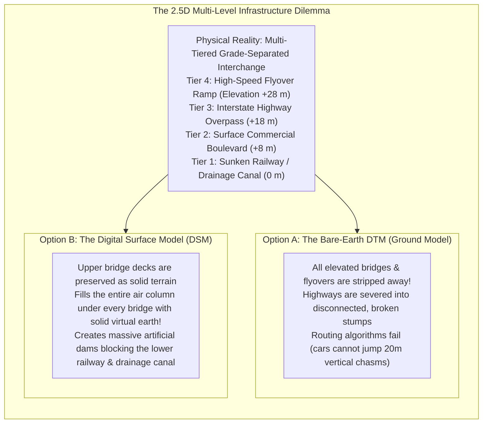
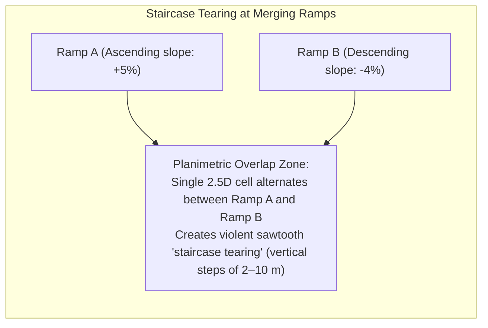
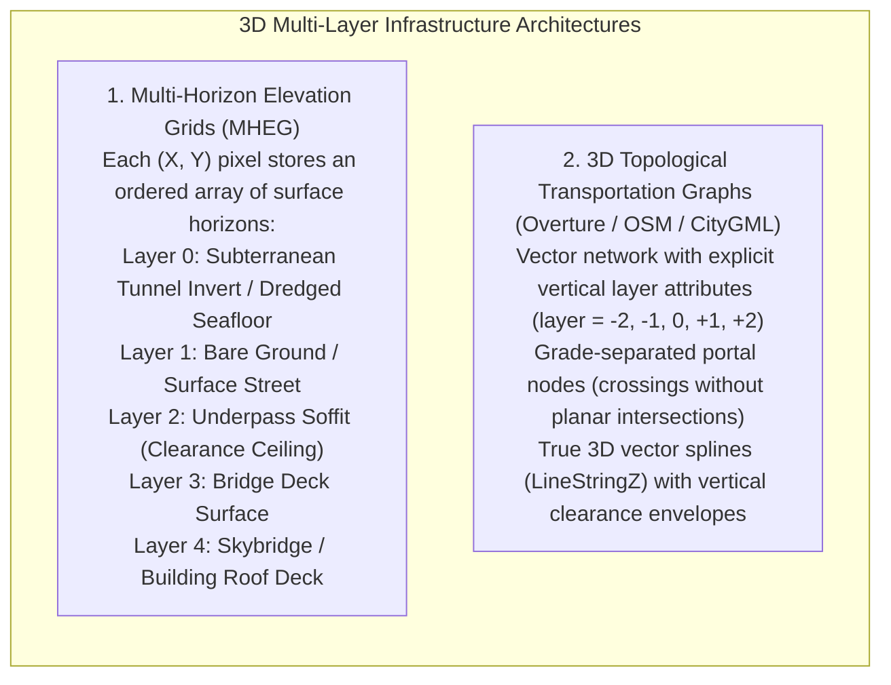

# Chapter 17: Vector Data Issues in Elevation Modeling

*Points, lines, polylines, polygons, multipolygons, breaklines, topology, and the breakdown of 2.5D assumptions when roads cross or pass under buildings.*

---

## 17.4 What Happens When Roads Cross or a Road Goes Under Buildings?

The ultimate failure mode of classical 2.5D elevation modeling occurs in complex urban built environments and multi-level transportation corridors. In a modern metropolitan interchange ("spaghetti junction"), three to five grade-separated highway flyovers, surface arterials, railway corridors, and pedestrian walkways cross directly above one another at the exact same planimetric $(X, Y)$ coordinate. Similarly, highways plunge into subterranean tunnels beneath skyscrapers, and pedestrian skybridges connect commercial towers over city avenues.

Forcing these multi-tiered, overlapping architectural realities into a single-valued 2.5D digital elevation model creates irreconcilable geometric paradoxes, destroying the utility of the model for both autonomous vehicular navigation and urban hydraulic flood routing.

---

### 17.4.1 The Dual Catastrophe of 2.5D Grids in Transportation Modeling

When a digital elevation model is generated over a multi-level interchange, the gridding pipeline is forced to choose which elevation to store in the single 2.5D cell:

#### Catastrophe 1: The Bare-Earth DTM Trap (Broken Networks)
In standard airborne LiDAR processing, bridge decks are classified as above-ground structural objects (often grouped with buildings or Class 17 in ASPRS LAS specifications). When creating a bare-earth DTM:
* The bridge decks and elevated viaducts are stripped out. The elevation raster records only the bare mineral ground beneath the bridges.
* **Impact on Autonomous Driving and Navigation:** A routing algorithm tracking a vehicle traveling on the Interstate flyover suddenly observes the highway roadbed drop $25\text{ m}$ into a railway ditch, and then spike $25\text{ m}$ back up on the other side. Trajectory guidance algorithms register an impossible vertical cliff, causing autonomous vehicle path-planning models to fail or trigger emergency stops.

#### Catastrophe 2: The Digital Surface Model Trap (Artificial Dams)
If the project instead preserves the elevated bridges (as in a Digital Surface Model [DSM] or photogrammetric drone mesh):
* The cell at coordinate $(X, Y)$ records the elevation of the uppermost bridge deck ($+28\text{ m}$).
* Because a 2.5D raster cannot represent the hollow open air space beneath the bridge, the space between the ground and the bridge deck is treated as **solid earth**.
* **Impact on Flood and Stormwater Modeling:** The sunken railway and surface boulevard passing under the flyover are completely blocked by a solid $28\text{-meter}$ wall of virtual dirt. During a storm simulation, numerical floodwaters flowing down the street cannot pass beneath the bridge. Water pools into a massive, artificial reservoir, falsely predicting catastrophic flooding of upstream neighborhoods while predicting zero water flow downstream.

#### Catastrophe 3: The Orthorectification vs. Bare-Earth Bridge Paradox ("Wavy Bridges")
A third operational failure occurs when aerial or satellite orthoimagery is rectified over a bare-earth DTM where bridge decks (`ASPRS Class 17`) were stripped out:
* Off-nadir camera rays viewing a highway bridge deck at elevation $z_{\text{deck}} = +28\text{ m}$ at look angle $\theta_i = 20^\circ$ are intersected with the bare-earth river or canyon floor at $z_{\text{ground}} = 0\text{ m}$.
* The missing vertical height $\Delta z = 28\text{ m}$ induces a planimetric relief displacement error of $\Delta r = \Delta z \tan\theta_i = 28\text{ m} \times \tan(20^\circ) = 10.19\text{ m}$!
* In the resulting orthoimage, the straight concrete bridge warps sideways by $10\text{ m}$ down into the river gorge like a melted painting. Consequently, **True Orthophoto** generation requires retaining 3D vector **Bridge Breaklines** (abutment saddle lines and deck edge polygons) in a specialized **Ortho-DEM**, even while removing those exact same bridge polygons in the companion bare-earth **Hydro-DTM**!

---

### 17.4.2 Highways Under Buildings, Skybridges, Subsea Tunnels, and Bridges Over Navigation Channels

Multi-valued vertical stacking occurs across both terrestrial urban corridors and coastal/marine navigation channels:
* **Highways Passing Through or Under Buildings:** The Trans-Manhattan Expressway (I-95) in New York passes directly beneath the four 32-story residential towers of the Bridge Apartments; Tokyo's Gate Tower Building famously routes an elevated Hanshin Expressway ramp directly through floors 5–7 of an office building; and Boston's I-93 Central Artery ("Big Dig") routes multi-level highway tubes beneath city parks, subway lines, and skyscraper foundations.
* **Elevated Pedestrian Skybridges and Industrial Pipe Racks:** In cities such as Minneapolis, Calgary, and Hong Kong, climate-controlled pedestrian skybridges span across streets at $z_{\text{ground}} + 6\text{ to }25\text{ m}$, while petrochemical refineries contain 3 to 6 stacked tiers of elevated pipe racks above the service roads.
* **Bridges and Overhead Cables Spanning Navigable Waterways:** In coastal Topo-Bathymetric DEMs (TBDEMs) and Electronic Navigational Charts (`IHO S-57`/`S-101`), a suspension bridge (e.g., Golden Gate Bridge or Verrazzano-Narrows Bridge) and high-voltage overhead power transmission cables cross directly above a dredged shipping channel ($d = 18.0\text{ m}$ below MLLW). A single-valued 2.5D TBDEM must store the **bathymetric seafloor** ($z = -18.0\text{ m}$) so ship hull draft and storm-surge models propagate unobstructed through the strait, while storing the bridge deck and low-steel girder arch as a 3D vector **Vertical Clearance (`VERCLR` / `VERCSA`)** feature referenced to **Mean High Water (MHW)** or **Highest Astronomical Tide (HAT)** (and correcting for thermal/traffic catenary sag!) to prevent container ship mast or crane collisions.

---

### 17.4.3 Engineering Solutions: Multi-Horizon Stacks and 3D Topological Graphs

To resolve the breakdown of 2.5D models in built and coastal environments, modern geospatial pipelines employ two complementary architectures:

#### 1. Multi-Horizon Elevation Grids (MHEG) and Bridge Soffit Envelopes
Rather than storing a single scalar $z(x,y)$, multi-horizon urban and coastal models store an ordered vertical stack of paired floor/deck and ceiling/soffit horizons at each cell $(i, j)$:

$$\mathbf{Z}[i, j] = \left\{ \big(z_{\text{floor},0}, z_{\text{ceil},0}, \text{class}_0\big), \; \big(z_{\text{floor},1}, z_{\text{ceil},1}, \text{class}_1\big), \; \dots, \; \big(z_{\text{floor},K}, \infty, \text{class}_K\big) \right\}$$

with the strict non-crossing topological invariant (Chapter 29 §29.3):

$$z_{\text{floor},0}(x,y) < z_{\text{ceil},0}(x,y) \le z_{\text{floor},1}(x,y) < z_{\text{ceil},1}(x,y) \le \dots \le z_{\text{floor},K}(x,y)$$

#### Worked Example: Underpass Flood Trap vs. Overpass Clearance in a 4-Tier Interchange
Consider a depressed underpass where a surface arterial dips to $z_{\text{floor},0} = +4.20\text{ m}$ (NAVD88) beneath a railroad bridge (low-steel soffit $z_{\text{ceil},0} = +8.65\text{ m}$, rail deck $z_{\text{floor},1} = +9.80\text{ m}$) and an upper interstate flyover (soffit $z_{\text{ceil},1} = +16.10\text{ m}$, roadway deck $z_{\text{floor},2} = +17.90\text{ m}$):
1. **Vertical Clearance Envelope:** The maximum safe vehicle height on the lower arterial is $\Delta H_{\text{clear},0} = z_{\text{ceil},0} - z_{\text{floor},0} = 8.65 - 4.20 = 4.45\text{ m}$ ($14\text{ ft } 7\text{ in}$). If a road resurfacing project adds $10\text{ cm}$ of asphalt to $z_{\text{floor},0}$ without milling, clearance drops to $4.35\text{ m}$, which mobile LiDAR vector clearance auditing immediately flags.
2. **Coupled 2D Flood & Evacuation Routing:** During an intense cloudburst when stormwater pumps fail, water ponds in the depressed underpass to stage $H_{\text{water}} = +6.00\text{ m}$. A Multi-Horizon model correctly predicts $d_{\text{water}} = 6.00 - 4.20 = 1.80\text{ m}$ of lethal standing floodwater on Horizon 0 (closing the arterial to emergency vehicles), while simultaneously confirming that Horizon 1 ($+9.80\text{ m}$) and Horizon 2 ($+17.90\text{ m}$) remain completely dry ($H_{\text{water}} < z_{\text{ceil},0} < z_{\text{floor},1}$) and open for evacuation routing.

#### 2. 3D Topological Transportation Networks (OpenStreetMap & Overture Maps)
In vector navigation databases (`OpenStreetMap`, `Overture Maps` `transportation` theme, and `CityGML 3.0`):
* Road, rail, and waterway centrelines are stored as 3D `LineStringZ` geometries carrying explicit integer ordering (`layer = -2..+5`, `z_level`, or `level` connectors) and linear-referenced vertical clearance attributes (`maxheight`).
* Two segments that cross in 2D $(X, Y)$ at distinct `layer` values share **no topological node** (grade-separated crossing); connectivity occurs strictly at explicit 3D ramp/portal transition nodes.

| Representation Architecture | Preserves Bare-Earth Drainage? | Preserves Overpass Routing? | Models Vertical Clearance ($\Delta H$)? | Storage & Computational Complexity |
| :--- | :--- | :--- | :--- | :--- |
| **2.5D Bare-Earth DTM** | Yes (if culverts breached) | **No** (severs bridges into chasms) | No | Lowest ($1\times$ float band) |
| **2.5D Surface DSM** | **No** (bridges act as solid dams) | Partial (topmost deck only) | No | Lowest ($1\times$ float band) |
| **2.5D DTM + 3D Vector Graph**| Yes | **Yes** (`LineStringZ` + `layer`) | **Yes** (per-edge `maxheight` attribute) | Moderate (Hybrid raster + vector graph) |
| **Multi-Horizon Grid (MHEG)** | **Yes** (Layer 0 / 1) | **Yes** (Layers 1..$K$) | **Yes** ($z_{\text{ceil},k} - z_{\text{floor},k}$ per pixel)| High ($2K\times$ bands or sparse voxel array) |
| **Full 3D B-Rep (`CityGML`/`IFC`)**| **Yes** (explicit 3D conduits) | **Yes** (explicit 3D deck solids) | **Yes** (exact 3D ray/mesh clash) | Highest (3D solid/mesh spatial index) |
