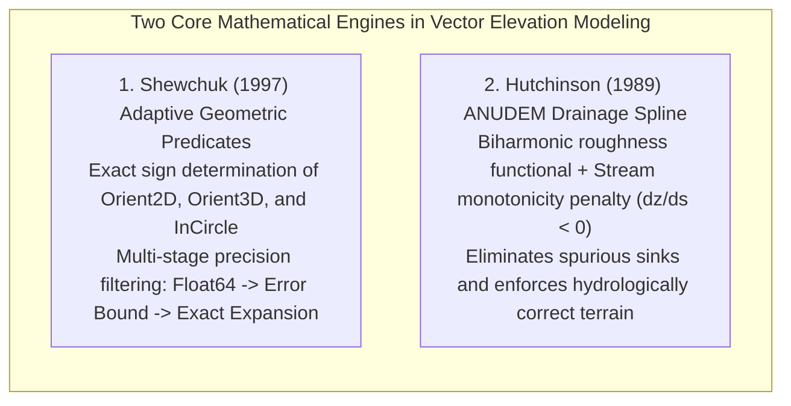
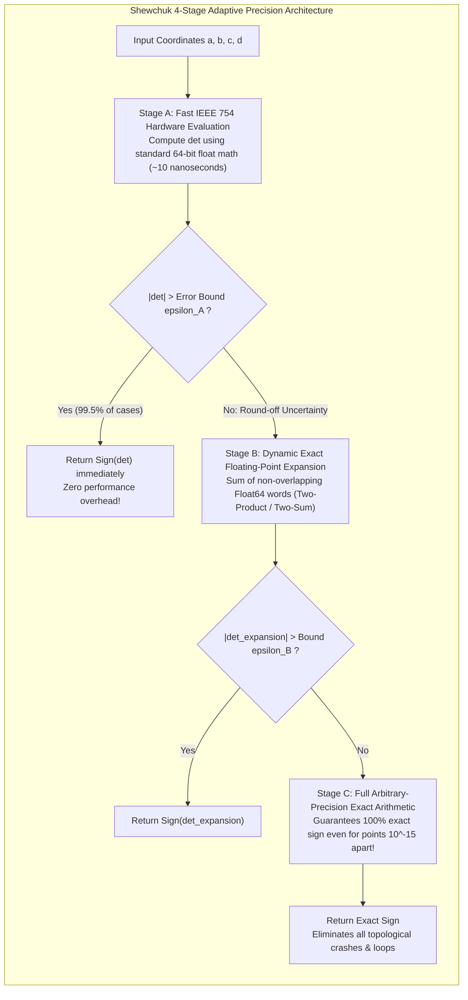
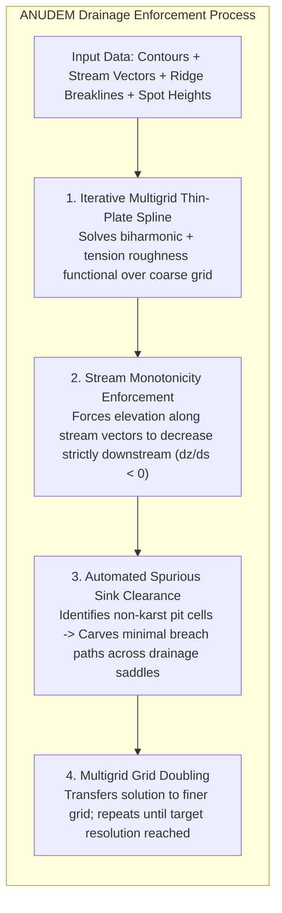

# Chapter 17: Vector Data Issues in Elevation Modeling

*Points, lines, polylines, polygons, multipolygons, breaklines, topology, and the breakdown of 2.5D assumptions when roads cross or pass under buildings.*

---

## 17.6 Mathematical Foundations of Geometric Predicates and Drainage-Enforced Splines

Integrating vector constraints into digital elevation models requires solving two foundational mathematical problems: determining the exact orientation and topological incidence of vector vertices without numerical failure, and enforcing hydrological flow continuity across rasterized stream networks. 

This section derives Jonathan Shewchuk's (1997) adaptive-precision floating-point geometric predicates and Michael Hutchinson's (1989) ANUDEM drainage-enforced spline optimization equations.

---

### 17.6.1 Shewchuk's Exact Geometric Predicates (1997)

Every computational geometry algorithm used in elevation modeling—Constrained Delaunay Triangulation (CDT), polygon clipping, point-in-polygon tests, and Voronoi diagram construction—relies on evaluating the **sign of a geometric determinant**.

#### 1. The 2D Orientation Predicate (`Orient2D`)
Given three 2D points $\mathbf{a} = [a_x, a_y]^\top$, $\mathbf{b} = [b_x, b_y]^\top$, and $\mathbf{c} = [c_x, c_y]^\top$, the predicate $\text{Orient2D}(\mathbf{a}, \mathbf{b}, \mathbf{c})$ determines whether $\mathbf{c}$ lies to the left of, to the right of, or directly on the directed line from $\mathbf{a}$ to $\mathbf{b}$:

$$\text{Orient2D}(\mathbf{a}, \mathbf{b}, \mathbf{c}) = \det \begin{bmatrix} a_x - c_x & a_y - c_y \\ b_x - c_x & b_y - c_y \end{bmatrix} = (a_x - c_x)(b_y - c_y) - (a_y - c_y)(b_x - c_x)$$

* **$\text{Orient2D} > 0$:** $\mathbf{c}$ lies strictly to the left of the line $\mathbf{a} \to \mathbf{b}$ (counter-clockwise orientation).
* **$\text{Orient2D} < 0$:** $\mathbf{c}$ lies strictly to the right of the line $\mathbf{a} \to \mathbf{b}$ (clockwise orientation).
* **$\text{Orient2D} = 0$:** The three points $\mathbf{a}, \mathbf{b}, \mathbf{c}$ are **strictly collinear**.

#### 2. The 3D Orientation Predicate (`Orient3D`)
Given four 3D points $\mathbf{a}, \mathbf{b}, \mathbf{c}, \mathbf{d}$ in a right-handed coordinate frame $(x, y, z)$, the predicate $\text{Orient3D}(\mathbf{a}, \mathbf{b}, \mathbf{c}, \mathbf{d})$ determines on which side of the oriented plane $(\mathbf{a}, \mathbf{b}, \mathbf{c})$ the query point $\mathbf{d}$ lies:

$$\text{Orient3D}(\mathbf{a}, \mathbf{b}, \mathbf{c}, \mathbf{d}) = \det \begin{bmatrix} a_x - d_x & a_y - d_y & a_z - d_z \\ b_x - d_x & b_y - d_y & b_z - d_z \\ c_x - d_x & c_y - d_y & c_z - d_z \end{bmatrix} = -\big((\mathbf{b} - \mathbf{a}) \times (\mathbf{c} - \mathbf{a})\big) \cdot (\mathbf{d} - \mathbf{a})$$

* **$\text{Orient3D} > 0$:** Point $\mathbf{d}$ lies strictly **below** the oriented plane $(\mathbf{a}, \mathbf{b}, \mathbf{c})$ (such that $\mathbf{a}, \mathbf{b}, \mathbf{c}$ appear clockwise when viewed from $\mathbf{d}$, or equivalently below the plane when $\mathbf{a}, \mathbf{b}, \mathbf{c}$ are counter-clockwise as viewed from $+z$).
* **$\text{Orient3D} < 0$:** Point $\mathbf{d}$ lies strictly **above** the counter-clockwise oriented plane $(\mathbf{a}, \mathbf{b}, \mathbf{c})$.
* **$\text{Orient3D} = 0$:** The four points $\mathbf{a}, \mathbf{b}, \mathbf{c}, \mathbf{d}$ are **strictly coplanar**.

#### 3. The 2D InCircle Predicate (`InCircle`)
In Delaunay triangulation, the empty-circumcircle criterion tests whether point $\mathbf{d}$ lies inside, outside, or on the circumcircle passing through the counter-clockwise triangle $\mathbf{a}, \mathbf{b}, \mathbf{c}$:

$$\text{InCircle}(\mathbf{a}, \mathbf{b}, \mathbf{c}, \mathbf{d}) = \det \begin{bmatrix} a_x - d_x & a_y - d_y & (a_x - d_x)^2 + (a_y - d_y)^2 \\ b_x - d_x & b_y - d_y & (b_x - d_x)^2 + (b_y - d_y)^2 \\ c_x - d_x & c_y - d_y & (c_x - d_x)^2 + (c_y - d_y)^2 \end{bmatrix}$$

* **$\text{InCircle} > 0$:** Point $\mathbf{d}$ lies **inside** the circumcircle (violating the Delaunay condition; triggers an edge flip).
* **$\text{InCircle} < 0$:** Point $\mathbf{d}$ lies strictly **outside** the circumcircle.
* **$\text{InCircle} = 0$:** The four points are **co-circular**.

#### Stage A Forward Error Bound and Exact Floating-Point Expansions (Dekker / Knuth / Shewchuk)
How does Shewchuk's Stage A filter know with mathematical certainty whether the hardware IEEE 754 `Float64` determinant $\hat{\Delta}$ has the exact same sign as the true real-number determinant $\Delta$?
1. **Forward Error Analysis of `Orient2D`:** Let $\mathbf{u} = 2^{-53} \approx 1.110223 \times 10^{-16}$ denote the IEEE 754 double-precision unit roundoff (satisfying $\text{fl}(x \circ y) = (x \circ y)(1 + \delta)$ with $|\delta| \le \mathbf{u}$ for $\circ \in \{+, -, \times\}$). In evaluating $\hat{\Delta} = \text{fl}\big(\text{fl}((a_x - c_x)(b_y - c_y)) - \text{fl}((a_y - c_y)(b_x - c_x))\big)$, let $L = \text{fl}((a_x - c_x)(b_y - c_y))$ and $R = \text{fl}((a_y - c_y)(b_x - c_x))$, and define the absolute magnitude sum:
   $$N_{\text{abs}} = |L| + |R| = \big|\text{fl}((a_x - c_x)(b_y - c_y))\big| + \big|\text{fl}((a_y - c_y)(b_x - c_x))\big|$$
   Shewchuk (1997) proved that the total accumulated floating-point error $|\hat{\Delta} - \Delta|$ is strictly bounded by:
   $$|\hat{\Delta} - \Delta| \le \epsilon_A = \left(3\mathbf{u} + 16\mathbf{u}^2\right) N_{\text{abs}} \approx 3.33067 \times 10^{-16}\,N_{\text{abs}}$$
   Therefore, whenever $|\hat{\Delta}| > \epsilon_A$ (which holds for $>99.5\%$ of point configurations), the sign of $\hat{\Delta}$ is **guaranteed to be 100% exact** at the cost of only two additions and one multiplication beyond the naive determinant!
2. **Exact Two-Sum and Two-Product Primitives (Stages B–D):** When $|\hat{\Delta}| \le \epsilon_A$, Stage B avoids slow software big-integer libraries by representing exact real numbers as unevaluated sums of non-overlapping IEEE 754 `Float64` words ($x = \sum_{i=1}^m x_i$ where $|x_i| \le \mathbf{u}|x_{i+1}|$). Using Donald Knuth's 6-operation **`Two-Sum`** and T. J. Dekker's **`Two-Product`** (which executes in a single hardware Fused Multiply-Add `FMA` instruction: $p = \text{fl}(a \cdot b)$ and exact roundoff residual $e = \text{fma}(a, b, -p)$ such that $a \cdot b \equiv p + e$ with zero information loss!), the exact determinant is refined incrementally until its magnitude exceeds the tighter Stage B/C error bounds $\epsilon_B, \epsilon_C$ or terminates in the exact 16-component expansion Stage D.

#### Worked Numerical Example: Near-Collinear UTM Breakline Vertices
Suppose three 3D highway curb breakline vertices in UTM Zone 10N are:
$$\mathbf{a} = (500\,000.00\text{ m}, \; 5\,000\,000.00\text{ m}), \qquad \mathbf{b} = (500\,100.00\text{ m}, \; 5\,000\,100.00\text{ m}), \qquad \mathbf{c} = (500\,050.00\text{ m}, \; 5\,000\,050.00 + 10^{-11}\text{ m})$$
1. **True Determinant ($\Delta$):**
   $$a_x - c_x = -50.0, \quad b_y - c_y = 50.0 - 10^{-11}, \qquad a_y - c_y = -50.0 - 10^{-11}, \quad b_x - c_x = +50.0$$
   $$\Delta = (-50)(50 - 10^{-11}) - (-50 - 10^{-11})(50) = \left(-2500 + 5\times 10^{-10}\right) - \left(-2500 - 5\times 10^{-10}\right) = +1.0 \times 10^{-9}\text{ m}^2 > 0 \quad (\text{CCW / Left})$$
2. **Hardware `Float64` Evaluation and Stage A Trigger:** At $N = 5 \times 10^6\text{ m}$, $c_y = \text{fl}(5\,000\,050.0 + 10^{-11}) = 5\,000\,050.0$ because $10^{-11}\text{ m}$ is smaller than $\frac{1}{2}\text{ULP}(5\times 10^6) = 2^{-31}\text{ m} \approx 4.66 \times 10^{-10}\text{ m}$! Even if $c_y$ differs by $1\text{ ULP}$ ($2^{-30}\text{ m}$), $N_{\text{abs}} = 2500 + 2500 = 5000\text{ m}^2$, giving Stage A threshold:
   $$\epsilon_A = 3.33067 \times 10^{-16} \times 5000 = 1.665 \times 10^{-12}\text{ m}^2$$
   Whenever $|\hat{\Delta}| \le 1.665 \times 10^{-12}\text{ m}^2$, Stage A immediately flags potential roundoff corruption and escalates to Stage B exact expansion, preventing any topological edge-flipping loop.

---

### 17.6.2 Hutchinson's ANUDEM Drainage-Enforced Spline (1989)

When digital elevation models are interpolated from digitized contour lines and stream vectors, standard minimum-curvature splines (like GMT `surface`) suffer from two severe hydrologic defects:
1. They create hundreds of artificial, closed depression "pits" or sinks along stream channels.
2. They allow streams to flow up hillsides or cross ridge noses instead of following natural valley thalwegs.

In 1989, Australian mathematician Michael F. Hutchinson developed the **ANUDEM** algorithm (Australian National University Digital Elevation Model, implemented in Esri software as `TopotoRaster`), which formulates elevation gridding as a constrained variational optimization problem.

#### Step 1: The Variational Roughness Functional and Discretized Fidelity Term
Given $M$ point/contour elevation observations $z_i = z(x_i, y_i) + \epsilon_i$ with local measurement variances $\sigma_i^2$, ANUDEM estimates the continuous elevation surface $z(x, y)$ by minimizing the penalized variational functional:

$$J[z] = \frac{1}{M}\sum_{i=1}^M \left(\frac{z(x_i, y_i) - z_i}{\sigma_i}\right)^2 + \lambda_{\text{smooth}} \iint_{\Omega} \left[ (1 - T)\left(z_{xx}^2 + 2z_{xy}^2 + z_{yy}^2\right) + T\left(z_x^2 + z_y^2\right) \right] dx \, dy + P_{\text{stream}}[z] + P_{\text{sink}}[z]$$

where the first term measures weighted data fidelity, the integral blends second-derivative thin-plate bending energy ($\nabla^4 z$) with first-derivative membrane tension ($T \in [0, 1]$, preventing contour-edge overshoots), and $P_{\text{stream}}, P_{\text{sink}}$ enforce active drainage topology.

#### Step 2: Stream Monotonicity Enforcement ($P_{\text{stream}}$)
Let $\mathbf{s}(s)$ denote a parameterized stream vector polyline oriented in the **downstream** flow direction with unit tangent vector $\hat{\mathbf{v}}_{\text{drainage}} = \frac{d\mathbf{s}}{ds}$ (where $s$ is downstream arc length). Because the spatial gradient $\nabla z$ points uphill (per `notation-and-symbols.md` §2.3), gravitational flow requires that elevation strictly decrease downstream along the streamline:

$$\frac{\partial z}{\partial s} = \nabla z \cdot \hat{\mathbf{v}}_{\text{drainage}} < 0 \quad \iff \quad -\nabla z \cdot \hat{\mathbf{v}}_{\text{drainage}} > 0 \quad \text{along the entire streamline } \mathbf{s}(s)$$

If the unconstrained spline produces a localized flat spot or upward bump along a river segment ($\frac{\partial z}{\partial s} \ge 0$), ANUDEM applies an asymmetric quadratic penalty functional (and explicit Gauss–Seidel ordered inequality projections $z_{\text{downstream}} \le z_{\text{upstream}} - \delta\,\Delta s$):

$$P_{\text{stream}}[z] = w_s \int_{\text{Streams}} \max\left( 0, \, \frac{\partial z}{\partial s} + \delta \right)^2 ds$$

where $\delta > 0$ is a minimum required downstream hydraulic slope (e.g., $\delta = 10^{-4}\text{ m}\cdot\text{m}^{-1}$) and $w_s \gg 1$ is a penalty weight.

#### Step 3: Spurious Sink Removal Algorithm
A grid cell $z_{i, j}$ is an interior **sink (pit)** if all its surrounding eight neighbors have strictly higher elevations:

$$z_{i, j} < \min_{(u,v) \in \mathcal{N}_8(i,j)} z_{u,v}$$

While genuine closed depressions exist in karst sinkholes, volcanic craters, desert endorheic basins, and glaciated kettle lakes (which can be passed to ANUDEM as explicit `sink` point/polygon exemptions), $>98\%$ of sinks in contour-derived or raw noisy DEMs are spurious interpolation artifacts. ANUDEM clears spurious sinks during each multigrid resolution doubling via three steps:
1. Detects all local minima that do not coincide with user-declared natural sink features.
2. Identifies the lowest watershed outlet **saddle cell** $(i_s, j_s)$ on the perimeter separating the spurious sink's catchment from an adjacent lower-elevation drainage basin.
3. Enforces a strictly descending chain of grid-cell inequalities along the least-cost drainage path $\hat{\mathbf{v}}_{\text{drainage}}$ from the sink through the saddle to the downstream channel so that:
   $$\frac{\partial z}{\partial s} = \nabla z \cdot \hat{\mathbf{v}}_{\text{drainage}} < 0 \quad \iff \quad z_{k+1} < z_k \quad \text{for every step } k \to k+1 \text{ along the outlet path}$$

By coupling coarse-to-fine multigrid relaxation with active stream-vector monotonicity and saddle breaching, ANUDEM aligns valley thalwegs with mapped blue-line streams and eliminates spurious contour pits at the moment of surface generation.
