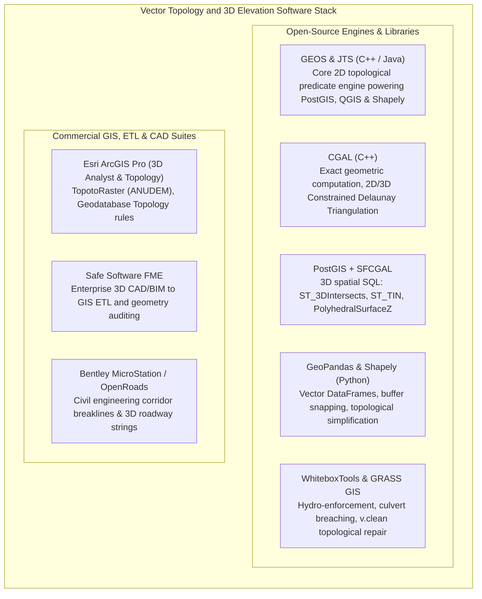

# Chapter 17: Vector Data Issues in Elevation Modeling

*Points, lines, polylines, polygons, multipolygons, breaklines, topology, and the breakdown of 2.5D assumptions when roads cross or pass under buildings.*

---

## 17.7 Software Ecosystem for Vector Processing, Topological Cleaning, and 3D Modeling

Vector operations in digital elevation modeling require a robust software pipeline capable of cleaning dirty drafting geometries, enforcing planar topology, evaluating exact predicates, and handling true 3D surfaces. This section details both the open-source and commercial software suites that manage vector breaklines, contours, and 3D solid geometry.



---

### 17.7.1 Open-Source Libraries and Vector Workflows

#### Topological Cleaning with GRASS GIS (`v.clean`)
When vector breaklines or contour lines are imported from CAD files or digitized shapefiles, they frequently contain topological defects: overshoots, undershoots, duplicate lines, and unclosed dangles. Operating inside an ephemeral CRS-aware workspace (`--tmp-project`), GRASS GIS imports 3D vectors with `v.in.ogr -z`, applies a chained sequence of native topological repair operators via `v.clean`, and exports clean 64-bit 3D geometries to GeoPackage:

```bash
# Run native 3D topological repair inside an ephemeral GRASS GIS project (NAD83(2011) / UTM 10N)
grass -c EPSG:6339 --tmp-project --exec bash -c "
  # 1. Import external 3D breaklines (-z preserves 3D Z vertex coordinates)
  v.in.ogr -z input=raw_breaklines.shp output=raw_breaklines

  # 2. Snap dangling nodes (0.25 m), break lines at all real intersections (Corbett planar rule),
  #    and remove duplicate segments and short (< 1.0 m) dangles
  v.clean input=raw_breaklines output=clean_breaklines \
      tool=snap,break,rmdupl,rmdangle thresh=0.25,0,0,1.0

  # 3. Export topologically clean 3D breaklines to OGC GeoPackage
  v.out.ogr input=clean_breaklines output=clean_breaklines.gpkg format=GPKG
"
```

#### 3D Geometry and Surface Intersections in PostGIS and SFCGAL
While standard PostGIS uses GEOS for 2D operations, the `postgis_sfcgal` extension integrates CGAL's exact 3D computational geometry kernels directly into SQL:

```sql
-- Enable SFCGAL extension in PostgreSQL (for exact 3D solids / constrained TINs)
CREATE EXTENSION postgis_sfcgal;

-- 1. Create a true 3D TIN surface (TINZ, flags = 2) from 3D vector points
CREATE TABLE project_tinz AS
SELECT ST_DelaunayTriangles(ST_Collect(geom_3d), 0.0, 2) AS tin_geom
FROM surveyed_ground_points;

-- 2. Detect 3D spatial intersections between a proposed highway deck and terrain
-- Unlike ST_Intersects (which flattens to 2D), ST_3DIntersects tests true 3D spatial clash!
SELECT 
    b.bridge_id,
    t.terrain_id,
    ST_3DIntersects(b.deck_polyhedral_geom, t.tin_geom) AS is_subsurface_collision
FROM highway_bridges b, project_tinz t;
```

#### Hydro-Enforcement and Culvert Breaching with WhiteboxTools
**WhiteboxTools** (developed by John Lindsay in Rust with open-source `whitebox` Python bindings) provides high-performance algorithms for hydro-enforcing digital elevation models across road embankments without flooding upstream valleys:

```python
"""Automated DEM Hydro-Enforcement using WhiteboxTools."""

from whitebox import WhiteboxTools

# 1. Initialize the open-source WhiteboxTools Rust engine
wbt = WhiteboxTools()
wbt.set_verbose_mode(False)

# 2. Breach culverts and bridges through road embankments (destructive hydro-enforcement)
# Finds road embankments obstructing drainage paths and carves least-cost digital trenches
wbt.breach_depressions_least_cost(
    dem="raw_lidar_dtm.tif",
    output="hydro_enforced_dem.tif",
    dist=100,  # Maximum breach search radius in grid cells (100 m on a 1 m DEM)
    max_cost=15.0,  # Maximum cumulative vertical excavation cost (meters)
    fill=False,  # Carve trenches only; do not flat-fill remaining natural basins
)

# 3. Compute D8 hydrologic flow direction and accumulation across the enforced surface
wbt.d8_pointer(dem="hydro_enforced_dem.tif", output="d8_flow_dir.tif")
wbt.d8_flow_accumulation(
    i="d8_flow_dir.tif",
    output="flow_accumulation.tif",
    out_type="specific contributing area",
    pntr=True,  # Critical: tells WhiteboxTools input 'i' is a D8 pointer, not raw elevation!
)
```

#### Automated 3D Vector Breakline Auditing and Repair in Python (`shapely`, `geopandas`, and `GDAL/OGR`)
Before passing vector hydro-flattening polygons or road breaklines into a triangulation or rasterization engine, an automated Python QA/QC pipeline using `geopandas` and `shapely` 2.1+ (backed by `GEOS` 3.12+) should verify `Z`-coordinate presence, repair self-intersections (`make_valid`), snap vertices to a millimeter grid (`set_precision`, implementing Hobby's snap-rounding), and enforce OGC/GeoJSON right-hand winding order (`orient_polygons`):

```python
"""Automated QA/QC and topological repair for 3D hydro-flattening breaklines."""

import geopandas as gpd
import numpy as np
import shapely


def audit_and_repair_3d_breaklines(
    input_path: str, output_path: str, grid_snap_m: float = 0.001
) -> dict:
  """Audits 3D vector breaklines for Z-presence, topology, river monotonicity, and winding."""
  gdf = gpd.read_file(input_path)
  geoms = gdf.geometry.to_numpy()

  # 1. Verify every geometry carries 3D Z coordinates and no NaN elevations
  has_z = shapely.has_z(geoms)
  if not np.all(has_z):
    n_missing = int(np.sum(~has_z))
    raise ValueError(
        f"CRITICAL: {n_missing} breaklines dropped their Z coordinate!"
    )

  coords = shapely.get_coordinates(geoms, include_z=True)
  if np.any(np.isnan(coords[:, 2])) or np.all(coords[:, 2] == 0.0):
    raise ValueError(
        "CRITICAL: Breakline Z coordinates contain NaN or all-zero datum drop!"
    )

  # 2. Repair self-intersecting bowties and unclosed rings without dropping Z
  invalid_mask = ~shapely.is_valid(geoms)
  n_invalid = int(np.sum(invalid_mask))
  if n_invalid > 0:
    geoms = shapely.make_valid(geoms)

  # 3. Apply Hobby (1999) snap-rounding to 1 mm grid to eliminate tile-seam slivers
  geoms = shapely.set_precision(geoms, grid_size=grid_snap_m, mode="valid_output")

  # 4. Enforce OGC / RFC 7946 Right-Hand Rule: Exterior CCW, Interior Holes CW
  geoms = shapely.orient_polygons(geoms, exterior_cw=False)

  # 5. Audit lake polygon constant-elevation rule (USGS 3DEP LBS tolerance <= 1 mm)
  z_spread = []
  for g in geoms:
    z_pts = shapely.get_coordinates(g, include_z=True)[:, 2]
    z_spread.append(float(np.ptp(z_pts)))

  gdf["geometry"] = geoms
  gdf["z_ptp_m"] = z_spread
  # Save to cloud-native GeoParquet or OGC GeoPackage (preserving Float64 XYZ)
  gdf.to_parquet(output_path)
  return {
      "total_features": len(gdf),
      "repaired_invalid_topologies": n_invalid,
      "max_lake_z_spread_m": round(max(z_spread, default=0.0), 5),
  }
```

For global or Pacific-basin vector breaklines and coastline polygons crossing the $\pm 180^\circ$ antimeridian, GDAL/OGR's `ogr2ogr` CLI splits wrapping geometries cleanly at the dateline while enforcing RFC 7946 right-hand ring orientation:

```bash
# Split antimeridian-spanning polygons at +/-180 deg and enforce 64-bit XYZ in GeoPackage
ogr2ogr -f GPKG pacific_coastlines_clean.gpkg raw_pacific_shoreline.shp \
    -wrapdateline -datelineoffset 10 -dim XYZ -nlt PROMOTE_TO_MULTI
```

Similarly, when ingesting legacy clockwise Esri Shapefiles directly into PostgreSQL/PostGIS for DEM hydro-flattening or spherical `GEOGRAPHY` queries, a single SQL pipeline enforces topological validity (`ST_MakeValid`), snaps vertices to a $1\text{ mm}$ fixed-precision grid (`ST_ReducePrecision`), and reorients rings to the OGC/RFC 7946 Counter-Clockwise exterior / Clockwise interior right-hand convention (`ST_ForcePolygonCCW`):

```sql
-- PostGIS 3.4+ Topological Repair, Snap-Rounding (1 mm), and CCW Winding Enforcement
CREATE TABLE hydro_breaklines_valid AS
SELECT
    feature_id,
    waterbody_type,
    ST_ForcePolygonCCW(
        ST_ReducePrecision(
            ST_MakeValid(geom_3d, 'method=structure keepcollapsed=false'),
            0.001 -- 1 mm snap-rounding hot-pixel grid size
        )
    ) AS geom_3d
FROM raw_shapefile_breaklines
WHERE ST_ZMin(geom_3d) > -500.0;
```

In addition, when constructing Constrained Delaunay Triangulations (CDTs) with hard breaklines directly in Python or C++, **CGAL** (`CGAL::Constrained_Delaunay_triangulation_2` with `CGAL::Exact_predicates_inexact_constructions_kernel` and `CGAL::Projection_traits_xy_3`) enforces 3D breakline segments while evaluating `Orient2D` and `InCircle` on the horizontal $(x, y)$ projection using Shewchuk's exact adaptive filters, guaranteeing zero topological crashes even when thousands of road curb and hydro-flattening breaklines meet at sub-millimeter tolerances.

---

### 17.7.2 Commercial and Industrial Suites

#### 1. Esri ArcGIS Pro: Geodatabase Topology Rules and `Topo to Raster`
In enterprise GIS, Esri's **Geodatabase Topology** engine and **3D Analyst** enforce over 30 rule-based geometric constraints across feature classes:
* Enforces planar and 3D boundary rules such as *Must Not Have Gaps*, *Must Not Overlap*, *Must Be Covered By Boundary Of*, and *Must Be Larger Than Cluster Tolerance*.
* **`Topo to Raster`:** The commercial implementation of Michael Hutchinson's **ANUDEM** algorithm (Section 17.6.2), which simultaneously ingests contour polylines, directed stream centerlines, lake boundary polygons, cliff breaklines, and summit spot heights to produce hydrologically connected DEMs.

#### 2. Safe Software FME, Laser-Scan Radius Topology, and Bentley MicroStation / OpenRoads
* **Safe Software FME (Feature Manipulation Engine):** The industry workhorse for reconciling 3D CAD/BIM models (AutoCAD `.dwg`, MicroStation `.dgn`, IFC `.ifc`) with GIS databases via `GeometryValidator` (detecting self-intersections, bad winding orders, non-planar 3D faces, and missing `Z` values) and `SurfaceModeller` (building breakline-enforced Delaunay TINs).
* **Laser-Scan (1Spatial) Radius Topology:** An enterprise object-oriented topological middleware engine for Oracle Spatial and PostGIS that snaps and maintains persistent node-edge-face topological primitives (`1Spatial` rules engine) in real time as national mapping agencies edit hydrographic and topographic breaklines.
* **Bentley MicroStation, OpenRoads, and Autodesk Civil 3D:** In civil corridor and port engineering, roadways, levees, and dredged navigation channels are authored as parametric 3D corridor assemblies ("strings": crown, edge-of-travelled-way, curb lip, top-of-curb, ditch thalweg, cut/fill daylight line) that export directly as hard breaklines into LandXML (`.xml`) and 3D TIN surfaces.

---

### 17.7.3 Software Comparison Matrix

| Software / Tool | License Model | Primary Geometric Domain | Key Mathematical Core | Best-Suited Role in Elevation Workflows |
| :--- | :--- | :--- | :--- | :--- |
| **GEOS / JTS** | Open-Source (LGPL) | 2D Vector Primitives | Snap-rounding, planar overlay, DE-9IM | Core 2D geometry engine for QGIS, PostGIS, Shapely. |
| **CGAL** | Open-Source (GPL/LGPL)| 2D/3D Meshes & Solids | Exact arithmetic predicates (Shewchuk) | Robust Constrained Delaunay Triangulation without crash. |
| **PostGIS / SFCGAL**| Open-Source (GPLv2) | 2D / 2.5D / True 3D | PostgreSQL SQL engine + CGAL 3D kernels | Enterprise 3D spatial queries, `PolyhedralSurfaceZ`. |
| **WhiteboxTools** | Open-Source (GPLv3) | Raster + Vector Hydro | Rust-optimized Least-Cost Breaching | Automated culvert breaching and DEM hydro-conditioning. |
| **GRASS GIS** | Open-Source (GPLv2) | 2D/3D Topological Vector | Corbett node-arc topology (`v.clean`) | CAD vector cleaning, intersection breaking, snapping. |
| **Esri ArcGIS Pro** | Commercial (Esri) | Raster, TIN, Geodatabase | ANUDEM (`TopotoRaster`), Rule Topology | National mapping, contour gridding, hydrologic modeling. |
| **Safe Software FME** | Commercial (Safe) | CAD / GIS / BIM 3D | Multi-format spatial ETL & validation | Transforming civil CAD drawings into 3D GIS breaklines. |
| **Bentley OpenRoads**| Commercial (Bentley) | 3D Civil Engineering | Parametric 3D corridor strings | Design-grade highway breakline modeling. |
