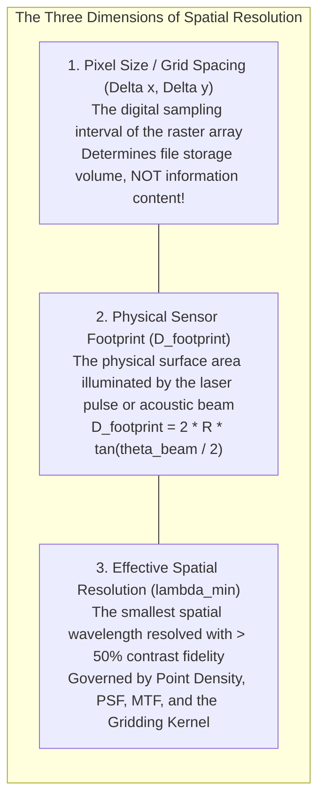
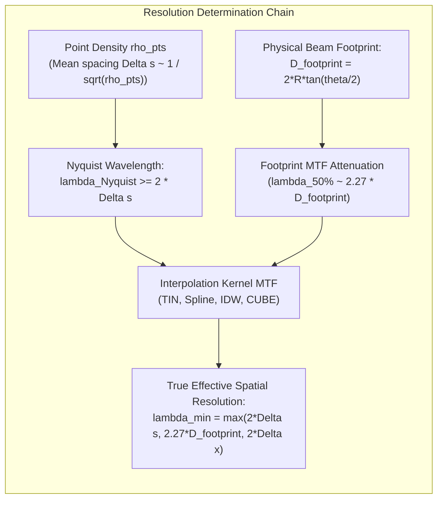
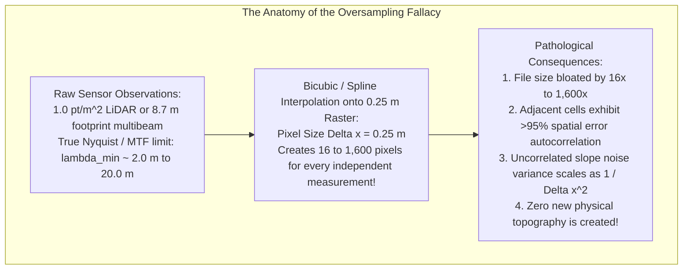

# Chapter 18: Resolution, Pixel Size, Oversampling, Precision, and Super-Resolution

*Why pixel size is not resolution, why more decimal places are not accuracy, and what happens when we push beyond the physical sensor limit.*

Among geospatial practitioners, no term is more frequently misunderstood, conflated, or commercialized than **resolution**. A raster dataset with $1.0\text{-meter}$ grid cell spacing is routinely described as a "1-meter resolution DEM," regardless of whether the underlying sensor was an optical camera resolving gravel pebbles, a high-altitude laser scanner with a $3\text{-meter}$ beam footprint, or a coarse spaceborne altimeter interpolated to a dense grid. Confusing the digital storage interval (pixel size) with physical resolving power (effective resolution) leads to catastrophic errors in hydrological modeling, hazard assessment, and earthwork quantification.

---

## 18.1 Resolution vs. Pixel Size vs. Effective Resolution

To establish scientific and metrological rigor, geospatial analysis must strictly decouple three fundamentally different quantities: **Pixel Size**, **Sensor Footprint**, and **Effective Spatial Resolution**.

---

### 18.1.1 Deconstructing the Terminology

#### 1. Pixel Size (Grid Spacing / Sampling Interval, $\Delta x, \Delta y$)
Pixel size represents the planimetric dimensions of a discrete cell in a raster matrix. A $1.0\text{-meter}$ pixel simply means that numerical elevation values are stored on a regular grid spaced every $1.0\text{ m}$ in the projected coordinate system. It is purely a digital container. Any digital array can be upsampled to $0.1\text{-m}$ pixels using bicubic interpolation without adding a single bit of new physical topography.

#### 2. Sensor Footprint (IFOV / Beamwidth)
The physical sensor footprint is the finite area on the Earth's surface or seabed illuminated during a single measurement:
* **Airborne & Spaceborne LiDAR:** For a laser with full-angle beam divergence $\gamma_{\text{div}}$ (typically $0.25\text{–}0.5\text{ mrad}$ for airborne scanners; $\approx 0.03\text{ mrad}$ for ICESat-2 ATLAS) flown at altitude $H_{\text{agl}}$ above ground at off-nadir angle $\theta_i$ on terrain of slope $\alpha$:
  $$D_{\text{footprint}} = 2 H_{\text{agl}} \tan\left(\frac{\gamma_{\text{div}}}{2}\right) \approx H_{\text{agl}}\,\gamma_{\text{div}} \quad (\text{nadir flat ground})$$
  At $H_{\text{agl}} = 2000\text{ m}$ with $\gamma_{\text{div}} = 0.3\text{ mrad}$, the physical laser footprint is $D_{\text{footprint}} \approx 0.60\text{ m}$ across (whereas NASA GEDI on the ISS has a $D_{\text{footprint}} \approx 25\text{ m}$ diameter footprint).
* **Multibeam Echo Sounder (MBES):** For a Mills Cross acoustic sonar with along-track transmit beamwidth $\psi_{\text{tx}}$ and across-track receive beamwidth $\psi_{\text{rx}}$ operating at water depth $d$ (positive downward, per `notation-and-symbols.md`) and beam steering angle $\theta$:
  $$D_{\text{along}} = \frac{2\,d}{\cos\theta} \tan\left(\frac{\psi_{\text{tx}}}{2}\right) \approx \frac{d\,\psi_{\text{tx}}}{\cos\theta}, \qquad D_{\text{across}} = \frac{2\,d}{\cos^2\theta} \tan\left(\frac{\psi_{\text{rx}}}{2}\right) \approx \frac{d\,\psi_{\text{rx}}}{\cos^2\theta}$$
  For a $1.0^\circ \times 1.0^\circ$ ($\psi_{\text{tx}} = \psi_{\text{rx}} = 0.01745\text{ rad}$) multibeam sonar at water depth $d = 500\text{ m}$, the nadir ($\theta = 0^\circ$) seabed footprint diameter is **$8.73\text{ meters}$**, expanding at an outer beam angle of $\theta = 60^\circ$ ($\cos^2 60^\circ = 0.25$) to **$17.45\text{ m}$ along-track by $34.91\text{ m}$ across-track**! The acoustic bottom return is a spatial convolution of all scatterers within that $500\text{ m}^2$ elliptical patch.

#### 3. Effective Spatial Resolution ($\lambda_{\min}$) and the MTF Chain
Effective spatial resolution is the smallest spatial wavelength ($\lambda_{\min}$) or periodic terrain undulation that can be resolved with $\ge 50\%$ amplitude fidelity ($\text{MTF}(f_{\text{eff}}) = 0.50$). It is governed by three cascading physical and numerical filters:
1. **The Nyquist–Shannon Sampling Criterion (Shannon, 1948; Hengl, 2006):** A sinusoidal terrain feature of spatial wavelength $\lambda = 1/f$ can be reconstructed without aliasing if and only if it is sampled by at least two independent measurements per wavelength:
   $$\lambda_{\text{Nyquist}} = 2\,\Delta s_{\text{pts}}$$
   For a 2D point cloud with spatial point density $\rho_{\text{pts}}$ ($\text{pts}\cdot\text{m}^{-2}$), the mean point spacing under a Poisson/random or quasi-regular distribution is $\Delta s_{\text{pts}} \approx \frac{1}{\sqrt{\rho_{\text{pts}}}}$ (or $\frac{1}{2\sqrt{\rho_{\text{pts}}}}$ expected nearest-neighbor distance; Hengl, 2006). The minimum unaliased wavelength supported by the point cloud is therefore:
   $$\lambda_{\min,\text{Nyquist}} \ge \frac{2}{\sqrt{\rho_{\text{pts}}}}$$
2. **Sensor Point Spread Function (PSF) and Modulation Transfer Function (MTF):** The physical sensor averages the true terrain $z_{\text{true}}(x, y)$ over its beam footprint via spatial convolution $z_{\text{meas}} = \text{PSF} * z_{\text{true}}$. Approximating a beam footprint of Full Width at Half Maximum $\text{FWHM} = D_{\text{footprint}}$ as a 2D Gaussian $\text{PSF}(r) = \frac{1}{2\pi\sigma_b^2}\exp\big(-\frac{r^2}{2\sigma_b^2}\big)$ with $\sigma_b = \frac{D_{\text{footprint}}}{2\sqrt{2\ln 2}} \approx \frac{D_{\text{footprint}}}{2.3548}$, its Fourier-domain Modulation Transfer Function $\text{MTF}_{\text{sensor}}(f) = |\mathcal{F}\{\text{PSF}\}(f)|$ at spatial frequency $f = 1/\lambda$ ($\text{cycles}\cdot\text{m}^{-1}$) is:
   $$\text{MTF}_{\text{sensor}}(f) = \exp\left(-2\pi^2 \sigma_b^2 f^2\right) = \exp\left(-\frac{\pi^2}{4\ln 2}\left(\frac{D_{\text{footprint}}}{\lambda}\right)^2\right) = 2^{-\left(\frac{\pi}{2\ln 2}\frac{D_{\text{footprint}}}{\lambda}\right)^2}$$
   Setting $\text{MTF}_{\text{sensor}}(f_{50\%}) = 0.50$ shows that any terrain feature with wavelength $\lambda = \frac{\pi}{2\ln 2} D_{\text{footprint}} \approx 2.266\,D_{\text{footprint}}$ already loses $50\%$ of its vertical relief amplitude, and features with $\lambda \le D_{\text{footprint}}$ are attenuated to $\le 2.85\%$ of their true height ($> 97\%$ erased) regardless of how densely the sensor oversamples the ground!
3. **The Gridding Interpolation Filter ($\text{MTF}_{\text{grid}}$):** Moving-average, IDW, Gaussian, or spline-in-tension gridding kernels multiply the sensor MTF by $\text{MTF}_{\text{grid}}(f)$, so the end-to-end system transfer function is $\text{MTF}_{\text{total}}(f) = \text{MTF}_{\text{sensor}}(f)\cdot\text{MTF}_{\text{grid}}(f)$.

---

### 18.1.2 The Oversampling Fallacy and Spectral Roll-Off

The **Oversampling Fallacy** is the mistaken belief that interpolating low-density or wide-footprint sensor data onto a fine-resolution raster grid increases the accuracy or informational content of the digital elevation model.

#### Worked Numerical Proof of Information Deficit and Forensic 2D PSD Detection
Consider two real-world oversampling scenarios:
1. **Topographic LiDAR ($1.0\text{ pt}\cdot\text{m}^{-2} \to 0.25\text{ m}$ Grid):** An airborne LiDAR survey with $\rho_{\text{pts}} = 1.0\text{ pt}\cdot\text{m}^{-2}$ ($\Delta s_{\text{pts}} = 1.0\text{ m}$) has a physical Nyquist cutoff at $f_{\max,\text{pts}} = \frac{1}{2\Delta s_{\text{pts}}} = 0.50\text{ cycles}\cdot\text{m}^{-1}$ ($\lambda_{\min} = 2.0\text{ m}$). Gridding this cloud onto a $\Delta x = 0.25\text{ m}$ raster sets the digital grid Nyquist frequency to $f_{\text{grid}} = \frac{1}{2\Delta x} = 2.00\text{ cycles}\cdot\text{m}^{-1}$ ($\lambda = 0.50\text{ m}$). Across the entire spectral annulus $f \in [0.50, 2.00]\text{ cycles}\cdot\text{m}^{-1}$ (which accounts for $1 - (0.50/2.00)^2 = \mathbf{93.75\%}$ of the 2D Fourier wavevector plane!), the raster contains **zero true terrain signal**—only interpolation kernel ringing, TIN facet creases, or high-frequency noise.
2. **Deep-Water Multibeam Sonar ($d = 500\text{ m}, D_{\text{footprint}} = 8.73\text{ m} \to 1.0\text{ m}$ Grid):** At $d = 500\text{ m}$, the $50\%$ MTF cutoff wavelength of a $1^\circ$ beam is $\lambda_{50\%} \approx 2.266 \times 8.73\text{ m} = 19.78\text{ m}$ ($f_{50\%} = 0.0506\text{ cycles}\cdot\text{m}^{-1}$). Gridding onto a $\Delta x = 1.0\text{ m}$ raster ($f_{\text{grid}} = 0.50\text{ cycles}\cdot\text{m}^{-1}$) creates $\approx 60\text{ pixels}$ ($\frac{\pi}{4} \times 8.73^2 = 59.8\text{ m}^2$) inside every single nadir circular acoustic footprint and $\approx 479\text{ pixels}$ inside every $60^\circ$ outer-beam elliptical footprint!

#### Pathological Impacts of Oversampling
1. **Severe Spatial Error Autocorrelation ($N_{\text{eff}} \ll N_{\text{pixels}}$):** Because 16 to 400 adjacent pixels are interpolated from the exact same noisy measurement, their error correlation approaches $\rho(\Delta x) \to 0.99$. Treating pixels as independent samples underestimates volumetric uncertainty $\sigma_V$ by $4\times\text{ to }20\times$ (Chapter 14 & Chapter 33).
2. **Derivative Noise Variance Amplification:** For any unsmoothed measurement noise component $\sigma_{z,\text{nugget}}$, the variance of finite-difference slope $\sigma_{\partial z/\partial x}^2 = \frac{\sigma_{z,\text{nugget}}^2}{2\Delta x^2}$ scales inversely with $\Delta x^2$ (a $16\times$ variance jump—or $4\times$ standard deviation jump—when shrinking $\Delta x$ from $1.0\text{ m}$ to $0.25\text{ m}$), while second-derivative Laplacian curvature variance $\sigma_{\nabla^2 z}^2 \propto \frac{\sigma_{z,\text{nugget}}^2}{\Delta x^4}$ explodes by **$256\times$** (Florinsky, 2016)!
3. **Massive Storage and Compute Waste:** A $100\text{ km}^2$ watershed gridded at $\Delta x = 1.0\text{ m}$ (`Float32`) occupies $10^8\text{ pixels}$ ($400\text{ MB}$). Oversampled to $\Delta x = 0.25\text{ m}$, it balloons to **$1.6 \times 10^9\text{ pixels}$ ($6.4\text{ GB}$)** while slowing 2D hydraulic simulations by $4^3 = 64\times$.

---

### 18.1.3 Hengl's (2006) Rules and the Goldilocks Grid Spacing

To prevent both under-sampling (aliasing real topography) and over-sampling (bloating storage and amplifying derivative noise), Tomislav Hengl (2006), Igor Florinsky (2016), USGS 3DEP, and NOAA HSSD establish quantitative rules for selecting nominal grid cell size $\Delta x$ from point density $\rho_{\text{pts}}$, contour density, and footprint diameter $D_{\text{footprint}}$:

$$\Delta x_{\text{optimal}} = \max\left( c_{\text{grid}}\,\Delta s_{\text{pts}}, \; \frac{1}{2} D_{\text{footprint}}(\theta) \right), \qquad \text{where } \Delta s_{\text{pts}} = \frac{1}{\sqrt{\rho_{\text{pts}}}} \quad \text{and } c_{\text{grid}} \in [1.0, 2.0]$$

* **Point-Cloud Rule (Hengl, 2006; USGS 3DEP):** Set $\Delta x$ between $1.0\times$ and $2.0\times$ the mean point spacing $\Delta s_{\text{pts}} = 1/\sqrt{\rho_{\text{pts}}}$ so that every grid cell contains on average $\bar{n}_{\text{cell}} = \rho_{\text{pts}}\,\Delta x^2 \in [1, 4]$ direct ground returns:
  * **USGS QL0 LiDAR** ($\rho_{\text{pts}} \ge 8\text{ pts}\cdot\text{m}^{-2}, \text{RMSE}_z \le 5\text{ cm}$): $\Delta s_{\text{pts}} \le 0.35\text{ m} \implies \Delta x = \mathbf{0.5\text{ m}}$.
  * **USGS QL1 LiDAR** ($\rho_{\text{pts}} \ge 8\text{ pts}\cdot\text{m}^{-2}, \text{RMSE}_z \le 10\text{ cm}$): $\Delta s_{\text{pts}} \le 0.35\text{ m} \implies \Delta x = \mathbf{0.5\text{ m}}\text{ to }\mathbf{1.0\text{ m}}$.
  * **USGS QL2 LiDAR** ($\rho_{\text{pts}} \ge 2\text{ pts}\cdot\text{m}^{-2}, \text{RMSE}_z \le 10\text{ cm}$): $\Delta s_{\text{pts}} \le 0.71\text{ m} \implies \Delta x = \mathbf{1.0\text{ m}}$.
* **Contour-Derived DEM Rule (Hengl, 2006):** For digitized contours of total length $\sum L_{\text{contour}}$ inside area $A$, the average spacing between contours is $\bar{w}_c = \frac{A}{\sum L_{\text{contour}}}$, and the grid cell size should satisfy $\Delta x \approx \frac{\bar{w}_c}{2}\text{ to }\frac{\bar{w}_c}{5}$ (or for cartographic map scale denominator $S_m$, $\Delta x \approx 0.0005 \cdot S_m$, e.g., $12\text{ m}$ for a $1:24,000$ quadrangle).
* **Hydrographic Depth-Dependent Resolution Rule (NOAA HSSD & IHO S-44):** Because multibeam footprint $D_{\text{footprint}} \propto d$ grows linearly with water depth $d$, fixed-resolution BAGs follow depth brackets (e.g., $\Delta x = 0.5\text{ m}$ for $d \in [0, 20\text{ m}]$, $1.0\text{ m}$ for $d \in [18, 40\text{ m}]$, $2.0\text{ m}$ for $d \in [36, 80\text{ m}]$, and $4.0\text{ m}$ for $d \in [72, 160\text{ m}]$), or adopt **Variable-Resolution BAGs (`VR-BAG` / `CHRT`)** where cell size adapts locally to sounding density and footprint size.
