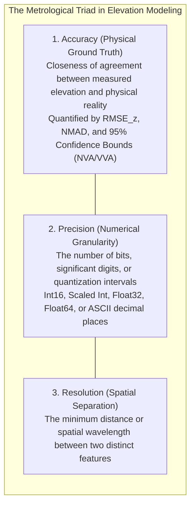
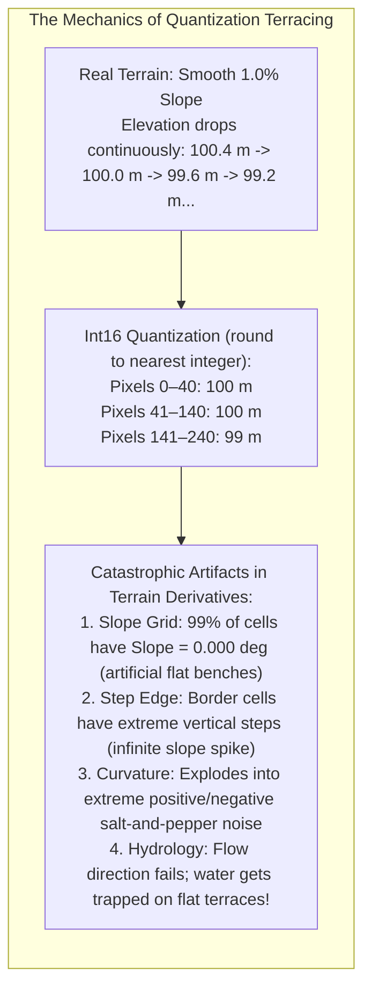
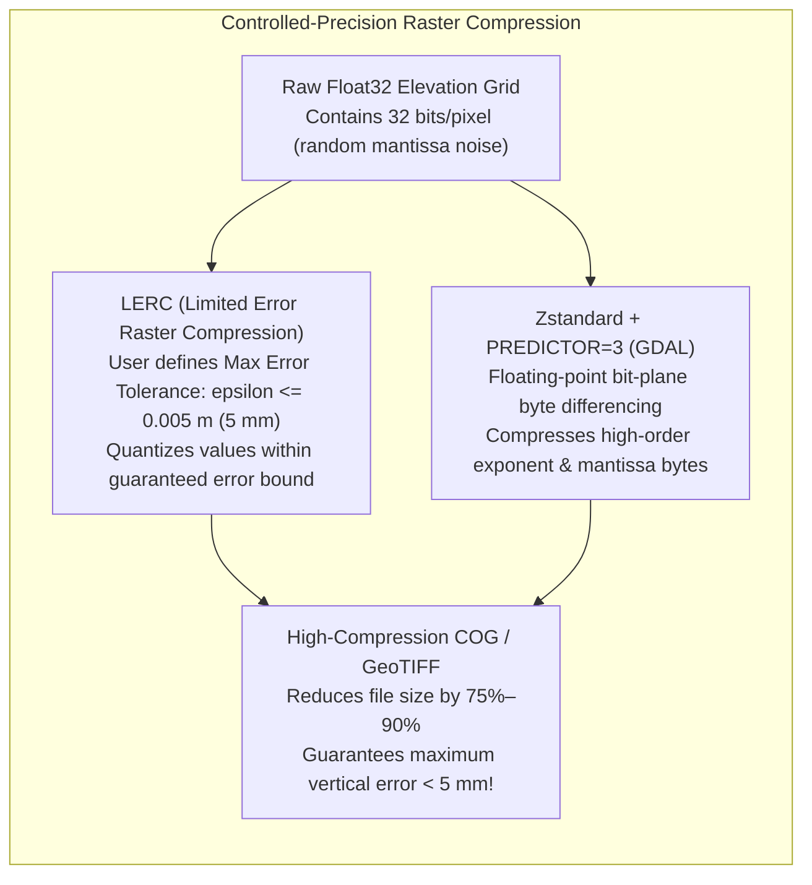

# Chapter 18: Resolution, Pixel Size, Oversampling, Precision, and Super-Resolution

*Why pixel size is not resolution, why more decimal places are not accuracy, and what happens when we push beyond the physical sensor limit.*

---

## 18.2 Resolution vs. Numerical Precision vs. Accuracy

Just as practitioners routinely conflate pixel size with spatial resolution, they frequently confuse **numerical precision** (the number of bits or decimal places used to store a value) with **measurement accuracy** (the degree of closeness to true physical reality). 

Storing an uncalibrated elevation model with 12 decimal places of floating-point precision does not make it accurate to the width of an atom; it simply stores random sensor noise and computational round-off to an absurd degree of granularity. Conversely, truncating floating-point elevation data into integers to save disk space introduces severe "terracing" quantization artifacts that ruin downstream slope and hydrologic modeling.



---

### 18.2.1 Numerical Data Types in Elevation Modeling

The binary data type selected to store elevation values dictates the dynamic vertical range, vertical quantization step size, and memory footprint of the dataset:

| Data Type | Bit Depth | Mantissa / Range | Quantization Step ($\Delta z$) | Memory per Pixel | Operational Hazards & Elevation Artifacts |
| :--- | :--- | :--- | :--- | :--- | :--- |
| **`Int16` (Raw)** | 16 bits | $[-32,768, \, +32,767]$ | **$1.0\text{ meter}$** | $2\text{ bytes}$ | **Severe Terracing:** Gentle slopes quantize into flat $1\text{-m}$ steps; slope drops to zero between steps. |
| **`Int16` (Scaled)** | 16 bits | Scale $= 0.01, \text{Offset} = z_0$ | **$0.01\text{ meter}$ ($1\text{ cm}$)** | $2\text{ bytes}$ | **Range Clipping:** Maximum vertical relief is restricted to $655.35\text{ m}$ ($2^{16} \times 0.01$). |
| **`Int32` (Scaled)** | 32 bits | Scale $= 0.001, \text{Offset} = 0$ | **$0.001\text{ meter}$ ($1\text{ mm}$)** | $4\text{ bytes}$ | Excellent for high-precision elevation; wide dynamic range ($\pm 2,147,483\text{ m}$). |
| **`Float32`** | 32 bits | 24-bit mantissa ($\approx 7$ digits) | Dynamic ($<0.001\text{ m}$ at Mount Everest) | $4\text{ bytes}$ | **The Modern Industry Standard:** Flawless vertical precision across planetary elevation scales. |
| **`Float64`** | 64 bits | 53-bit mantissa ($\approx 16$ digits)| $10^{-12}\text{ meters}$ | $8\text{ bytes}$ | **Wasteful for Elevation:** Wastes 50% memory storing sensor noise; mandatory only for horizontal coordinates. |

---

### 18.2.2 The `Int16` Quantization Terracing Disaster

In early digital cartography (and many legacy regional GIS repositories), raster DEMs were stored as raw 16-bit signed integers (`Int16`) where one unit equaled one meter. 



#### Why $1\text{-Meter}$ Quantization Destroys Slope, Curvature, and TWI
When a continuous elevation signal $z$ is quantized to uniform step size $\Delta q$ (e.g., $\Delta q = 1.0\text{ m}$ for raw `Int16` SRTM/ASTER/legacy USGS DEMs), the quantization error $e_q = \text{round}(z / \Delta q)\Delta q - z$ is uniformly distributed on $\left[-\frac{\Delta q}{2}, +\frac{\Delta q}{2}\right]$, introducing an irreducible **quantization variance** and root-mean-square error:

$$\sigma_q^2 = \int_{-\Delta q/2}^{+\Delta q/2} \frac{e_q^2}{\Delta q}\,de_q = \frac{\Delta q^2}{12} \implies \text{RMSE}_q = \frac{\Delta q}{\sqrt{12}} \approx 0.2887\,\Delta q \quad (\approx 0.29\text{ m for } \Delta q = 1\text{ m})$$

Worse than the $0.29\text{ m}$ vertical RMSE is the **spatial coherence** of the rounding steps across gentle terrain:
* Consider an alluvial coastal plain or continental shelf with a gentle slope of $S = 0.5\%$ ($1\text{ m}$ vertical fall over $200\text{ m}$ horizontal distance) gridded at $\Delta x = 1.0\text{ m}$.
* In a continuous `Float32` DEM, the slope is a uniform $\alpha = \arctan(0.005) = 0.2865^\circ$, profile curvature is $\kappa_p = 0.0\text{ m}^{-1}$, and downslope aspect $\psi_{\text{aspect}}$ points smoothly toward the coast.
* In an unscaled `Int16` DEM ($\Delta q = 1.0\text{ m}$), the elevation values remain identical ($z = 100\text{ m}$) for 200 consecutive pixels, and then abruptly step down by $-1.0\text{ m}$ to $z = 99\text{ m}$ at pixel 201!
* Across $99\%$ of the floodplain (198 of every 200 pixels), a $3\times 3$ slope stencil sees 9 identical integers: the calculated slope collapses to **$\|\nabla z\| = 0.000^\circ$**, aspect is undefined (`NaN` or biased strictly to $45^\circ$ multiples near terrace corners), and the Topographic Wetness Index ($\text{TWI} = \ln(a_s / \tan\alpha)$) blows up to $+\infty$ ($\tan\alpha = 0$ division by zero!).
* Conversely, at the two pixels straddling the integer step, the finite-difference slope spikes to $\arctan\big(\frac{1.0\text{ m}}{2\Delta x}\big) = 26.57^\circ$ ($50\%$ grade—a $100\times$ overestimate of the true $0.5\%$ slope!), while second-derivative Laplacian curvature oscillates wildly between $\pm \frac{1}{\Delta x^2} = \pm 1.0\text{ m}^{-1}$, painting contour-like "bull's-eye" rings across every curvature, hillshade, and soil-erosion map.

#### Scaled Integers (`z = scale * int_val + offset`) vs. IEEE 754 `Float32`
When integer storage is required by a format specification (such as LAS/LAZ point records, which store $X, Y, Z$ as 32-bit signed integers `Int32` with header scale factors `[x_scale, y_scale, z_scale]` and offsets `[x_offset, y_offset, z_offset]`), choosing `z_scale = 0.001` ($1\text{ mm}$) reduces quantization noise to $\sigma_q = \frac{1\text{ mm}}{\sqrt{12}} = 0.29\text{ mm}$ across a $\pm 2.147 \times 10^6\text{ m}$ range.

For gridded rasters (GeoTIFF/COG, BAG, NetCDF/Zarr), IEEE 754 single-precision **`Float32`** is the universal standard. Because `Float32` uses 1 sign bit, an 8-bit exponent $E$, and 23 explicit mantissa fraction bits ($24$ bits of significand precision), its quantization step (**Unit in the Last Place**, $\text{ULP}$) scales dynamically with elevation magnitude $|z|$:

$$\text{ULP}_{\text{Float32}}(z) = 2^{\lfloor \log_2 |z| \rfloor - 23}$$

* **Near Sea Level / Intertidal Zone ($|z| \in [1\text{ m}, 2\text{ m})$):** $\text{ULP} = 2^{0 - 23} = 2^{-23}\text{ m} \approx \mathbf{0.119\,\mu\text{m}}$.
* **Coastal Shelf & Mountain Valleys ($|z| \in [512\text{ m}, 1024\text{ m})$):** $\text{ULP} = 2^{9 - 23} = 2^{-14}\text{ m} \approx \mathbf{0.061\text{ mm}}$.
* **Summit of Mount Everest ($z = +8848.86\text{ m}$) or Challenger Deep ($d = 10,925\text{ m}$, $|z| \in [8192\text{ m}, 16384\text{ m})$):** $\text{ULP} = 2^{13 - 23} = 2^{-10}\text{ m} = \mathbf{0.9766\text{ mm}} < 1\text{ mm}$.

Thus `Float32` guarantees **sub-millimeter vertical precision everywhere on Earth** (from the deepest ocean trench to the highest Himalayan peak), making 64-bit `Float64` ($8\text{ bytes/pixel}$) completely unnecessary for storing terrestrial or marine elevation bands $z(x,y)$—even though `Float64` remains mandatory for projected horizontal $(E, N)$ coordinates ($N \sim 5 \times 10^6\text{ m}$, where `Float32` $\text{ULP} = 2^{22-23} = 0.50\text{ m}$!).

---

### 18.2.3 The False Precision Trap in ASCII and Text Formats

At the opposite extreme of `Int16` truncation lies the **False Precision Trap**: exporting coordinates or elevations to text formats (GeoJSON, CSV, XYZ, or ASCII Grid) with unrounded 64-bit floating-point decimal expansions:

```
# Pathological False Precision in an ASCII / GeoJSON Point Export:
-122.419415598124958, 37.774929548192847, 18.234857193857192
```

#### The Physical Scale of Decimal Places (Degrees vs. Meters)
When converting IEEE 754 binary floats (`0.1` has an infinite binary repeating fraction `0.0001100110011...`) to base-10 ASCII text without explicit rounding (`%.6f` or `%.3f`), software prints 15 to 17 decimal digits:
* **In Geographic Degrees ($1^\circ \approx 111,320\text{ m}$ at the Equator):**
  * **5 decimal places ($10^{-5\circ}$):** $\approx 1.11\text{ m}$ (coarse navigation).
  * **6 decimal places ($10^{-6\circ}$):** $\approx 0.111\text{ m}$ ($11.1\text{ cm}$ — standard aerial mapping).
  * **8 decimal places ($10^{-8\circ}$):** $\approx 1.11\text{ mm}$ (geodetic GNSS survey monument precision).
  * **15 decimal places ($10^{-15\circ}$):** $\approx \mathbf{0.111\text{ nanometers}}$ ($1.11\text{ Å}$ — **the covalent diameter of a single hydrogen atom!**).
* **In Metric Elevations or Projected Coordinates ($1\text{ m}$):**
  * **2 decimal places ($10^{-2}\text{ m}$):** $1\text{ cm}$ (standard LiDAR / RTK DEM precision).
  * **3 decimal places ($10^{-3}\text{ m}$):** $1\text{ mm}$ (terrestrial laser scanning / spirit leveling precision).
  * **15 decimal places ($10^{-15}\text{ m}$):** $\mathbf{1.0\text{ femtometer}}$ ($10^{-15}\text{ m}$ — **the charge radius of a single atomic proton nucleus!**).

Exporting elevation models or GeoJSON contours with 15 decimal places bloats text payloads by $300\%\text{–}500\%$ and fills the low-order bytes with high-entropy binary-to-decimal conversion noise that destroys `GZIP`/`ZSTD` dictionary compression. Always round ASCII exports to physical measurement uncertainty ($\sim 1\text{ mm}$ to $1\text{ cm}$ in meters, or $7\text{–}8$ decimals in degrees per RFC 7946).

---

### 18.2.4 Modern Controlled-Precision Compression: LERC and Bit-Plane Truncation

To optimize storage without sacrificing metrological accuracy, modern cloud-native formats utilize **controlled-precision lossy compression**:



#### 1. LERC (Limited Error Raster Compression)
Developed by Esri and open-sourced under the Apache 2.0 license, LERC is supported natively in GDAL (`COMPRESS=LERC`):
* The user declares a maximum tolerable vertical error $\epsilon_{\max}$ (e.g., $\epsilon_{\max} = 0.005\text{ m} = 5\text{ mm}$).
* LERC partitions the raster into small micro-blocks (typically $8 \times 8$ pixels), subtracts the local block minimum $z_{\min}$, and uniformly quantizes offsets into integer bins of width $2\epsilon_{\max}$ (followed by bit-packing or Huffman/delta coding in LERC2) so that **no pixel ever deviates from its true floating-point value by more than $\epsilon_{\max}$**:
  $$\max_{i, j} |z_{\text{decompressed}}[i, j] - z_{\text{raw}}[i, j]| \le \epsilon_{\max}$$
* Achieves compression ratios of **$5:1$ to $15:1$** while guaranteeing metrological integrity.

#### 2. Zstandard with Floating-Point Predictor (`PREDICTOR=3`)
In standard DEFLATE or ZSTD compression, raw IEEE 754 floats compress poorly because the low-order mantissa bits are essentially random noise. Setting `PREDICTOR=3` in GDAL transposes the 4 bytes of each 32-bit float into separate bit-planes:
* All exponent bytes (which vary smoothly across terrain) are clustered together and compress to nearly zero size.
* Only the noisy least-significant mantissa bytes remain uncompressed, shrinking Cloud-Optimized GeoTIFF (COG) file sizes by $60\%\text{–}80\%$ with **zero loss of precision**.
