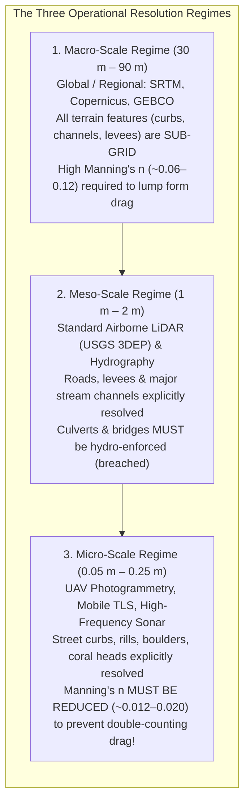
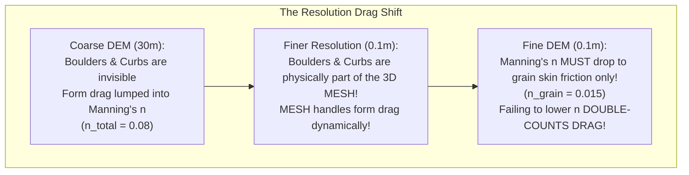
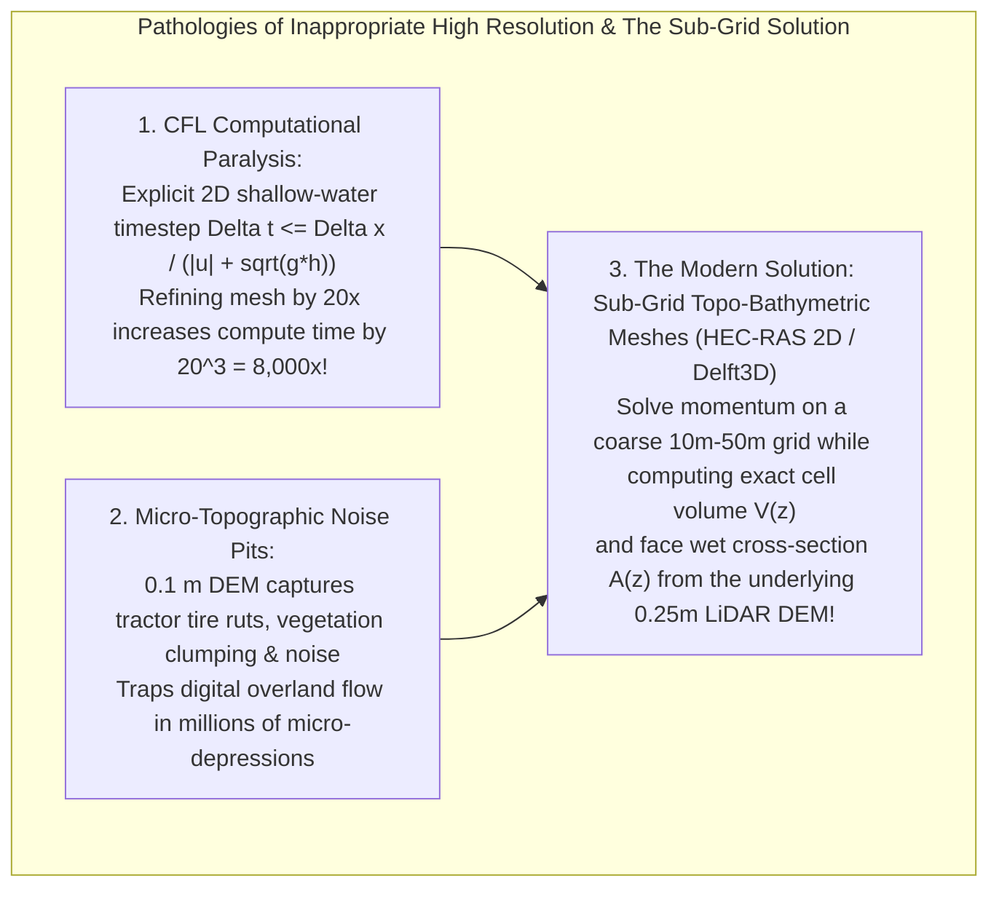

# Chapter 18: Resolution, Pixel Size, Oversampling, Precision, and Super-Resolution

*Why pixel size is not resolution, why more decimal places are not accuracy, and what happens when we push beyond the physical sensor limit.*

---

## 18.3 How the Resolution of the Resulting Product Changes What Is Appropriate

A digital elevation model does not exist in an abstract vacuum; its spatial resolution dictates which physical processes are explicitly resolved by the geometric mesh, and which processes must be parameterized as statistical sub-grid roughness. A computational physics model (such as a 2D hydrodynamic flood solver, a coastal storm-surge simulator, or an overland landslide run-out engine) calibrated on a $30\text{-meter}$ DEM will produce completely erroneous results if run on a $0.1\text{-meter}$ DEM without adjusting its physical governing parameters.

---

### 18.3.1 The Roughness Paradox: Scale-Dependent Manning's $n$

In hydraulic engineering and flood inundation modeling, water velocity $V$ is governed by the empirical Manning equation:

$$V = \frac{1}{n} R_h^{2/3} S_0^{1/2}$$

where $R_h$ is hydraulic radius, $S_0$ is bed slope, and $n$ is **Manning's roughness coefficient**.

#### Why Roughness Is Not an Invariant Surface Property
Practitioners often treat Manning's $n$ as a fixed material constant (e.g., "concrete is always $n = 0.015$, dense forest is always $n = 0.10$"). In computational terrain analysis, this assumption is false. Manning's $n$ is an effective lumped parameter that accounts for two distinct physical mechanisms:
1. **Skin Friction ($n_{\text{grain}}$):** Viscous shear stress against micro-scale soil particles, sand grains, and vegetation stems.
2. **Form Drag ($n_{\text{form}}$):** Pressure resistance caused by flow stagnation and turbulent wake separation behind macroscopic topographic obstacles (street curbs, road embankments, boulders, bridge piers, and tree trunks).

$$\text{Total Resistance } n_{\text{total}} = \sqrt{n_{\text{grain}}^2 + n_{\text{form}}^2}$$

#### The Double-Counting Drag Failure and Worked Hydraulic Example
* **On a $30\text{-meter}$ DEM:** Street curbs, roadside swales, coral bommies, and road crowns are entirely sub-grid within the $900\text{ m}^2$ cell. To prevent simulated floodwaters or tsunami bores from accelerating unphysically across the smoothed digital surface, the modeler must assign a high effective roughness ($n_{\text{total}} \approx 0.06\text{–}0.10$) that lumps the unresolved form drag of urban curbs, walls, and reef boulders into the bed shear stress term $\boldsymbol{\tau}_b = \rho_w g n_{\text{total}}^2 \|\mathbf{u}\|\mathbf{u} / h^{1/3}$.
* **On a $0.10\text{-meter}$ DEM:** The $15\text{-cm}$ vertical face of every concrete street curb, roadside ditch, boulder, and coral head is explicitly resolved in the 3D elevation mesh. A 2D shallow-water hydrodynamic solver (solving the full depth-averaged Saint-Venant momentum equations with hydrostatic pressure gradient $-g h \nabla(z_{\text{bed}} + h)$ and convective acceleration $\mathbf{u}\cdot\nabla\mathbf{u}$) directly computes flow stagnation, pressure reflections, and wake eddies against those resolved obstacles.
* **Worked Quantitative Impact:** Suppose stormwater sheet flow of depth $h = 0.25\text{ m}$ flows down an urban street corridor of longitudinal slope $S_0 = 0.010$ ($1\%$) where resolved curbs, speed bumps, and parked-car pads already extract $75\%$ of the momentum via explicit pressure form drag (equivalent to $n_{\text{form}} = 0.055$), while the actual asphalt pavement skin friction is $n_{\text{grain}} = 0.015$.
  1. **Correct Fine-Mesh Parameterization ($n = n_{\text{grain}} = 0.015$):** Combined with the mesh's explicit geometric form drag ($n_{\text{eff}} = \sqrt{0.015^2 + 0.055^2} = 0.0570$), the true mean corridor velocity is $V_{\text{true}} = \frac{1}{0.0570}(0.25)^{2/3}(0.01)^{1/2} = 0.696\text{ m}\cdot\text{s}^{-1}$.
  2. **Unadjusted Coarse-Grid Parameterization ($n = 0.060$ applied on top of the $0.10\text{ m}$ mesh):** The solver adds $n = 0.060$ on top of the mesh's geometric $n_{\text{form}} = 0.055$, inflating total resistance to $n_{\text{double}} = \sqrt{0.060^2 + 0.055^2} = 0.0814$—choking flow velocity by $30\%$ ($V = 0.488\text{ m}\cdot\text{s}^{-1}$) and overpredicting peak flood stage by $+24\%$!

---

### 18.3.2 Scale-Dependent Geomorphometry: Slope, Curvature, and Topographic Wetness Index (Florinsky, 2016)

Beyond hydrodynamics, virtually every terrain derivative used in geomorphology, soil science, and benthic habitat mapping exhibits strong **scale dependency** with grid spacing $\Delta x$ (Florinsky, 2016):
1. **Monotonic Attenuation of Slope ($\tan\alpha = \|\nabla z\|_2$):** As grid spacing $\Delta x$ coarsens from $0.5\text{ m}$ to $30\text{ m}$ and $90\text{ m}$, short-wavelength hillslope undulations are low-pass filtered out. Empirically and analytically (via Parseval's theorem $\mathbb{E}[\|\nabla z\|^2] = \iint \|\mathbf{k}\|^2 S_z(\mathbf{k}) |\text{MTF}(\mathbf{k}, \Delta x)|^2 d\mathbf{k}$), the mean and 95th-percentile terrain slope decrease monotonically with increasing $\Delta x$. A landslide susceptibility threshold calibrated at $\alpha_{\text{crit}} = 32^\circ$ on a $1\text{ m}$ LiDAR DTM will miss $60\%\text{–}80\%$ of unstable scarps if applied unmodified to a $30\text{ m}$ DEM where the same scarps average out to $19^\circ$!
2. **Scale-Horizon Shift in Curvatures ($\kappa_p, \kappa_c, \nabla^2 z$) and Bathymetric Position Index (BPI):** Second-order derivatives weight the spatial power spectrum by $\|\mathbf{k}\|^4$, making curvature sensitive exclusively to landforms of wavelength $\lambda \sim 2\Delta x\text{ to }6\Delta x$. On a $0.5\text{ m}$ DEM, curvature maps micro-rills, tree-throw pits, and individual coral heads; on a $30\text{ m}$ DEM, curvature maps ridge-valley hillslope catenas; on a $500\text{ m}$ bathymetric grid, curvature maps continental shelf canyons and abyssal hills.
3. **Systematic Shift in Topographic Wetness Index ($\text{TWI}$):** Defined by Beven & Kirkby (1979) as $\text{TWI} = \ln\left(\frac{a_s}{\tan\alpha}\right)$, where $a_s = A_{\text{catchment}} / \Delta x$ is the specific catchment area per unit contour width. When $\Delta x$ coarsens from $1\text{ m}$ to $30\text{ m}$, minimum single-cell $a_s$ jumps $30\times$ while $\tan\alpha$ decreases, shifting the entire watershed $\text{TWI}$ histogram upward by $+2.5\text{ to }+4.0$ log units!

---

### 18.3.3 Scale-Dependent Hydrologic Flow Routing and Sub-Grid Porosity

The mathematical algorithm appropriate for routing water across an elevation surface changes fundamentally with spatial resolution:

| Spatial Resolution | Dominant Physical Scale | Channel Representation | Appropriate Flow Routing Algorithm | Required Hydrologic Vector Conditioning |
| :--- | :--- | :--- | :--- | :--- |
| **$30\text{ m} – 90\text{ m}$** | Regional Watersheds | **Sub-Grid:** Rivers are narrower than one cell. | **D8 / D-Infinity / MFD:** Kinematic routing based on regional aspect. | Depression breaching/filling; sub-grid 1D channel reach parameterization. |
| **$1\text{ m} – 5\text{ m}$** | Local Floodplains | **Partially Resolved:** Main river banks captured; culverts invisible. | **2D Diffusion-Wave / Shallow Water (SWE):** Solves momentum across cells. | **Mandatory Hydro-Enforcement:** Culverts and bridges breached or linked via 1D culverts. |
| **$0.05\text{ m} – 0.5\text{ m}$** | Street Scale / Urban | **Fully Resolved:** Gutter curbs, curb inlets, ditches, rills explicit. | **Full 2D SWE / Sub-Grid Porosity:** Full momentum conservation + turbulence. | **Dual-Drainage Coupling:** Surface mesh coupled to subsurface 1D storm-sewer pipe network. |

---

### 18.3.4 When High Resolution Is Harmful—and the Sub-Grid Bathymetry Solution

Higher resolution is not always desirable. Deploying raw ultra-high-resolution DEMs as the computational mesh in regional simulations introduces severe numerical and physical pathologies:

#### The Courant–Friedrichs–Lewy (CFL) Computational Penalty vs. Sub-Grid Terrain Tables
In explicit numerical hydrodynamic and tsunami modeling, the maximum stable integration timestep $\Delta t$ is strictly bounded by the **Courant–Friedrichs–Lewy (CFL) stability criterion**:

$$\Delta t \le C_{\text{CFL}} \frac{\Delta x}{\|\mathbf{u}\|_2 + \sqrt{g \, h}}$$

where $\Delta x$ is computational cell spacing, $g = 9.80665\text{ m}\cdot\text{s}^{-2}$, $h$ is water depth, and $\|\mathbf{u}\|_2$ is flow speed:
* Refining a uniform computational mesh by a factor of $M = 20$ (from $\Delta x = 10\text{ m}$ to $\Delta x = 0.5\text{ m}$) increases the number of 2D cells by $M^2 = 400\times$ and reduces the maximum stable time step $\Delta t$ by $M = 20\times$, exploding total CPU/GPU floating-point operations by **$M^3 = 20^3 = 8,000\times$**!
* **The Sub-Grid Bathymetry / Topography Architecture:** Modern hydrodynamic solvers (such as **HEC-RAS 2D**, **TUFLOW HPC**, and **Delft3D Flexible Mesh**) overcome this $M^3$ barrier by decoupling the **computational momentum grid** ($\Delta X_{\text{comp}} = 10\text{–}50\text{ m}$) from the **underlying high-resolution LiDAR/sonar terrain grid** ($\Delta x_{\text{DEM}} = 0.25\text{–}1.0\text{ m}$). During preprocessing, each coarse cell $(I, J)$ integrates the exact sub-grid elevation histogram of its hundreds of constituent $0.25\text{ m}$ DEM pixels to pre-tabulate a continuous **Elevation–Volume curve** $V_{I,J}(\eta) = \iint_{\Omega_{I,J}} \max(0, \eta - z(x,y))\,dx\,dy$, while each coarse cell face pre-tabulates the exact **Elevation–Wetted-Area and Hydraulic Radius curve** $A_{\text{face}}(\eta)$ from the high-resolution DEM profile along that face. This allows a $1\text{ m}$-wide drainage ditch or a $0.3\text{ m}$ levee crown inside a $20\text{ m}$ computational cell to convey or block water with $0.25\text{ m}$ geometric fidelity while running at the fast $20\text{ m}$ CFL time step!
