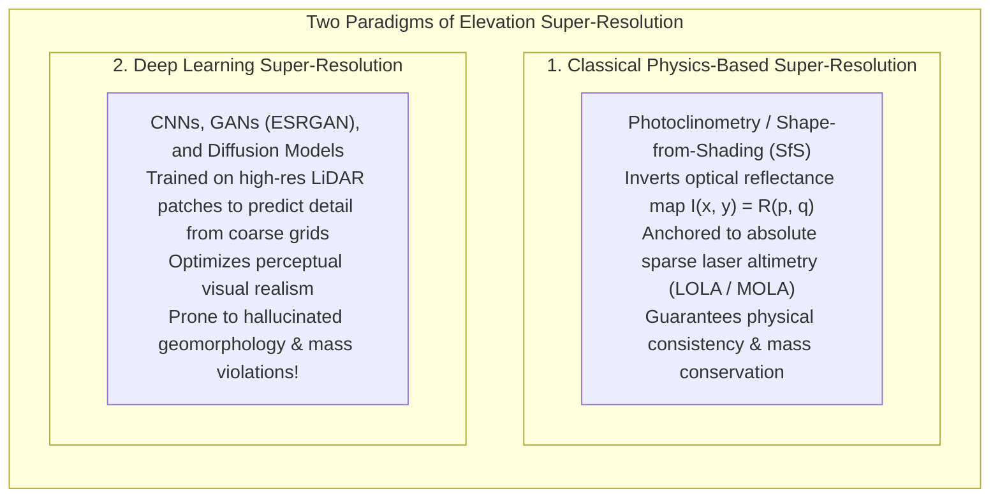
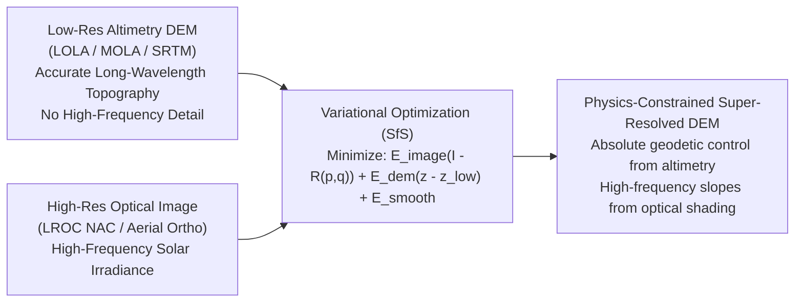
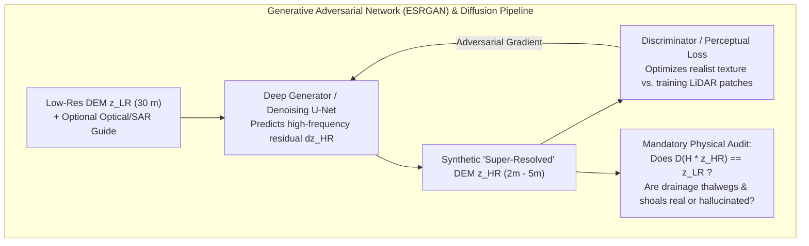
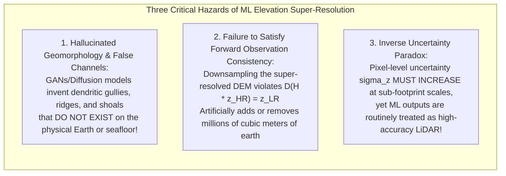

# Chapter 18: Resolution, Pixel Size, Oversampling, Precision, and Super-Resolution

*Why pixel size is not resolution, why more decimal places are not accuracy, and what happens when we push beyond the physical sensor limit.*

---

## 18.4 Super-Resolution of DEMs: Classical Physics vs. Machine Learning

When elevation data is physically constrained to low resolution—such as coarse $30\text{-meter}$ orbital radar topography or sparse planetary laser altimetry—scientists and engineers seek to enhance the surface through **super-resolution (SR)**. Super-resolution aims to reconstruct a high-resolution elevation model from one or more lower-resolution observations.

However, the methodology chosen to achieve super-resolution divides into two fundamentally opposed philosophies: **classical physics-based inverse modeling** (which enforces physical radiative transfer and photometric consistency) and **data-driven deep learning** (which hallucinates plausible high-frequency textures based on training priors).

---

### 18.4.1 Classical Physics-Based Super-Resolution: Shape-from-Shading (SfS)

In planetary science and terrestrial remote sensing, the primary physics-based technique for enhancing elevation resolution is **Shape-from-Shading (SfS)**—also known as **photoclinometry** (pioneered by Berthold Horn in 1975 and refined in the NASA Ames Stereo Pipeline [ASP]).

#### The Image Irradiance Equation
A high-resolution optical image records reflected solar radiance $I(x, y)$. Under the Lambertian or Lommel-Seeliger scattering law, the pixel brightness is a known mathematical function of the illumination vector $\hat{\mathbf{s}}$ and the local surface normal $\hat{\mathbf{n}}(p, q)$:

$$I(x, y) = R(p, q) = \rho_0 \frac{\hat{\mathbf{n}} \cdot \hat{\mathbf{s}}}{\hat{\mathbf{n}} \cdot \hat{\mathbf{v}} + \hat{\mathbf{n}} \cdot \hat{\mathbf{s}}}$$

where $p = \frac{\partial z}{\partial x}$, $q = \frac{\partial z}{\partial y}$ are the directional terrain slopes, $\hat{\mathbf{v}}$ is the viewing vector, and $\rho_0$ is surface albedo.

#### The Variational Optimization Formulation and Multi-Sensor Physical Fusion
Because inverting a single monocular image's brightness $I(x,y)$ into a 2D gradient vector $\nabla z = [p, q]^\top$ is mathematically underdetermined (one scalar equation for two slope components $p$ and $q$ at each pixel, plus unknown surface albedo variations $\rho_0(x,y)$), modern physical super-resolution (Horn, 1990; Alexandrov & Beyer, 2018) combines **multi-azimuth illumination views** $\{I_k(x,y)\}_{k=1}^K$ (captured at different solar azimuths/elevations) with a low-resolution **geodetic altimetry or stereo DEM anchor** $z_{\text{LR}}(x,y)$:

$$\min_{z_{\text{HR}}(x, y), \,\rho_0(x,y)} \iint_{\Omega} \left[ \sum_{k=1}^K w_k(x,y)\left( I_k(x, y) - \rho_0(x,y)\,R_k\big(\nabla z_{\text{HR}}, \hat{\mathbf{s}}_k\big) \right)^2 + \lambda_1 \left( (G_\sigma * z_{\text{HR}})(x, y) - z_{\text{LR}}(x, y) \right)^2 + \lambda_2 \|\mathbf{H}(z_{\text{HR}})\|_F^2 \right] dx \, dy$$

* **The Low-Frequency Geodetic Anchor:** Convolving the candidate high-resolution surface $z_{\text{HR}}$ with the low-resolution sensor's Point Spread Function $G_\sigma$ ensures that long-wavelength elevations match the vertically accurate laser altimeter or stereo DEM ($z_{\text{LR}}$), eliminating low-frequency integration drift while leaving sub-footprint high frequencies free to respond to optical shading.
* **Cross-Modal Physical Super-Resolution Across Earth and Planetary Domains:**
  1. **Planetary Stereo + Multi-View Photoclinometry (MOLA/LOLA + HiRISE/LROC NAC):** On the Moon and Mars, NASA's Ames Stereo Pipeline (`sfs`) fuses $20\text{–}100\text{ m}$ laser altimetry (LOLA/MOLA) with $0.25\text{–}1.0\text{ m}$ optical orbital imagery (LROC NAC, HiRISE) acquired under multiple sun angles to resolve decimeter-scale boulder fields and crater rims inside Artemis landing zones (Alexandrov & Beyer, 2018).
  2. **Coastal Bathymetry Fusion (ICESat-2 Green LiDAR + Sentinel-2 / WorldView Multispectral SDB):** Along shallow coastlines (Chapter 9 & Chapter 11), spaceborne ICESat-2 (`ATL03`/`ATL24`) provides vertically accurate ($\text{RMSE}_d \approx 0.15\text{–}0.30\text{ m}$) bathymetric photon profiles along sparse $90\text{ m}$ ground tracks, while $2\text{–}10\text{ m}$ optical multispectral imagery (WorldView, Sentinel-2) captures continuous 2D log-ratio radiative attenuation $\ln R_{\text{rs}}(\lambda_{\text{blue}}) / \ln R_{\text{rs}}(\lambda_{\text{green}})$. Anchoring the 2D optical reflectance surface to ICESat-2 profiles produces a physically constrained $2\text{–}10\text{ m}$ bathymetric grid without neural hallucination.
  3. **InSAR Coherence + Optical Shading + GEDI Canopy Calibration:** In terrestrial global DSM-to-DTM enhancement, combining $30\text{ m}$ bistatic X-band InSAR (Copernicus GLO-30) with GEDI/ICESat-2 sub-canopy ground heights and $10\text{ m}$ Sentinel-1/2 optical-radar covariates strips vegetation biases while preserving physical watershed mass balance.

---

### 18.4.2 Deep Learning Super-Resolution: CNNs, GANs, Vision Transformers, and Diffusion Models

Over the past decade, computer vision researchers have adapted single-image super-resolution (SISR) neural architectures—Convolutional Neural Networks (`SRCNN`, `EDSR`), Generative Adversarial Networks (`SRGAN`, `ESRGAN`; Ledig et al., 2017; Wang et al., 2018), Vision Transformers (`SwinIR`), and conditional Denoising Diffusion Probabilistic Models (`DDPM`)—to upsample coarse $30\text{ m}$ global DEMs to $2\text{–}10\text{ m}$ grid spacings.

In a purely generative DEM super-resolution pipeline, the network learns an empirical conditional distribution $p_\theta(\mathbf{z}_{\text{HR}} \mid \mathbf{z}_{\text{LR}})$ from training pairs of downsampled and native airborne LiDAR tiles. When conditioned *only* on the coarse DEM $\mathbf{z}_{\text{LR}}$ (without a high-resolution optical or SAR image at the target location), the network has **zero physical information** about what actually lies inside each $30\text{ m} \times 30\text{ m}$ pixel; it simply synthesizes high-frequency terrain textures that statistically resemble its training corpus.

---

### 18.4.3 The Critical Dangers of Machine Learning Super-Resolution and Mandatory Audit Criteria

While generative deep learning produces visually striking hillshades, deploying ML-super-resolved DEMs in civil engineering, flood inundation modeling, or nautical charting introduces three severe failure modes:

#### 1. Hallucinated Geomorphology and Out-of-Distribution Domain Shift
A generative neural network conditioned solely on $\mathbf{z}_{\text{LR}}$ samples from its learned training prior. If an ESRGAN or Diffusion model is trained on fluvial-dissected Appalachian hillslopes and deployed over a glaciated shield, a karst plain, an urban levee system, or a continental-shelf sand-wave field:
* The network **hallucinates realistic-looking dendritic V-shaped stream gullies and sharp ridge spurs** that do not exist in reality.
* In a 2D flood or landslide simulation, these synthetic gullies channelize runoff along fictional thalwegs, while in bathymetric charting, hallucinated abyssal hills or smoothed-away rock pinnacles create fatal navigation hazards.
* Evaluating DEM super-resolution models using computer-vision perceptual metrics such as **SSIM** (Structural Similarity Index) or **LPIPS** (Learned Perceptual Image Patch Similarity) actively rewards the network for inventing sharp, high-contrast false topography!

#### 2. Violation of the Physical Downsampling Invariant (Mass Non-Conservation)
Any physically valid super-resolved surface $\hat{\mathbf{z}}_{\text{HR}}$ must satisfy the **Forward Observation Consistency Constraint**: when convolved with the coarse sensor's physical Point Spread Function $\mathbf{H}$ and decimated back to the coarse grid via $\mathbf{D}$, it must recover the observed low-resolution measurements within the sensor's measurement noise $\sigma_{\text{LR}}$:

$$\left\| \mathbf{D}\left(\mathbf{H} * \hat{\mathbf{z}}_{\text{HR}}\right) - \mathbf{z}_{\text{LR}} \right\|_\infty \le k\,\sigma_{\text{LR}} \qquad \text{and} \qquad \iint_{\Omega_I} \hat{z}_{\text{HR}}(x,y)\,dx\,dy = \Delta X_{\text{LR}}^2 \, z_{\text{LR},I}$$

Standard $L_1$, $L_2$, and adversarial GAN losses do not enforce this projection constraint unless an explicit **Back-Projection / Conservation Layer** ($\hat{\mathbf{z}}_{\text{HR}}^{\text{proj}} = \hat{\mathbf{z}}_{\text{HR}} - \mathbf{H}^\top\mathbf{D}^\top(\mathbf{D}\mathbf{H}\mathbf{H}^\top\mathbf{D}^\top)^{-1}(\mathbf{D}\mathbf{H}\hat{\mathbf{z}}_{\text{HR}} - \mathbf{z}_{\text{LR}})$) is appended to the network architecture.

#### 3. The Sub-Footprint Uncertainty Inflation Law
When a coarse DEM cell of size $\Delta X_{\text{LR}} = 30\text{ m}$ and cell-mean vertical uncertainty $\sigma_{z,\text{LR}} = 1.5\text{ m}$ is super-resolved into $N = (30\text{ m} / 2\text{ m})^2 = 225$ sub-pixels of size $\Delta x_{\text{HR}} = 2\text{ m}$, the pointwise vertical uncertainty $\sigma_{z,\text{HR}}(\mathbf{x})$ at each $2\text{ m}$ sub-pixel is **strictly larger** than the $30\text{ m}$ cell-mean uncertainty because it must include the unresolved sub-grid topographic variance $\sigma_{\text{subgrid}}^2$ inside the $30\text{ m}$ footprint:

$$\sigma_{z,\text{HR}}^2(\mathbf{x}) = \sigma_{z,\text{LR}}^2 + (1 - \rho_{\text{skill}}^2)\,\sigma_{\text{subgrid}}^2(\Delta X_{\text{LR}} \to \Delta x_{\text{HR}}) \ge \sigma_{z,\text{LR}}^2$$

where $\rho_{\text{skill}} \in [0, 1]$ is the true correlation between predicted and actual sub-grid residuals. Every super-resolved DEM must publish a companion per-pixel uncertainty band reflecting this sub-footprint variance inflation.

| Evaluation Dimension | Classical Physics-Based Super-Resolution (`sfs`, Sensor Fusion) | Unconstrained Generative ML Super-Resolution (`ESRGAN`, `DDPM`) |
| :--- | :--- | :--- |
| **Source of High-Frequency Detail** | Physical observations at target site (multi-angle optical shading $I_k(x,y)$, SAR amplitude, multispectral attenuation). | Statistical textures sampled from learned neural weights trained on external LiDAR regions. |
| **Downsampling Mass Conservation** | **Guaranteed** via forward observation term $\|G_\sigma * z_{\text{HR}} - z_{\text{LR}}\|_2^2$. | **Violated** unless an explicit average-pooling back-projection layer is enforced. |
| **Out-of-Distribution Behavior** | Degrades gracefully to smooth prior $z_{\text{LR}}$ in shadowed or textureless zones. | **Hallucinates** false gullies, craters, boulders, or shoals matching training domain. |
| **Metrological & Legal Admissibility**| **Auditable** physical error propagation from radiometric SNR and altimetry TPU. | **Inadmissible** for safety-critical navigation, flood insurance (FEMA), or earthwork contracts. |
