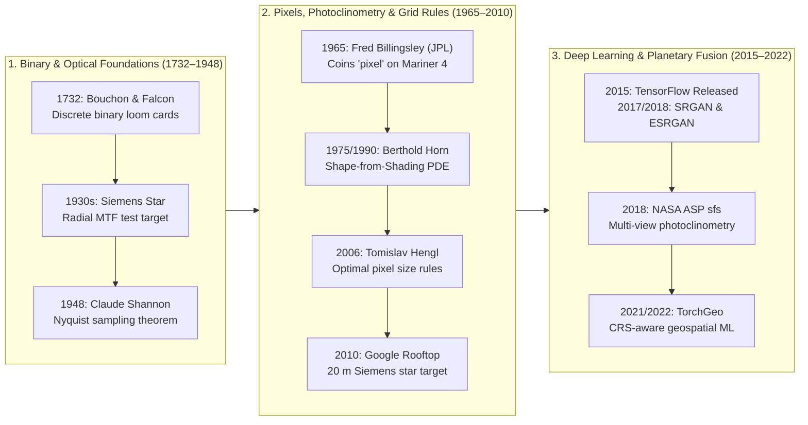
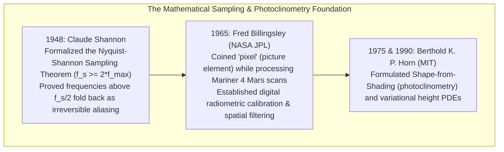

# Chapter 18: Resolution, Pixel Size, Oversampling, Precision, and Super-Resolution

*Why pixel size is not resolution, why more decimal places are not accuracy, and what happens when we push beyond the physical sensor limit.*

---

## 18.5 Historical Evolution of Spatial Resolution, Digital Sampling, and Super-Resolution (`gis-history` Context)

The effort to define, quantify, and push beyond physical resolution limits—recorded across the [`gis-history`](../00-front-matter/gis-history-timeline.md) chronological archive—spans nearly three centuries: from 18th-century binary loom control cards and 1930s radial optical test patterns to the Nyquist–Shannon sampling theorem, planetary image processing at NASA JPL, and modern physics-informed and neural super-resolution.

---

### 18.5.1 Binary Discretization and Optical Resolution Targets (1732–1930s)

#### 1703–1732: Leibniz Binary Arithmetic and Bouchon/Falcon Punched Cards
Long before electronic computers, Gottfried Wilhelm Leibniz published *Explication de l'Arithmétique Binaire* (1703), demonstrating that any number can be represented by discrete powers of two ($0$ and $1$). Between 1725 and 1732 in Lyon, France, Basile Bouchon and Jean-Baptiste Falcon translated continuous woven silk patterns into discrete rows of holes on perforated paper tapes and linked punched cards (culminating in Joseph Marie Jacquard's 1804 loom and Charles Babbage's Analytical Engine). This established the two foundational concepts of digital rasters: **spatial discretization** (sampling a continuous 2D pattern onto a discrete $(i, j)$ grid of threads) and **bit-depth quantization** ($2^b$ discrete states).

#### 1930s: The Siemens Star and Continuous Spatial Frequency Testing
In the 1930s, optical engineers at Siemens & Halske in Berlin invented the **Siemens star** to test cinema and aerial reconnaissance lenses. Whereas discrete 3-bar targets (such as the 1951 USAF resolution test chart) only test resolving power at fixed horizontal and vertical steps, a Siemens star consists of $N$ black-and-white spoke pairs ($2N$ alternating radial wedges) meeting at a central point. Along a circle of radius $r$ from the center, the local spatial cycle wavelength is $\lambda(r) = \frac{2\pi r}{N}$ (spatial frequency $f(r) = \frac{N}{2\pi r}$). Because $r \to 0$ toward the center, a single target sweeps continuously through all spatial frequencies and all $360^\circ$ of azimuth, immediately exposing the circular **blur circle** ($r_{\text{cutoff}}$ where the Modulation Transfer Function $\text{MTF}(f)$ drops to zero), directional astigmatism, and **spurious resolution** (phase-reversed contrast rings inside the blur circle where $\text{MTF}(f) < 0$!).

---

### 18.5.2 Information Theory, the "Pixel," and Shape-from-Shading (1948–1990)

#### 1948: Claude Shannon and the Nyquist–Shannon Sampling Theorem
In July and October 1948, Claude E. Shannon published *"A Mathematical Theory of Communication"* in the *Bell System Technical Journal*, unifying earlier sampling results by E. T. Whittaker (1915), Harry Nyquist (1928), and V. A. Kotelnikov (1933). Shannon proved two pillars of modern DEM engineering:
1. **The Sampling Theorem:** A continuous band-limited signal with maximum frequency $f_{\max}$ is completely determined by its samples spaced at $\Delta x = \frac{1}{2 f_{\max}}$ via $\text{sinc}$ interpolation; conversely, any energy at frequencies $f > \frac{1}{2\Delta x}$ folds back into low frequencies as **spatial aliasing** (Moiré patterns).
2. **Source Coding and Entropy ($H = -\sum p_k \log_2 p_k$):** Established the theoretical compression limit of quantized signals, explaining why random floating-point noise in low-order mantissa bits cannot be compressed losslessly.

#### 1965: Fred C. Billingsley Coins "Pixel" at NASA JPL
In the era of NASA's Ranger lunar probes and the historic July 1965 flyby of Mars by Mariner 4—which captured 21 digital $200 \times 200$ 6-bit images transmitted back to Earth at $8.33\text{ bits/s}$—NASA Jet Propulsion Laboratory engineer **Frederic C. Billingsley** published *"Digital Video Processing at JPL"* in *Proceedings of the SPIE* (Vol. 3, *Electronic Imaging Techniques*, 1965), introducing the word **pixel** (contraction of *picture element*) in print and laying the foundation for JPL's `VICAR` image processing system (1966).

#### 1975 & 1990: Berthold Horn Formalizes Shape-from-Shading (Photoclinometry)
Building on early lunar slope estimation by Van Diggelen (1951) and Rindfleisch (1966), MIT computer scientist **Berthold K. P. Horn** published *"Obtaining shape from shading information"* (1975) and *"Height and gradient from shading"* (*IJCV*, 1990), deriving the reflectance map $R(p, q)$ and the coupled variational Euler–Lagrange equations that solve simultaneously for surface height $z(x,y)$ and gradient $(p,q)$ while enforcing surface integrability ($z_{xy} = z_{yx}$).

---

### 18.5.3 Modern Grid Metrology, On-Orbit Targets, and Geospatial Deep Learning (2006–2022)

#### 2006 & 2016: Hengl's Pixel-Size Framework and Florinsky's Multiscale Geomorphometry
* **2006 (Hengl):** Tomislav Hengl published *"Finding the right pixel size"* in *Computers & Geosciences* (2006), unifying cartographic scale, GPS positional error, point density ($\Delta x \approx \frac{1}{2\sqrt{\rho}}\text{ to }\frac{1}{\sqrt{\rho}}$), contour density, and semivariogram range into objective equations for selecting DEM grid spacing.
* **2016 (Florinsky):** Igor V. Florinsky published the second edition of *Digital Terrain Analysis in Soil Science and Geology* (2016), rigorously quantifying how DEM grid spacing, derivative stencil order, and quantization noise propagate into slope, curvature, and soil-landscape models.

#### 2010: The Google Mountain View Rooftop Siemens Star
To audit the real-world on-orbit Modulation Transfer Function (MTF) and spatial resolving power of sub-meter commercial satellites and aerial cameras, Google painted a large high-contrast **Siemens star** (radial spoke target) on a rooftop in Mountain View, California (`37° 25' 20.6" N, 122° 05' 25.3" W` / `37.4224° N, 122.0904° W`) in 2010, providing a permanent open-air spatial-frequency calibration reference visible from aircraft and low-Earth orbit.

#### 2015, 2018 & 2021: TensorFlow, NASA ASP `sfs`, and TorchGeo
* **2015–2018 (TensorFlow, SRGAN, ESRGAN, & NASA ASP `sfs`):** Google's release of **TensorFlow** (2015) and the introduction of `SRGAN` (Ledig et al., 2017) and `ESRGAN` (Wang et al., 2018) sparked widespread experimentation with neural DEM super-resolution. Concurrently, Oleg Alexandrov and Ross Beyer (2018) implemented rigorous multi-view, altimetry-anchored Shape-from-Shading (`sfs`) in the open-source **NASA Ames Stereo Pipeline**, providing a physically verifiable alternative for lunar and Martian landing-site certification.
* **2021–2022 (TorchGeo):** Adam Stewart and collaborators released **TorchGeo** (published at ACM SIGSPATIAL 2022), bringing native CRS reprojection, R-tree spatial bounding-box intersection (`RasterDataset`), and leakage-free spatial block sampling to PyTorch.

---

### 18.5.4 Chronological Summary of Resolution, Sampling, and Super-Resolution Milestones

| Year | Historical Milestone & Pioneers | Primary Technical Contribution | Impact on Elevation & Bathymetric Modeling |
| :--- | :--- | :--- | :--- |
| **1703 / 1732** | **Binary Arithmetic & Punched Loom Cards** (*Leibniz*; *Bouchon & Falcon*) | Discrete binary encoding of numerical and 2D spatial patterns. | Precursor to discrete raster $(i,j)$ matrices and $2^b$ bit-depth quantization. |
| **1928 / 1948** | **Nyquist–Shannon Sampling Theorem** (*H. Nyquist*; *C. E. Shannon*) | Proves band-limited reconstruction requires sampling rate $f_s \ge 2 f_{\max}$. | Establishes the minimum resolvable terrain wavelength $\lambda_{\min} = 2\Delta s$ and explains aliasing. |
| **1930s** | **Siemens Star Optical Target** (*Siemens & Halske*) | Radial wedge target with continuous spatial frequency $f(r) = \frac{N}{2\pi r}$. | Standardizes omnidirectional MTF cutoff, astigmatism, and spurious-resolution measurement. |
| **1965** | **Coining of "Pixel" on Mariner 4** (*Fred C. Billingsley*, NASA JPL) | Formalizes the *picture element* (`pixel`) in digital planetary imaging. | Establishes the fundamental unit of raster DEMs and digital radiometric/spatial filtering. |
| **1975 / 1990** | **Shape-from-Shading (Photoclinometry)** (*Berthold K. P. Horn*, MIT) | Reflectance map $R(p,q)$ and variational height-from-shading Euler–Lagrange PDE. | Enables physical sub-footprint slope recovery from optical shading without neural hallucination. |
| **2006** | **Objective Pixel-Size Rules** (*Tomislav Hengl*) | Links grid spacing $\Delta x$ to point density $\rho_{\text{pts}}$, contour spacing, and nugget variance. | Provides quantitative formulas preventing the oversampling fallacy in LiDAR/sonar gridding. |
| **2010** | **Google Rooftop Siemens Star** (*Google*, Mountain View, CA) | $20\text{ m}$ 36-spoke rooftop target for aerial and satellite MTF calibration. | Enables continuous in-situ verification of effective resolution vs. nominal GSD. |
| **2015–2018** | **TensorFlow, SRGAN/ESRGAN & LERC** (*Google*; *Ledig et al.*; *Esri*) | Deep perceptual super-resolution networks; bounded-error raster compression (`LERC`). | Catalyzes ML DEM upsampling research while LERC solves lossless-equivalent `Float32` storage. |
| **2018** | **Multi-View Planetary `sfs`** (*O. Alexandrov & R. A. Beyer*, NASA Ames) | Multi-illumination photoclinometry anchored to LOLA/MOLA laser altimetry in ASP. | Produces physics-constrained sub-meter lunar and Martian landing-site DEMs. |
| **2021 / 2022** | **TorchGeo Library** (*A. J. Stewart et al.*) | CRS-aware PyTorch `RasterDataset` and `GridGeoSampler` spatial block loaders. | Prevents spatial data leakage when training and auditing deep learning elevation models. |

Together, these historical milestones demonstrate a recurring scientific truth: hardware digitization (`pixel`, `Float32`, `LERC`) and neural networks can optimize how elevation grids are stored and interpolated, but physical resolving power remains governed by Shannon's 1948 sampling limit and Horn's radiative-transfer physics.
