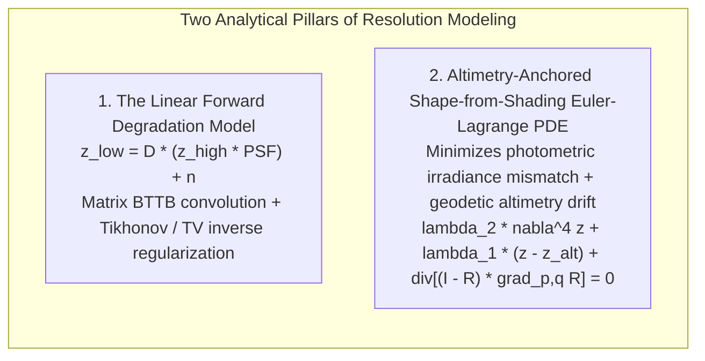
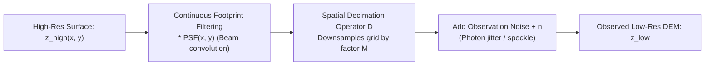
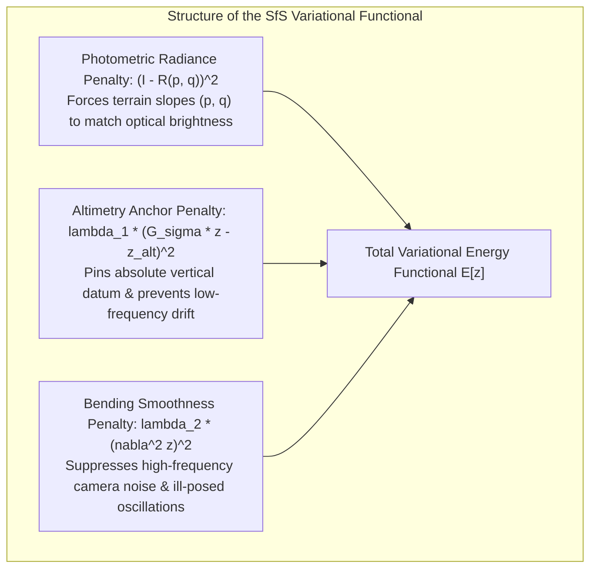

# Chapter 18: Resolution, Pixel Size, Oversampling, Precision, and Super-Resolution

*Why pixel size is not resolution, why more decimal places are not accuracy, and what happens when we push beyond the physical sensor limit.*

---

## 18.6 Mathematical Foundations of Forward Degradation and Shape-from-Shading

This section provides complete mathematical derivations for the two foundational analytical formulations in elevation resolution modeling: the forward degradation model combining Point Spread Function (PSF) convolution with decimation, and the Euler-Lagrange partial differential equation governing Shape-from-Shading (photoclinometry) anchored to low-resolution laser altimetry.

---

### 18.6.1 The Forward Degradation Model and Regularized Inversion

In remote sensing, a low-resolution digital elevation model $z_{\text{low}}(x, y)$ is the output of a physical degradation process acting upon the continuous, true Earth surface $z_{\text{true}}(x, y)$:

#### 1. Continuous Integral Formulation
$$z_{\text{low}}(\mathbf{x}_i) = \iint_{\Omega} z_{\text{true}}(\mathbf{x}') \, \text{PSF}(\mathbf{x}_i - \mathbf{x}') \, d\mathbf{x}' + n(\mathbf{x}_i)$$

where $\text{PSF}(\mathbf{x})$ is the spatial Point Spread Function (typically modeled as a 2D circularly symmetric Gaussian kernel $\text{PSF}(r) = \frac{1}{2\pi \sigma_b^2} e^{-\frac{r^2}{2\sigma_b^2}}$ representing beam divergence or antenna beamwidth), and $n(\mathbf{x}) \sim \mathcal{N}(0, \sigma_n^2)$ is additive sensor noise.

#### 2. Discrete Vector-Matrix Formulation
Discretizing the continuous high-resolution surface into a column vector $\mathbf{z}_{\text{high}} \in \mathbb{R}^{N}$ ($N = M_x \times M_y$) and the observed low-resolution grid into $\mathbf{z}_{\text{low}} \in \mathbb{R}^{K}$ ($K \ll N$):

$$\mathbf{z}_{\text{low}} = \mathbf{D} \, \mathbf{H} \, \mathbf{z}_{\text{high}} + \mathbf{n}$$

where:
* $\mathbf{H} \in \mathbb{R}^{N \times N}$ is the 2D spatial convolution matrix, possessing a **Block-Toeplitz-with-Toeplitz-Blocks (BTTB)** structure (diagonalized in the Fourier domain via 2D Fast Fourier Transforms).
* $\mathbf{D} \in \mathbb{R}^{K \times N}$ is the decimation (subsampling) matrix that extracts every $s$-th pixel along the coordinate axes.
* $\mathbf{n} \in \mathbb{R}^K$ is the noise vector with covariance matrix $\boldsymbol{\Sigma}_n = \sigma_n^2 \mathbf{I}$.

#### 3. Regularized Inverse Reconstruction (Tikhonov Regularization)
Direct inversion of $\mathbf{D}\mathbf{H}$ is severely ill-posed because $\mathbf{D}$ is rank-deficient ($K < N$) and high spatial frequencies lie in the null space. To reconstruct $\hat{\mathbf{z}}_{\text{high}}$, we formulate a regularized least-squares optimization problem:

$$\hat{\mathbf{z}}_{\text{high}} = \arg\min_{\mathbf{z}} \left[ \|\mathbf{z}_{\text{low}} - \mathbf{D}\mathbf{H}\mathbf{z}\|_2^2 + \lambda \|\mathbf{L}\mathbf{z}\|_2^2 \right]$$

where $\mathbf{L}$ is a high-pass regularization operator (e.g., discrete Laplacian $\nabla^2$) penalizing unphysical surface roughness, and $\lambda > 0$ is the regularization parameter. 

Taking the matrix derivative with respect to $\mathbf{z}$ and setting it to zero yields the normal equations:

$$\left( \mathbf{H}^\top \mathbf{D}^\top \mathbf{D} \mathbf{H} + \lambda \mathbf{L}^\top \mathbf{L} \right) \hat{\mathbf{z}}_{\text{high}} = \mathbf{H}^\top \mathbf{D}^\top \mathbf{z}_{\text{low}}$$

$$\hat{\mathbf{z}}_{\text{high}} = \left( \mathbf{H}^\top \mathbf{D}^\top \mathbf{D} \mathbf{H} + \lambda \mathbf{L}^\top \mathbf{L} \right)^{-1} \mathbf{H}^\top \mathbf{D}^\top \mathbf{z}_{\text{low}}$$

This system is solved efficiently using conjugate gradient methods or in the frequency domain using 2D FFTs.

#### 4. Fourier-Domain Wiener Deconvolution and Posterior Uncertainty Inflation
In the non-decimated footprint-deblurring regime ($\mathbf{D} = \mathbf{I}$, such as deconvolving an oversampled wide-beam multibeam sonar or spaceborne altimeter grid; when $\mathbf{D} \ne \mathbf{I}$, decimation aliases $M^2$ spectral replicas across Brillouin zones), a spatially shift-invariant PSF $\mathbf{H}$ has 2D Fourier transfer function $H(\mathbf{k}) = \mathcal{F}\{\text{PSF}\}(\mathbf{k})$ ($\text{MTF}(\mathbf{k}) = |H(\mathbf{k})|$). With Laplacian regularization $L(\mathbf{k}) = -\|\mathbf{k}\|_2^2$, the Tikhonov / Wiener frequency-domain reconstruction filter $W(\mathbf{k})$ at radial wavenumber $\mathbf{k} = [k_x, k_y]^\top$ ($\text{rad}\cdot\text{m}^{-1}$) is:

$$\hat{Z}_{\text{high}}(\mathbf{k}) = \underbrace{\frac{H^*(\mathbf{k})}{|H(\mathbf{k})|^2 + \lambda \|\mathbf{k}\|_2^4}}_{W(\mathbf{k})} Z_{\text{obs}}(\mathbf{k}) = \frac{H^*(\mathbf{k})}{|H(\mathbf{k})|^2 + \frac{S_n(\mathbf{k})}{S_z(\mathbf{k})}} Z_{\text{obs}}(\mathbf{k})$$

where $S_z(\mathbf{k}) \propto \|\mathbf{k}\|_2^{-\beta}$ ($\beta \approx 2.5\text{–}3.5$ for natural fractal topography) is the prior terrain power spectral density and $S_n(\mathbf{k}) = \sigma_n^2 \Delta x^2$ is the white measurement noise floor. Notice the physical trade-off governed by the **Spectral Signal-to-Noise Ratio** $\text{SNR}(\mathbf{k}) = \frac{|H(\mathbf{k})|^2 S_z(\mathbf{k})}{S_n(\mathbf{k})}$:
1. **Low Wavenumbers ($\|\mathbf{k}\|_2 \ll 1/\sigma_b$, $\text{MTF}(\mathbf{k}) \approx 1$):** $W(\mathbf{k}) \approx \frac{1}{H(\mathbf{k})}$, recovering the exact long-wavelength elevation without bias.
2. **High Wavenumbers Beyond the Footprint Cutoff ($\|\mathbf{k}\|_2 \gg 1/\sigma_b$, $\text{MTF}(\mathbf{k}) \to 0$):** Because $|H(\mathbf{k})|^2 \ll \lambda \|\mathbf{k}\|_2^4$, an unregularized inverse filter ($\lambda = 0$) would multiply sensor noise $n(\mathbf{k})$ by $|H(\mathbf{k})|^{-1} = \exp(+\frac{1}{2}\sigma_b^2\|\mathbf{k}\|_2^2) \to \infty$! The Wiener/Tikhonov filter instead drives $W(\mathbf{k}) \to 0$, and the resulting posterior error power spectrum $S_e(\mathbf{k})$ is:
   $$S_e(\mathbf{k}) = \frac{S_z(\mathbf{k})\,S_n(\mathbf{k})}{|H(\mathbf{k})|^2 S_z(\mathbf{k}) + S_n(\mathbf{k})} \xrightarrow{|H(\mathbf{k})| \to 0} S_z(\mathbf{k})$$
   Integrating $S_e(\mathbf{k})$ over the sub-footprint high-frequency waveband proves mathematically that **unresolved sub-footprint terrain variance cannot be recovered from a single blurred DEM alone** without injecting an independent high-frequency physical observable (such as optical shading $I(x,y)$).

---

### 18.6.2 Shape-from-Shading (SfS) Variational PDE Anchored to Altimetry

In planetary photoclinometry and optical DEM enhancement (Horn, 1990; Alexandrov & Beyer, 2018), fine-scale topography is reconstructed from high-resolution optical imagery $I(x, y)$ (whose camera PSF width $\sigma_{\text{cam}} \ll \sigma_{\text{alt}}$ resolves sub-meter slopes) while anchoring long-wavelength elevation to a vertically accurate low-resolution altimetry or stereo DEM $z_{\text{alt}}(x, y)$.

#### Step 1: The Total Variational Energy Functional
Let $p = \frac{\partial z}{\partial x}$ and $q = \frac{\partial z}{\partial y}$ denote the directional terrain slopes ($\nabla z = [p, q]^\top$). The super-resolved surface $z(x, y)$ minimizes the global energy functional $E[z]$:

$$E[z] = \iint_{\Omega} \left[ \left( I(x, y) - R(p, q) \right)^2 + \lambda_1 \left( (G_\sigma * z)(x, y) - z_{\text{alt}}(x, y) \right)^2 + \lambda_2 \left( \nabla^2 z \right)^2 \right] dx \, dy$$

where $R(p, q)$ is the non-linear reflectance map relating terrain slopes to predicted image irradiance, $G_\sigma$ is the low-pass smoothing kernel of the coarse altimetry DEM (which simplifies to the Dirac delta $\delta(\mathbf{x})$ when $G_\sigma * z \approx z$ in point-anchored mode), and $\lambda_1, \lambda_2 > 0$ are weighting parameters (`--initial-dem-constraint-weight` and `--smoothness-weight` in NASA ASP `sfs`).

#### Step 2: Deriving the Euler–Lagrange Partial Differential Equation
Let $\delta z$ be an arbitrary smooth variation vanishing together with its normal derivatives on the boundary $\partial\Omega$. Taking the first variation $\delta E = \left.\frac{d}{d\epsilon} E[z + \epsilon\,\delta z]\right|_{\epsilon=0}$:

$$\delta E = 2 \iint_{\Omega} \left[ -(I - R) \delta R + \lambda_1 \big(G_\sigma * z - z_{\text{alt}}\big) (G_\sigma * \delta z) + \lambda_2 (\nabla^2 z) \nabla^2(\delta z) \right] dx \, dy$$

Applying the chain rule to the variation of the reflectance map $\delta R(p, q)$:

$$\delta R = \frac{\partial R}{\partial p} \delta p + \frac{\partial R}{\partial q} \delta q = \frac{\partial R}{\partial p} \frac{\partial(\delta z)}{\partial x} + \frac{\partial R}{\partial q} \frac{\partial(\delta z)}{\partial y} = \nabla_{p,q} R \cdot \nabla(\delta z)$$

Substituting this into the photometric term and applying integration by parts (Green's first identity, where the boundary line integral vanishes because $\delta z|_{\partial\Omega} = 0$) flips the sign of $-\nabla_{p,q}R \cdot \nabla(\delta z)$ to $+\nabla \cdot [(I - R)\nabla_{p,q}R]\,\delta z$:

$$\iint_{\Omega} -(I - R)\,\nabla_{p,q} R \cdot \nabla(\delta z) \, dx \, dy = +\iint_{\Omega} \left[ \frac{\partial}{\partial x} \left( (I - R) \frac{\partial R}{\partial p} \right) + \frac{\partial}{\partial y} \left( (I - R) \frac{\partial R}{\partial q} \right) \right] \delta z \, dx \, dy$$

Using the self-adjointness of the symmetric Gaussian convolution operator $G_\sigma$ ($\iint f\,(G_\sigma * \delta z) = \iint (G_\sigma * f)\,\delta z$) and applying Green's second identity twice to the biharmonic bending term:

$$\iint_{\Omega} \lambda_2 (\nabla^2 z) \nabla^2(\delta z) \, dx \, dy = \iint_{\Omega} \lambda_2 (\nabla^4 z) \delta z \, dx \, dy$$

where $\nabla^4 z = \frac{\partial^4 z}{\partial x^4} + 2\frac{\partial^4 z}{\partial x^2 \partial y^2} + \frac{\partial^4 z}{\partial y^4}$ is the biharmonic operator. Combining all three terms into a single integral factoring out $\delta z$:

$$\delta E = 2 \iint_{\Omega} \left\{ \lambda_2 \nabla^4 z + \lambda_1 G_\sigma * \big(G_\sigma * z - z_{\text{alt}}\big) + \nabla \cdot \Big[ \big(I(x,y) - R(p, q)\big) \, \nabla_{p, q} R \Big] \right\} \delta z \, dx \, dy = 0$$

By the fundamental lemma of the calculus of variations, the term in braces must vanish identically everywhere in $\Omega$, yielding the **Euler–Lagrange PDE for Altimetry-Anchored Shape-from-Shading**:

$$\lambda_2 \nabla^4 z + \lambda_1 G_\sigma * \big(G_\sigma * z - z_{\text{alt}}\big) + \nabla \cdot \Big[ \big(I(x,y) - R(p, q)\big) \, \nabla_{p, q} R \Big] = 0$$

(or, in direct point-anchored mode where $G_\sigma = \delta(\mathbf{x})$, $\lambda_2 \nabla^4 z + \lambda_1 (z - z_{\text{alt}}) + \nabla \cdot [(I - R)\nabla_{p,q} R] = 0$).

#### Step 3: Worked Numerical Example of Sub-Footprint Slope Sensitivity vs. Direct Ranging
Why can optical shading resolve centimeter-tall ripples that are invisible to direct laser or stereo ranging? Consider a lunar or desert sand ripple of wavelength $\lambda = 2.0\text{ m}$ and vertical amplitude $A_z = 0.02\text{ m}$ ($2\text{ cm}$):
$$z(x) = A_z \sin\left(\frac{2\pi x}{\lambda}\right) \implies p(x) = \frac{\partial z}{\partial x} = \frac{2\pi A_z}{\lambda}\cos\left(\frac{2\pi x}{\lambda}\right) = 0.0628\cos(\pi x)$$
* **Direct Altimetry / Stereo Ranging ($\sigma_z \approx 0.15\text{ m}$):** A $2\text{ cm}$ ripple is $7.5\times$ smaller than the $15\text{ cm}$ vertical ranging noise ($\text{SNR}_{\text{range}} = 0.02 / 0.15 = 0.13 \ll 1$) and is completely buried in ranging noise.
* **Low-Sun Optical Photoclinometry ($\theta_i = 75^\circ$ solar incidence angle from zenith):** For a Lambertian surface illuminated along the $+x$ axis ($\hat{\mathbf{s}} = [\sin\theta_i, 0, \cos\theta_i]^\top$), the linearized fractional image contrast $\Delta I / I_0 \approx \tan\theta_i \cdot p(x)$ amplifies the slope by $\tan 75^\circ = 3.732$:
  $$\frac{\Delta I_{\text{peak}}}{I_0} \approx \tan(75^\circ) \times 0.0628 = 3.732 \times 0.0628 = \mathbf{23.4\% \text{ brightness contrast!}}$$
  On a 12-bit optical camera with $0.5\%$ radiometric noise ($\text{SNR}_{\text{photometric}} = 23.4\% / 0.5\% \approx 47$), the $2\text{ cm}$ ripple produces a massive $47\sigma$ brightness modulation, which the Euler–Lagrange PDE integrates directly into sub-centimeter relative relief while $\lambda_1(G_\sigma * z - z_{\text{alt}})$ locks the absolute meter-level elevation to the altimeter!
