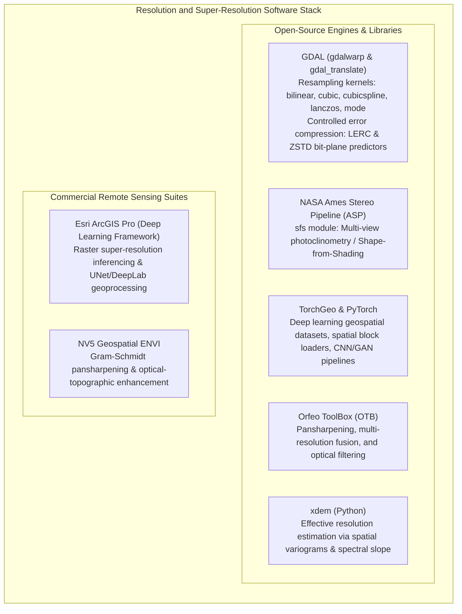

# Chapter 18: Resolution, Pixel Size, Oversampling, Precision, and Super-Resolution

*Why pixel size is not resolution, why more decimal places are not accuracy, and what happens when we push beyond the physical sensor limit.*

---

## 18.7 Software Ecosystem for Resolution Manipulation, Resampling, and Super-Resolution

Manipulating spatial resolution, executing controlled-error compression, and performing physics-based or deep learning super-resolution spans a spectrum of open-source CLI utilities, scientific planetary tools, and commercial image processing suites.



---

### 18.7.1 Open-Source Tools and Pipelines

#### GDAL: Advanced Resampling and Controlled-Error Compression
The `gdalwarp` and `gdal_translate` utilities provide fine-grained control over resampling filters and numerical precision:

```bash
# 1. High-Fidelity Resampling with Anti-Aliasing (Cubic Spline)
# Resample DEM while suppressing high-frequency Moiré aliasing
gdalwarp -r cubicspline -tr 2.0 2.0 \
    -co COMPRESS=ZSTD -co PREDICTOR=3 -co TILED=YES \
    native_1m_dem.tif resampled_2m_dem.tif

# 2. Controlled-Precision LERC Compression (Max Error <= 5 mm)
# Reduces file size by 85% while guaranteeing that no pixel deviates by > 0.005 m
gdal_translate -co COMPRESS=LERC -co MAX_Z_ERROR=0.005 \
    raw_float32_dem.tif compressed_lerc_dem.tif

# 3. Categorical Land-Cover Resampling (Majority Vote)
# Preserves discrete integer classes without creating non-existent intermediate values
gdalwarp -r mode -tr 10.0 10.0 \
    asprs_classified_1m.tif classified_10m.tif

# 4. Multi-Scale Overview Pyramid Generation with Explicit Resampling Rules
# Use 'average' for unbiased terrain mass balance, or 'min'/'max' for shoal/obstacle safety
gdaladdo -r average --config COMPRESS_OVERVIEW ZSTD --config PREDICTOR_OVERVIEW 3 \
    resampled_2m_dem.tif 2 4 8 16
```

#### Orfeo ToolBox (`OTB`) and `xdem` Multi-Scale Variogram Auditing
* **Orfeo ToolBox (`OTB`):** Developed by CNES (French Space Agency), OTB provides C++ and CLI utilities (`otbcli_Superimpose`, `otbcli_BundleToPerfectSensor`, `otbcli_Smoothing`) for co-registering and fusing high-resolution panchromatic shading with coarser multispectral and elevation grids using B-spline and Bayes fusion kernels.
* **`xdem` Spatial Correlation and Effective Resolution Estimation:** In Python, `xdem.spatialstats` fits multi-range spherical + exponential semivariograms $\gamma(h)$ to DEM elevation residuals against independent ICESat-2 or LiDAR reference data:

```python
"""Estimating sub-grid nugget vs. short-range correlation length using xdem."""

import numpy as np
import xdem

# 1. Load target DEM and high-accuracy LiDAR reference DEM, co-registered on a 1 m grid
dem_target = xdem.DEM("oversampled_dem_1m.tif")
dem_ref = xdem.DEM("usgs_3dep_ql1_1m.tif").reproject(dem_target)
dh = dem_target - dem_ref

# 2. Sample empirical variogram across spatial lags from 1 m to 5,000 m
df_vgm = xdem.spatialstats.sample_empirical_variogram(
    values=dh, subsample=50000, n_variograms=3
)

# 3. Fit double-range sum of spherical + exponential models
# Reveals the short-range gridding/PSF smoothing scale r_1 (~effective resolution!)
func_sum, params = xdem.spatialstats.fit_sum_model_variogram(
    ["Sph", "Exp"], empirical_variogram=df_vgm
)
print(params)  # Inspect range r_1 (effective smoothing footprint) vs. nominal 1 m pixel
```

#### NASA Ames Stereo Pipeline (ASP): The `sfs` and `parallel_sfs` Tools
The NASA Ames Stereo Pipeline provides the `sfs` (and multi-tile `parallel_sfs`) command-line tools, implementing the Ceres-Solver non-linear least-squares optimization of the altimetry-anchored Shape-from-Shading variational functional (Alexandrov & Beyer, 2018):

```bash
# Enhance a coarse 20 m LOLA/stereo DEM to 1 m using multi-azimuth LROC NAC images
# --reflectance-type: 0 = Lambertian, 1 = Lunar-Lambert (McEwen), 2 = Hapke
sfs -i init_coarse_dem_resampled_1m.tif \
    lroc_nac_morning_sun.cub lroc_nac_afternoon_sun.cub \
    --smoothness-weight 0.08 \
    --initial-dem-constraint-weight 0.001 \
    --reflectance-type 1 \
    --float-albedo \
    --float-exposure \
    --max-iterations 100 \
    -o sfs_output/lunar_landing_site_1m
```

* `sfs` reads the ISIS `.cub` or CSM camera ephemeris and SPICE solar illumination vectors $\hat{\mathbf{s}}_k$ for each input image to evaluate the Lunar-Lambert or Hapke reflectance map $R_k(p, q)$.
* `--initial-dem-constraint-weight` sets the Lagrange multiplier $\lambda_1$ anchoring long-wavelength elevations to `-i init_coarse_dem_resampled_1m.tif`, while `--smoothness-weight` sets the biharmonic integrability weight $\lambda_2$ and `--float-albedo` jointly solves for spatially varying surface albedo $\rho_0(x, y)$ across multi-illumination images.

#### Auditing Effective Spatial Resolution and `Int16` Quantization in Python (`scipy.fft`, `xdem`, `rasterio`)
When given a third-party DEM that claims "$0.5\text{ m}$ resolution," practitioners can audit its **true effective spatial resolution** ($\lambda_{\text{eff}}$), check for `Int16` quantization terracing, and verify whether a super-resolved DEM satisfies the forward downsampling conservation invariant using `rasterio` and `scipy.fft`:

```python
"""Forensic Audit of Effective Resolution, Quantization, and Mass Conservation."""

import numpy as np
import rasterio
from scipy import fft


def audit_dem_resolution_and_precision(
    dem_path: str, reference_lr_path: str | None = None
) -> dict:
  """Audits radial 2D power spectrum roll-off, quantization steps, and LR mass balance."""
  with rasterio.open(dem_path) as src:
    z = src.read(1, masked=True).filled(np.nan)
    dx = float(abs(src.transform.a))
    dtype_str = str(src.dtypes[0])

  valid_z = z[np.isfinite(z)]
  # 1. Detect hidden integer or scaled-integer quantization (fractional histogram test)
  frac_mod1 = np.mod(valid_z, 1.0)
  pct_exact_integer = float(
      np.mean((frac_mod1 < 1e-4) | (frac_mod1 > 1.0 - 1e-4)) * 100.0
  )
  sorted_unique_diffs = np.diff(np.unique(np.round(valid_z, 5)))
  min_quant_step_m = (
      float(np.percentile(sorted_unique_diffs, 5))
      if len(sorted_unique_diffs) > 0
      else 0.0
  )

  # 2. Compute radially averaged 2D Power Spectral Density (PSD) to find spectral knee
  z_filled = np.where(np.isfinite(z), z - np.nanmean(z), 0.0)
  ny, nx = z_filled.shape
  win = np.outer(np.hanning(ny), np.hanning(nx))
  f2d = fft.fftshift(fft.fft2(z_filled * win))
  psd2d = (np.abs(f2d) ** 2) / (nx * ny)

  fy = fft.fftshift(fft.fftfreq(ny, d=dx))
  fx = fft.fftshift(fft.fftfreq(nx, d=dx))
  f_rad = np.hypot(fx[None, :], fy[:, None])
  f_nyquist = 1.0 / (2.0 * dx)

  # Fit log-log fractal power law S(f) ~ f^(-beta) in mid-frequency band [0.05, 0.25]*f_Nyq
  band = (f_rad >= 0.05 * f_nyquist) & (f_rad <= 0.25 * f_nyquist) & (psd2d > 0)
  beta_slope = float(
      -np.polyfit(np.log10(f_rad[band]), np.log10(psd2d[band]), 1)[0]
  )

  # 3. Optional: Verify Forward Downsampling Conservation against coarse LR DEM
  max_vol_bias_m = None
  if reference_lr_path is not None:
    with rasterio.open(reference_lr_path) as lr_src:
      z_lr = lr_src.read(1, masked=True).filled(np.nan)
      s = int(round(abs(lr_src.transform.a) / dx))
    ny_lr = min(z_lr.shape[0], ny // s)
    nx_lr = min(z_lr.shape[1], nx // s)
    z_hr_blocks = z[: ny_lr * s, : nx_lr * s].reshape(ny_lr, s, nx_lr, s)
    z_hr_block_mean = np.nanmean(z_hr_blocks, axis=(1, 3))
    max_vol_bias_m = float(
        np.nanmax(np.abs(z_hr_block_mean - z_lr[:ny_lr, :nx_lr]))
    )

  return {
      "nominal_pixel_size_m": dx,
      "nyquist_wavelength_m": 2.0 * dx,
      "storage_dtype": dtype_str,
      "pct_integer_quantized": round(pct_exact_integer, 2),
      "effective_quantization_step_m": round(min_quant_step_m, 5),
      "spectral_fractal_exponent_beta": round(beta_slope, 2),
      "max_lr_conservation_bias_m": max_vol_bias_m,
  }
```

#### TorchGeo: Deep Learning Spatial Data Pipelines with Conservation Projection
TorchGeo bridges PyTorch tensors with real-world geospatial coordinate systems while allowing physical back-projection layers to enforce downsampling mass conservation:

```python
"""Training a Physics-Constrained Super-Resolution Elevation Model with TorchGeo."""

from rasterio.enums import Resampling
import torch
import torch.nn as nn
import torch.nn.functional as F
from torchgeo.datasets import RasterDataset
from torchgeo.samplers import GridGeoSampler


class HighResLiDARDataset(RasterDataset):
  """Target HR 1 m elevation dataset ('mask' key, float32 with bilinear resampling)."""

  filename_glob = "*_lidar_1m.tif"
  is_image = False
  dtype = torch.float32
  resampling = Resampling.bilinear


class CoarseDEMDataset(RasterDataset):
  """Input LR 30 m elevation dataset ('image' key, float32 with bilinear resampling)."""

  filename_glob = "*_copernicus_30m.tif"
  is_image = True
  resampling = Resampling.bilinear


class MassConservingSRBlock(nn.Module):
  """Enforces exact cell-average volume conservation D(H * z_HR) == z_LR."""

  def __init__(self, scale_factor: int = 30):
    super().__init__()
    self.s = scale_factor

  def forward(self, z_hr_pred: torch.Tensor, z_lr_obs: torch.Tensor) -> torch.Tensor:
    # z_hr_pred has shape (B, C, H, W) at 1 m; z_lr_obs has shape (B, C, H//s, W//s) at 30 m
    z_lr_from_hr = F.avg_pool2d(z_hr_pred, kernel_size=self.s, stride=self.s)
    # Subtract coarse bias so every s x s block integrates exactly to z_lr_obs
    bias_correction = F.interpolate(
        z_lr_obs - z_lr_from_hr, scale_factor=self.s, mode="nearest"
    )
    return z_hr_pred + bias_correction


# 1. Instantiate CRS-aware datasets and intersect spatial R-tree extents
hr_data = HighResLiDARDataset("data/lidar/")
lr_data = CoarseDEMDataset("data/copernicus/")
dataset = hr_data & lr_data

# 2. Sample 480 x 480 patches (divisible by s = 30 -> 16 x 16 coarse blocks) without overlap
sampler = GridGeoSampler(dataset, size=480, stride=480)
```

---

### 18.7.2 Commercial Remote Sensing Suites

#### Esri ArcGIS Pro (Deep Learning Tools)
* Ingests trained deep learning packages (`.dlpk`, such as Super-Resolution ESRGAN models) via the `SuperResolveRaster` geoprocessing tool.
* Executes inferencing on GPU tensors across massive Cloud Raster Formats (CRF).
* **Limitation:** Visual quality is prioritized over mass conservation; users must apply post-processing volume checks to ensure hydrological validity.

#### NV5 Geospatial ENVI
* **Gram-Schmidt Pansharpening:** Merges low-resolution multispectral bands with high-resolution panchromatic bands while preserving spectral radiometric ratios.
* **Topographic Shading Inversion:** Tools for optical terrain enhancement using sun-angle ray tracing.

---

### 18.7.3 Software Comparison Matrix

| Software / Tool | License Model | Primary Mathematical Engine | Key Resolution Capability | Primary Operational Use Case |
| :--- | :--- | :--- | :--- | :--- |
| **GDAL** | Open-Source (MIT/X) | Polyphase filters (Bicubic, Lanczos) | LERC / ZSTD compression; multi-kernel resampling | Format translation, pyramid generation, precision control. |
| **NASA ASP (`sfs`)**| Open-Source (Apache 2.0) | Variational PDE Photoclinometry | Physical Shape-from-Shading with altimetry anchor | Planetary and lunar DEM super-resolution (LOLA/LROC). |
| **TorchGeo** | Open-Source (MIT) | PyTorch deep learning framework | Geospatial spatial samplers, CNN/Diffusion models | Research and development of ML elevation models. |
| **Orfeo ToolBox** | Open-Source (Apache 2.0) | Optical filtering & pansharpening | Multi-sensor resolution merging | Remote sensing image fusion and filtering. |
| **`xdem`** | Open-Source (BSD-3) | Semivariograms & Fourier PSD | Effective resolution & spatial correlation length | Empirical audit of true resolution vs. nominal pixel size. |
| **ArcGIS Pro** | Commercial (Esri) | PyTorch / TensorRT inference | `SuperResolveRaster` geoprocessing tool | Rapid GIS deep learning raster enhancement. |
| **NV5 ENVI** | Commercial (NV5) | Gram-Schmidt / Photometric models | High-fidelity spectral & topographic sharpening | Advanced aerospace and defense imagery enhancement. |
