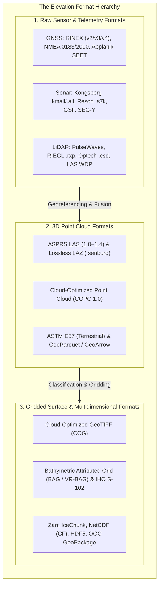
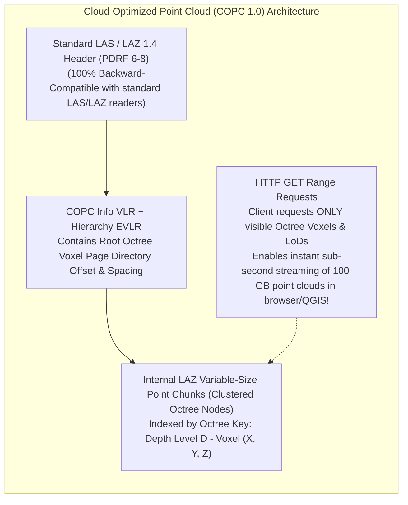
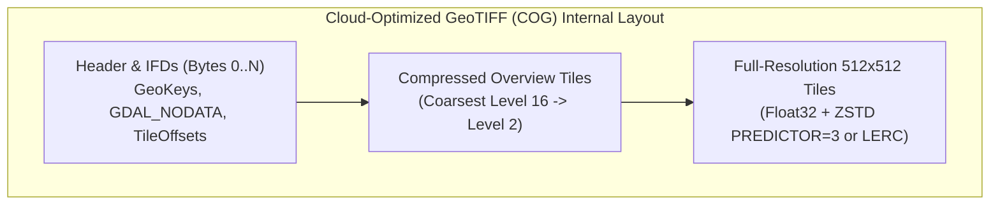

# Chapter 19: Key File Formats, Metadata, Archiving, and Data Discovery (STAC & Beyond)

*How elevation data is encoded on disk and in the cloud, documented for posterity, discovered via modern catalogs, and preserved across decades.*

Data formats are not passive containers; they are the computational contracts that govern how physical sensor measurements are stored, accessed, and interpreted. Over six decades of computing, the formats used in digital elevation and bathymetric modeling have evolved from hardware-specific binary bitstreams into open, self-describing, cloud-native arrays accessible over HTTP. Choosing an inappropriate file format can destroy vertical accuracy through integer truncation, strip spatial coordinate reference systems, corrupt multi-beam uncertainty bands, or render petabytes of uncompressed data unqueryable in the cloud.

---

## 19.1 Key File Formats for Sensors, Point Clouds, and Gridded Products

The elevation modeling data lifecycle transitions across three distinct format domains: **raw sensor telemetry**, **3D point clouds**, and **gridded/multidimensional surface rasters**.

---

### 19.1.1 Raw Sensor Telemetry and Navigation Formats

Raw telemetry formats capture direct, uncalibrated hardware outputs, providing the permanent legal and scientific record required for retrospective re-processing:

* **RINEX (Receiver Independent Exchange Format, 1989–present):** Standardized by the astronomical and geodetic community (current version 4.0), RINEX stores raw satellite carrier-phase, pseudorange, and Doppler observables across multi-GNSS constellations (GPS, GLONASS, Galileo, BeiDou). It is the universal input for post-processed kinematic (PPK) and Precise Point Positioning (PPP) trajectory solving.
* **NMEA 0183 / NMEA 2000:** Text-based (NMEA 0183) and Controller Area Network binary (NMEA 2000) streaming strings broadcast by shipboard and airborne instruments (`$GPGGA` for position, `$GPZDA` for time, `$INVTG` for velocity).
* **Applanix POSPac / SBET (Smooth Best Estimate of Trajectory):** The de facto industrial binary standard for 6-DOF blended GNSS/IMU trajectories, storing position, velocity, and roll/pitch/heading attitude at $100\text{–}200\text{ Hz}$ alongside full covariance matrices.
* **Kongsberg `.all` / `.kmall`, Teledyne Reson `.s7k`, EdgeTech `.jsf`, & SEG-Y:** Vendor and industry acoustic formats logging raw transceiver telemetry, beamforming phase differences, surface sound speed, water-column backscatter timeseries, and runtime installation parameters. Kongsberg's legacy `.all` and modern UDP/datagram `.kmall` (along with Teledyne Reson `.s7k`) record full multibeam range/angle/backscatter packets; EdgeTech's `.jsf` format logs dual-frequency chirp sidescan and sub-bottom sonar envelopes; and Society of Exploration Geophysicists **SEG-Y** (1975/2017) stores sub-bottom profiler and marine seismic reflection traces.
* **Generic Sensor Format (GSF, 1998):** Developed by Science Applications International Corporation (SAIC) for the U.S. Naval Oceanographic Office (NAVO), GSF is an open, vendor-neutral binary C library and file format for archiving processed multibeam bathymetry, per-beam ray-traced travel times, launch angles, sound velocity profiles, and Total Propagated Uncertainty (TPU).
* **Full-Waveform LiDAR Formats (PulseWaves, Riegl `.rxp` / `.sdb`, Optech `.csd`, & LAS 1.3/1.4 WDP):** Open and vendor formats for digitized full-waveform LiDAR profiles, storing the outgoing laser pulse and returned echo intensity timeseries ($1\text{ ns}$ bins) along with the 3D origin and pointing vector $\mathbf{r}_{\text{ray}}(\tau) = \mathbf{p}_0 + \tau\,\mathbf{d}_{\text{ray}}$ so multi-echo Gaussian decomposition and sub-surface bathymetric refraction can be recomputed years later.

---

### 19.1.2 3D Point Cloud Formats: LAS, LAZ, COPC, E57, 3D Tiles (`.pnts`), and GeoParquet

#### ASPRS LAS (v1.0–1.4) and Lossless LAZ (`LASzip`)
Standardized by the American Society for Photogrammetry and Remote Sensing in 2003 (and expanded to **LAS 1.4 – R15** in 2019), the **LAS format** is the universal binary interchange standard for discrete 3D point clouds:
* **Binary Structure:** Consists of a 375-byte Public Header Block (in LAS 1.4, supporting $>4.29 \times 10^9$ points via 64-bit `uint64` point counts), Variable Length Records (VLRs) and Extended VLRs (EVLRs) encoding OGC WKT CRS strings and waveform descriptors, followed by tightly packed fixed-size binary Point Data Record Formats (`PDRF 0` through `PDRF 10`). Modern airborne and bathymetric LiDAR pipelines mandate **PDRF 6–10**, which expand return numbers to 4 bits ($1\text{–}15$ returns per pulse), scan angle to $0.006^\circ$ precision (`Int16`), and classification codes from 32 (`0–31`) to 256 classes (`0–255`, enabling ASPRS bathymetric classes `40` Bathymetric Bottom, `41` Water Surface, and `45` Water Column).
* **Coordinate Quantization:** Coordinates are stored as signed 32-bit integers (`Int32`) scaled by header factors ($X = X_{\text{int}} \times \text{Scale}_X + \text{Offset}_X$). Setting `Scale = 0.001` ($1\text{ mm}$) preserves sub-millimeter precision across $\pm 2,147\text{ km}$ from the local offset origin.
* **LAZ Compression (Martin Isenburg, 2013):** The open-source `LASzip` compressor partitions point records into 50,000-point chunks and applies multi-stream context-based arithmetic coding to first- and second-order coordinate/timestamp deltas, achieving **$7:1$ to $12:1$ bit-for-bit lossless compression**.

#### Cloud-Optimized Point Cloud (COPC 1.0)
Standardized in 2021 by Hobu, Inc. (Connor Manning, Howard Butler, et al.), **COPC 1.0** unifies archival storage and real-time cloud streaming:
* A `.copc.laz` file is **100% a valid LAZ 1.4 file** (readable sequentially by any legacy LAZ parser) whose internal LAZ compressed chunks are spatially reorganized into a **clustered octree** (`EPT`-style Poisson-disk decimated hierarchy).
* Web viewers (Potree, QGIS 3.26+, Cesium) and PDAL pipelines (`readers.copc`) read the 160-byte `copc_info` VLR and `copc_hierarchy` EVLR via HTTP `Range` requests, fetching only the octree nodes intersecting the user's 3D bounding box and target spatial resolution.

#### ASTM E57, PLY, PCD, Entwine Point Tiles (EPT), 3D Tiles (`.pnts`), and GeoParquet / GeoArrow
* **ASTM E57 (ASTM E2807), PLY, and PCD:** `E57` combines binary point arrays with an embedded XML tree to store multi-station terrestrial laser scans (TLS), spherical range grids, sensor pose matrices, and calibrated pinhole/cylindrical imagery; Stanford `PLY` and Point Cloud Library `PCD` serve 3D computer vision and SLAM meshes.
* **Entwine Point Tiles (EPT) and OGC 3D Tiles (`.pnts` / 3D Tiles 1.1 `.glb`):** Multi-file octree and bounding-volume hierarchy (BVH) streaming formats powering WebGL globes (`CesiumJS`, `deck.gl`).
* **GeoParquet and GeoArrow:** Columnar storage formats storing $X, Y, Z$, intensity, and classification in contiguous Apache Parquet/Arrow buffers, enabling zero-copy GPU transfer and vectorized SQL point-cloud analytics in DuckDB, BigQuery, and Snowflake.

---

### 19.1.3 Gridded Surface Formats: GeoTIFF, COG, BAG, IHO S-102, and Cloud Arrays

#### TIFF, GeoTIFF 1.1, and Cloud-Optimized GeoTIFF (COG)
Built on Sam Leffler's `libtiff` (1991) and Niles Ritter & Mike Ruth's **GeoTIFF 1.0** (1995; updated to **OGC GeoTIFF 1.1** in 2019), the **Cloud-Optimized GeoTIFF (COG)** (OGC Standard `21-026r2`, 2023) is the universal standard for gridded DEMs:
1. **Internal Tiling (`TILED=YES`, `BLOCKXSIZE=512`, `BLOCKYSIZE=512`):** Replaces full-width scanline strips with $256 \times 256$ or $512 \times 512$ rectangular tiles so a spatial window query reads only the intersecting tiles.
2. **Internal Decimated Overviews:** Multi-scale overview pyramids (factors $2, 4, 8, 16, \dots$) are stored inside the same file, computed with domain-specific resampling (`min`/`max` for shoal/obstacle safety, `average` for mass balance).
3. **Streamable IFD Header Layout & Tag Semantics:** All Image File Directories (IFDs), `TileOffsets`, `TileByteCounts`, GeoKeys, `GDAL_NODATA` (TIFF ASCII tag `42113`), and scale/offset tags sit at the start of the file so an HTTP client can fetch any tile in two `Range` requests. Supported elevation compressions include lossless **`LZW`**, **`DEFLATE`**, and **`ZSTD`** (paired with horizontal integer differencing `PREDICTOR=2` or IEEE 754 floating-point byte-plane shuffling `PREDICTOR=3`), and bounded-error **`LERC`**.

#### Bathymetric Attributed Grid (BAG, VR-BAG) and IHO S-102
Initiated by the Open Navigation Surface (ONS) Working Group (Calder et al., 2005; v1.0 released 2006), the **Bathymetric Attributed Grid (`.bag`)**—and its international ECDIS counterpart **IHO S-102** (*Bathymetric Surface Product Specification*)—are HDF5 containers engineered specifically for safety-critical hydrography:
* **Mandatory Co-Registered Elevation (Positive-Up!) and Uncertainty Bands:** Every BAG file contains an HDF5 root group `/BAG_root` with two mandatory 2D `Float32` datasets:
  1. `/BAG_root/elevation`: Gridded bathymetric **elevation stored as positive UPWARD ($z \le 0$ for subaqueous depths below the vertical datum**, with NoData sentinel `1000000.0` = $10^6\text{ m}$), matching the positive-up convention of seamless Topo-Bathymetric DEMs and IHO S-102 (`notation-and-symbols.md` §1.1)!
  2. `/BAG_root/uncertainty`: Co-registered **Total Vertical Uncertainty ($\text{TVU}_{95\%}$)** at the $95\%$ confidence level (positive in meters, NoData `1000000.0`).
* **Tracking List (`/BAG_root/tracking_list`) and XML Metadata (`/BAG_root/metadata`):** A compound HDF5 table recording every hydrographer-designated sounding override (`row, col, depth, uncertainty, track_code, list_series`) so shoal hazard overrides can always be audited or reverted, paired with a full ISO 19115/19139 XML metadata stream.
* **Variable-Resolution BAG (`VR-BAG`):** Introduced in BAG 1.6 to support CHRT (CUBE with Hierarchical Resolution), adding `/BAG_root/varres_metadata` (storing per-macro-cell refinement dimensions and `(dx, dy)` spacings) and `/BAG_root/varres_refinements` (a 1D packed array of variable-resolution sub-grids), allowing $0.25\text{ m}$ harbor-pier cells and $16\text{ m}$ offshore channel cells to coexist in a single file.

#### Scientific & Cloud-Native Multidimensional Formats: NetCDF/CF, HDF5, Zarr, IceChunk, FITS, VICAR, PFM, and GeoPackage
* **NetCDF (1988) with CF Conventions & HDF5 (1990):** The standard containers for global bathymetry (`GEBCO`, `GMT` `.grd`), tide models, and spaceborne LiDAR (`ICESat-2 ATL03/ATL08`, `GEDI L2A` in HDF5).
* **Zarr (2015) and IceChunk (2024):** Zarr partitions $N$-dimensional arrays $(t, z, y, x)$ into independent compressed chunk objects (`c/0/14/22`) addressable directly on S3/GCS; **IceChunk** adds an immutable, Git-like transactional snapshot and branch/tag log on top of Zarr v3 so distributed Dask/GPU workers can update petabyte DEM cubes with full ACID isolation and time-travel reproducibility.
* **FITS (1981), JPL VICAR (1966), NAVO PFM (`pfmabe`, 1994), and OGC GeoPackage (`.gpkg`, 2014):** `FITS` and `VICAR` remain foundational in planetary and astronomical DEM archives (`PDS4`); NAVO's `PFM` pioneered 3D binned hydrographic sounding editing; and **OGC GeoPackage** embeds both vector breaklines and tiled elevation rasters (`gpkg_2d_gridded_coverage_ancillary`) inside a single portable SQLite database file.
