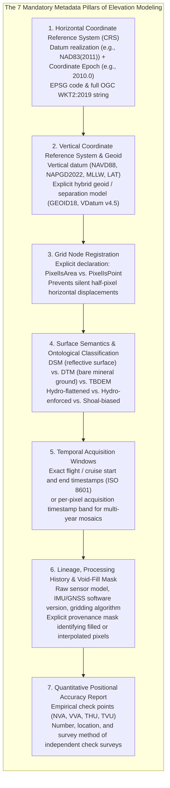
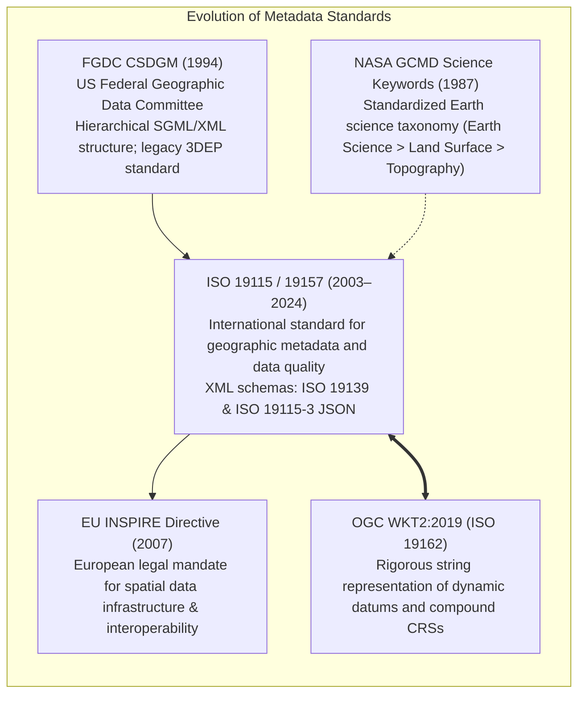

# Chapter 19: Key File Formats, Metadata, Archiving, and Data Discovery (STAC & Beyond)

*How elevation data is encoded on disk and in the cloud, documented for posterity, discovered via modern catalogs, and preserved across decades.*

---

## 19.2 Metadata: Making a DEM Usable, Auditable, and Legally Defensible

A raster digital elevation model without rigorous metadata is merely an anonymous, uncalibrated 2D array of floating-point numbers. It cannot be legally admitted into engineering contracts, cannot be safely used for navigational charting, and cannot be integrated into long-term climate change analysis. If an analyst cannot determine whether an elevation value denotes bare earth or tree canopy, whether vertical heights are referenced to the ellipsoid or sea level, or whether coordinates are shifted by half a pixel, the elevation model is scientifically useless.



---

### 19.2.1 The Seven Mandatory Metadata Pillars

Every elevation dataset produced by government agencies, commercial vendors, or research institutions must embed or accompany the **Seven Mandatory Metadata Pillars**:

#### Pillar 1: Horizontal Coordinate Reference System, Realization, and Epoch
It is insufficient to declare `"WGS84"` or `"NAD83"`. Because tectonic plates move at $2\text{–}10\text{ cm/year}$, a horizontal coordinate is ambiguous without its realization and temporal epoch:
* **Required Specification:** Name, EPSG identifier, tectonic plate model, datum realization, and realization epoch:
  * Example: `NAD83(2011) epoch 2010.0` or `ITRF2020 epoch 2024.5`.
* Must include the complete **OGC WKT2:2019 (ISO 19162)** string in the file header.

#### Pillar 2: Vertical Datum, Separation Model, and Tide Epoch
Vertical elevation $Z$ is meaningless without declaring the reference surface:
* **Terrestrial Orthometric:** Declare vertical datum and explicit hybrid geoid model (e.g., `NAVD88 height, GEOID18 model`).
* **Ellipsoidal Heights:** Declare ellipsoidal datum (e.g., `WGS84 (G1762) ellipsoidal height`).
* **Hydrographic Tidal Datums:** Declare tidal datum, National Tidal Datum Epoch (NTDE), and separation model (e.g., `Mean Lower Low Water (MLLW), 1983–2001 NTDE, NOAA VDatum v4.5`).

#### Pillar 3: Grid Node Registration (`PixelIsArea` vs. `PixelIsPoint`)
Every gridded DEM must explicitly declare whether the georeferenced tiepoint $(x_0, y_0)$ of pixel $(0, 0)$ refers to the **outer upper-left corner of the pixel footprint** (`PixelIsArea`) or the **geometric center of the pixel sample point** (`PixelIsPoint`):
* **GeoTIFF Tag (`GTRasterTypeGeoKey`, Key ID `1025`):** Set to `RasterPixelIsArea` (`1`, the default for USGS 3DEP GeoTIFFs and optical imagery) or `RasterPixelIsPoint` (`2`, used by SRTM `.hgt`, Copernicus DEM GeoTIFFs, GMT grid-node grids, and NetCDF grids with `node_offset = 0`).
* **The Half-Pixel Shift Disaster:** In `GDAL`, the 6-parameter affine geotransform `[GT(0), GT(1), GT(2), GT(3), GT(4), GT(5)]` **always** reports the upper-left corner of the upper-left pixel's area regardless of `GTRasterTypeGeoKey` (when `AREA_OR_POINT=Point` is set, GDAL shifts `GT(0)` and `GT(3)` outward by $-\frac{1}{2}\Delta x$ and $+\frac{1}{2}\Delta y$ so the pixel center sits at the tiepoint!). If a custom script strips `GTRasterTypeGeoKey` or writes raw array origin coordinates without accounting for this convention, the entire DEM shifts horizontally by $(\Delta E, \Delta N) = (+\frac{1}{2}\Delta x, -\frac{1}{2}\Delta y)$. On a $30\text{ m}$ SRTM or Copernicus grid over a $35^\circ$ mountain slope, that $21.2\text{ m}$ diagonal shift induces a systematic vertical error of $\Delta z = 21.2\text{ m} \times \tan(35^\circ) = \mathbf{14.85\text{ meters}}$!

#### Pillar 4: Surface Semantics and Conditioning
Must explicitly categorize the physical surface and hydro-conditioning ontology (Chapter 20):
* **Product Type:** Reflective Digital Surface Model (`DSM`), Bare-Earth Digital Terrain Model (`DTM`), Digital Bathymetric Model (`DBM`), or Seamless Topo-Bathymetric DEM (`TBDEM`).
* **Hydrologic Conditioning:** Unconditioned raw surface, **Hydro-Flattened** (flat water bodies $\ge 2\text{ acres}$ and monotonic rivers $\ge 30\text{ m}$ wide per USGS 3DEP LBS, preserving road embankments over culverts), or **Hydro-Enforced** (culverts and bridges digitally breached for continuous D8/2D flow routing).
* **Aggregation / Decimation Rule:** Arithmetic Mean, Inverse-Distance / Spline, CUBE Hypothesis Disambiguation, **Shoal-Biased Minimum Depth** (for nautical charting), or **Maximum Obstacle Elevation** (for aviation obstruction).

#### Pillar 5: Temporal Windows and Per-Pixel Timestamp Masks
Topography and bathymetry evolve continuously due to erosion, sand-wave migration, construction, earthquakes, and seasonal vegetation/snow cycles:
* Single-campaign surveys must record acquisition start and end timestamps in UTC ISO 8601 format (`start_datetime`, `end_datetime`, e.g., `2024-03-15T14:22:00Z`).
* Multi-survey regional or global mosaics (e.g., USGS 3DEP seamless grids, NOAA CUDEM, GEBCO, ArcticDEM mosaics) must provide a **co-registered per-pixel provenance and timestamp raster band** (or polygon index) recording the exact survey date $t(x,y)$ and Type Identifier (`TID`) of every cell.

#### Pillar 6: Lineage, Processing History, and Void-Fill Provenance
* Complete sensor hardware and trajectory lineage: sensor make/model (e.g., *Riegl VQ-1560 II-S*, *Kongsberg EM 2040*), flying altitude / water depth range, GNSS/INS post-processing software (e.g., *POSPac MMS 8.9*, base stations / PPP ephemeris), sound speed cast IDs, and ground-filtering / gridding parameters.
* **Void-Fill Provenance Mask:** A discrete categorical bitmask identifying whether each pixel was directly measured, interpolated across a removed building/canopy footprint, or patched from an external background source (e.g., filling an InSAR shadow void with ASTER or SRTM).

#### Pillar 7: Quantitative Positional Accuracy Report (ASPRS, USGS 3DEP, IHO S-44)
Metadata must never merely assert "meets specification." Under the **ASPRS Positional Accuracy Standards (2015/2023)**, **USGS 3DEP LBS**, and **IHO S-44 (6th ed.)**, metadata must report quantitative empirical checkpoint statistics and propagated uncertainty parameters:
* **Terrestrial Open-Terrain Vertical Accuracy (NVA):** Reported as $\text{RMSE}_z$, mean bias $\mu_e$, standard deviation $\sigma_e$, NMAD, and $95\%$ Non-Vegetated Vertical Accuracy $\text{NVA}_{95\%} = 1.9600 \times \text{RMSE}_z$ evaluated across $M_{\text{NVA}} \ge 20\text{–}30$ independent survey-grade checkpoints ($3\times$ more accurate than the DEM).
* **Terrestrial Vegetated Vertical Accuracy (VVA):** Reported as the non-parametric 95th percentile of absolute errors $Q_{0.95}(|e|)$ across vegetated land-cover classes.
* **Hydrographic Total Propagated Uncertainty (TVU & THU):** Reported per pixel at $95\%$ confidence in `/BAG_root/uncertainty` alongside the target IHO S-44 survey order (Exclusive Order, Special Order, Order 1a/1b, Order 2) and its governing parameters $\text{TVU}_{\max}(d) = \sqrt{a_{\text{IHO}}^2 + (b_{\text{IHO}}\,d)^2}$ and $\text{THU}_{\max}(d) = c_{\text{THU}} + p_{\text{THU}}\,d$.

| Metadata Standard | Issuing Body & Year | Primary Serialization | Core Strengths for Elevation Modeling |
| :--- | :--- | :--- | :--- |
| **FGDC CSDGM** | U.S. FGDC (1994) | XML / SGML | Legacy U.S. federal standard; detailed lineage and accuracy sections (`horizpa`, `vertacc`). |
| **ISO 19115-1 / -2 & 19157**| ISO / TC 211 (2003–2022) | XML (`ISO 19139`) / JSON | Mandatory international metadata and data-quality (`DQ_AbsoluteExternalPositionalAccuracy`) schema for BAG, S-102, and 3DEP. |
| **NASA GCMD Keywords** | NASA (1987–present) | Hierarchical Controlled Taxon | Standardized global discovery keywords (`EARTH SCIENCE > LAND SURFACE > TOPOGRAPHY`, `OCEANS > BATHYMETRY`). |
| **EU INSPIRE Elevation** | European Union (2007) | GML / ISO 19139 XML | Legally mandated cross-border elevation, breakline, and vertical datum (`EVRS`) interoperability across Europe. |
| **OGC WKT2:2019 (ISO 19162)**| OGC / ISO (2019) | Structured ASCII Text | Unambiguous encoding of `COMPOUNDCRS`, `DYNAMIC[FRAMEEPOCH[...]]`, and vertical `GEOIDMODEL` transformations. |

---

### 19.2.2 Major Geospatial Metadata Standards



#### 1. FGDC CSDGM (1994)
The **Content Standard for Digital Geospatial Metadata (CSDGM)** was mandated by Executive Order 12906 across all U.S. federal agencies in 1994. While comprehensive, CSDGM predated modern web APIs and multi-dimensional compound datums, leading to its gradual replacement by international standards.

#### 2. ISO 19115, 19115-1, and ISO 19157 (Data Quality)
The modern international benchmark for geospatial metadata:
* **ISO 19115-1:2014:** Defines the core structural model (identification, constraints, lineage, distribution, and reference systems).
* **ISO 19115-2:** Extends metadata to imagery, gridded data, and sensor acquisition parameters.
* **ISO 19157:2013:** Focuses exclusively on **Data Quality**, establishing formal mathematical tests for positional accuracy, thematic classification accuracy, and temporal consistency.
* Serialized via **ISO 19139 XML** or modern **ISO 19115-3 JSON-LD**.

#### 3. NASA Global Change Master Directory (GCMD) Keywords
NASA's GCMD establishes a controlled hierarchical vocabulary to ensure planetary datasets can be discovered across multidisciplinary scientific engines:
```
EARTH SCIENCE > LAND SURFACE > TOPOGRAPHY > TERRAIN ELEVATION > DIGITAL ELEVATION MODEL (DEM)
```

#### 4. OGC WKT2:2019 (ISO 19162) Compound Coordinate Reference Systems
Older GIS formats stored coordinate systems as crude PROJ.4 projection strings (e.g., `+proj=utm +zone=10 +datum=WGS84`), which completely lacked vertical datum definitions. OGC WKT2:2019 allows the definition of true **Compound Coordinate Reference Systems (`COMPOUNDCRS`)** that bind horizontal and vertical datums into an unambiguous, human- and machine-readable text block:

```
COMPOUNDCRS["NAD83(2011) / UTM zone 10N + NAVD88 height",
  PROJCRS["NAD83(2011) / UTM zone 10N",
    BASEGEOGCRS["NAD83(2011)",
      DATUM["North American Datum 1983 (2011)",
        ELLIPSOID["GRS 1980",6378137,298.257222101]],
      ID["EPSG",6318]],
    CONVERSION["UTM zone 10N",
      METHOD["Transverse Mercator",ID["EPSG",9807]],
      PARAMETER["Latitude of natural origin",0],
      PARAMETER["Longitude of natural origin",-123],
      PARAMETER["Scale factor at natural origin",0.9996],
      PARAMETER["False easting",500000],
      PARAMETER["False northing",0]],
    CS[Cartesian,2],
      AXIS["easting (E)",east],
      AXIS["northing (N)",north],
      LENGTHUNIT["metre",1],
    ID["EPSG",6339]],
  VERTCRS["NAVD88 height",
    VDATUM["North American Vertical Datum 1988",ID["EPSG",5103]],
    CS[vertical,1],
      AXIS["gravity-related height (H)",up],
      LENGTHUNIT["metre",1],
    GEOIDMODEL["GEOID18"],
    ID["EPSG",5703]]]
```
