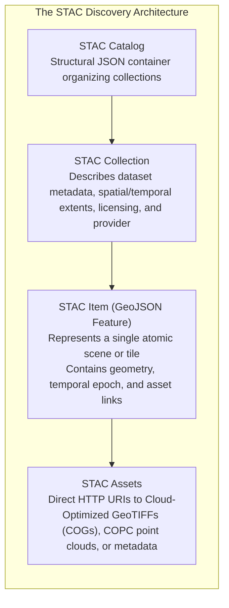
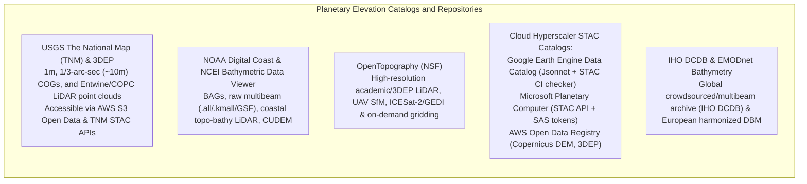

# Chapter 19: Key File Formats, Metadata, Archiving, and Data Discovery (STAC & Beyond)

*How elevation data is encoded on disk and in the cloud, documented for posterity, discovered via modern catalogs, and preserved across decades.*

---

## 19.3 Searching for the Right Data and Data Type: STAC and Modern Catalogs

Finding the correct digital elevation model for a specific engineering, scientific, or cartographic task has historically been an exercise in frustration: navigating fragmented agency clearinghouses, downloading hundreds of gigabytes of zipped raster tiles, only to discover that the downloaded data was a 1970s contour-derived integer DEM or a raw Digital Surface Model (DSM) unsuited for floodplain modeling.

The emergence of the **SpatioTemporal Asset Catalog (STAC)** specification and cloud-native geospatial catalogs has transformed spatial data discovery from manual web crawling into standardized, scriptable, and serverless API queries.



---

### 19.3.1 The SpatioTemporal Asset Catalog (STAC) Specification

Standardized by the Radiant Earth Foundation and the open-source community (version 1.0.0 in 2021, version 1.1.0 in 2024), **STAC** provides a common JSON language to describe geospatial assets:

#### 1. Core STAC Entities
* **STAC Item:** A standard GeoJSON Feature augmented with a `datetime` property, a `links` array, and an `assets` dictionary. In elevation modeling, a STAC Item represents a single LiDAR flight tile, a satellite radar elevation scene, or a hydrographic survey sheet.
* **STAC API:** A RESTful API standard (implementing OGC API - Features) enabling dynamic spatial, temporal, and property-based filtering:
  `GET /search?bbox=-122.5,37.5,-122.0,38.0&datetime=2020-01-01T00:00:00Z/..&collections=usgs-3dep-1m`

#### 2. Essential STAC Extensions for Elevation Data (`proj`, `raster`, `pointcloud`, `eo`, `sar`, `scientific`, `version`)
Standard STAC Item and Collection metadata is augmented through formal JSON-Schema modular extensions:
* **Projection Extension (`proj`, v1.1 / v2.0):** Enforces explicit horizontal and compound georeferencing, embedding `proj:epsg` (v1.1, e.g., `6339`) or `proj:code` (v2.0, e.g., `"EPSG:6339"`), `proj:wkt2` (full ISO 19162 `COMPOUNDCRS` string), `proj:shape` (`[rows, cols]`), `proj:bbox`, and `proj:transform` (the 6-element affine geotransform `[a, b, c, d, e, f]`) directly inside the Item properties so clients can compute pixel intersections without opening the remote raster header.
* **Raster Extension (`raster`, v1.1):** Encodes band-level numerical and metrological properties for each asset band (`elevation`, `uncertainty`, `source_mask`): `data_type` (`float32`), `unit` (`metre`), `nodata` (`"nan"` or `-9999.0`), `spatial_resolution` ($1.0\text{ m}$), `scale` / `offset`, and precomputed `statistics` (`minimum`, `maximum`, `mean`, `stddev`).
* **Point Cloud Extension (`pointcloud`, v1.0):** Designed for `COPC`, `LAZ`, and `E57` assets: records `pc:count` (total points), `pc:type` (`lidar`, `eopc`, `radar`, `sonar`), `pc:encoding` (`copc`, `laz`), `pc:density` ($\text{pts}\cdot\text{m}^{-2}$), and `pc:schemas` (attribute names, byte sizes, and types for `X, Y, Z, Intensity, ReturnNumber, Classification, GpsTime`) alongside per-channel `pc:statistics`.
* **Electro-Optical (`eo`), SAR (`sar`), Scientific (`scientific`), and Version (`version`) Extensions:**
  * `eo` and `sar`: Record `eo:cloud_cover` and solar illumination angles (`view:sun_azimuth`, `view:sun_elevation`) for optical stereo/SDB DEMs, or radar frequency band (`sar:frequency_band = "X"`, `"C"`, `"L"`, `"P"`), polarization, and orbit state (`sar:instrument_mode`) for InSAR DEMs.
  * `scientific`: Embeds persistent `sci:doi`, `sci:citation`, and `sci:publications` directly into STAC Collections and Items so automated pipelines can generate reproducible bibliography tables.
  * `version`: Tracks dataset edition (`version = "2023.1"`), `deprecated` flags, and `links` (`rel = "predecessor-version"` / `"successor-version"`) when a survey is reprocessed with a newer geoid or trajectory.

```json
{
  "type": "Feature",
  "stac_version": "1.1.0",
  "stac_extensions": [
    "https://stac-extensions.github.io/projection/v1.1.0/schema.json",
    "https://stac-extensions.github.io/raster/v1.1.0/schema.json",
    "https://stac-extensions.github.io/scientific/v1.0.0/schema.json",
    "https://stac-extensions.github.io/version/v1.2.0/schema.json"
  ],
  "id": "USGS_1M_10_x55y419_CA_NoCal_2019",
  "collection": "usgs-3dep-1m",
  "geometry": {
    "type": "Polygon",
    "coordinates": [[[-122.45, 37.80], [-122.40, 37.80], [-122.40, 37.85], [-122.45, 37.85], [-122.45, 37.80]]]
  },
  "properties": {
    "datetime": "2019-04-12T18:30:00Z",
    "version": "1.0",
    "sci:citation": "USGS 3D Elevation Program (3DEP) 1-Meter DEM, Northern California (2019)",
    "proj:epsg": 6339,
    "proj:wkt2": "COMPOUNDCRS[\"NAD83(2011) / UTM zone 10N + NAVD88 height\"...]",
    "raster:bands": [
      {
        "data_type": "float32",
        "spatial_resolution": 1.0,
        "unit": "metre",
        "nodata": "nan"
      }
    ]
  },
  "assets": {
    "elevation": {
      "href": "https://storage.googleapis.com/usgs-3dep-cogs/USGS_1M_10_x55y419.tif",
      "type": "image/tiff; application=geotiff; profile=cloud-optimized",
      "roles": ["data", "elevation", "dtm"]
    }
  }
}
```

---

### 19.3.2 STAC GeoParquet: Serverless Querying of Billions of Tiles

While querying a RESTful STAC API (`POST /search`) works well for interactive bounding boxes returning 10 to 1,000 items, paginating through 50 million global LiDAR/InSAR STAC Items over HTTP JSON introduces minutes of network serialization latency.

In 2024, the cloud-native geospatial community standardized **STAC GeoParquet**:
* Millions of hierarchical STAC Item JSON documents are flattened and compiled into partitioned Apache GeoParquet columnar files (sorted spatially along a Hilbert curve or S2/H3 cell key so row-group bounding-box statistics `bbox.xmin, bbox.ymin, bbox.xmax, bbox.ymax` enable instant row-group pruning).
* Using vectorized SQL engines such as **DuckDB** or **Polars**, analysts execute spatial, temporal, resolution, and datum filters over millions of tiles directly on S3/GCS via HTTP `Range` reads in milliseconds—with zero database servers to maintain:

```sql
-- Query millions of global elevation scenes directly from S3 using DuckDB
INSTALL spatial; LOAD spatial;
INSTALL httpfs;  LOAD httpfs;

SELECT 
    id, 
    datetime, 
    assets.elevation.href AS cog_url,
    "proj:epsg" AS epsg_code
FROM read_parquet('s3://stac-geoparquet-registry/planetary_elevation.parquet')
WHERE bbox.xmax >= -122.5 AND bbox.xmin <= -122.3
  AND bbox.ymax >= 37.7   AND bbox.ymin <= 37.9
  AND ST_Intersects(geometry, ST_MakeEnvelope(-122.5, 37.7, -122.3, 37.9))
  AND "raster:bands"[1].spatial_resolution <= 1.0
  AND list_contains(assets.elevation.roles, 'dtm'); -- Enforce Bare-Earth DTM
```

---

### 19.3.3 Major Planetary Catalogs, Cloud Registries, and Hydrographic Portals



| Discovery Portal / Catalog | Primary Elevation & Bathymetric Holdings | Native Cloud / API Formats | Key Strengths & Programmatic Access |
| :--- | :--- | :--- | :--- |
| **Google Earth Engine Data Catalog** | Copernicus GLO-30, NASADEM, SRTM, USGS 3DEP ($1\text{ m}$ & $10\text{ m}$), ArcticDEM, REMA, FABDEM, GEBCO, ETOPO | Earth Engine Tiles + Open GitHub **Jsonnet / STAC Catalog** (with CI schema checker) | Petabyte serverless compute (`ee.Image`) and machine-validated open STAC catalog metadata (2018–2024). |
| **Microsoft Planetary Computer** | USGS 3DEP LiDAR (`COPC` & $1\text{ m}/10\text{ m}$ `COG`), Copernicus GLO-30/90, ALOS World 3D (`AW3D30`), NASADEM | **STAC API** + **STAC GeoParquet** on Azure Blob Storage | Direct `pystac-client` + `odc-stac` / `stackstac` streaming into `xarray`/Dask. |
| **AWS Open Data Registry** | Copernicus DEM (`COG`), USGS 3DEP Entwine (`EPT` / `COPC`), NOAA NWS / NCEI hydrographic BAGs & `.all`/`.kmall` | S3 Buckets (`s3://copernicus-dem-30m`, `s3://usgs-lidar-public`, `s3://noaa-ocs-nationalbathymetry-pds`) | Zero-egress in-region S3 range requests for PDAL, GDAL `/vsis3/`, and NOAA Kluster/CUDEM. |
| **USGS The National Map / OpenTopography**| Complete U.S. 3DEP QL0–QL2 airborne LiDAR, ifsar Alaska, fault-zone TLS/UAS, global academic point clouds | `COG`, `COPC`, `LAS/LAZ`, REST API & `py3dep` / `bmi-topography` | On-demand custom TIN/spline gridding, 3D differencing, and canopy/ground filtering in the browser or API. |
| **NOAA Digital Coast, NCEI & IHO DCDB** | U.S. H-sheet hydrographic smooth sheets & BAGs, JALBTCX bathy-lidar, CUDEM, global research multibeam & IHO CSB | `BAG` / `VR-BAG`, `GSF`, `.all`/`.kmall`, `COG`, NOAA `fetches` CLI | Authoritative source for positive-up/positive-down datum-verified coastal and deep-ocean bathymetry. |
| **EMODnet Bathymetry** | Harmonized European seas DTM ($\sim 115\text{ m}$) + high-resolution national hydrographic survey composites | `NetCDF` (CF), `GeoTIFF`, OGC WMS/WCS, CDI metadata | Includes per-pixel source provenance (`Source References`) and uncertainty envelopes across European waters. |

---

### 19.3.4 How to Filter for the *Right* Product Type

When searching modern catalogs, analysts must apply strict semantic, datum, and provenance filters to avoid ingesting inappropriate elevation models into production pipelines. For example, querying `"elevation"` over a coastal estuary without filtering on `roles`, vertical datum (`proj:wkt2`), and sensor lineage can return a heterogeneous mix of 1970s contour-derived `Int16` DEMs, unbreached X-band radar DSMs (`Copernicus GLO-30` where mangrove canopies sit $18\text{ m}$ above the mudflat), and MLLW chart-datum bathymetric grids (`BAG`). Before streaming any asset into a model, automated ingestion scripts should inspect the STAC `raster:bands` statistics, verify that `GTRasterTypeGeoKey` (`Area` vs. `Point`) matches the target grid alignment, and filter on the criteria below:

| Operational Requirement | Essential Catalog Filters | Dangerous Datasets to Exclude |
| :--- | :--- | :--- |
| **Hydraulic Flood Modeling** | `roles: ["dtm"]`, `hydro: "enforced"`, `resolution <= 2.0` | **Exclude DSMs** (bridges act as dams) and unconditioned LiDAR DTMs (unbreached culverts). |
| **Solar / Telecom Line-of-Sight**| `roles: ["dsm"]`, `includes: ["buildings", "canopy"]` | **Exclude DTMs** (bare earth ignores signal-blocking trees and structures). |
| **Safety of Navigation (Charting)**| `roles: ["bathymetry"]`, `decimation: "shoal_biased"`, `datum: "MLLW"`| **Exclude Mean-decimated grids** (erases pinnacles) and ellipsoidal heights. |
| **Tectonic Fault Scarp Detection** | `roles: ["dtm"]`, `source: "lidar"`, `method: "bare_earth"` | **Exclude contour-derived DEMs** (wedding-cake terracing masks fine fault scarps). |
| **Seamless Coastal Storm-Surge Mesh**| `roles: ["tbdem"]`, `datum: "NAVD88"` (or VDatum `SEP` applied) | **Exclude unharmonized land/chart mixes** (subtracting MLLW depth from NAVD88 height creates a false coastal cliff). |
