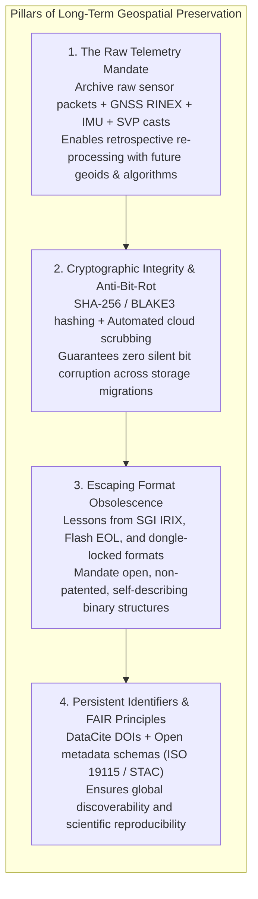
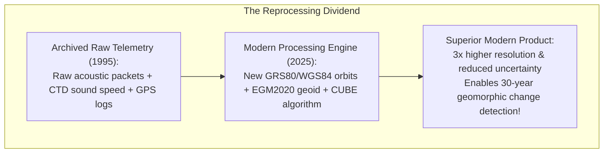
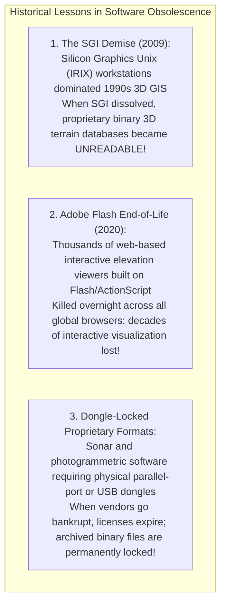

# Chapter 19: Key File Formats, Metadata, Archiving, and Data Discovery (STAC & Beyond)

*How elevation data is encoded on disk and in the cloud, documented for posterity, discovered via modern catalogs, and preserved across decades.*

---

## 19.4 Archiving, Long-Term Data Preservation, and the Battle Against Digital Obsolescence

Digital elevation data is an irreplaceable temporal record of the Earth's physical evolution. An airborne LiDAR survey of a barrier island captured days before a Category 5 hurricane, or a high-resolution multibeam survey of an active submarine volcano, can never be re-acquired. However, digital information is fragile. Left unmaintained, digital elevation datasets suffer from physical media decay ("bit rot"), organizational abandonment, and software obsolescence. Preserving elevation models across decades requires a proactive strategy that balances raw sensor archiving, cryptographic integrity, and strictly open format architectures.

---

### 19.4.1 What to Archive: The "Reprocessing Dividend"

A common mistake in government and municipal archiving is retaining only the final gridded product (e.g., a $1\text{-meter}$ bare-earth GeoTIFF) while deleting raw sensor packets and trajectory files to save storage costs. 

This practice discards the **Reprocessing Dividend**:
* In 1995, multibeam sonar data was processed using primitive single-sound-velocity profiles and crude manual cleaning, producing coarse, noisy bathymetric maps.
* Twenty years later, researchers ingested the original 1995 raw sensor packets (`.all` files, raw CTD casts, and navigation logs) into modern processing engines (CUBE, VDatum, and backscatter normalization tools). 
* The reprocessed 1995 survey yielded a bathymetric surface with **three times higher feature resolution and half the vertical uncertainty**, revealing subtle submarine fault scarps and shipwrecks that were completely invisible in the original 1995 deliverable.

#### Mandatory Raw Archival Package and OAIS (ISO 14721) Structure
Under the **Open Archival Information System (OAIS, ISO 14721)** reference model used by NOAA NCEI, NASA Earthdata DAACs, and USGS EROS, an archival elevation dataset is structured into a self-contained **Archival Information Package (AIP)** (often serialized on disk using the IETF **BagIt** RFC 8493 directory specification with `manifest-sha256.txt`) preserving five mandatory tiers:
1. **Raw Sensor Telemetry Streams:** Unmodified binary range/angle/waveform packets (e.g., Riegl `.rxp`/`.sdb`, PulseWaves, Kongsberg `.kmall`/`.all`, Reson `.s7k`, EdgeTech `.jsf`, or raw satellite SAR Level-0 phase history and optical Level-1B imagery with RPCs).
2. **Raw Navigation and Attitude Observables:** Dual-frequency GNSS base station and rover carrier-phase logs in **RINEX v3/v4**, raw IMU specific-force and angular-rate logs ($\mathbf{f}^b(t), \boldsymbol{\omega}_{ib}^b(t)$), post-processed SBET trajectories (`sbet.out` + `smrmsg.out` covariance logs), and acoustic USBL/DVL logs.
3. **Environmental Refractivity & Tide Profiles:** Full water-column CTD / MVP **Sound Velocity Profiles (SVP)** with timestamps and coordinates; barometric pressure, temperature, and humidity logs; and co-temporal tide gauge / VDatum separation grids.
4. **Physical Installation & Calibration Geometry:** Surveyed vessel/aircraft 3D lever-arm offset vectors ($\mathbf{l}_{\text{lever}}^b$ in the body frame with explicit axis sign conventions!), pre- and post-mission patch-test / boresight angles $(\delta\phi, \delta\theta, \delta\psi)$, latency offset $\delta t_{\text{lat}}$, and static draft / dynamic squat tables.
5. **Validated Deliverable Products & Provenance Masks:** Cloud-Optimized Point Clouds (`.copc.laz` or `.gsf`), gridded surfaces (`.tif` COG or `.bag`), 3D hydro-flattening breaklines (`.gpkg` / `.parquet`), independent checkpoint residuals, and ISO 19115 / STAC metadata.

#### Worked Economic Analysis of the Reprocessing Dividend
Why is deleting raw telemetry to "save storage costs" a catastrophic financial blunder? Consider a $500\text{ km}^2$ coastal topo-bathymetric LiDAR and multibeam survey that cost **$C_{\text{acq}} = \$750,000$** in aircraft/vessel mobilization, crew time, and weather standby:
* The final $1\text{ m}$ gridded COG and BAG deliverables occupy $V_{\text{grid}} \approx 15\text{ GB}$, whereas the complete raw archival package (full-waveform `.rxp`/`.sdb`, `.kmall` water-column/multibeam logs, RINEX, raw IMU, and COPC point clouds) occupies $V_{\text{raw}} = 8.0\text{ TB}$.
* At modern cloud deep-archive rates ($c_{\text{archive}} \approx \$0.99\text{ per TB/month} \approx \$12\text{ per TB/year}$ on AWS S3 Glacier Deep Archive or Google Cloud Archive Storage), preserving the entire $8.0\text{ TB}$ raw telemetry package for **25 years** costs:
  $$C_{\text{storage, 25yr}} = 8.0\text{ TB} \times \$12\text{ TB}^{-1}\cdot\text{yr}^{-1} \times 25\text{ yr} = \mathbf{\$2,400} \quad (\mathbf{0.32\%} \text{ of acquisition cost!})$$
* Seven years after acquisition, when North America transitions from `NAD83(2011) / NAVD88` to dynamic **`NATRF2022 / NAPGD2022 (GEOID2022)`**, and when improved sub-canopy/turbid-water waveform deconvolution algorithms reduce shallow bathymetric bias by $18\text{ cm}$, an agency that retained the $8.0\text{ TB}$ raw package can re-run an automated cloud pipeline (`POSPac` PPP-AR $\to$ refraction ray-trace $\to$ `PDAL`/`CUBE`) for under $\$1,500$ of spot compute—realizing a **$500\times$ return on investment** compared to re-flying the coast!

---

### 19.4.2 Fighting Bit Rot, Silent Corruption, and Media Decay

Physical storage media and network transfers experience non-zero bit-error rates (BER):
* **Magnetic Tape (9-Track & LTO):** Legacy 1970s–1990s 9-track half-inch tapes and early LTO cartridges suffer from polyurethane binder hydrolysis ("sticky-shed syndrome", requiring baking at $55^\circ\text{C}$ to read one final time!), magnetic domain relaxation, and drive-head obsolescence within $10\text{–}20\text{ years}$.
* **Optical Media (CD-R, DVD-R, MO Discs):** Organic cyanine/azo recording dyes oxidize and reflective aluminum layers corrode ("disc rot") within $5\text{–}15\text{ years}$.
* **NAND Flash (SSDs / Thumb Drives):** Unpowered floating-gate / charge-trap NAND flash cells leak electrons via quantum tunneling, losing charge retention within $1\text{–}3\text{ years}$ when stored unpowered on a shelf (JEDEC JESD218 standard).
* **Hard Disk Drives & RAM:** Even enterprise spinning disks exhibit an uncorrectable bit read error rate ($\text{UBER}$) of roughly $1\text{ in }10^{15}\text{ bits}$ ($\approx 1\text{ silent bit flip per }125\text{ TB}$ read). If a single bit flips inside the exponent of an IEEE 754 `Float32` elevation pixel or inside a `DEFLATE`/`ZSTD` compressed Huffman table, either an artificial $10^{10}\text{ m}$ spike appears or the entire $512\times 512$ DEM tile fails to decompress!

#### End-to-End Cryptographic Checksums, Erasure Coding, and Scrubbing
To guarantee bit-level immutability across decades:
1. **Per-File Cryptographic Digests (`SHA-256` / `BLAKE3`) and Internal Chunk Checksums:** Compute and store cryptographic digests at the moment of field acquisition (`sha256sum`) AND enable format-level block checksums (such as HDF5/BAG `Fletcher32` filter checksums and Zarr/IceChunk `CRC32C`/`SHA-256` chunk manifests) so corruption is localized to a single chunk.
2. **Multi-Region Erasure Coding (Reed–Solomon) and Active Scrubbing:** Replicate archives across geographically distinct fault domains (at least 3 copies across 2+ regions on distinct storage media—the **3-2-1-1 archival rule**), with continuous background scrubbing daemons that read every object, verify its `SHA-256` digest against the BagIt manifest, and heal bit flips automatically from Reed–Solomon parity shards.

---

### 19.4.3 Format Obsolescence: Lessons from SGI, Flash, and Dongle-Locked Formats

The history of computing demonstrates that software ecosystems die far faster than physical media:

#### The Golden Rules of Archival Format Selection
To prevent elevation data from becoming unreadable digital hieroglyphics:
1. **Never Archive in Proprietary Binary Formats:** Never store archival deliverables in proprietary software databases that require a paid commercial license, a hardware dongle, or cloud activation servers to read.
2. **Mandate Open, Self-Describing Formats:** Archive exclusively in open, non-patented formats governed by international consensus standards: **Cloud-Optimized GeoTIFF (COG)**, **ASPRS LAZ / COPC**, **Bathymetric Attributed Grid (BAG)**, **NetCDF (CF-compliant)**, or **Zarr**.
3. **Embed the Geodetic CRS Internally:** The Coordinate Reference System must be embedded directly inside the file header as an explicit **WKT2:2019** string. Never rely on external companion files (such as `.tfw` world files or `.prj` text files), which inevitably become separated during data migrations.

---

### 19.4.4 Persistent Identifiers and FAIR Principles

To guarantee that elevation models remain discoverable and scientifically verifiable across generations, archives must comply with the **FAIR Data Principles**:
* **Findable:** Datasets must be assigned a persistent **Digital Object Identifier (DOI)** via DataCite or CrossRef, accompanied by rich, machine-readable STAC and ISO 19115 metadata.
* **Accessible:** Data must be retrievable via open, standard communication protocols (HTTPS) without proprietary gatekeepers.
* **Interoperable:** Data and metadata must use open standards (COG, COPC, GeoParquet, WKT2) with controlled vocabularies (EPSG, NASA GCMD).
* **Reusable:** Datasets must carry explicit, legally unambiguous open licenses (e.g., Creative Commons Zero [CC0], CC-BY, or U.S. Public Domain) with complete data lineage documentation.
