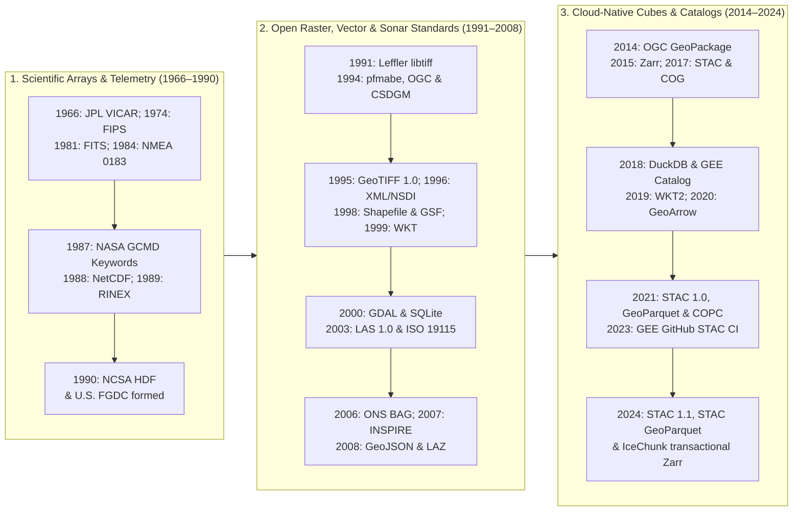
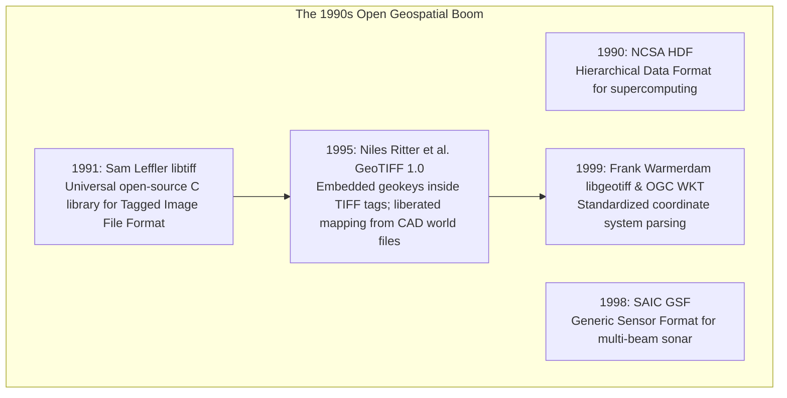
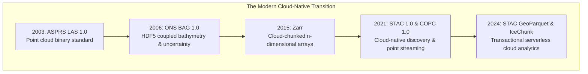

# Chapter 19: Key File Formats, Metadata, Archiving, and Data Discovery (STAC & Beyond)

*How elevation data is encoded on disk and in the cloud, documented for posterity, discovered via modern catalogs, and preserved across decades.*

---

## 19.5 Historical Evolution of Geospatial Formats, Metadata, and Catalogs (`gis-history` Context)

The evolution of geospatial file formats, metadata standards, and discovery catalogs—documented in the [`gis-history`](../00-front-matter/gis-history-timeline.md) chronological archive—spans six decades of computer science: from 1960s planetary magnetic tape labels to self-describing binary formats (`FITS`, `NetCDF`, `GeoTIFF`, `LAS`, `BAG`) and 2020s cloud-native, range-request-streamable containers (`COG`, `COPC`, `Zarr`, `STAC GeoParquet`, `IceChunk`).

---

### 19.5.1 Early Planetary Imaging and Scientific Arrays (1966–1989)

#### 1966: NASA JPL VICAR
In 1966, researchers at NASA's Jet Propulsion Laboratory developed **VICAR** (Video Image Communication and Retrieval) to process robotic planetary television scans (Ranger, Surveyor, Mariner). VICAR introduced the concept of an ASCII system label prepended to binary image arrays, establishing the ancestor of self-describing raster formats.

#### 1981: FITS (Flexible Image Transport System)
In 1981, astronomers standardized **FITS** (Wells et al., 1981) to interchange radio, optical, and planetary digital arrays across international observatories. FITS formalized the decoupling of human-readable ASCII header cards from raw multidimensional binary arrays.

#### 1984: NMEA 0183
In 1984, the National Marine Electronics Association published **NMEA 0183**, defining standard comma-delimited ASCII strings broadcast over RS-232 serial cables ($4800\text{ baud}$). It remains the baseline data interface for maritime GPS and sonar telemetry.

#### 1988–1989: NetCDF and RINEX
* **NetCDF (1988):** Unidata developed the **Network Common Data Form (NetCDF)** to provide machine-independent array access for atmospheric, oceanographic, and climate modeling. Governed by Climate and Forecast (CF) conventions, NetCDF became the global benchmark for geophysical and ocean elevation grids.
* **RINEX (1989):** Werner Gurtner and Gerhard Mader developed **RINEX** (Receiver Independent Exchange Format) at the University of Bern, enabling researchers to process GPS carrier phase data across competing receiver hardware (Trimble, Leica, Ashtech, TI-4100).

---

### 19.5.2 The Digital Cartography and Open Standards Boom (1990–1999)

#### 1991: Sam Leffler and `libtiff`
In 1991, Silicon Graphics engineer Sam Leffler released **`libtiff`**, an open-source C library for reading and writing the Tagged Image File Format (TIFF). `libtiff` became the foundational raster substrate upon which all modern spatial imagery and elevation formats were built.

#### 1994: The OGC, FGDC Metadata, and NAVO `pfmabe`
* **Open Geospatial Consortium (1994):** Founded as the Open GIS Consortium, the OGC united commercial software vendors, government agencies, and academics to develop non-proprietary spatial standards.
* **FGDC CSDGM (1994):** Presidential Executive Order 12906 mandated federal metadata compliance, establishing the first standardized inventory of U.S. geospatial data assets.
* **NAVO `pfmabe` (1994):** The Naval Oceanographic Office created the **Pure File Magic (PFM)** format to manage gigabyte-scale multibeam bathymetry, introducing the concept of spatial binning and interactive ping editing.

#### 1995: Niles Ritter and the GeoTIFF 1.0 Standard
In 1995, Niles Ritter and an informal working group published the **GeoTIFF 1.0 specification**. By embedding georeferencing coordinate systems and map projection parameters directly inside private TIFF metadata tags (`GeoKeyDirectoryTag`, `ModelTiepointTag`, `ModelPixelScaleTag`), GeoTIFF eliminated the fragile practice of pairing naked images with separate `.tfw` world files.

#### 1998–1999: Shapefile, GSF, `libgeotiff`, and GDAL
* **1998 (Shapefile & GSF):** Esri published the open technical description for the Shapefile, while SAIC created the Generic Sensor Format (GSF) for hydrographic multibeam bathymetry.
* **1999 (`libgeotiff` & WKT):** Frank Warmerdam released `libgeotiff`, and the OGC standardized Well-Known Text (WKT).
* **2000 (GDAL):** Frank Warmerdam established the **Geospatial Data Abstraction Library (GDAL)**, which created a universal, open-source abstract data model for all raster formats, democratizing planetary elevation analysis.

---

### 19.5.3 Standardization and the Cloud-Native Revolution (2000–2024)

* **2003 (ASPRS LAS & ISO 19115):** ASPRS published LAS 1.0, and ISO standardized ISO 19115:2003 for international geographic metadata.
* **2006 (Bathymetric Attributed Grid):** Open Navigation Surface standardized BAG 1.0, mandating co-registered elevation and uncertainty grids for hydrography.
* **2014–2015 (GeoPackage & Zarr):** OGC standardized GeoPackage (an open SQLite container replacing Shapefiles), while Alistair Miles created **Zarr**, partitioning multidimensional arrays into compressed cloud objects.
* **2017–2021 (STAC, COPC, GeoParquet, DuckDB, WKT2, GeoArrow):** The cloud-native geospatial revolution accelerated rapidly: **STAC** and **COG** were initiated in 2017; **DuckDB** and the public **Google Earth Engine Data Catalog** launched in 2018; **OGC WKT2:2019 (ISO 19162)** standardized dynamic and compound CRS definitions in 2019; **GeoArrow** began in 2020; and **STAC 1.0.0**, **GeoParquet**, and **COPC 1.0** were released in 2021.
* **2023–2024 (Earth Engine GitHub STAC Catalog, STAC 1.1.0, STAC GeoParquet, IceChunk):** In 2023, Google open-sourced the Earth Engine Data Catalog on GitHub with automated Jsonnet and STAC schema CI validation. In 2024, **STAC 1.1.0** finalized core asset roles, **STAC GeoParquet** enabled serverless SQL querying over tens of millions of tiles via DuckDB, and **IceChunk** introduced transactional, Git-like cloud array storage on top of Zarr.

---

### 19.5.4 Master Chronological Table of Formats, Metadata, and Catalogs

| Year | Historical Milestone & Architects | Format / Standard Category | Enduring Impact on Elevation & Bathymetric Pipelines |
| :--- | :--- | :--- | :--- |
| **1966** | **NASA JPL VICAR** (*Robert Nathan et al.*, JPL) | Self-describing planetary raster | Prepends ASCII key-value labels to binary arrays for lunar/planetary DEMs. |
| **1974** | **FIPS 5-2** (*U.S. NBS / NIST*) | Administrative geocode | Standardizes state and county numeric codes for U.S. DEM and flood map catalogs. |
| **1981** | **FITS** (*D. C. Wells, E. W. Greisen, & R. H. Harten*) | Scientific multi-extension array | Standardizes 80-character ASCII header cards + IEEE binary arrays across astronomy/planetary science. |
| **1984** | **NMEA 0183** (*National Marine Electronics Assoc.*) | Real-time serial ASCII telemetry | Universal marine/airborne sentence interface (`$GPGGA`, `$GPZDA`, `$SDDBT`). |
| **1987** | **NASA GCMD Science Keywords** (*NASA*) | Controlled metadata taxonomy | Standardizes hierarchical Earth science discovery keywords (`TOPOGRAPHY`, `BATHYMETRY`). |
| **1988** | **NetCDF 1.0** (*Glenn Davis, Russ Rew et al.*, Unidata) | Machine-independent array container | Becomes the standard container for `GMT` grids, `GEBCO`, and oceanographic models. |
| **1989** | **RINEX v1** (*Werner Gurtner & Gerhard Mader*) | Vendor-neutral GNSS observables | Enables multi-vendor carrier-phase PPK and PPP GNSS trajectory post-processing. |
| **1990** | **NCSA HDF & Formation of U.S. FGDC** (*NCSA*; *OMB*) | Hierarchical container & governance | HDF (and HDF5) underpins `BAG`, `IHO S-102`, `ICESat-2`, and `GEDI` products. |
| **1991** | **`libtiff`** (*Sam Leffler*, Silicon Graphics) | Open-source C raster library | Provides the tiled, multi-band binary TIFF engine underlying GeoTIFF and COG. |
| **1994** | **NAVO `pfmabe` (PFM), OGC Founded, & FGDC CSDGM** | 3D sonar bin store & standards | `pfmabe` pioneers 3D binned multibeam editing; OGC and FGDC CSDGM formalize interoperability. |
| **1995–1996**| **GeoTIFF 1.0, W3C XML, & U.S. NSDI** (*N. Ritter & M. Ruth*) | Embedded georeferenced TIFF | Embeds CRS and affine tiepoints/scales directly inside TIFF tags, eliminating `.tfw` fragility. |
| **1998** | **Esri Shapefile Spec & SAIC GSF** (*Esri*; *SAIC/NAVO*) | Vector & multibeam ping formats | GSF standardizes open archival of ray-traced multibeam pings and per-beam TPU. |
| **1999–2000**| **`libgeotiff`, OGC WKT, SQLite, & GDAL** (*F. Warmerdam*; *D. R. Hipp*)| Open translation & database layer | `GDAL` unifies reading/writing of 150+ raster DEM formats; SQLite powers SpatiaLite/GeoPackage. |
| **2003** | **ASPRS LAS 1.0 & ISO 19115:2003** (*ASPRS*; *ISO/TC 211*) | Binary point clouds & ISO metadata | Standardizes discrete LiDAR point attributes, return numbers, and international metadata XML. |
| **2006–2008**| **ONS BAG 1.0, EU INSPIRE, GeoJSON, & `LASzip` (LAZ)** | Coupled uncertainty & compression | BAG mandates co-registered elevation + $\text{TVU}_{95\%}$; Isenburg's LAZ achieves $10:1$ lossless LiDAR compression. |
| **2014–2015**| **OGC GeoPackage 1.0 & Zarr** (*OGC*; *Alistair Miles*) | SQLite container & cloud chunks | GeoPackage replaces Shapefiles; Zarr maps $N$-D arrays directly to cloud object storage keys. |
| **2017–2020**| **STAC, COG, DuckDB, Earth Engine Catalog, WKT2, & GeoArrow** | Cloud-native discovery & compute | Enables HTTP `Range` streaming of DEM tiles (`COG`), `COMPOUNDCRS` WKT2, and zero-copy columnar arrays. |
| **2021–2024**| **STAC 1.0/1.1, COPC 1.0, STAC GeoParquet, & IceChunk** | Serverless cloud point/array stores | `COPC` brings octree HTTP range streaming to LAZ 1.4; `STAC GeoParquet` + `IceChunk` make petabyte archives queryable and transactional. |
