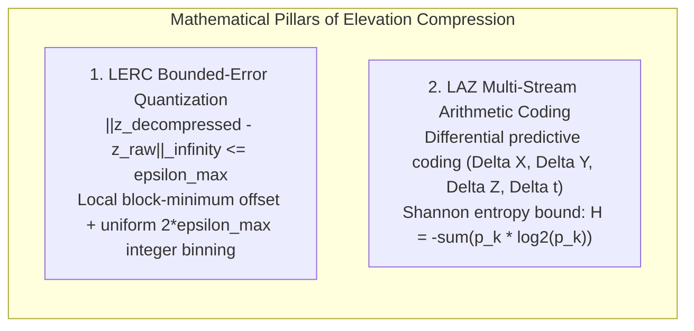
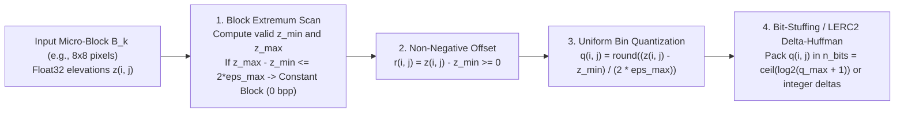
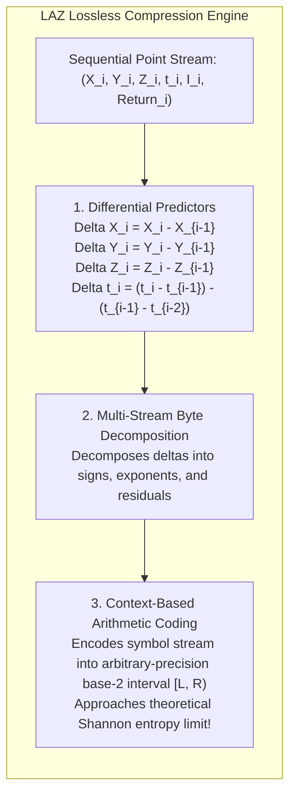

# Chapter 19: Key File Formats, Metadata, Archiving, and Data Discovery (STAC & Beyond)

*How elevation data is encoded on disk and in the cloud, documented for posterity, discovered via modern catalogs, and preserved across decades.*

---

## 19.6 Mathematical Foundations of Elevation Compression

Storing petabytes of high-resolution digital elevation models requires compression algorithms that minimize bit storage while guaranteeing metrological rigor. Standard image compression algorithms (such as JPEG) apply lossy Discrete Cosine Transforms that introduce high-frequency ringing and corrupt numerical elevation values. 

This section derives the two foundational mathematical models governing modern elevation compression: the bounded-error quantization model of LERC (Limited Error Raster Compression), and the multi-stream arithmetic coding entropy bound governing LAZ point cloud compression.

---

### 19.6.1 LERC: Bounded-Error Block-Minimum Offset Quantization

Limited Error Raster Compression (**LERC**) is a controlled-precision lossy (or lossless when $\epsilon_{\max} = 0$) compression algorithm engineered specifically for floating-point and integer rasters. Unlike transform-based compressors, LERC provides a strict $L_\infty$ mathematical guarantee: **no decompressed pixel value will ever deviate from its original uncompressed value by more than a user-declared threshold $\epsilon_{\max}$**:

$$\|\hat{\mathbf{Z}} - \mathbf{Z}\|_\infty = \max_{i, j} |\hat{z}_{i, j} - z_{i, j}| \le \epsilon_{\max}$$

#### Step 1: Micro-Block Partitioning and Local Reference Offset
LERC divides each tile into small rectangular micro-blocks $B_k$ (typically $8 \times 8$ pixels), encodes any NoData mask as a 1-bit validity bitmap, and computes the local block minimum $z_{\min} = \min_{(i,j) \in B_k} z_{i,j}$ and maximum $z_{\max} = \max_{(i,j) \in B_k} z_{i,j}$:
1. If all pixels in block $B_k$ are invalid (`NoData`), LERC writes a 2-bit **Empty** block header ($0\text{ bits/pixel}$).
2. If $z_{\max} - z_{\min} = 0$ (or $z_{\max} - z_{\min} \le 2\epsilon_{\max}$, so the midpoint $\frac{1}{2}(z_{\min} + z_{\max})$ satisfies the $\epsilon_{\max}$ bound everywhere in $B_k$), LERC flags the block as **Constant** and stores a single `Float32` scalar ($0\text{ residual bits/pixel}$).
3. Otherwise, LERC stores $z_{\min}$ in the micro-block header and shifts all valid pixels in $B_k$ into non-negative local offsets:
   $$r_{i, j} = z_{i, j} - z_{\min} \ge 0$$

#### Step 2: Bounded Uniform Quantization
To guarantee that maximum reconstruction error never exceeds $\epsilon_{\max}$, the continuous non-negative offset $r_{i,j} = z_{i,j} - z_{\min}$ is quantized into discrete unsigned integer bins of width $2 \epsilon_{\max}$:

$$q_{i, j} = \left\lfloor \frac{z_{i, j} - z_{\min}}{2 \epsilon_{\max}} + \frac{1}{2} \right\rfloor = \operatorname{round}\left( \frac{z_{i, j} - z_{\min}}{2 \epsilon_{\max}} \right)$$

where $\lfloor \cdot \rfloor$ denotes the floor function. (In LERC2, integer spatial differencing $\Delta q$ along rows/columns and canonical Huffman coding are optionally applied to $q_{i,j}$ whenever a sloped hillside makes integer deltas smaller than raw bit-stuffed $q_{i,j}$.)

#### Step 3: Decompression and Mathematical Error Bound Proof
During decompression, the reconstructed elevation $\hat{z}_{i, j}$ is recovered via (clamped to $z_{\max}$ at the upper bin edge):

$$\hat{z}_{i, j} = \min\!\left(z_{\min} + q_{i, j} \cdot (2 \epsilon_{\max}), \; z_{\max}\right)$$

#### Proof of the Error Bound
Before upper-bound clamping (which can only shrink the error when $z_{i,j} \le z_{\max}$), the difference $e_{i, j}$ between the reconstructed value $z_{\min} + 2\epsilon_{\max}\,q_{i,j}$ and the true raw elevation $z_{i, j}$ is:

$$e_{i, j} = \left( z_{\min} + q_{i, j} \cdot 2\epsilon_{\max} \right) - z_{i, j} = 2\epsilon_{\max} \left( q_{i, j} - \frac{z_{i, j} - z_{\min}}{2\epsilon_{\max}} \right)$$

By definition of nearest-integer rounding, for any real number $u \in \mathbb{R}$:

$$\left| \operatorname{round}(u) - u \right| \le \frac{1}{2}$$

Substituting $u = \frac{z_{i, j} - z_{\min}}{2\epsilon_{\max}}$:

$$|e_{i, j}| = 2\epsilon_{\max} \left| q_{i, j} - u \right| \le 2\epsilon_{\max} \left( \frac{1}{2} \right) = \epsilon_{\max}$$

Therefore:

$$\max_{i, j} |\hat{z}_{i, j} - z_{i, j}| \le \epsilon_{\max} \quad \text{(Q.E.D.)}$$

The reconstructed elevation is mathematically guaranteed to fall within the interval $[z_{i, j} - \epsilon_{\max}, \, z_{i, j} + \epsilon_{\max}]$. 

#### Step 4: Bit-Packing Compression Ratio
Let $q_{\max} = \max q_{i, j}$. The integer bins $q_{i, j}$ are packed into the minimum number of bits required:

$$b = \lceil \log_2 (q_{\max} + 1) \rceil \quad [\text{bits / pixel}]$$

If terrain within an $8 \times 8$ block has a residual spread of $0.08\text{ m}$ and $\epsilon_{\max} = 0.005\text{ m}$ ($5\text{ mm}$), then $q_{\max} = \frac{0.08}{0.010} = 8 \implies b = 4\text{ bits/pixel}$. The block achieves an immediate **$8:1$ compression ratio** ($32\text{ bits} \to 4\text{ bits}$).

---

### 19.6.2 LAZ: Multi-Stream Context-Based Arithmetic Coding

The **LAZ format** (Martin Isenburg's `LASzip`) achieves lossless compression of massive 3D point clouds by combining **differential predictive modeling** with **adaptive arithmetic coding**.

#### 1. Differential Predictors and Delta Modeling
Because LiDAR points are recorded sequentially along scanlines, adjacent points are separated by small spatial increments. LAZ computes first- and second-order differences:
* **Spatial Deltas:** $\Delta X_i = X_i - X_{i-1}, \quad \Delta Y_i = Y_i - Y_{i-1}, \quad \Delta Z_i = Z_i - Z_{i-1}$
* **Second-Order Timestamp Acceleration:** Because laser pulses fire at constant repetition rates ($100\text{–}1000\text{ kHz}$), GPS timestamps increment with nearly constant velocity. LAZ predicts timestamp $t_i^{\text{pred}} = 2 t_{i-1} - t_{i-2}$, encoding only the second-order residual:
  $$\Delta^2 t_i = t_i - (2 t_{i-1} - t_{i-2}) \approx 0$$

#### 2. The Shannon Entropy Bound
By Claude Shannon's source coding theorem (1948), the minimum theoretical average number of bits required to encode a discrete sequence of symbols $S = \{s_1, \dots, s_K\}$ with probability distribution $p(s_k)$ is the **Shannon Entropy $H(S)$**:

$$H(S) = -\sum_{k=1}^K p(s_k) \log_2 p(s_k) \quad [\text{bits / symbol}]$$

In raw LAS point clouds, coordinates have near-uniform bit distributions, yielding high entropy ($H \approx 28\text{–}32\text{ bits/coordinate}$). 

However, the differential delta streams $\Delta X, \Delta Y, \Delta Z$ follow a sharply peaked **Laplacian (double-exponential) distribution** centered at zero:

$$p(\Delta x) = \frac{1}{2b} \exp\left( -\frac{|\Delta x|}{b} \right)$$

The probability of zero residual $p(0)$ is extremely high ($\approx 0.70\text{–}0.90$). The entropy of the delta stream collapses to $H \approx 2\text{–}4\text{ bits/symbol}$.

#### 3. Adaptive Arithmetic Coding
Unlike Huffman coding (which must allocate an integer number of bits $\ge 1$ to every symbol), **arithmetic coding** encodes an entire sequence of symbols into a single arbitrary-precision floating-point sub-interval $[L, R) \subset [0, 1)$:
* The interval is initialized to $[0, 1)$.
* For each symbol $s_k$, the interval is narrowed proportionally to its cumulative probability:
  $$L_{\text{new}} = L_{\text{old}} + (R_{\text{old}} - L_{\text{old}}) \sum_{j < k} p(s_j)$$
  $$R_{\text{new}} = L_{\text{old}} + (R_{\text{old}} - L_{\text{old}}) \sum_{j \le k} p(s_j)$$
* By updating context-specific probability models dynamically as new points arrive, `LASzip` achieves an average bit-rate within $0.1\%$ of the theoretical Shannon entropy bound, compressing billions of LiDAR points by **$70\%\text{–}90\%$ without losing a single bit of information**.

#### 4. Analytical Entropy of Laplacian Coordinate Deltas and Byte-Plane Shuffling (`PREDICTOR=3`)
Why does differential prediction reduce the Shannon entropy of both point clouds (`LAZ`) and floating-point elevation rasters (`ZSTD`/`DEFLATE` with `PREDICTOR=3`) so dramatically?
1. **Differential Entropy of a Quantized Laplacian Residual:** For a continuous zero-mean Laplacian delta distribution $p(\Delta z) = \frac{1}{2b}\exp\left(-\frac{|\Delta z|}{b}\right)$ with scale parameter $b = \mathbb{E}[|\Delta z|]$ (where the variance is $\sigma_{\Delta z}^2 = 2b^2$), the differential entropy in bits is $h(p) = -\int_{-\infty}^\infty p(u)\log_2 p(u)\,du = \log_2(2 e b)$. When quantized into integer bins of step size $\Delta q \ll b$, the discrete Shannon entropy $H(S)$ is given by:
   $$H(S) \approx \log_2\left(\frac{2 e \, b}{\Delta q}\right) = \log_2\left(\frac{b}{\Delta q}\right) + \log_2(2e) \approx \log_2\left(\frac{b}{\Delta q}\right) + 2.4427\text{ bits/sample}$$
   * **Worked Numerical Comparison (LAS vs. LAZ):** In a raw `LAS 1.4` file with $\Delta q = 0.001\text{ m}$ ($1\text{ mm}$) across a $10\text{ km}$ tile, raw $X, Y, Z$ integers span $\sim 10^7$ bins ($H_{\text{raw}} \approx \log_2(10^7) \approx 23.25\text{ bits}$, stored in $32\text{ bits}$ per coordinate $= 96\text{ bits/point}$). Along a scanline where adjacent LiDAR returns differ by mean vertical delta $b_z = 0.015\text{ m}$ ($15\text{ mm}$) and horizontal delta $b_{xy} = 0.040\text{ m}$ ($40\text{ mm}$), the theoretical entropy of the delta streams drops to:
     $$H(\Delta Z) \approx \log_2\left(\frac{0.015}{0.001}\right) + 2.44 = 3.91 + 2.44 = \mathbf{6.35\text{ bits}}, \qquad H(\Delta X) \approx \log_2(40) + 2.44 = \mathbf{7.76\text{ bits}}$$
     reducing the 96-bit $(X,Y,Z)$ payload to $\approx 21.9\text{ bits/point}$ ($4.4:1$ lossless coordinate compression, and $>8:1$ across the full 30- to 68-byte PDRF record once constant-rate GPS time $\Delta^2 t_i \approx 0$ and zero-valued bitfields are arithmetic-coded!).
2. **Floating-Point Byte-Shuffle Predictor (`PREDICTOR=3` in TIFF / COG / Zarr `ByteShuffle`):** In an uncompressed IEEE 754 `Float32` DEM array of $N$ pixels ($4N$ bytes), each pixel consists of 4 bytes $[B_3, B_2, B_1, B_0]$ where $B_3$ holds the sign and upper 7 bits of the exponent, $B_2$ holds the lowest exponent bit and top 7 mantissa bits, and $B_1, B_0$ hold the lower 16 bits of mantissa. Because adjacent pixels on a hillslope have nearly identical exponents ($B_3$ and upper $B_2$), interleaving $[B_3, B_2, B_1, B_0]$ pixel-by-pixel breaks up run-length patterns every 4 bytes. Setting `PREDICTOR=3` in `libtiff`/GDAL executes two reversible lossless transforms before `ZSTD` or `DEFLATE`:
   * **Stage 1 (Byte-Plane Transpose):** De-interleaves the $4N$ bytes into four contiguous byte planes: all $N$ sign/exponent bytes $[B_{3,1}, \dots, B_{3,N}]$, followed by all $N$ high-mantissa bytes $[B_{2,1}, \dots, B_{2,N}]$, mid-mantissa bytes $[B_{1,1}, \dots, B_{1,N}]$, and least-significant bytes $[B_{0,1}, \dots, B_{0,N}]$.
   * **Stage 2 (Horizontal Byte Differencing):** Replaces each byte $b_k$ along each scanline with its modulo-256 first difference $\Delta b_k = (b_k - b_{k-1}) \bmod 256$. Across the $B_3$ and $B_2$ planes, $\Delta b_k = 0$ for $>95\%$ of pixels, compressing those two planes by $>20:1$ and shrinking the overall lossless `Float32` COG by $45\%\text{–}75\%$!
