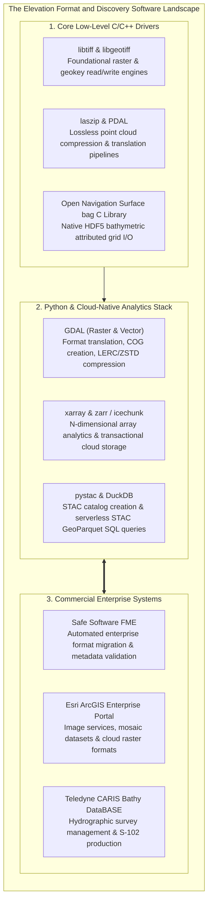

# Chapter 19: Key File Formats, Metadata, Archiving, and Data Discovery (STAC & Beyond)

*How elevation data is encoded on disk and in the cloud, documented for posterity, discovered via modern catalogs, and preserved across decades.*

---

## 19.7 Software Ecosystem for Formats, Discovery, and Archiving

The software ecosystem managing elevation data formats spans low-level C libraries, command-line translators, Python multidimensional array engines, and enterprise hydrographic database suites.



---

### 19.7.1 Open-Source Tools and Pipelines

#### Fast STAC GeoParquet Querying with DuckDB
With the standardization of STAC GeoParquet, searching millions of cloud-optimized elevation models across global cloud storage requires only a standard SQL client:

```python
"""Querying Global LiDAR and DEM Assets using DuckDB and STAC GeoParquet."""

import duckdb

# Connect to in-memory DuckDB database and install spatial extensions
conn = duckdb.connect()
conn.execute("INSTALL spatial; LOAD spatial;")
conn.execute("INSTALL httpfs; LOAD httpfs;")

# Query California 3DEP 1m COGs within a bounding box using native Parquet structs
query = """
SELECT 
    id, 
    datetime, 
    "proj:epsg" AS epsg,
    assets.elevation.href AS s3_cog_url
FROM read_parquet('s3://stac-geoparquet-registry/usgs_3dep_national.parquet')
WHERE bbox.xmax >= -122.50 AND bbox.xmin <= -122.35
  AND bbox.ymax >= 37.70   AND bbox.ymin <= 37.85
  AND ST_Intersects(geometry, ST_MakeEnvelope(-122.50, 37.70, -122.35, 37.85))
  AND "raster:bands"[1].spatial_resolution <= 1.0
LIMIT 10;
"""

df_scenes = conn.execute(query).df()
for _, row in df_scenes.iterrows():
  print(f"Scene: {row['id']} | EPSG: {row['epsg']} | URL: {row['s3_cog_url']}")
```

#### Multidimensional Array Processing with `xarray` and `zarr`
For continental-scale elevation models (such as global Copernicus 30m or GEBCO ocean bathymetry), data is managed as chunked multidimensional arrays:

```python
"""Accessing and Processing Chunked Elevation Arrays using xarray and Zarr."""

import xarray as xr

# Open a cloud-native Zarr elevation store directly from cloud object storage
ds = xr.open_zarr(
    "s3://copernicus-dem-zarr/copernicus_30m.zarr", consolidated=True
)

# Extract an elevation slice and compute regional statistics lazily via Dask
subset = ds["elevation"].sel(latitude=slice(38.0, 37.0), longitude=slice(-122.5, -121.5))
mean_elev = subset.mean().compute()
print(f"Mean Regional Elevation: {mean_elev.values:.2f} meters")
```

#### Converting Point Clouds to Cloud-Optimized Point Clouds (COPC) with PDAL and Creating COGs with GDAL
Transforming legacy uncompressed LAS or raw GeoTIFFs into streaming cloud-native **COPC** and **COG** deliverables using `PDAL` and `GDAL`:

```bash
# 1. Convert raw LAS into Cloud-Optimized Point Cloud (COPC 1.0) with LAZ 1.4 compression
pdal translate raw_flight_strip.las output_cloud.copc.laz \
    --writers.copc.forward=all \
    --writers.copc.a_srs="EPSG:6339+5703"

# 2. Create a Lossless Cloud-Optimized GeoTIFF (COG) with ZSTD + Floating-Point Predictor 3
gdal_translate -of COG raw_float32_dem.tif coastal_dem_lossless_cog.tif \
    -co BLOCKSIZE=512 \
    -co COMPRESS=ZSTD \
    -co LEVEL=12 \
    -co PREDICTOR=3 \
    -co OVERVIEWS=IGNORE_EXISTING \
    -co OVERVIEW_RESAMPLING=AVERAGE \
    -a_nodata -9999.0

# 3. Create a Bounded-Error LERC Cloud-Optimized GeoTIFF (Guaranteed max error <= 2 mm)
#    For shoal-biased positive-up bathymetry (z <= 0), pre-build 'max' overviews with gdaladdo
#    and preserve them in the COG via OVERVIEWS=FORCE_USE_EXISTING:
cp raw_float32_dem.tif tmp_shoal_oview.tif
gdaladdo -r max tmp_shoal_oview.tif 2 4 8 16
gdal_translate -of COG tmp_shoal_oview.tif coastal_dem_lerc_2mm_cog.tif \
    -co BLOCKSIZE=512 \
    -co COMPRESS=LERC_ZSTD \
    -co MAX_Z_ERROR=0.002 \
    -co OVERVIEWS=FORCE_USE_EXISTING
```

#### Inspecting Hydrographic BAG / VR-BAG Files and Transactional `IceChunk` Stores in Python
Because Open Navigation Surface **BAG** (`.bag`) and **IHO S-102** files are structured HDF5 containers, analysts can inspect their positive-up `/BAG_root/elevation`, $95\%$ `/BAG_root/uncertainty`, designated-sounding `/BAG_root/tracking_list`, and Variable-Resolution (`VR-BAG`) refinements directly in Python using `h5py` or `osgeo.gdal`, and version-control multi-temporal DEM cubes using **`icechunk`** and **`xarray`**:

```python
"""Inspecting Open Navigation Surface BAG HDF5 structure and committing to IceChunk."""

import h5py
import icechunk
import numpy as np
import xarray as xr


def audit_hydrographic_bag(bag_path: str) -> dict:
  """Audits a hydrographic BAG / VR-BAG file for positive-up elevation, TVU_95, and tracking list."""
  with h5py.File(bag_path, "r") as f:
    root = f["BAG_root"]
    elev = root["elevation"][:]  # Stored positive-up (z <= 0 below chart datum!)
    uncert = root["uncertainty"][:]  # 95% Total Vertical Uncertainty (TVU_95 > 0)
    tracking = root["tracking_list"][:]  # Designated shoal overrides

    # BAG specification uses 1000000.0 (1e6) as the official NoData sentinel
    valid = (elev < 999999.0) & (uncert < 999999.0)
    z_valid = elev[valid]
    tvu_valid = uncert[valid]
    has_vr = "varres_refinements" in root

  return {
      "shoalest_elevation_z_m": round(float(np.max(z_valid)), 3),
      "deepest_elevation_z_m": round(float(np.min(z_valid)), 3),
      "median_tvu95_m": round(float(np.median(tvu_valid)), 3),
      "max_tvu95_m": round(float(np.max(tvu_valid)), 3),
      "designated_sounding_overrides": int(len(tracking)),
      "is_variable_resolution_vr_bag": has_vr,
  }


def commit_dem_update_to_icechunk(
    ds_patch: xr.Dataset, bucket: str, prefix: str
) -> str:
  """Writes a versioned, ACID-transactional DEM update into a cloud IceChunk Zarr repository."""
  storage = icechunk.s3_storage(bucket=bucket, prefix=prefix, from_env=True)
  repo = icechunk.Repository.open_or_create(storage)
  session = repo.writable_session("main")

  # Write or update multidimensional (time, y, x) elevation + uncertainty cube (Zarr v3)
  ds_patch.to_zarr(
      session.store, mode="a", zarr_format=3, consolidated=False
  )
  snapshot_id = session.commit(
      "Ingest 2025 post-storm bathy-lidar survey patch"
  )
  return snapshot_id
```

#### Creating and Validating STAC Items with `pystac`
To ensure that newly generated COG and COPC deliverables pass automated schema validation (such as the Google Earth Engine STAC checker or Radiant Earth `stac-validator`), metadata should be constructed programmatically using `pystac`:

```python
"""Creating a Schema-Validated STAC 1.1.0 Item for a Bare-Earth COG DEM."""

from datetime import datetime, timezone
import pystac

item = pystac.Item(
    id="USGS_1M_10_x55y419_CA_NoCal_2024",
    geometry={
        "type": "Polygon",
        "coordinates": [[
            [-122.45, 37.80],
            [-122.40, 37.80],
            [-122.40, 37.85],
            [-122.45, 37.85],
            [-122.45, 37.80],
        ]],
    },
    bbox=[-122.45, 37.80, -122.40, 37.85],
    datetime=datetime(2024, 5, 10, 18, 0, tzinfo=timezone.utc),
    stac_extensions=[
        "https://stac-extensions.github.io/projection/v2.0.0/schema.json",
        "https://stac-extensions.github.io/scientific/v1.0.0/schema.json",
    ],
    properties={
        "proj:code": "EPSG:6339",
        "sci:citation": "USGS 3DEP 1m Hydro-Flattened Bare-Earth DTM (2024)",
    },
)
item.add_asset(
    key="elevation",
    asset=pystac.Asset(
        href="https://storage.googleapis.com/usgs-3dep-cogs/USGS_1M_10_x55y419.tif",
        media_type=pystac.MediaType.COG,
        roles=["data", "elevation", "dtm"],
        title="1m Hydro-Flattened Bare-Earth DTM (NAVD88 / GEOID18)",
    ),
)
```

In addition, the open-source **`stac-geoparquet`** Python library (`stac_geoparquet.arrow.parse_stac_items_to_arrow`) compiles collections of validated `pystac.Item` objects directly into Hilbert-sorted Apache GeoParquet catalogs (`planetary_elevation.parquet`) with embedded WKB bounding polygons and row-group `bbox` statistics. When paired with `GDAL` virtual file systems (`/vsicurl/`, `/vsis3/`, `/vsigs/`), a downstream worker can query the `stac-geoparquet` catalog in DuckDB and pass the resulting COG URLs directly to `gdal.Warp` or `rioxarray.open_rasterio("https://.../tile.tif", chunks={"x": 1024, "y": 1024})`—streaming only the exact compressed $512 \times 512$ byte ranges intersecting the study watershed without ever staging intermediate files to local disk.

For low-level C and C++ hydrographic pipelines, the Open Navigation Surface **`bag` library** (`libbag`, maintained by NOAA and the ONS Working Group on GitHub) provides native C++17 and Python (`bagPy`) bindings that validate the embedded ISO 19115 XML schema against the official ONS XSD definitions, read and write Variable-Resolution (`VR-BAG`) refinement grids, and compute X.509 PKI cryptographic digital signatures over `/BAG_root` (`VerifyBag` / `SignBag`) to verify hydrographic office authenticity and prevent unauthorized data tampering inside shipboard S-100/S-102 ECDIS navigation systems.

---

### 19.7.2 Commercial and Enterprise Systems

#### Safe Software FME (Feature Manipulation Engine)
FME is the industry-standard geospatial ETL platform:
* **Format Migration:** Translates between conflicting military, CAD, and GIS formats (e.g., converting MicroStation `.dgn` bridge breaklines and AutoCAD `.dwg` contours into an OGC GeoPackage with explicit 3D elevations).
* **Automated Metadata Validation:** Runs automated validation workflows ensuring that incoming contractor DEMs comply strictly with ISO 19115-1 and USGS 3DEP metadata standards before ingestion into enterprise databases.

#### Esri ArcGIS Enterprise Portal and Image Server
* **Mosaic Datasets:** Dynamic enterprise raster catalogs that catalog thousands of individual GeoTIFF/COG tiles, applying on-the-fly orthorectification, datum shifts, and hillshading without duplicating underlying pixels.
* **Cloud Raster Format (CRF):** Esri's internal multi-threaded, tiled raster storage format optimized for parallel GPU cluster processing and deep learning inferencing.

#### Teledyne CARIS Bathy DataBASE
The enterprise hydrographic data management platform deployed across national hydrographic offices (NOAA, UKHO, Australian Hydrographic Office):
* **S-102 and BAG Production:** Manages petabytes of validated multibeam bathymetry, tracking lists, and uncertainty surfaces.
* **Dynamic Surface Compilation:** Combines historical smooth sheets, modern high-density multibeam, and satellite-derived bathymetry (SDB) into seamless navigation surfaces with automated shoal deconfliction.

---

### 19.7.3 Software Comparison Matrix

| Software / Library | License Model | Primary Format Strengths | Execution Environment | Key Role in Elevation Pipelines |
| :--- | :--- | :--- | :--- | :--- |
| **GDAL** | Open-Source (MIT/X) | GeoTIFF, COG, BAG, NetCDF, GeoPackage | CLI / C++ / Python API | Universal translation, pyramid creation, compression. |
| **PDAL** | Open-Source (BSD) | LAS, LAZ, COPC, E57, EPT | CLI / C++ / Python API | 3D point cloud filtering, indexing, and COPC creation. |
| **DuckDB** | Open-Source (MIT) | STAC GeoParquet, Parquet, GeoPackage | In-process SQL engine | Fast spatial catalog querying across millions of scenes. |
| **`xarray` / `zarr`** | Open-Source (Apache/MIT)| Zarr, NetCDF, OpenND | Python / Dask | Distributed cloud-native multidimensional array analysis. |
| **IceChunk** | Open-Source (Apache 2.0)| Transactional Zarr Array Store | Rust / Python | ACID-compliant version control for massive DEM stores. |
| **Safe FME** | Commercial (Safe) | 450+ CAD/BIM/GIS formats | Desktop / Enterprise Server | Multi-format ETL, CAD-to-GIS breakline conversion. |
| **ArcGIS Enterprise** | Commercial (Esri) | CRF, Mosaic Dataset, COG | Enterprise Cloud Server | Dynamic image services, web mapping, geoprocessing. |
| **CARIS Bathy DataBASE**| Commercial (Teledyne) | BAG, VR-BAG, S-102, GSF | Enterprise Desktop / Server | Hydrographic data validation, S-102 chart compilation. |
