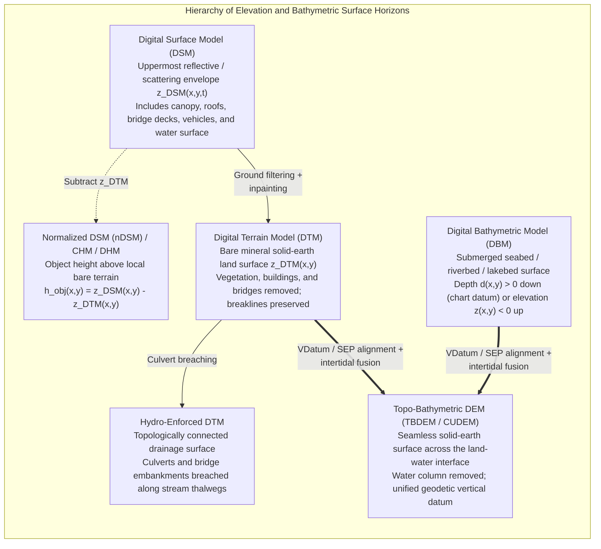
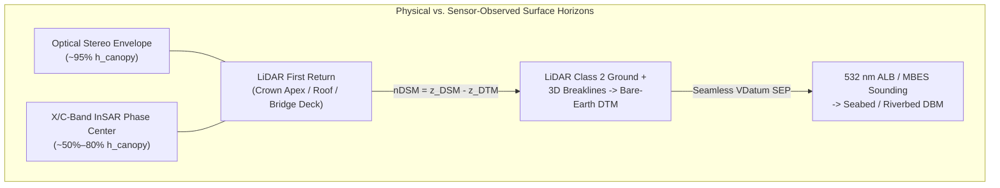

# Chapter 20: Naming, Ontologies, and the Confusing Definitions of Surface Objects

*What is "the ground"? What each DSM or DTM dataset includes or excludes, and the ontological grey zones of buildings, roads, bridges, pipes, wires, solar panels, and indoor space.*

Before an elevation model can be analyzed, differenced, or coupled to a physical solver, practitioners must establish what physical interface the stored coordinates $z(x, y, t)$ actually represent. Across geodesy, photogrammetry, terrestrial laser scanning, interferometric radar, and hydrography, the terminology surrounding elevation surfaces is plagued by conflicting agency conventions, language-specific acronym collisions, and wavelength-dependent physical boundaries. A dataset distributed simply as a "DEM" may represent the bare mineral soil, the outer foliar envelope of an old-growth forest, a radar scattering phase center suspended halfway down a tree canopy, the concrete decks of highway viaducts, a hydro-flattened water surface, or an undocumented mosaic of all five.

This chapter resolves the ontological ambiguities governing digital elevation models. We formalize the mathematical and physical definitions of standard surface horizons, dissect borderline civil and coastal structures (buildings, sod bunkers, bridges, culverts, levees, elevated pipelines, piers, and breakwaters), analyze slender and non-Lambertian infrastructure (overhead conductors, solar photovoltaic arrays, guy-wired masts, and wind turbines), and examine what happens when elevation modeling crosses from exterior terrain into indoor and subterranean "innerspace."

---

## 20.1 Naming and Definitions: The Alphabet Soup of Elevation Models

The geospatial literature employs an array of overlapping acronyms—**DEM**, **DSM**, **DTM**, **nDSM**, **CHM**, **DHM**, **DBM**, **TBDEM**, and **CUDEM**—frequently treating them as casual synonyms. Rigorous engineering requires distinguishing two orthogonal properties that are routinely conflated in informal usage:
1. **Geometric Data Structure:** How the surface is discretized mathematically in memory—such as a regular raster grid, a Triangulated Irregular Network (TIN), a point cloud, or a variable-resolution quadtree (covered in Chapter 15).
2. **Physical & Semantic Surface Ontology:** Which real-world material boundary, electromagnetic/acoustic scattering horizon, or rule-enforced surface is represented at horizontal coordinate $(x, y)$ and epoch $t$.

---

### 20.1.1 Deconstructing the Core Elevation Horizons

#### 1. DEM (Digital Elevation Model): Umbrella Term vs. Agency-Specific Bare Earth
Depending on the institutional jurisdiction, **DEM** carries two distinct meanings:
* **International Generic Usage (ISO 19107 / OGC / Remote Sensing):** *DEM* acts as the overarching umbrella noun for any digital quantitative representation of Earth (or planetary) surface elevation $z(x, y)$, encompassing both first-surface models (DSMs) and bare-earth models (DTMs). For example, the **Copernicus DEM (GLO-30)**, **SRTM DEM**, and **ArcticDEM** are all named "DEMs," yet physically represent **Digital Surface Models** containing forests and buildings.
* **Strict USGS / North American Topographic Convention:** Within the U.S. Geological Survey (**USGS 3D Elevation Program, 3DEP**, Lidar Base Specification TM 11-B4), a *DEM* denotes specifically a **regular raster grid of bare-earth orthometric elevations** ($H$, positive upward in NAVD88 or NAPGD2022) in which off-terrain objects have been stripped, inland ponds $\ge 2\text{ acres}$ ($0.81\text{ ha}$) and rivers $\ge 30.5\text{ m}$ ($100\text{ ft}$) wide have been hydro-flattened, and free-spanning bridge decks (`Class 17`) have been removed.
* **European Terminology Collisions (`DGM`, `DOM`, `DHM`):** Practitioners ingesting European national LiDAR datasets must beware of false cognates across German, Swiss, and French cartographic agencies. In Germany (*AdV*), **DGM** (*Digitales Geländemodell*) is a bare-earth DTM, **DOM** (*Digitales Oberflächenmodell*) is a first-return DSM, and **DHM** (*Digitales Höhenmodell*) is the generic umbrella term (while swisstopo's legacy **DHM25** specifically denoted a bare-earth terrain model distinct from *swissSURFACE3D* **DOM**). Conversely, in several photogrammetric and forestry workflows, **DHM (Digital Height Model)** denotes the *normalized above-ground object height* ($\text{DSM} - \text{DTM}$)! Always inspect product lineage metadata rather than trusting three-letter file prefixes.

#### 2. DSM (Digital Surface Model) and Wavelength-Dependent Scattering Horizons
A **Digital Surface Model (DSM)** represents the upper physical envelope of landscape and seascape objects—tree crowns, agricultural crops, building roofs, industrial tanks, highway overpasses, moored vessels, and instantaneous water surfaces. Crucially, however, **"the DSM" is not a single sensor-independent geometric boundary**. Different remote sensing wavelengths penetrate semi-transparent media (foliage, dry snow, dry desert sand) to markedly different depths:

$$z_{\text{DSM}}(x, y; \lambda, \theta_i) = z_{\text{DTM}}(x, y) + \int_{0}^{h_{\text{canopy}}} w_{\text{sensor}}(\zeta; \lambda, \theta_i, \text{LAI}) \, d\zeta$$

where $\zeta = z - z_{\text{DTM}}$ is height above bare ground, $h_{\text{canopy}}$ is the physical top-of-canopy height, $\text{LAI}$ is Leaf Area Index, and $w_{\text{sensor}}$ is the normalized vertical sensitivity profile of the measurement physics:
* **Optical Multi-View Stereo Photogrammetry ($\lambda \approx 400\text{–}900\text{ nm}$):** Dense image matching locks onto sunlit outer leaf clusters and roof textures, reconstructing the outer visual envelope near $z_{\text{DTM}} + (0.90\text{–}1.00)\,h_{\text{canopy}}$, while bridging narrow canopy gaps into smooth domes.
* **Discrete First-Return Airborne LiDAR ($\lambda = 1064\text{ nm}$ or $1550\text{ nm}$):** High-pulse-rate narrow-beam scanners trigger on upper branches and leaves within $0.1\text{–}0.5\text{ m}$ of the physical crown apex, while simultaneously recording last returns on the forest floor through canopy gaps. (By contrast, Geiger-mode and photon-counting sensors like ICESat-2 ATLAS at $532\text{ nm}$ resolve full vertical photon histograms from crown apex to understory.)
* **Interferometric SAR ($\text{InSAR}$) Scattering Phase Center:** Radar pulses penetrate vegetation according to wavelength $\lambda_{\text{SAR}}$. Short-wavelength **X-band** ($\lambda_{\text{SAR}} = 3.1\text{ cm}$, e.g., TanDEM-X / Copernicus DEM) scatters in the upper-to-middle crown ($0.65\text{–}0.85\,h_{\text{canopy}}$); **C-band** ($\lambda_{\text{SAR}} = 5.6\text{ cm}$, e.g., SRTM) penetrates deeper ($0.45\text{–}0.70\,h_{\text{canopy}}$); and long-wavelength **L-band** ($23.5\text{ cm}$, NISAR) and **P-band** ($70\text{ cm}$, ESA Biomass) scatter off major trunks and the trunk-ground double-bounce interface near the forest floor. Treating an SRTM or Copernicus DSM as either a true top-of-canopy surface or a bare-earth DTM introduces systematic positive biases of $5\text{–}22\text{ m}$ across temperate and tropical forests.

#### 3. DTM (Digital Terrain Model) and Structural Breaklines
A **Digital Terrain Model (DTM)** isolates the bare mineral lithosphere (soil, talus, bedrock outcrops, road subgrades, and earthen levees) with vegetation, buildings, elevated viaducts, and transient objects removed. In classical photogrammetric and geodetic usage (following Miller & Laflamme, 1958, who coined the term at MIT), a rigorous DTM is distinguished from an unstructured bare-earth grid by the explicit inclusion of **3D vector breaklines**—hard slope discontinuities along retaining walls, road curbs, bluff crests, and water-body shorelines—together with mass points inside a Constrained Delaunay Triangulation (CDT) prior to rasterization. Without breaklines, isotropic gridding smooths sharp $2\text{ m}$ highway embankments and vertical seawalls into gentle ramps.

---

### 20.1.2 Derivative, Semantic Urban, and Marine Surface Models

#### 4. nDSM (Normalized DSM), CHM (Canopy Height Model), and DHM
Subtracting a co-registered bare-earth DTM from a DSM removes underlying topographic relief and isolates the vertical height of above-ground objects ($h_{\text{obj}} \ge 0\text{ m}$):

$$\text{nDSM}(x, y) = z_{\text{DSM}}(x, y) - z_{\text{DTM}}(x, y)$$

In forest ecology and carbon accounting (where allometric equations relate tree height to above-ground biomass density $\text{AGB} \propto h_{\text{tree}}^b$), the vegetation-masked $\text{nDSM}$ is termed a **Canopy Height Model (CHM)**; in urban 3D reconstruction and telecommunications propagation, it is often called a **Digital Height Model (DHM)**.

From first-order variance propagation, the vertical uncertainty $\sigma_{\text{nDSM}}$ of a normalized height pixel depends critically on the **cross-covariance** $\operatorname{Cov}(e_{\text{DSM}}, e_{\text{DTM}})$ between the two input surfaces:

$$\sigma_{\text{nDSM}}^2(x, y) = \sigma_{\text{DSM}}^2(x, y) + \sigma_{\text{DTM}}^2(x, y) - 2\operatorname{Cov}\!\big(e_{\text{DSM}}(x, y),\, e_{\text{DTM}}(x, y)\big)$$

* **Co-Acquired Single-Sensor Case (e.g., First vs. Last Return of One LiDAR Pulse):** Long-wavelength GNSS trajectory errors ($\sigma_{\text{GNSS},z} \approx 5\text{–}8\text{ cm}$), IMU attitude biases, and geoid model errors ($N$) affect $z_{\text{DSM}}$ and $z_{\text{DTM}}$ identically ($\rho_{\text{corr}} \approx +0.85\text{ to }+0.95$). Common-mode errors cancel in subtraction, yielding relative tree or building heights accurate to $\sigma_{\text{nDSM}} \approx 3\text{–}6\text{ cm}$ even if absolute geodetic elevation is uncertain to $15\text{ cm}$!
* **Asynchronous Multi-Sensor Case (e.g., Satellite Stereo DSM Minus Legacy Airborne LiDAR DTM):** Errors are statistically independent ($\operatorname{Cov} = 0$), so variances *add* rather than cancel, and any unmodeled vertical datum shift, geoid epoch mismatch, or horizontal co-registration offset $\Delta\mathbf{x}$ on a slope $\nabla z$ injects false height bias $\Delta(\text{nDSM}) \approx -\nabla z \cdot \Delta\mathbf{x}$, frequently producing impossible negative heights ($\text{nDSM} < 0$) on steep hillsides.

#### 5. Multi-Scale Urban Building Ontologies (`CityGML` LODs)
Even when buildings are isolated, defining a single "building height" or "roof surface" is ambiguous unless anchored to a formal **Level of Detail (LOD)** ontology. In OGC **CityGML** (Gröger & Plümer, 2012; Kutzner et al., 2020), buildings progress from 2.5D footprints/roof-edge polygons (**LOD0**), extruded prismatic blocks (**LOD1**), and differentiated roof architectures such as gables, hips, and dormers (**LOD2**), to detailed architectural exteriors with windows and overhangs (**LOD3**). As **Biljecki, Ledoux, and Stoter (2016)** demonstrated in their refined 16-level specification (`LOD0.0` through `LOD3.3`), extruding an LOD1 block to the *maximum* roof-parapet or elevator-penthouse LiDAR return rather than the *median* roof-plane or eave height systematically biases urban canyon sky-view factors, solar insolation budgets, and aerodynamic roughness models by $15\%\text{–}30\%$.

#### 6. DBM (Digital Bathymetric Model) and Acoustic/Optical Seabed Horizons
A **Digital Bathymetric Model (DBM)** represents the solid bottom of oceans, estuaries, lakes, and rivers with the water column removed. Just as terrestrial DSMs vary by wavelength, bathymetric horizons depend on acoustic frequency and optical turbidity:
* High-frequency multibeam sonars ($200\text{–}400\text{ kHz}$) can trigger prematurely on dense benthic kelp/seagrass meadows (*Macrocystis*, *Zostera*, *Posidonia oceanica*)—producing an underwater "vegetated DSM" $0.5\text{–}3\text{ m}$ shoaler than the mineral seabed—or reflect off fluid-mud lutoclines ($\rho \approx 1080\text{ kg}\cdot\text{m}^{-3}$) above consolidated mud (Chapter 29).
* Per the handbook sign convention (Front Matter, Section 1.1), hydrographic soundings and IHO S-44 error budgets express **depth** as positive downward ($d > 0\text{ m}$) below a tidal **Chart Datum** (MLLW or LAT), whereas modern gridded surface standards (**IHO S-102** Bathymetric Surface Product Specification and NetCDF/CF) store bathymetric **elevation** positive upward ($z = -d < 0\text{ m}$).

#### 7. TBDEM (Topo-Bathymetric DEM) and CUDEM
A **Topo-Bathymetric Digital Elevation Model (TBDEM)**—exemplified operationally by NOAA's **Continuously Updated Digital Elevation Model (CUDEM)** framework (Amante et al., 2023)—fuses terrestrial bare-earth DTMs, nearshore $532\text{ nm}$ airborne bathymetric LiDAR, and offshore acoustic DBMs into a single seamless, positive-up ($z$) solid-earth grid referenced to a unified geodetic or orthometric vertical datum (e.g., NAVD88, IGLD85, or NAPGD2022) via spatially varying separation grids ($\text{SEP}$, Chapter 3). Eliminating the instantaneous water surface and bridging the surf-zone "white ribbon" is mandatory for coupled storm-surge, tsunami runup, and estuarine hydrodynamic solvers.

---

### 20.1.3 Worked Numerical Example: Multi-Sensor vs. Single-Sensor CHM Uncertainty

Suppose a forestry agency maps canopy height on a $\alpha = 22^\circ$ mountain slope ($\tan 22^\circ = 0.4040$) using two candidate workflows:

1. **Workflow A (Single-Pass Airborne LiDAR):** First returns ($z_{\text{DSM}}$) and bare-earth `Class 2` returns ($z_{\text{DTM}}$) share a $1\sigma$ trajectory/geoid vertical error $\sigma_{\text{traj}} = 0.080\text{ m}$, plus independent local ranging/interpolation noise $\sigma_{\text{loc,DSM}} = 0.050\text{ m}$ and $\sigma_{\text{loc,DTM}} = 0.070\text{ m}$. Thus $\sigma_{\text{DSM}}^2 = 0.080^2 + 0.050^2 = 0.0089\text{ m}^2$, $\sigma_{\text{DTM}}^2 = 0.080^2 + 0.070^2 = 0.0113\text{ m}^2$, and $\operatorname{Cov}(e_{\text{DSM}}, e_{\text{DTM}}) = \sigma_{\text{traj}}^2 = 0.0064\text{ m}^2$. The normalized canopy height uncertainty is:
   $$\sigma_{\text{CHM,A}} = \sqrt{0.0089 + 0.0113 - 2(0.0064)} = \sqrt{0.0074\text{ m}^2} = 0.086\text{ m} \quad (\text{LE95} = 0.17\text{ m})$$
2. **Workflow B (Optical Stereo Satellite DSM Minus Prior LiDAR DTM):** The stereo DSM has independent vertical precision $\sigma_{z,\text{stereo}} = 0.60\text{ m}$ and horizontal geolocation residual $\sigma_H = 1.50\text{ m}$ ($1\sigma$) relative to the LiDAR DTM ($\sigma_{\text{DTM}} = 0.106\text{ m}$, $\operatorname{Cov} = 0$). Including slope-coupled horizontal error ($\sigma_{z,\text{slope}} = \tan\alpha \cdot \sigma_H = 0.4040 \times 1.50 = 0.606\text{ m}$):
   $$\sigma_{\text{CHM,B}} = \sqrt{0.60^2 + 0.606^2 + 0.106^2} = \sqrt{0.3600 + 0.3672 + 0.0112} = 0.859\text{ m} \quad (\text{LE95} = 1.68\text{ m})$$

Ignoring horizontal co-registration and common-mode error correlation understates the asynchronous CHM uncertainty by an order of magnitude ($0.17\text{ m}$ vs. $1.68\text{ m}$) and produces widespread $\text{nDSM} < 0\text{ m}$ artifacts on unaligned slopes.

---

### 20.1.4 Master Comparison Matrix of Elevation Surface Ontologies

| Product Acronym | Physical Horizon Represented | Buildings & Towers | Vegetation (Forest / Kelp) | Free-Spanning Bridges | Water Bodies | Standard Vertical Sign & Datum |
| :--- | :--- | :--- | :--- | :--- | :--- | :--- |
| **DSM** | Sensor-specific upper scattering envelope | **Preserved** (roofs, masts) | **Preserved** (wavelength-dependent crown depth) | **Preserved** (deck elevation) | Instantaneous reflective water surface | $+z$ up ($H$ orthometric or $h$ ellipsoidal) |
| **DTM** (USGS **DEM**) | Bare mineral subaerial earth + breaklines | **Removed** (inpainted underneath) | **Removed** (bare soil) | **Removed** (`Class 17` stripped) | Hydro-flattened polygons/banks | $+z$ up ($H$, e.g., NAVD88 / NAPGD2022) |
| **Hydro-Enforced DTM** | Topologically continuous overland drainage | **Removed** (or raised in urban 2D mesh) | **Removed** | **Breached** to channel bed | **Breached** culverts & continuous slope | $+z$ up ($H$ geopotential-consistent) |
| **nDSM / CHM / DHM** | Relative height above local bare terrain | Building height $h_{\text{bldg}}$ | Canopy height $h_{\text{tree}}$ | Deck clearance $\Delta z_{\text{deck}}$ | $0.00\text{ m}$ over flat water | $+h_{\text{obj}} \ge 0\text{ m}$ above local $z_{\text{DTM}}$ |
| **DBM** | Submerged solid seafloor / lakebed | Offshore platforms flagged as obstructions | Kelp/seagrass filtered to mineral bed | Open-pile piers removed | Water column removed | $+d$ down (IHO S-44 / Chart Datum) or $+z$ up (S-102) |
| **TBDEM / CUDEM** | Seamless subaerial + subaqueous solid earth | **Removed** on land; solid coastal structures kept | **Removed** (marsh/mangrove bias corrected) | **Removed** / hydro-enforced | Water column removed across coast | $+z$ up on unified geodetic/orthometric datum |
