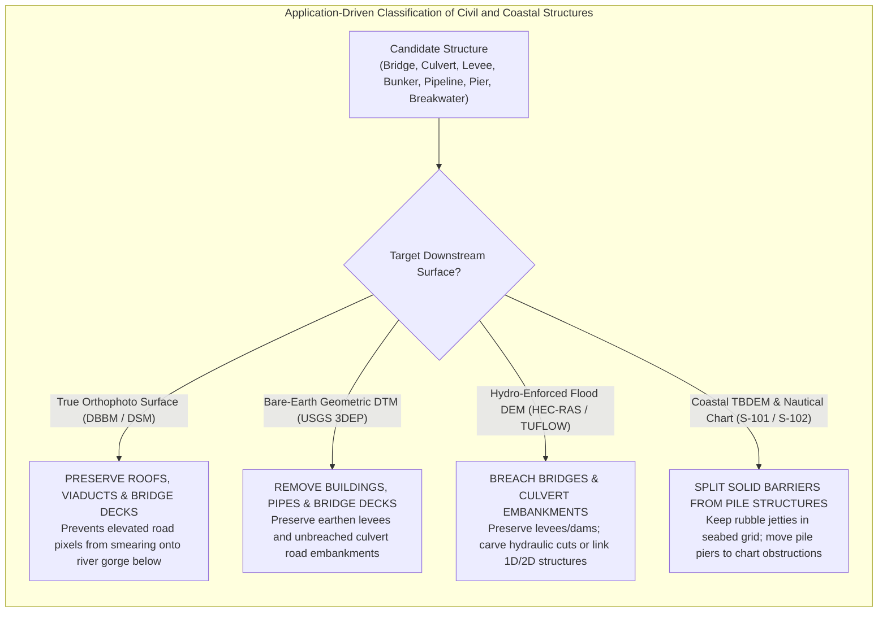
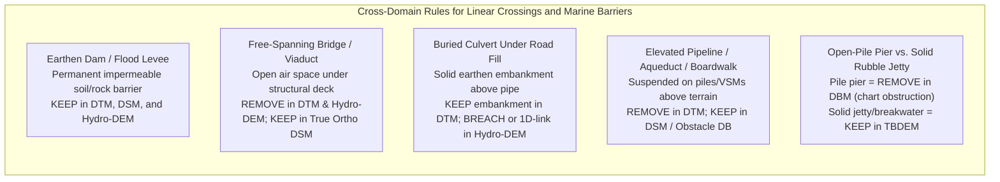

## 20.2 The Confusing Definitions of Buildings, Roads, Bridges, and Other Objects

When an automated point-cloud classifier, deep-learning segmentation network, or human photogrammetrist partitions a landscape into "Ground" (`ASPRS Class 2`) and "Non-Ground," they are executing an ontological judgment rather than a purely geometric measurement. Nature and civil engineering form a continuous spectrum of hybrid structures: grass-covered subterranean bunkers, dry desert riverbeds used seasonally as highways, gravel causeways pierced by corrugated metal culverts, elevated arctic pipelines, open-pile timber piers, and solid rubble-mound breakwaters.

No single binary classification satisfies every downstream consumer. A feature that *must* be preserved as solid surface in one workflow (such as a highway bridge deck during True Orthophoto generation) will catastrophically corrupt another workflow (such as 2D hydrodynamic flood routing) if left in place.

---

### 20.2.1 What Is a "Building"? Ontological Grey Zones

In elementary mapping specifications, a building is defined as a permanent, roofed, walled edifice intended for shelter or occupancy. Operational elevation production immediately confronts seven structural grey zones where geometric filters and semantic definitions diverge:

| Candidate Structure | Physical & Radiometric Signature | Bare-Earth DTM | Surface DSM | Primary Operational Failure Mode |
| :--- | :--- | :--- | :--- | :--- |
| **Permanent Roofed Building** | Planar/pitched roof, sharp vertical perimeter wall drop ($\Delta z > 2\text{ m}$) | **Removed** (inpainted from perimeter ground) | **Preserved** (roof envelope) | Warehouse roofs wider than the morphological filter window ($W > 150\text{ m}$) remain as flat mesas in the DTM. |
| **Earth-Sheltered Bunker / Sod-Roofed Structure** | Reinforced concrete vault buried under $0.5\text{–}2\text{ m}$ of topsoil and live turfgrass; flush upslope transition | **Ambiguous** (geometrically continuous with hillslope) | **Preserved** (top of sod) | Ground filters accept the sod roof as `Class 2` terrain; civil earthwork or trenching cuts into live structural slabs. |
| **Greenhouses, Polytunnels & Glass Atriums** | Specular glass or polyethylene film over metal framing | **Removed** (nursery soil beneath) | **Corrupted** (partial transmission) | $1064\text{ nm}$ LiDAR penetrates glazing, mixing roof-frame hits with interior plant benches ($1\text{–}3\text{ m}$ chatter). |
| **Shipping Containers, Silos & Modular Trailers** | Stacked steel ISO boxes ($2.59\text{ m}$ high per tier) in ports and railyards | **Removed** (paved terminal apron kept) | **Preserved** (transient epoch height) | Leaving container stacks in port DTMs fabricates $10\text{–}15\text{ m}$ coastal bluffs that block simulated storm-surge inundation! |
| **Carports, Canopy Gas Stations & Stadium Overhangs** | Cantilevered roof supported on slender columns; open air and drivable pavement underneath | **Removed** (underlying apron kept) | **Preserved** (upper canopy) | Single-valued 2.5D grids cannot represent both the drivable ground plane and the overhead clearance limit. |
| **Construction Scaffolding, Ruins & Temporary Tents / Yurts** | Porous tubular steel frames, roofless masonry walls, or seasonal fabric domes | **Removed** (`Class 22` temporal / `Class 6`) | **Epoch-dependent** | Repeat DoD change detection misinterprets tent erection or scaffolding teardown as thousands of $\text{m}^3$ of soil uplift/erosion. |
| **Subsea Caissons, Wellheads & Artificial Reefs** | Submerged concrete/steel habitats and oil/gas templates ($2\text{–}25\text{ m}$ relief on seabed) | **Kept or Flagged** (`Class 43`/`44`) | **N/A** (water surface) | Smoothing seabed grids erases shoalest structural clearances required for trawler and submarine safety. |

Even for conventional buildings, elevation assignment depends on semantic granularity. As formalized by **Biljecki et al. (2016)**, a "footprint elevation" ($z_{\text{base}}$) on a sloped street differs between the lowest curb corner (`LOD0.0`), the mean perimeter grade (`LOD0.1`), and the underground basement slab, while "roof height" differs by meters between eave line, median roof plane, ridge crest, and rooftop HVAC/chimney superstructures.

---

### 20.2.2 What Is a "Road"? Surface vs. Elevated vs. Ephemeral Corridors

Roadways illustrate how identical functional labels (`highway=*` in OpenStreetMap) correspond to radically different topographic ontologies depending on structural support and hydrology:

1. **At-Grade Paved Highways and Urban Streets:** Asphalt or concrete placed directly onto compacted earthen subgrade, bounded by $10\text{–}20\text{ cm}$ concrete curbs and drainage gutters (`ASPRS Class 11`, Road Surface). Because they form the impermeable boundary governing urban stormwater sheet flow, at-grade roads—and critically their exact curb-and-crown micro-topography—are **strictly preserved in both DTMs and DSMs**.
2. **Unpaved Logging Tracks, Mine Haul Roads, and Cut-and-Fill Trails:** Bench-cut into steep forested hillslopes, these dirt and gravel corridors alter subsurface pore-pressure interception and concentrate overland runoff into roadside ditches. They represent true mineral topography (**kept in DTM**), even when completely occluded from nadir optical cameras by closed forest canopy.
3. **Dry Riverbeds (Arroyos, Wadis) and Tidal Causeways Used as Roads:** In arid regions and macro-tidal coasts (e.g., *Passage du Gois* in France), seasonal vehicle tracks follow active ephemeral stream channels or intertidal sandbars. Semantically they appear in transportation networks, but topographically and hydrologically they *are* the primary thalweg or seabed (**kept in DTM/TBDEM**, never artificially raised or flattened as embankments).
4. **Elevated Highway Viaducts, Multi-Level Interchanges, and Parking Decks:** Reinforced concrete decks supported on piers above ground streets, valleys, or wetlands. Only the lowest ground-contacting roadway belongs in a 2.5D bare-earth DTM; all elevated decks (`Class 17`) must be stripped from the DTM and stored in 3D multi-surface vector/mesh structures (Chapter 17).

---

### 20.2.3 Bridges, Culverts, Dams, Pipes, and Coastal Structures

Linear crossings and water-control infrastructure represent the single largest source of catastrophic modeling failures when elevation datasets cross disciplinary boundaries.

#### 1. Earthen Dams and Flood-Control Levees
Compacted earthen dams, floodwalls, and riverine/coastal levees are engineered landforms specifically built to impound reservoirs or confine flood stages.
* **Mandatory Rule:** Dams and levees are **kept in all DTMs, DSMs, TBDEMs, and Hydro-DEMs**, reinforced with explicit crest breaklines so rasterization does not notch or lower the minimum crest elevation.
* **Error Consequence:** Because a flood levee may measure only $3\text{ m}$ wide at its crown and $4\text{ m}$ above the adjacent floodplain, morphological ground filters with excessive window radii ($W > 20\text{ m}$) or coarse grid spacing ($\Delta x \ge 5\text{ m}$ without breaklines) routinely shave $0.5\text{–}1.5\text{ m}$ off the crest, triggering false overtopping in storm-surge and FEMA flood simulations.

#### 2. Free-Spanning Bridges vs. True Orthophoto Relief Smearing
A free-spanning bridge or highway overpass carries traffic on an elevated deck ($z_{\text{deck}}$) separated by an air gap ($\Delta z_{\text{bridge}} = z_{\text{deck}} - z_{\text{bed}}$) from the river or ground underneath.
* **Bare-Earth DTM & Hydrologic DEM:** The bridge deck (`Class 17`) **must be removed** (and bounded by bridge-saddle breaklines under USGS 3DEP rules) so terrain contours do not snap up to the roadway and simulated rivers do not hit a solid concrete wall.
* **True Orthophoto Rectification Surface (DBBM / DSM):** When orthorectifying off-nadir aerial or satellite imagery, projecting pixels onto a bare-earth DTM where the bridge was removed causes the optical ray passing through the elevated bridge deck to intersect the underlying river or canyon floor at an outward radial **relief displacement error** $\Delta r$:

$$\Delta r = r_{\text{deck}} \frac{\Delta z_{\text{bridge}}}{H_{\text{agl}} - \Delta z_{\text{bridge}}} = \Delta z_{\text{bridge}} \tan\theta_i$$

where $H_{\text{agl}}$ is sensor altitude above the valley floor, $r_{\text{deck}}$ is radial ground distance from nadir to the bridge, and $\theta_i$ is the off-nadir viewing incidence angle.

##### Worked Numerical Example: The "Salvador Dalí" Warped Bridge Artifact
An aerial mapping camera flies at $H_{\text{agl}} = 1200.0\text{ m}$ above a river gorge and images a highway bridge deck sitting $\Delta z_{\text{bridge}} = 28.0\text{ m}$ above the water at an off-nadir ground offset $r_{\text{deck}} = 500.0\text{ m}$ ($\theta_i = \arctan\frac{500}{1172} = 23.10^\circ$). If the imagery is orthorectified using the bare-earth DTM ($z = 0\text{ m}$) instead of a bridge-inclusive **Digital Building and Bridge Model (DBBM)**:

$$\Delta r = 500.0\text{ m} \times \frac{28.0\text{ m}}{1200.0\text{ m} - 28.0\text{ m}} = \frac{14\,000}{1172.0} = 11.95\text{ m}$$

The asphalt lanes and traffic markings of the bridge are stretched and bowed $11.95\text{ m}$ sideways onto the river water surface, while in adjacent flight lines viewed from the opposite side the bridge bows $11.95\text{ m}$ in the opposite direction—producing a $23.9\text{ m}$ double-bridge seam! True Orthophoto pipelines therefore require maintaining explicit 3D bridge-deck breakline polygons alongside the bare-earth DTM.

#### 3. Buried Culverts: Geometric Reality vs. Hydraulic Connectivity
Unlike a bridge, a **culvert** is a corrugated steel, HDPE, or concrete pipe ($0.5\text{–}4\text{ m}$ diameter) buried beneath $2\text{–}15\text{ m}$ of solid earthen road or railway fill. To every nadir sensor (LiDAR, photogrammetry, SAR), the continuous road crown *is* the true bare-earth surface; hence a geometric DTM **preserves the embankment**. However, in any 2D overland flow or watershed delineation grid, an unbreached $6\text{ m}$ road embankment across a $2\%$ stream valley impounds a phantom reservoir hundreds of meters long before overtopping! Hydro-enforced DTMs resolve this either by **hydro-conditioning (breaching)**—cutting a narrow raster trench down to the surveyed culvert invert elevation—or, for pressurized high-flow engineering, preserving the embankment crest in the 2D mesh while inserting a **1D pressurized pipe/weir hydraulic connector** linking the upstream and downstream headwall cells.

#### 4. Elevated Pipelines, Aqueducts, Boardwalks, Open-Pile Piers, and Solid Jetties
* **Elevated Pipelines and Timber Boardwalks:** Above-ground arctic pipelines on vertical support members (e.g., the Trans-Alaska Pipeline, $1.5\text{–}4\text{ m}$ above permafrost), refinery pipe racks, and raised coastal marsh boardwalks allow water, wind, and wildlife to pass freely underneath. They belong to `Class 19` (*Overhead Structure*) or `Class 6`, **removed from DTMs** so they do not act as hundreds-of-kilometers-long synthetic levees.
* **Open-Pile Piers vs. Solid-Fill Breakwaters and Jetties:** Along coastlines, hydrographers and coastal modelers enforce a strict hydrodynamic distinction:
  * **Open-Pile Piers, Wharves, and Trestles:** Supported on spaced timber, steel, or concrete pilings; tidal currents, storm waves, and littoral sand pass beneath the deck with minor drag. The deck and pilings are **removed from the continuous bathymetric grid (DBM/TBDEM)** so wave/circulation models (Delft3D, ADCIRC) see the true seabed channel, while the structure's perimeter is encoded as a vector shoreline construction (`SLCONS`) or obstruction (`OBSTRN`) in IHO S-57/S-101 navigational charts.
  * **Solid-Fill Rubble-Mound Jetties, Breakwaters, Groins, and Causeways:** Built from impermeable cores and interlocking armor stone or concrete dolosse extending continuously from the seabed to above Mean High Water. Because they physically reflect waves and trap littoral sediment drift, they **are permanent topo-bathymetric landforms and must be preserved in full elevation fidelity in every DBM and TBDEM**.
