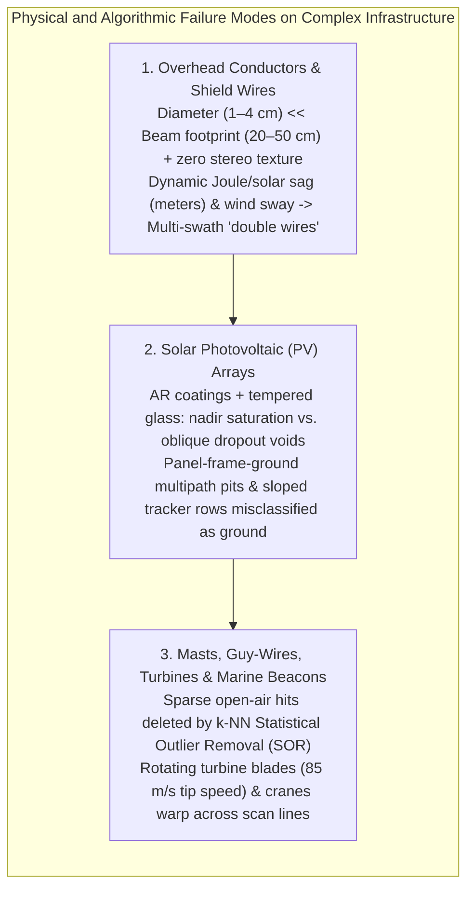
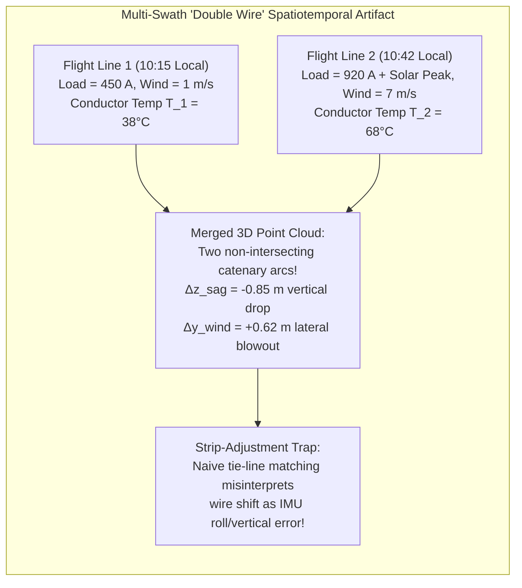
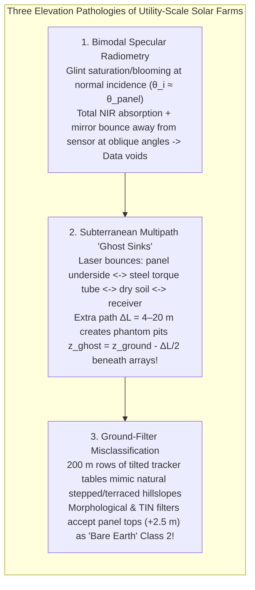

## 20.3 Dealing with Wires, Powerlines, Solar Panels, and Antennas

Slender, specular, and kinematically non-stationary infrastructure objects—high-voltage overhead transmission conductors, utility-scale solar photovoltaic (PV) tracker arrays, guy-wired telecommunications masts, rotating wind turbines, and offshore navigation beacons—push remote sensing physics and point-cloud classification ontologies to their breaking points. Because these targets violate the implicit assumptions of elevation mapping (that surfaces are extended, Lambertian, opaque, and stationary during a survey), naive automated pipelines either erase lethal aviation/maritime obstacles as "statistical noise" or bake severe multipath pits and multi-swath ghost duplicates into surface models.

---

### 20.3.1 Overhead Transmission Lines: Beam Dilution, Timescale Drift, and "Double Wires"

Electrical transmission corridor mapping (`NERC FAC-003` / `FAC-008` compliance in North America; EN 50341 in Europe) is one of the highest-value engineering applications of airborne and UAS LiDAR (**Matikainen et al., 2016**). Preventing vegetation-induced arc flashovers (such as those that ignited the 2003 Northeast blackout and major Western U.S. wildfires) requires millimeter-to-centimeter knowledge of 3D conductor geometry relative to underlying terrain and growing tree crowns.

#### Optical Stereo Failure and LiDAR Beam Footprint Dilution
Passive optical photogrammetry fails almost completely on overhead wires: a $1\text{–}4\text{ cm}$ weathered aluminum cable subtends less than a third of a pixel from crewed aircraft altitudes, lacks internal texture along its length (creating aperture ambiguity along epipolar lines), and changes background parallax continuously against ground and trees below.

Active LiDAR detects wires via time-of-flight ranging, yet suffers severe **footprint area dilution**. Consider an aluminum-conductor steel-reinforced (ACSR) cable of diameter $d_{\text{wire}} = 2.5\text{ cm}$ ($0.025\text{ m}$) illuminated from altitude $H_{\text{agl}} = 1000\text{ m}$ by a laser with $1/e^2$ divergence $\gamma_{\text{div}} = 0.30\text{ mrad}$, yielding a ground footprint diameter $D_{\text{fp}} = H_{\text{agl}}\gamma_{\text{div}} = 0.30\text{ m}$ ($A_{\text{fp}} = \frac{\pi}{4}D_{\text{fp}}^2 = 706.9\text{ cm}^2$):
* For a uniform top-hat beam centered on the conductor, the intercepted area is $A_{\text{int}} \approx d_{\text{wire}} D_{\text{fp}} = 75.0\text{ cm}^2$—only **$10.6\%$ of the pulse energy** (or up to $\operatorname{erf}\!\left(\frac{\sqrt{2}\,d_{\text{wire}}}{D_{\text{fp}}}\right) = 13.2\%$ if dead-center in a $\text{TEM}_{00}$ Gaussian beam, falling to $3.7\%$ when the pulse center misses the wire axis by $12\text{ cm}$ and below $1\%$ beyond $17.5\text{ cm}$).
* Nearly $90\%$ of the pulse energy continues downward to reflect strongly off ground or canopy. Capturing thinner **optical ground wires (OPGW / shield wires)** at the top of towers ($d_{\text{wire}} \approx 10\text{–}14\text{ mm}$) therefore demands low-altitude helicopter or UAS flights ($H_{\text{agl}} = 50\text{–}150\text{ m}$), high pulse repetition rates ($>500\text{ kHz}$), and full-waveform or multi-return receivers with short dead-time ($\tau_{\text{dead}} < 1.5\text{ ns}$).

#### Timescale Physics and the Multi-Swath "Double Wire" Phenomenon
Unlike buildings or rock outcrops, overhead powerlines are thermo-mechanically active structures whose 3D coordinates change by **decimeters to meters over minutes to hours**:
1. **Joule Heating ($I^2 R$) and Solar Irradiance:** Shifts in grid dispatch or cloud cover heat conductors from $25^\circ\text{C}$ to $75^\circ\text{–}100^\circ\text{C}$ with a thermal time constant of only $\tau_{\text{th}} \approx 5\text{–}15\text{ minutes}$ (**IEEE Std 738-2012**), elongating aluminum strands and dropping mid-span elevation by $0.5\text{–}3.5\text{ m}$ (derived rigorously in Section 20.6).
2. **Aerodynamic Wind Blowout and Galloping:** Cross-winds swing the suspended catenary laterally out of the vertical plane by $\Delta y = S_{\text{sag}}\sin\phi_{\text{wind}}$, while freezing rain creates asymmetric ice airfoils that trigger meter-scale low-frequency aeroelastic "galloping."
3. **The "Double Wire" Lidar Artifact:** When two overlapping LiDAR flight strips map the same transmission corridor $20\text{–}45\text{ minutes}$ apart, changes in electrical current or wind gusts displace the cable between passes. The combined point cloud exhibits **two distinct, crisp parallel wires** separated by $0.3\text{–}1.5\text{ m}$ vertically and laterally! Practitioners must: (a) **never include `Class 13/14` wire points in inter-swath boresight or trajectory adjustment** (`TerraMatch` / ICP), and (b) time-tag every catenary fit to a single flight-line epoch synchronized with utility SCADA amperage and weather-station logs.

#### Authoritative ASPRS LAS 1.4 (R15) Infrastructure Point Classes
A frequent production bug arises from misassigning ASPRS LAS 1.4 integer classification codes around corridors. The official **ASPRS LAS 1.4 – R15** specification defines:
* **`Class 13` — Wire – Guard (Shield):** Topmost lightning-protection static wires and OPGW telecommunications cables.
* **`Class 14` — Wire – Conductor (Phase):** Current-carrying high-voltage phase conductors (single or bundled sub-conductors).
* **`Class 15` — Transmission Tower:** Lattice steel towers, monopoles, H-frames, and distribution poles.
* **`Class 16` — Wire-Structure Connector:** Suspension/dead-end insulator strings and attachment hardware separating energized `Class 14` wires from grounded `Class 15` towers.
* **`Class 17` — Bridge Deck:** Elevated roadway/railway bridge decks (*never* guard wires—confusing `Class 13` and `Class 17` causes automated DTM bridge-removal scripts to breach transmission corridors or leave bridges intact!).
* **`Class 18` — High Noise:** Birds, insects, aerosol plumes, and mid-air receiver noise above the surface envelope.
* **`Class 19` — Overhead Structure:** Industrial conveyors, pipe racks, highway sign gantries, and mining stackers.

---

### 20.3.2 Solar Photovoltaic (PV) Arrays: Specular Dropouts, Ghost Pits, and Terraced Ground Misclassification

Utility-scale solar photovoltaic installations—now covering thousands of hectares per facility—introduce three severe radiometric and semantic pathologies in both LiDAR and photogrammetric DEMs:

1. **Specular Mirror Dropout vs. Detector Blooming:** PV modules combine silicon-nitride anti-reflective coatings (engineered to absorb $>95\%$ of incident $400\text{–}1100\text{ nm}$ light) beneath smooth low-iron tempered glass. When the laser ray strikes away from the panel surface normal $\hat{\mathbf{n}}_{\text{panel}}$, the $4\%$ Fresnel reflection bounces harmlessly into the sky while the silicon absorbs the refracted pulse, creating **zero-return "black hole" voids**. Conversely, along the single scan line where the laser beam aligns perpendicular to the tilted glass ($\hat{\mathbf{r}}_{\text{beam}} \approx -\hat{\mathbf{n}}_{\text{panel}}$), retro-reflected glint saturates the avalanche photodiode (APD), causing range-walk blooming ($10\text{–}40\text{ cm}$ premature range pull-in).
2. **Multipath Subterranean "Ghost Sinks":** Pulses grazing row edges or reflecting off bright gravel/dry soil beneath single-axis trackers undergo multiple bounces between the ground, galvanized steel racking/torque tubes, and the glass underside before escaping back toward the aircraft. Every extra round-trip path length $\Delta L_{\text{multi}}$ delays pulse arrival by $\Delta\tau = \Delta L_{\text{multi}}/c_0$, placing apparent 3D coordinates **below the physical Earth**:
   $$z_{\text{ghost}} \approx z_{\text{ground}} - \frac{\Delta L_{\text{multi}}}{2}\cos\theta_{\text{scan}}$$
   For $2\text{ m}$ tall tracker rows where pulses bounce $3\text{–}6$ times ($\Delta L_{\text{multi}} = 6\text{–}18\text{ m}$), raw point clouds exhibit dense curtains of "subterranean points" $3\text{–}9\text{ m}$ underground! If not stripped via local minimum-surface consistency checks (`Class 7` Low Point), a single uncleaned multipath point pulls TIN-interpolated DTMs into deep conical sinkholes.
3. **Sloped Solar Arrays Mistaken for Terraced Ground:** Single-axis solar trackers rotate from $+60^\circ$ east at sunrise to $-60^\circ$ west at sunset, sitting $1.5\text{–}3.5\text{ m}$ above grade across rows hundreds of meters long. Because the height jump at the lower lip of a tilted panel may be only $0.6\text{ m}$—smaller than standard ground-filter height thresholds ($dh_0 \approx 0.5\text{–}1.0\text{ m}$)—Progressive Morphological and Cloth Simulation filters frequently climb onto the low edge of the panels and classify entire utility solar fields as terraced `Class 2` bare hillsides, corrupting site grading and stormwater runoff models.

---

### 20.3.3 Antennas, Guy-Wires, Wind Turbines, Cranes, and Marine Navigation Beacons

#### The Statistical Outlier Removal (SOR) Safety Paradox
Standard point-cloud preprocessing pipelines run $k$-nearest-neighbor **Statistical Outlier Removal (SOR)** (`PDAL filters.outlier`) or radius-count filters (`min_k` neighbors within radius $r$) to purge birds, insects, and atmospheric noise before surface generation. On a $350\text{ m}$ guy-wired meteorological or broadcast mast, however, the steel lattice spire tapers to $<30\text{ cm}$ width and its tensioned $12\text{ mm}$ steel guy-wires generate isolated, sparse hits separated by $3\text{–}15\text{ m}$ in empty 3D space.
* An SOR filter querying $k = 20$ neighbors computes a huge mean neighbor distance $\bar{d}_k \gg \mu_d + 2\sigma_d$ and **silently reclassifies the mast tip and guy-wires as `Class 18` noise**!
* **Identical Marine Hazard:** In shallow hydrographic multibeam and topo-bathy LiDAR surveys, single-pile navigation daybeacons, channel markers, dolphin pilings, and vertical shipwreck masts protrude as slender $20\text{–}50\text{ cm}$ columns in the water column. Unsupervised CUBE hypothesis pruning or 3D outlier culling strips them as "acoustic water-column fliers" (fish or bubbles), violating **IHO S-44 Exclusive / Special Order** feature-detection mandates!

#### Kinematic Distortion of Wind Turbines and Construction Cranes
Modern onshore and offshore wind turbines stand $150\text{–}280\text{ m}$ tall with rotor diameters exceeding $220\text{ m}$. At a nominal rotation rate of $\Omega_{\text{rot}} = 10\text{ rpm}$ ($1.047\text{ rad}\cdot\text{s}^{-1}$), a $110\text{ m}$ blade tip travels at linear speed $v_{\text{tip}} = \Omega_{\text{rot}} R_{\text{blade}} \approx 115\text{ m}\cdot\text{s}^{-1}$ ($414\text{ km/h}$!):
* Across a $2\text{ s}$ airborne LiDAR sweep, the rotor turns $120^\circ$, smearing each blade into curved "scimitar" ribbons or disconnected mid-air fragments; in satellite pushbroom stereo ($\Delta t \approx 10\text{–}45\text{ s}$ between fore and aft views), blades and weathervaning construction crane booms vanish or project to wildly erroneous elevations hundreds of meters away from the tower hub.
* Operational DSMs and aviation obstruction databases (ICAO Annex 15 / FAA Digital Obstacle File) must never rely on raw rasterized blade hits; instead, tower hubs are localized in the point cloud and parameterized geometrically as vertical cylindrical/conical clearance envelopes extending to full maximum tip height $z_{\text{base}} + H_{\text{hub}} + R_{\text{blade}}$.
