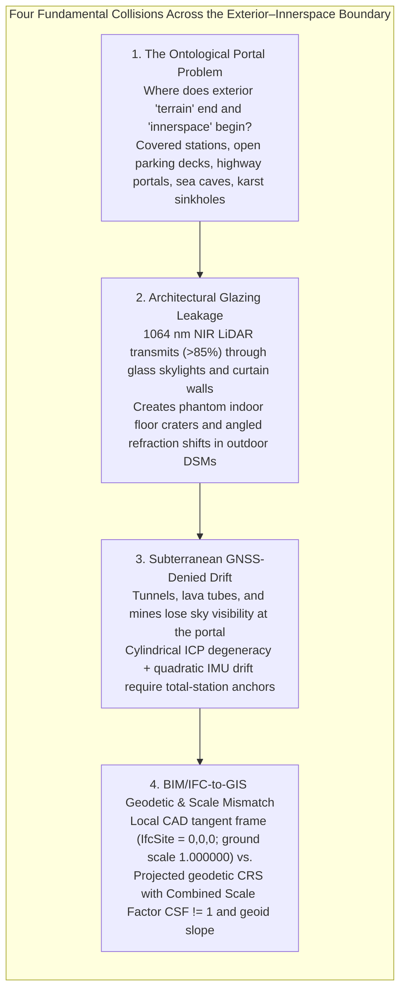
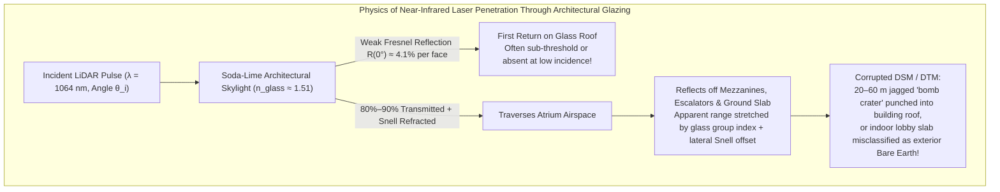
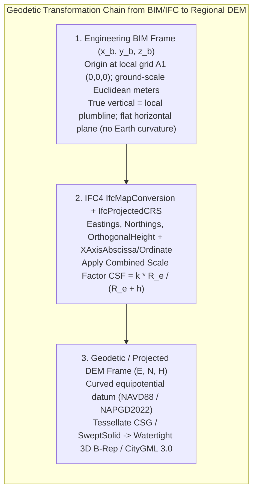

## 20.4 Dealing with Innerspace: Inside-Building and Subterranean Issues

Classical cartography and elevation modeling treat the Earth's land surface and building exteriors as a single, opaque boundary separating solid matter below from open atmosphere above. Modern engineering, urban emergency response, autonomous robotics, karst hydrogeology, and mining, however, routinely cross into **innerspace**—the navigable, hollow 3D cavities inside buildings and beneath the topographic surface. Open-air multi-story parking garages, covered railway terminals, arched public markets, highway and subsea transit tunnels, natural sea caves, volcanic lava tubes, and multi-horizon underground mines all violate both the single-valued $z = f(x, y)$ surface paradigm and the radiometric/geodetic assumptions of exterior mapping.

---

### 20.4.1 Where Does "Outside Terrain" End and "Innerspace" Begin?

Defining a topologically consistent transition ("portal") between exterior elevation models and interior 3D spaces exposes subtle semantic ambiguities across both terrestrial and coastal environments:

1. **Semi-Open Structures (Parking Decks, Train Sheds, Covered Markets, Underpasses):** An open-sided 6-level concrete parking garage or glass-canopied railway terminal (e.g., St Pancras or Grand Central approaches) is physically contiguous with the public street grid. Vehicles and pedestrians drive seamlessly from the exterior bare-earth DTM ($z_0$) onto stacked interior ramps ($z_1, z_2, \dots, z_5$). In a 2.5D DSM, only the roof slab ($z_5$) exists; in a bare-earth DTM, the entire structure is excised down to $z_0$, severing all elevated pedestrian skybridges and transit platforms.
2. **Highway/Rail Portals and Cut-and-Cover Tunnels:** At a mountain tunnel portal, the drivable road grade (`Class 11`) plunges beneath the hillside (`Class 2`). A single-surface DTM must represent the natural mountain ridge overhead so overland streams cross above the tunnel, meaning the highway alignment disappears from the terrain grid between portals unless represented in a true 3D multi-surface stack or OGC **CityGML 3.0** `Tunnel` / **IFC 4.3** `IfcTunnel` solid model (**Kutzner et al., 2020**).
3. **Natural Karst Caves, Lava Tubes, and Coastal Sea Caves:** Collapsed lava-tube skylights (e.g., Hawaiʻi and lunar/Martian pits in Chapter 31), karst cenotes, and wave-cut sea caves undercut coastal cliffs by tens of meters. In coastal erosion hazard mapping, ignoring a $25\text{ m}$ deep sea cave hollowed beneath a seemingly intact $30\text{ m}$ coastal bluff DTM masks imminent flexural cliff collapse! Capturing these cavities requires fusing boat-mounted mobile LiDAR + shallow-water multibeam sonar across the air-water cave mouth into a watertight 3D triangle mesh or Truncated Signed Distance Field (TSDF, Chapter 21).

---

### 20.4.2 Optical Physics of Glass Penetration: Skylight Craters and Refractive Ghosts

One of the most pervasive blunders in high-density urban airborne and mobile LiDAR DSMs occurs over glass-roofed shopping gallerias, airport concourses, botanical conservatories, and curtain-wall skyscrapers.

#### Fresnel Reflectance and Refractive Range Distortion
Standard topographic laser scanners emit at $\lambda = 905\text{ nm}$ or $1064\text{ nm}$ (with eye-safe mobile units often at $1550\text{ nm}$). Clean architectural soda-lime glass has phase refractive index $n_{\text{glass}} \approx 1.507$ at $1064\text{ nm}$. At near-normal incidence ($\theta_i \approx 0^\circ$), the single-surface **Fresnel power reflectance** is:

$$R_{\text{Fresnel}}(0^\circ) = \left(\frac{n_{\text{glass}} - n_{\text{air}}}{n_{\text{glass}} + n_{\text{air}}}\right)^2 = \left(\frac{1.507 - 1.0003}{1.507 + 1.0003}\right)^2 \approx 0.0409 \quad (4.1\%)$$

Unless dust, condensation, or metallic Low-E solar-control coatings boost surface backscatter, the specular $4\%\text{–}8\%$ reflection from a tilted skylight bounces away from the receiver aperture, leaving **no return on the physical glass roof**. Meanwhile, $80\%\text{–}90\%$ of the optical pulse transmits into the building interior and scatters diffusely off concrete lobby floors, escalators, and office desks:
* **Apparent Elevation Depression:** Beyond recording true indoor objects tens of meters below the roofline, any laser ray striking an interior wall through an angled curtain-wall pane of thickness $t_g$ undergoes lateral Snell offset and an optical path delay $\Delta R_{\text{glass}} = (n_{g,\text{glass}} - 1)\frac{t_g}{\cos\theta_g}$, projecting phantom points behind and below their true indoor positions.
* **Filtering Defense:** Urban DSM/DTM pipelines prevent "skylight craters" by combining multi-return pulse topology (flagging last returns that fall inside closed cadastral/OSM building footprints) with full-waveform echo-width inspection and explicit 2D building polygon hydro/roof enforcement.

---

### 20.4.3 Subterranean Positioning Degeneracy in Tunnels and Mines

Mapping underground mines, subway tubes, utility stormwater interceptors, and subsea railway tunnels (e.g., Channel Tunnel, Seikan Tunnel) relies on backpack, trolley, or drone-mounted **Simultaneous Localization and Mapping (SLAM)** (Chapter 6) because GNSS carrier signals attenuate completely within centimeters of rock and soil.

In a long, straight bored tunnel of constant circular or horseshoe cross-section, trajectory estimation suffers **axial observability collapse**:
* Let $\hat{\mathbf{u}}_{\text{axis}}$ denote the unit vector along the tunnel centerline. Every surface normal $\hat{\mathbf{n}}_k$ on the cylindrical tunnel lining is orthogonal to the tunnel axis ($\hat{\mathbf{n}}_k \cdot \hat{\mathbf{u}}_{\text{axis}} \approx 0$). Consequently, the point-to-plane Iterative Closest Point (ICP) information matrix $\mathbf{H}_{\text{ICP}} = \sum_k \mathbf{J}_k^\top \mathbf{J}_k$ becomes singular along $\hat{\mathbf{u}}_{\text{axis}}$, leaving along-track scale and pitch drift governed solely by inertial dead-reckoning.
* An uncalibrated initial pitch misalignment $\theta_{\text{pitch},0}$, vertical gyro drift $b_g = \dot{\theta}_{\text{drift}}$, or uncompensated vertical accelerometer bias $b_a$ causes elevation error $\delta z(s)$ along tunnel distance $s = v t$ to grow quadratically: $\delta z(s) \approx \theta_{\text{pitch},0}\,s + \left(\frac{b_g}{2 v} + \frac{b_a}{2 v^2}\right)s^2$, easily exceeding $0.5\text{–}3.0\text{ m}$ vertically over a $2\text{ km}$ bore!
* **Survey-Grade Mitigation:** Engineering-grade subterranean DEMs constrain SLAM factor graphs with classical mine-surveying **total-station traverses** carried inward from exterior GNSS control monuments through portals and vertical ventilation shafts (plumbed optically or via gyro-theodolites orienting to True North via Earth's rotation vector $\boldsymbol{\omega}_\oplus$).

---

### 20.4.4 Bridging Indoor BIM (`IFC`) and Outdoor Geodetic DEMs (`CityGML` / GIS)

Integrating architectural **Building Information Models (BIM)** encoded in **ISO 16739-1 Industry Foundation Classes (IFC)** with regional DTMs/TBDEMs is notoriously error-prone (**Noardo et al., 2020**). The mismatch stems from three incompatible mathematical assumptions between local structural CAD and ellipsoidal geodesy:

1. **Ground Distance vs. Projected Grid Distance (`Combined Scale Factor`):** Structural engineers design buildings, tunnels, and viaducts in **true ground meters** ($1.000000\text{ m}$ steel beam length as fabricated), whereas map-projected DEMs (`UTM`, State Plane) distort horizontal distances by both the projection point scale factor $k(\varphi, \lambda)$ and the ellipsoidal elevation factor $\frac{R_\oplus}{R_\oplus + h}$:

$$\text{CSF} = k(\varphi, \lambda) \cdot \frac{R_\oplus}{R_\oplus + h}, \qquad \Delta s_{\text{grid}} = \text{CSF} \cdot \Delta s_{\text{ground}}$$

where $R_\oplus = \sqrt{M(\varphi)N(\varphi)} \approx 6\,371\,000\text{ m}$ is the Gaussian mean radius of curvature and $h$ is ellipsoidal height ($\text{m}$).
2. **Flat Tangent Plane vs. Earth Curvature and Geoid Slope:** Over a long subterranean rail tunnel or $2\text{ km}$ airport concourse, a flat CAD $xy$-plane diverges vertically from the curved level geoid equipotential surface by $\Delta H_{\text{curv}} \approx \frac{D^2}{2 R_\oplus}$ ($7.8\text{ cm}$ at $D = 1\text{ km}$; $31.4\text{ cm}$ at $D = 2\text{ km}$!).
3. **Constructive Solid Geometry (CSG) vs. Boundary Meshes & IndoorGML:** IFC represents walls (`IfcWall`), floor slabs (`IfcSlab`), and utility ducts via parametric `SweptSolid` and Boolean CSG trees, whereas GIS terrain engines require explicit non-self-intersecting boundary representations (`PolyhedralSurfaceZ`, OGC 3D Tiles) and indoor navigation graphs (**OGC IndoorGML** cellular space/node-relation duality).

#### Worked Numerical Example: Abutment Misalignment in a $600\text{ m}$ BIM Viaduct-Tunnel Portal
A transit agency designs a $L_{\text{ground}} = 600.000\text{ m}$ cut-and-cover station and viaduct in the Denver metropolitan area ($h = 1650.0\text{ m}$ ellipsoidal height, $R_\oplus = 6\,371\,000\text{ m}$) and imports the `.ifc` model into a State Plane GIS DTM where the local projection scale factor is $k = 0.99996000$, anchoring the western portal at $(E_0, N_0)$ with `IfcMapConversion.Scale = 1.0` (omitting the CSF):
1. **Elevation Factor:** $\text{EF} = \frac{6\,371\,000}{6\,371\,000 + 1650.0} = 0.99974108$ ($-258.9\text{ ppm}$).
2. **Combined Scale Factor:** $\text{CSF} = 0.99996000 \times 0.99974108 = 0.99970109$ ($-298.9\text{ ppm}$).
3. **Eastern Portal Horizontal Error:** Because $600.000\text{ m}$ on the ground spans only $600.000 \times 0.99970109 = 599.8207\text{ m}$ on the projected grid, importing at unit scale causes the eastern BIM abutment to overshoot the LiDAR-surveyed concrete pier in the DEM by:
   $$\Delta L = (1 - \text{CSF})\cdot L_{\text{ground}} = 0.00029891 \times 600.000\text{ m} = 0.1793\text{ m} \quad (179.3\text{ mm})$$
   Simultaneously, the uncurved CAD horizontal datum plane rises $\Delta H_{\text{curv}} = \frac{600^2}{2 \times 6.371 \times 10^6} = 28.3\text{ mm}$ above the orthometric DTM at the eastern end! Setting `IfcMapConversion` (`Eastings`, `Northings`, `OrthogonalHeight`, `XAxisAbscissa`, `XAxisOrdinate`, and `Scale = 0.99970109`) resolves the horizontal mismatch to sub-millimeter precision.
