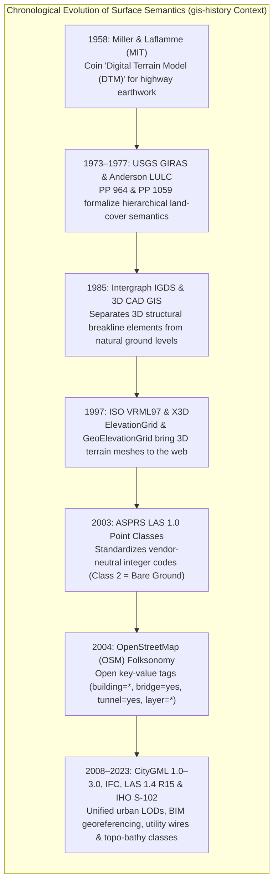
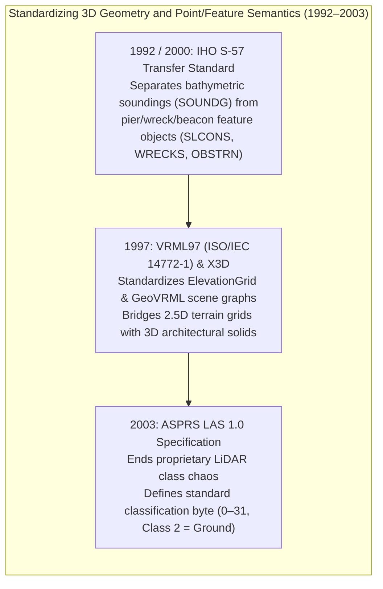

## 20.5 Historical Evolution of Surface Ontologies and Semantic Classifications

The formal distinction between "bare terrain" and "surface objects" in digital elevation modeling did not emerge overnight. As documented in the [`gis-history`](https://github.com/schwehr/gis-history) chronology, it evolved across five decades alongside breakthroughs in computer-aided design, binary sensor formats, hydrographic charting standards, and crowd-sourced semantic web ontologies—transforming elevation datasets from anonymous arrays of numbers into richly typed 3D semantic representations.

---

### 20.5.1 From MIT Highway DTMs to National Land-Cover Taxonomies (1958–1985)

#### 1958: The Birth of the "Digital Terrain Model" at MIT
Long before airborne laser scanning existed, civil engineers **Charles L. Miller and Robert A. Laflamme** (1958) at the MIT Photogrammetry Laboratory introduced the term **Digital Terrain Model (DTM)** to automate highway cut-and-fill earthwork optimization on an IBM 650 drum computer. Crucially, because human stereoplotter operators manually placed a floating photogrammetric mark directly onto bare soil between trees and around houses, early photogrammetric DTMs were *inherently* bare-earth models: semantic object removal occurred inside the human operator's visual cortex during data capture! Only with the arrival of automated image correlation (1970s–1980s), InSAR (1990s), and airborne LiDAR (1990s) did sensors begin blindly recording roof decks and tree crowns, forcing the discipline to invent separate terms (**DSM** vs. **DTM**) for what sensors measured versus what engineers wanted.

#### 1973–1977: USGS GIRAS and the Anderson Land Use / Land Cover Taxonomy
In **1973** (`gis-history`), the U.S. Geological Survey initiated the **Geographic Information Retrieval and Analysis System (GIRAS)**—documented by **William B. Mitchell, Stephen C. Guptill, K. Eric Anderson, Robin G. Fegeas, and Cheryl A. Hallam (1977)** in *USGS Professional Paper 1059*—one of the earliest operational topological vector GIS architectures in federal service. GIRAS digitized, verified, and archived national maps encoded in the landmark **Anderson Land Use and Land Cover Classification System**, developed by **James R. Anderson, Ernest E. Hardy, John T. Roach, and Richard E. Witmer (1976)** in *USGS Professional Paper 964*.
* Anderson et al. (1976) recognized a foundational truth of remote sensing ontology: *land cover* (the physical material reflecting energy, such as asphalt, forest canopy, water, or perennial ice) is distinct from *land use* (human socio-economic function, such as an urban park vs. commercial timberland).
* Their hierarchical Level I (`1 Urban`, `2 Agricultural`, `3 Rangeland`, `4 Forest`, `5 Water`, `6 Wetland`, `7 Barren`, `8 Tundra`, `9 Perennial Snow/Ice`) and Level II taxonomy remains the direct ancestor of the National Land Cover Database (NLCD), USGS 3DEP Vegetated Vertical Accuracy (VVA) strata, and modern global land-cover masks used to convert satellite DSMs into DTMs.

#### 1985: Intergraph IGDS and 3D CAD-GIS Infrastructure Separation
In **1985** (`gis-history`), **Intergraph Corporation** popularized 3D CAD-based GIS built upon its **Interactive Graphics Design Software (IGDS)** binary `.dgn` design format (which simultaneously spawned Bentley Systems' PseudoStation and **MicroStation** ecosystem). Whereas early 2D raster and topological polygon GIS packages treated elevation as a single scalar attribute on a flat map, IGDS provided 63 independent 3D graphical levels storing true $(X, Y, Z)$ B-splines, 3D line strings, retaining walls, highway alignments, and bridge structures. This CAD-GIS lineage established modern civil engineering breakline conventions—and directly hosted **Terrasolid TerraScan**, which was written as a MicroStation MDL application to classify airborne LiDAR point clouds.

---

### 20.5.2 Web 3D Meshes, Hydrographic Object Catalogs, and ASPRS LAS 1.0 (1992–2003)

#### 1992–2000: IHO S-57 and the Separation of Seabed from Marine Obstructions
In marine cartography, the International Hydrographic Organization's **IHO S-57** *Transfer Standard for Digital Hydrographic Data* (adopted 1992, Edition 3.1 frozen in 2000) formalized an ontological split between continuous seabed relief (`DEPARE` depth areas, `DEPCNT` depth contours, `SOUNDG` soundings) and discrete physical structures (`WRECKS`, `OBSTRN` submerged obstructions, `UWTROC` underwater rocks, `SLCONS` shoreline constructions/piers, `CBLSUB` submarine cables, `PIPSOL` pipelines). This rigorous separation ensured that shoal hazards were never smoothed away during bathymetric contour generalization.

#### 1997: VRML97 (`ISO/IEC 14772-1`) and X3D
In **1997** (`gis-history`), ISO standardized **VRML97** (*Virtual Reality Modeling Language*) alongside the initiation of its XML/royalty-free successor **X3D** by the Web3D Consortium. VRML97 introduced the `ElevationGrid` primitive (and X3D's Geospatial component added ellipsoid-aware `GeoElevationGrid`), allowing 2.5D terrain heightfields and true 3D polygonal buildings, bridges, and subterranean tunnels to coexist inside a single hierarchical scene graph—laying the conceptual foundation for KML/Collada, glTF, and OGC 3D Tiles.

#### 2003: ASPRS LAS 1.0 Ends the Proprietary Point-Class Babel
During the late 1990s commercial airborne LiDAR boom, every sensor manufacturer and service bureau invented incompatible proprietary ASCII or binary integer codes: in one file `1` meant bare ground and `2` meant buildings; in another `1` meant first-return canopy and `8` meant bare earth. In **May 2003** (`gis-history`), the American Society for Photogrammetry and Remote Sensing released **LAS 1.0**, introducing a vendor-neutral binary point record with a 5-bit standardized classification lookup table (`Class 0` Created/Never Classified, `Class 1` Unclassified, `Class 2` Ground, `Class 3–5` Low/Medium/High Vegetation, `Class 6` Building, `Class 7` Low Point/Noise, `Class 8` Model Key-Point, `Class 9` Water). Practically overnight, `Classification == 2` became the universal contract for bare-earth DTM generation across open-source and commercial software alike.

---

### 20.5.3 Open Folksonomies, Semantic 3D Cities, and Unified Topo-Bathy Profiles (2004–Present)

#### 2004: OpenStreetMap (`OSM`) Tag Folksonomy
Launched by Steve Coast in **2004** (`gis-history`), **OpenStreetMap** eschewed rigid ISO/FGDC feature-catalog committees in favor of an open, extensible key-value tag ontology (`building=*`, `building:levels=*`, `roof:shape=*`, `highway=*`, `bridge=yes`, `tunnel=yes`, `culvert=yes`, `layer=-1..+5`, `power=line`, `man_made=pier` vs. `man_made=breakwater`). Today, planetary-scale elevation pipelines (including USGS/NOAA hydro-enforcement workflows, Overture Maps [2023], and global DSM-to-DTM machine learning models) ingest OSM vector tags to decide automatically where to breach culverts, mask glass-roofed buildings, and separate open-pile piers from solid breakwaters.

#### 2008–2021: OGC CityGML (v1.0 to v3.0) and ISO 16739 IFC
In **2008**, the Open Geospatial Consortium adopted **CityGML 1.0** (expanded in CityGML 2.0 [2012, **Gröger & Plümer, 2012**], refined geometrically by **Biljecki et al., 2016**, and modularized in **CityGML 3.0** [2021, **Kutzner et al., 2020**]). CityGML linked the terrain surface directly to buildings via the **Terrain Intersection Curve (`TIC`)**—an explicit 3D closed polyline recording the exact line where a building facade or tunnel portal meets the bare-earth DTM—and introduced `Space` and `HollowSpace` concepts in v3.0 to unify exterior topography with indoor rooms and utility vaults alongside buildingSMART's **IFC (`ISO 16739-1:2018` for IFC4; extended to `IFC 4.3` infrastructure in `ISO 16739-1:2024`)**.

#### 2011–2023: ASPRS LAS 1.4 (R15), Topo-Bathy Domain Profile, and IHO S-100 / S-102
With **LAS 1.4** (initial release November 2011; **Revision 15 published July 2019**), Point Data Record Formats `6–10` expanded the classification attribute from 5 bits (`0–31`, burdened by synthetic/key-point/withheld bit-flags) to a clean **full 8-bit unsigned integer (`0–255`)**. This unlocked dedicated semantic classes for rail (`10`), road surfaces (`11`), electrical guard and phase conductors (`13–16`), bridge decks (`17`), overhead industrial structures (`19`), snow (`21`), temporal exclusions (`22`), and the **ASPRS Bathymetric Lidar Domain Profile**:
* **`Class 40`:** Bathymetric Point (submerged seafloor/riverbed bottom—the underwater counterpart to `Class 2` Ground).
* **`Class 41`:** Water Surface (air-water interface used for Snell's Law 3D refraction ray-tracing, Chapter 9).
* **`Class 42`:** Derived Water Surface (synthetic water surface interpolated across specular dropouts).
* **`Class 43`:** Submerged Object (kelp, boulders, traps, unverified underwater anomalies).
* **`Class 44`:** IHO S-57 Object (verified wrecks, obstructions, rocks, pilings).
* **`Class 45`:** No Bottom Found (optically deep/turbid extinction indicator, distinguishing true deep water from unmapped gaps).

In parallel, the IHO **S-100 Universal Hydrographic Data Model** paired **S-102** (gridded positive-up bathymetric elevation + uncertainty surfaces) with **S-101** (next-generation vector Electronic Navigational Charts), building directly upon the **2006 Open Navigation Surface Bathymetric Attributed Grid (`BAG`)** specification's `Tracking List`—which allowed hydrographers to store explicit discrete shoal overrides alongside continuous seabed rasters without corrupting grid topology. Most recently, the **Overture Maps Foundation (2023)** (`gis-history`) harmonized global open `Buildings` (combining OpenStreetMap footprints with Microsoft, Google Open Buildings, and Esri community roof detections, complete with height and facade attributes) and 3D level-aware `Transportation` connector graphs (`level` and `connector` schemas for bridges and tunnels), providing planetary-scale semantic masks that modern terrain pipelines fuse directly with spaceborne and airborne elevation archives.

| Year / Milestone | Standard or System | Primary Semantic / Ontological Contribution | Impact on DEM / DBM Production |
| :--- | :--- | :--- | :--- |
| **1958** | MIT DTM (Miller & Laflamme) | Coined *Digital Terrain Model* for automated highway earthwork | Established human-filtered bare-earth coordinate profiles |
| **1973–1977** | USGS GIRAS & Anderson LULC | Separated physical *land cover* from socio-economic *land use* | Created hierarchical strata for vegetation accuracy (`VVA`) & DSM masking |
| **1985** | Intergraph IGDS (`.dgn`) | 63-level 3D CAD design elements (`X,Y,Z` B-splines & breaklines) | Foundation for civil breakline enforcement & TerraScan LiDAR macros |
| **1992–2000** | IHO S-57 Transfer Standard | Split continuous seabed (`DEPARE`) from discrete hazards (`WRECKS`, `OBSTRN`) | Preserved shoalest pinnacle clearances during bathymetric gridding |
| **2003–2019** | ASPRS LAS 1.0 $\to$ LAS 1.4 R15 | Standardized vendor-neutral point classes (`0–31` $\to$ `0–255`, Bathy `40–45`) | Universal contract for `Class 2` Ground, `13/14` Wires, `17` Bridges, `40` Seabed |
| **2008–2024** | OGC CityGML 1.0–3.0 & ISO 16739 IFC | Defined `LOD0–LOD4`, `TerrainIntersectionCurve`, `HollowSpace`, `IfcMapConversion` | Linked bare-earth DTMs to 3D buildings, tunnels, and georeferenced BIM solids |
