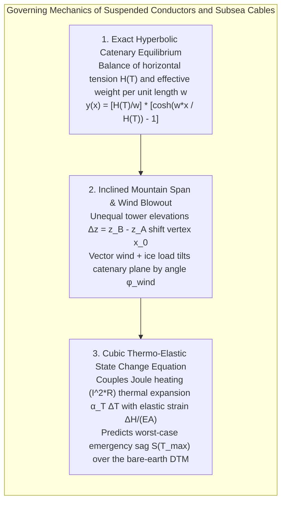
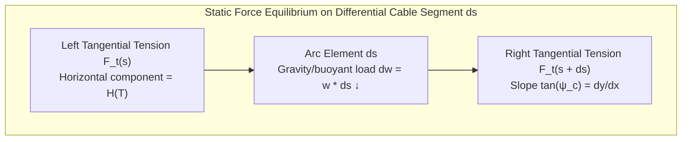
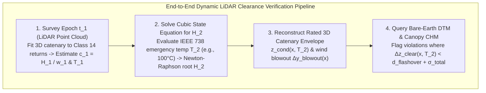

## 20.6 Mathematical Foundations of Catenary Sag and Thermal Conductor Mechanics

Evaluating vertical and lateral clearance between overhead electrical transmission conductors (`ASPRS Class 14`) and underlying bare-earth DTMs (`Class 2`) or encroaching forest crowns (`Class 5`) cannot be performed by simply measuring static Euclidean distances in a single-epoch LiDAR point cloud. Because a suspended conductor is a tensioned thermo-elastic structure coupled to electrical load current, solar heating, wind drag, and ice accretion (**Kiessling et al., 2003; IEEE Std 738-2012**), its 3D elevation trajectory $z_{\text{cond}}(x, t)$ changes continuously by meters. Equally important, the exact same catenary differential equations govern **subsea telecommunications cables**, **ROV/towfish umbilicals**, and **offshore mooring lines** suspended across submarine canyons!

This section derives the exact hyperbolic catenary equation for both level and inclined mountain spans, quantifies the parabolic error bound, formulates vector ice-and-wind blowout loading, derives the **Cubic Thermo-Elastic State Change Equation**, and works a complete numerical engineering clearance audit.

---

### 20.6.1 The Classical Hyperbolic Catenary Curve

Consider a flexible cable of uniform linear weight density $w$ ($\text{N}\cdot\text{m}^{-1}$; in air $w = m_c g$, whereas for a submerged marine cable of volume per unit length $A_c$ in seawater of density $\rho_w$, $w = (m_c - \rho_w A_c)g$ is the submerged wet weight per unit length) suspended between two rigid supports separated by horizontal span distance $L$ ($\text{m}$).

To adhere strictly to the handbook symbol conventions (Front Matter, Section 7) without colliding with conductor temperature $T$ ($^\circ\text{C}$ or $\text{K}$), let:
* $(x, z)$ denote local vertical-plane Cartesian coordinates ($\text{m}$), with $z$ positive upward and temporary origin $(0, z_{\min})$ placed at the lowest vertex of the curve ($y(x) = z(x) - z_{\min}$).
* $F_t(s)$ denote the total tangential cable tension ($\text{N}$) at arc-length coordinate $s$ ($\text{m}$).
* $H(T)$ denote the horizontal component of cable tension ($\text{N}$) at uniform conductor temperature $T$.
* $\psi_c(s)$ denote the local tangent inclination angle above the horizontal ($\tan\psi_c = dy/dx$).

#### Step 1: Differential Force Balance
Static equilibrium of horizontal and vertical forces acting on an infinitesimal cable element $ds = \sqrt{dx^2 + dy^2}$ requires:

$$\sum F_x = 0 \implies F_t(s) \cos\psi_c(s) = H(T) = \text{constant along the span}$$

$$\sum F_y = 0 \implies d\big(F_t(s) \sin\psi_c(s)\big) = w \, ds$$

Dividing the vertical equilibrium relation by the constant horizontal tension $H(T)$ eliminates $F_t(s)$:

$$d\big(\tan\psi_c\big) = d\!\left(\frac{dy}{dx}\right) = \frac{w}{H(T)} \, ds \implies \frac{d^2 y}{dx^2} = \frac{w}{H(T)} \frac{ds}{dx} = \frac{1}{c(T)} \sqrt{1 + \left(\frac{dy}{dx}\right)^2}$$

where $c(T) = \frac{H(T)}{w}$ (SI unit: $\text{N} / (\text{N}\cdot\text{m}^{-1}) = \text{m}$) is the **catenary parameter**.

#### Step 2: Exact Closed-Form Integration
Substituting $u = dy/dx$ gives the separable first-order ODE $\frac{du}{\sqrt{1 + u^2}} = \frac{dx}{c(T)}$. Integrating from the vertex $(x = 0, u(0) = 0)$ yields $\operatorname{arsinh}(u) = \frac{x}{c(T)}$, or:

$$\frac{dy}{dx} = \sinh\!\left(\frac{x}{c(T)}\right)$$

Integrating a second time with $y(0) = 0$ establishes the **exact hyperbolic catenary equation**:

$$y(x) = c(T)\left[\cosh\!\left(\frac{x}{c(T)}\right) - 1\right] = \frac{H(T)}{w}\left[\cosh\!\left(\frac{w x}{H(T)}\right) - 1\right]$$

For a **level span** with equal tower attachment elevations $z(-L/2) = z(+L/2) = z_{\text{att}}$, the exact mid-span vertical sag $S_{\text{sag}}(T)$ and total unstressed/stressed physical arc length $s(T)$ across $[-L/2, +L/2]$ are:

$$S_{\text{sag}}(T) = c(T)\left[\cosh\!\left(\frac{L}{2 c(T)}\right) - 1\right], \qquad s(T) = 2\int_0^{L/2} \cosh\!\left(\frac{x}{c(T)}\right)dx = 2 c(T)\sinh\!\left(\frac{L}{2 c(T)}\right)$$

---

### 20.6.2 Parabolic Approximation, Inclined Mountain Spans, and Wind Blowout

#### Parabolic Taylor Expansion and Truncation Error Bound
On standard high-voltage transmission corridors, $H(T) \approx 15\text{–}45\text{ kN}$ and $w \approx 10\text{–}25\text{ N}\cdot\text{m}^{-1}$, so $c(T) \in [1000\text{ m}, 3000\text{ m}]$. For typical tower spans $L \in [150\text{ m}, 400\text{ m}]$, the dimensionless ratio $\epsilon = \frac{L}{2 c(T)} \le 0.15 \ll 1$. Expanding $\cosh u = 1 + \frac{u^2}{2!} + \frac{u^4}{4!} + \cdots$ and $\sinh u = u + \frac{u^3}{3!} + \cdots$ yields the **parabolic engineering approximations**:

$$S_{\text{sag}}(T) \approx \frac{w L^2}{8 H(T)}\left(1 + \frac{w^2 L^2}{48 H(T)^2}\right) \approx \frac{w L^2}{8 H(T)}, \qquad s(T) \approx L + \frac{w^2 L^3}{24 H(T)^2} = L + \frac{8 S_{\text{sag}}(T)^2}{3 L}$$

Notice the geometric sensitivity $\frac{dS_{\text{sag}}}{ds} = \frac{3 L}{16 S_{\text{sag}}}$: for a $300\text{ m}$ span with $6.4\text{ m}$ sag, every **$10\text{ cm}$ of thermal conductor elongation increases vertical sag by $88\text{ cm}$**—nearly a $9\times$ mechanical amplification! (Warning: on ultra-long fjord or river crossings where $L > 1200\text{ m}$, the $\frac{w^2 L^2}{48 H^2}$ quartic correction exceeds $0.5\text{ m}$ and exact hyperbolic formulas must be retained.)

#### Inclined Spans Across Steep Mountain Topography
In rugged terrain, adjacent towers $A$ ($x = 0, z = z_A$) and $B$ ($x = L, z = z_B$) sit at unequal elevations with vertical rise $\Delta z_{AB} = z_B - z_A \ne 0$. Fitting a symmetric level parabola introduces multi-meter elevation errors! Using the exact hyperbolic identity $\cosh b - \cosh a = 2\sinh\!\left(\frac{b+a}{2}\right)\sinh\!\left(\frac{b-a}{2}\right)$, the horizontal coordinate $x_{\text{vertex}}$ of the lowest point relative to the span midpoint $L/2$ is:

$$x_{\text{vertex}} = \frac{L}{2} - c(T)\,\operatorname{arsinh}\!\left(\frac{\Delta z_{AB}}{2 c(T)\sinh\!\big(L / [2 c(T)]\big)}\right) \approx \frac{L}{2} - \frac{H(T)\,\Delta z_{AB}}{w L}$$

On steep mountain slopes where $\frac{H(T)\,|\Delta z_{AB}|}{w L} > \frac{L}{2}$, $x_{\text{vertex}} < 0$: the mathematical vertex lies *upslope/downslope outside the physical span*, meaning the conductor pulls upward on the lower tower's suspension insulator (`uplift` failure mode)! Along the span $x \in [0, L]$, the absolute positive-up geodetic elevation of the conductor and its vertical clearance $\Delta z_{\text{clear}}(x)$ above the bare-earth DTM $z_{\text{DTM}}(x)$ are:

$$z_{\text{cond}}(x, T) = z_A + c(T)\left[\cosh\!\left(\frac{x - x_{\text{vertex}}}{c(T)}\right) - \cosh\!\left(\frac{x_{\text{vertex}}}{c(T)}\right)\right], \qquad \Delta z_{\text{clear}}(x, T) = z_{\text{cond}}(x, T) - z_{\text{DTM}}(x)$$

#### Combined Ice Accretion and Cross-Wind Blowout Vector Load
Under storm conditions with radial glaze ice thickness $t_{\text{ice}}$ (ice weight $w_{\text{ice}} = \rho_{\text{ice}} g \pi t_{\text{ice}}(d_{\text{wire}} + t_{\text{ice}})$) and horizontal cross-wind aerodynamic drag per unit length $w_{\text{wind}} = \frac{1}{2}\rho_{\text{air}} C_d v_{\text{wind}}^2 (d_{\text{wire}} + 2 t_{\text{ice}})$, the resultant transverse load $w_{\text{eff}}$ and lateral **catenary swing angle** $\phi_{\text{wind}}$ from the vertical plane are:

$$w_{\text{eff}} = \sqrt{(w_{\text{bare}} + w_{\text{ice}})^2 + w_{\text{wind}}^2}, \qquad \phi_{\text{wind}} = \arctan\!\left(\frac{w_{\text{wind}}}{w_{\text{bare}} + w_{\text{ice}}}\right)$$

In tilted plane coordinates, the cable hangs with inclined sag $S_{\text{incl}} = \frac{w_{\text{eff}} L^2}{8 H}$, projecting vertically as $S_{\text{vert}} = S_{\text{incl}}\cos\phi_{\text{wind}}$ and swinging horizontally toward corridor-edge trees by $\Delta y_{\text{blowout}} = S_{\text{incl}}\sin\phi_{\text{wind}}$.

---

### 20.6.3 The Cubic Thermo-Elastic State Change Equation

Suppose an airborne LiDAR survey captures a conductor in **State 1** (conductor temperature $T_1$, effective load $w_1$, fitted horizontal tension $H_1$). Utility engineers must predict the horizontal tension $H_2$ and vertical sag $S_2$ in a future emergency **State 2** (peak thermal rating temperature $T_2$ governed by **IEEE Std 738** steady-state heat balance $q_{\text{conv}}(T_2, v_{\text{wind}}) + q_{\text{rad}}(T_2) = q_{\text{solar}} + I_{\max}^2 R(T_2)$, and mechanical load $w_2$).

With coefficient of linear thermal expansion $\alpha_T$ ($\text{K}^{-1}$), composite Young's modulus $E$ ($\text{Pa}$), and metallic cross-sectional area $A$ ($\text{m}^2$), the change in total cable arc length $s_2 - s_1$ equals the sum of unconstrained **thermal expansion** $\Delta L_{\text{thermal}} = \alpha_T L (T_2 - T_1)$ and **Hookean elastic stretch**:

$$s_2 - s_1 = \alpha_T L (T_2 - T_1) + \frac{H_2 - H_1}{E A} L$$

Substituting the geometric arc-length relation $s_i - L \approx \frac{w_i^2 L^3}{24 H_i^2}$ (for a level span, or using ruling-span $L_r = \sqrt{\sum L_k^3 / \sum L_k}$ across suspension insulator strings), dividing by $L$, and multiplying through by $E A H_2^2$ yields the **Cubic Governing State Change Equation**:

$$H_2^3 + \underbrace{\left[ \frac{E A w_1^2 L^2}{24 H_1^2} - H_1 + E A \alpha_T (T_2 - T_1) \right]}_{A_{\text{state}}} H_2^2 - \underbrace{\frac{E A w_2^2 L^2}{24}}_{B_{\text{state}}} = 0$$

Every term in this polynomial carries exact SI units of $\text{N}^3$. Because $B_{\text{state}} > 0$ and the linear $H_2$ term vanishes, Descartes' rule of signs guarantees **exactly one positive real physical root** $H_2 > 0$! (For an inclined mountain span with chord inclination angle $\beta_{AB} = \arctan(\Delta z_{AB}/L)$, replacing $L^2$ in the slack terms by $L^2 \cos\beta_{AB}$—or scaling $E A$ by $\cos^2\beta_{AB}$ per Kiessling et al., 2003—accounts for the inclined chord geometry.)

---

### 20.6.4 Worked Numerical Example: Morning LiDAR Survey vs. $100^\circ\text{C}$ Peak Thermal Sag

An electric utility flies helicopter LiDAR at 08:30 over a $230\text{ kV}$ corridor strung with standard **`Drake` 795 kcmil 26/7 ACSR** conductor across a level span $L = 300.0\text{ m}$ (`w_1 = w_2 = w = 15.97 N/m`, axial stiffness $E A = 32.10 \times 10^6\text{ N}$, composite thermal expansion coefficient $\alpha_T = 1.93 \times 10^{-5}\text{ K}^{-1}$).
* **State 1 (LiDAR Survey at $T_1 = 20.0^\circ\text{C}$):** Least-squares catenary regression on `Class 14` points yields $c_1 = 1753.29\text{ m}$, corresponding to horizontal tension $H_1 = c_1 w = 28\,000.0\text{ N}$. The surveyed mid-span sag is:
  $$S_1 = 1753.29\left[\cosh\!\left(\frac{300.0}{2 \times 1753.29}\right) - 1\right] = 6.420\text{ m} \quad \left(\text{parabolic } \frac{w L^2}{8 H_1} = 6.417\text{ m}\right)$$
  Directly beneath mid-span, the `Class 2` DTM sits at $z_{\text{DTM}} = 100.00\text{ m}$, a `Class 5` pine crown top sits at $z_{\text{tree}} = 109.00\text{ m}$ ($\text{CHM} = 9.00\text{ m}$), and the surveyed conductor sits at $z_{\text{cond}}(T_1) = 113.58\text{ m}$—an apparent vertical clearance of **$4.58\text{ m}$** above the tree.
* **State 2 (Summer Peak Emergency Rating at $T_2 = 100.0^\circ\text{C}$, $\Delta T = +80.0\text{ K}$):** Evaluating the cubic coefficients:
  $$A_{\text{state}} = \frac{(32.10 \times 10^6)(15.97)^2(300.0)^2}{24(28\,000.0)^2} - 28\,000.0 + (32.10 \times 10^6)(1.93 \times 10^{-5})(80.0)$$
  $$A_{\text{state}} = 39\,159.3\text{ N} - 28\,000.0\text{ N} + 49\,562.4\text{ N} = +60\,721.7\text{ N}$$
  $$B_{\text{state}} = \frac{(32.10 \times 10^6)(15.97)^2(300.0)^2}{24} = 3.0701 \times 10^{13}\text{ N}^3$$
  Solving $H_2^3 + 60\,721.7\,H_2^2 - 3.0701 \times 10^{13} = 0$ via Newton-Raphson yields **$H_2 = 19\,555.9\text{ N}$** (a $30.2\%$ drop in tension!) and $c_2 = H_2 / w = 1224.54\text{ m}$.
* **Rated Sag and Flashover Verdict:** At $100.0^\circ\text{C}$, the exact hyperbolic sag grows to:
  $$S_2 = 1224.54\left[\cosh\!\left(\frac{300.0}{2 \times 1224.54}\right) - 1\right] = 9.199\text{ m} \implies \Delta S = S_2 - S_1 = +2.779\text{ m}$$
  The conductor drops $2.78\text{ m}$ to $z_{\text{cond}}(T_2) = 110.80\text{ m}$, shrinking vertical clearance above the $109.00\text{ m}$ pine tree from a seemingly generous $4.58\text{ m}$ down to **$1.80\text{ m}$**—violating the mandatory minimum $230\text{ kV}$ vegetation flashover buffer (`NERC FAC-003`) and demanding immediate hazard-tree pruning!
