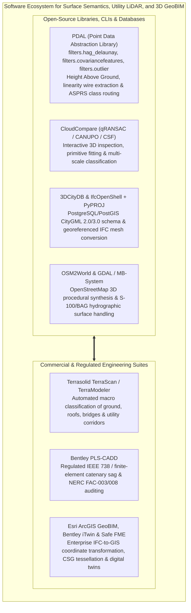

## 20.7 Software Ecosystem for Feature Extraction, 3D City Models, and Utility Infrastructure

Operationalizing surface ontologies—separating bare-earth terrain (`Class 2` / `Class 40`) from bridge decks (`Class 17`), extracting linear conductors (`Class 14`) without deleting guy-wired aviation masts, and georeferencing parametric BIM models (`IFC`) onto ellipsoidal DEMs—requires combining open-source point-cloud/geometry engines, spatial relational databases, and specialized civil/utility engineering suites.



---

### 20.7.1 Open-Source Pipelines and Runnable Code Workflows

#### 1. Extracting Utility Conductors Without Deleting Slender Towers in PDAL
A frequent mistake when running PDAL's `filters.hag_delaunay` is feeding an uncleaned point cloud directly into the Delaunay ground interpolator without ensuring `Class 2` ground points exist and low multipath pits (`Class 7`, e.g., under solar panels) are excluded. Furthermore, instead of running global Statistical Outlier Removal across high airspace (which deletes radio spires), **3D local covariance eigenvalue linearity** ($L_\lambda = \frac{\lambda_1 - \lambda_2}{\lambda_1} \in [0, 1]$, where $\lambda_1 \ge \lambda_2 \ge \lambda_3$ are principal eigenvalues of the neighborhood covariance matrix) cleanly isolates slender linear conductors (`Linearity >= 0.97` at `HeightAboveGround >= 6.0 m`):

```json
{
  "pipeline": [
    {
      "type": "readers.las",
      "filename": "corridor_survey_las14.laz"
    },
    {
      "type": "filters.elm",
      "cell": 10.0,
      "class": 7,
      "threshold": 1.5
    },
    {
      "type": "filters.hag_delaunay",
      "count": 12,
      "allow_extrapolation": false
    },
    {
      "type": "filters.covariancefeatures",
      "knn": 25,
      "threads": 8,
      "feature_set": "Linearity,Planarity,Scattering"
    },
    {
      "type": "filters.assign",
      "value": [
        "Classification = 14 WHERE (Classification == 1 && HeightAboveGround >= 6.0 && Linearity >= 0.97)"
      ]
    },
    {
      "type": "writers.copc",
      "filename": "corridor_wires_classified.copc.laz",
      "forward": "all",
      "extra_dims": "HeightAboveGround=float32,Linearity=float32"
    }
  ]
}
```

* **`filters.elm` (Extended Local Minimum):** Flags subterranean solar-panel or water specular multipath blunders as `Class 7` (`Low Point`) *before* ground triangulation so they cannot pull the DTM downward into sinkholes.
* **`filters.hag_delaunay`:** Triangulates strictly `Classification == 2` points and writes exact vertical clearance above bare earth into `HeightAboveGround`.
* **`filters.covariancefeatures` + `filters.assign`:** Routes elevated 1D linear structures directly into ASPRS `Class 14` (`Wire – Conductor`) while leaving vertical lattice tower members (`Class 15`) and sparse mast tips intact!

#### 2. Python Catenary Curve Fitting and Cubic Thermal Sag Clearance Audit
Once `Class 14` conductor points are classified for a single flight line (avoiding multi-swath "double wire" mixing), the following self-contained Python workflow fits the exact 3D hyperbolic catenary via robust Huber/Soft-L1 non-linear least squares (`scipy.optimize.least_squares`), solves the Kiessling/IEEE cubic thermo-elastic state equation for peak emergency operating temperature $T_2$, and audits clearance against a bare-earth GeoTIFF DTM:

```python
"""Fit 3D hyperbolic catenary to Class 14 LiDAR points & audit emergency thermal sag."""

import numpy as np
from scipy.optimize import brentq, least_squares


def fit_and_audit_span(
    pts_xyz: np.ndarray,
    dtm_profile_z: np.ndarray,
    w_n_per_m: float = 15.97,
    ea_newtons: float = 32.10e6,
    alpha_per_k: float = 1.93e-5,
    t1_c: float = 20.0,
    t2_c: float = 100.0,
    min_clearance_m: float = 4.20,
) -> dict[str, float]:
    """Fits exact catenary at T1 and predicts minimum DTM clearance at T2."""
    # 1. Project 3D Class 14 wire points onto principal horizontal span axis
    xy_mean = pts_xyz[:, :2].mean(axis=0)
    _, _, vt = np.linalg.svd(pts_xyz[:, :2] - xy_mean, full_matrices=False)
    span_axis = vt[0]
    s_coord = (pts_xyz[:, :2] - xy_mean) @ span_axis
    s_min, s_max = float(s_coord.min()), float(s_coord.max())
    span_len = s_max - s_min

    # 2. Robustly fit exact catenary z(s) = z0 + c1 * (cosh((s - s0) / c1) - 1)
    def residuals(params: np.ndarray) -> np.ndarray:
        s0, z0, c1 = params
        return (z0 + c1 * (np.cosh((s_coord - s0) / c1) - 1.0)) - pts_xyz[:, 2]

    res = least_squares(
        residuals,
        x0=[0.5 * (s_min + s_max), float(pts_xyz[:, 2].min()), 1600.0],
        bounds=([s_min - 500.0, -500.0, 100.0], [s_max + 500.0, 9000.0, 10000.0]),
        loss="soft_l1",
        f_scale=0.05,
    )
    s0_fit, z0_fit, c1_fit = res.x
    h1_tension = c1_fit * w_n_per_m

    # 3. Solve Cubic State Change Equation for horizontal tension H2 at T2
    a_coef = (
        (ea_newtons * (w_n_per_m**2) * (span_len**2)) / (24.0 * (h1_tension**2))
        - h1_tension
        + ea_newtons * alpha_per_k * (t2_c - t1_c)
    )
    b_coef = (ea_newtons * (w_n_per_m**2) * (span_len**2)) / 24.0
    h2_tension = brentq(lambda h: h**3 + a_coef * (h**2) - b_coef, 100.0, 2.0e5)
    c2_rated = h2_tension / w_n_per_m

    # 4. Anchor tower attachment heights at s_min, s_max and compute T2 profile
    z_att_a = z0_fit + c1_fit * (np.cosh((s_min - s0_fit) / c1_fit) - 1.0)
    z_att_b = z0_fit + c1_fit * (np.cosh((s_max - s0_fit) / c1_fit) - 1.0)
    dz_ab = z_att_b - z_att_a
    s_grid = np.linspace(s_min, s_max, len(dtm_profile_z))
    s_vert_2 = 0.5 * (s_min + s_max) - c2_rated * np.arcsinh(
        dz_ab / (2.0 * c2_rated * np.sinh(span_len / (2.0 * c2_rated)))
    )
    z_cond_t2 = z_att_a + c2_rated * (
        np.cosh((s_grid - s_vert_2) / c2_rated)
        - np.cosh((s_min - s_vert_2) / c2_rated)
    )
    min_clear_t2 = float(np.min(z_cond_t2 - dtm_profile_z))
    return {
        "H1_N": h1_tension,
        "H2_N": h2_tension,
        "rmse_fit_m": float(np.sqrt(np.mean(res.fun**2))),
        "min_clearance_T2_m": min_clear_t2,
        "violation": float(min_clear_t2 < min_clearance_m),
    }
```

#### 3. Georeferencing BIM/IFC Solids onto Projected DTMs with `IfcOpenShell`
When converting architectural `.ifc` models (`IfcSlab`, `IfcRoof`, `IfcBridgePart`, `IfcTunnel`) into 3D GIS terrain meshes, **`IfcOpenShell`** reads `IfcMapConversion` (`ISO 16739-1` IFC4+) so ground-scale CAD coordinates are rotated by grid convergence (`XAxisAbscissa`, `XAxisOrdinate`) and scaled by the Combined Scale Factor ($\text{CSF}$) rather than naively dropped at `(0, 0, 0)`:

```python
"""Extract georeferenced 3D BIM meshes with IFC4 IfcMapConversion & CSF scaling."""

import ifcopenshell
import ifcopenshell.geom
import ifcopenshell.util.unit
import numpy as np

ifc = ifcopenshell.open("transit_portal_ifc4.ifc")
unit_scale = ifcopenshell.util.unit.calculate_unit_scale(ifc)  # Project units -> SI meters
settings = ifcopenshell.geom.settings()
settings.set(settings.USE_WORLD_COORDS, True)

# Read IFC4 geodetic conversion parameters (scaling Eastings/Northings/Height to meters)
map_convs = ifc.by_type("IfcMapConversion")
if map_convs:
    mc = map_convs[0]
    e0 = mc.Eastings * unit_scale
    n0 = mc.Northings * unit_scale
    h0 = mc.OrthogonalHeight * unit_scale
    ux = 1.0 if mc.XAxisAbscissa is None else mc.XAxisAbscissa
    uy = 0.0 if mc.XAxisOrdinate is None else mc.XAxisOrdinate
    norm = np.hypot(ux, uy)
    cos_theta, sin_theta = ux / norm, uy / norm
    csf = mc.Scale if mc.Scale is not None else 1.0
else:
    e0, n0, h0, cos_theta, sin_theta, csf = 0.0, 0.0, 0.0, 1.0, 0.0, 1.0

rot_scale = csf * np.array([[cos_theta, -sin_theta], [sin_theta, cos_theta]])

# create_shape() returns vertices in SI meters; apply CSF + grid rotation + map origin
for elem in ifc.by_type("IfcSlab") + ifc.by_type("IfcRoof"):
    shape = ifcopenshell.geom.create_shape(settings, elem)
    pts_local = np.array(shape.geometry.verts, dtype=np.float64).reshape(-1, 3)
    pts_gis = np.empty_like(pts_local)
    pts_gis[:, :2] = (pts_local[:, :2] @ rot_scale.T) + np.array([e0, n0])
    pts_gis[:, 2] = pts_local[:, 2] + h0  # Orthometric height H (m)
```

#### 4. `3dcitydb`, `OSM2World`, and Hydrographic Surface/Feature Separation
* **`3dcitydb` (3D City Database — Yao et al., 2018):** Open-source PostgreSQL/PostGIS relational schema implementing OGC **CityGML 1.0/2.0/3.0**, storing multi-LOD buildings (`LOD0`–`LOD4`), `TerrainIntersectionCurve` (`TIC`) vectors anchored to bare-earth DTMs, tunnels, and bridges with native export to OGC 3D Tiles, glTF, and KML.
* **`OSM2World`:** Open-source Java engine that translates 2D OpenStreetMap semantic tags (`building:part=*`, `bridge=yes`, `layer=*`, `tunnel=yes`, `power=tower`, `power=line`) draped over an input SRTM/LiDAR DTM into topologically consistent 3D meshes, automatically carving bridge underpasses and elevated viaduct clearances.

---

### 20.7.2 Commercial and Regulated Industrial Software Suites

* **Terrasolid (`TerraScan`, `TerraModeler`, `TerraPhoto`):** Industry workhorse for USGS 3DEP and national airborne LiDAR production. Provides deterministic macro chains for progressive TIN ground classification, automated bridge-deck (`Class 17`) saddle detection, catenary wire tracking (`Class 13/14`), building roof planarization, and **True Orthophoto** generation (`TerraPhoto`) using combined bare-earth TIN + 3D bridge/building vector models so elevated viaducts never smear onto rivers below.
* **Bentley `PLS-CADD` (Power Line Systems):** Regulated global utility engineering standard for overhead line routing, structural pole/tower finite-element loading, multi-span ruling-span sag-tension state modeling, IEEE Std 738 dynamic thermal line rating, wind blowout simulation, and NERC `FAC-003` / `FAC-008` LiDAR compliance reporting.
* **Esri `ArcGIS GeoBIM`, Bentley `iTwin`, and Safe Software `FME`:** Enterprise platforms bridging Autodesk Revit / Civil 3D and IFC 4.3 infrastructure models with geodetic GIS DTMs, automating WKT2 coordinate transformations, Combined Scale Factor warping, and CSG-to-3D-Tiles (`I3S` / Cesium) tessellation.
* **Teledyne `CARIS HIPS & SIPS` / `Bathy DataBASE` and QPS `Qimera`:** Hydrographic production suites enforcing IHO S-44/S-101/S-102 semantics—preserving `Designated Soundings` on submerged wrecks, pilings, and navigation beacons against surface smoothing while exporting co-registered BAG and S-102 elevation/uncertainty grids.

---

### 20.7.3 Software Ecosystem Comparison Matrix

| Software / Library | License | Primary Semantic / Geometric Domain | Key Strength for Chapter 20 Challenges | Critical Operational Caveat |
| :--- | :--- | :--- | :--- | :--- |
| **PDAL** | BSD-3-Clause | Point cloud pipelines (`LAS 1.4` / `COPC`) | Headless `hag_delaunay`, `elm` multipath culling, `covariancefeatures` wire extraction | `hag_delaunay` requires clean `Class 2` ground points first; never run blind `outlier` on guy-wired towers. |
| **CloudCompare** | GPL-2.0+ | Interactive 3D point clouds & meshes | `CANUPO` multi-scale classifier, `qRANSAC` primitive detection, manual class editing | Manual GUI workflows require coordinate global-shift handling on large UTM coordinates (`Float32` internal). |
| **`IfcOpenShell`** | LGPL-3.0 | BIM / `ISO 16739-1` IFC C++ & Python | Exact CSG-to-mesh tessellation & `IfcMapConversion` reading | Does not apply geoid undulation $N(x,y)$ curvature warping across multi-kilometer linear tunnels automatically. |
| **`3dcitydb`** | Apache-2.0 | `CityGML` on PostgreSQL / PostGIS | Stores semantic LOD0–LOD4 buildings, tunnels, and `TerrainIntersectionCurve` | Requires clean watertight input B-Reps (`val3dity` validation recommended before import). |
| **`OSM2World`** | LGPL-3.0 | Procedural 3D from OpenStreetMap + DTM | Resolves `bridge=yes` / `layer=*` stacking over bare-earth terrain | Accuracy is bounded by crowd-sourced OSM tag completeness and nominal lane/clearance heuristics. |
| **TerraScan** | Commercial | Production airborne/mobile LiDAR | High-speed deterministic macros for `Class 2`, `6`, `13–17` & True Ortho breaklines | Macro distance/angle thresholds must be retuned for sloped solar farms and narrow flood levees. |
| **PLS-CADD** | Commercial | Utility transmission engineering | Certified finite-element sag-tension, IEEE 738 thermal & wind blowout clearance | Requires accurate conductor stranding tables, SCADA load/weather sync, and single-swath wire isolation. |
| **CARIS / Qimera** | Commercial | Hydrographic DBM / S-101 / S-102 | Enforces `Designated Sounding` shoal overrides & separates pile piers from seabed | Requires explicit surveyor attribution to distinguish kelp/fish water-column echoes from slender beacons. |
